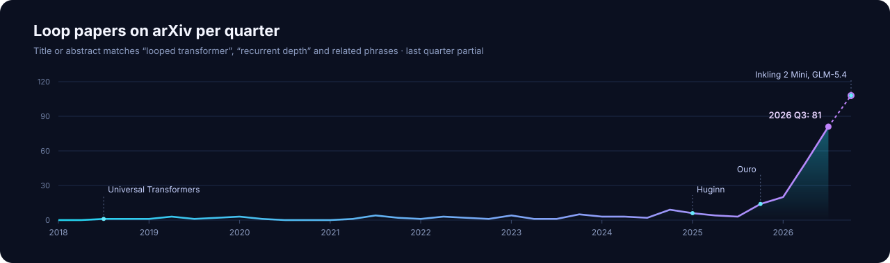

<!-- Generated by scripts/build.py from the YAML files. Do not edit by hand. -->

<p align="center"></p>

<h1 align="center">Awesome Loop</h1>

<p align="center">Looped and recurrent-depth language models: papers, open models, and the evidence behind their claims, recorded the same way for every paper so that results can be compared.</p>

<p align="center">    <a href="LICENSE"></a> <a href="https://github.com/sjy1203/awesome-loop/actions/workflows/ci.yml"></a></p>

<p align="center"><b>English</b> · <a href="README.zh-CN.md">简体中文</a></p>

<p align="center"><a href="#loop-papers-over-time">Papers over time</a> · <a href="#trending-in-the-last-30-days">Trending</a> · <a href="#top-10-must-read">Top 10</a> · <a href="#deep-cards">Deep cards</a> · <a href="#all-papers">All papers</a> · <a href="#design-space">Design space</a> · <a href="#open-questions">Open questions</a> · <a href="#open-models">Open models</a></p>

## Loop papers over time



Quarterly count of arXiv papers whose title or abstract contains a loop phrase (phrases and counts in [data/trend.json](data/trend.json)); the last quarter is partial. Keyword matches are a proxy for activity in the field, not a curated count.

## Trending in the last 30 days

| # | Paper | Released | Per day | Likes | Stars |
|---:|---|---|---:|---:|---:|
| 1 | [Introducing Inkling 2 Mini](https://thinkingmachines.ai/news/inkling-2-mini/) · **[deep card](docs/en/tml-inkling-2-mini.md)**<br><sub>Thinking Machines Lab blog</sub> | 2026-11-20 | **1,026** | 8,210 | - |
| 2 | [GLM-5.4: Toward Generalized Coding with Our First Loop Transformer](https://z.ai/blog/glm-5.4) · **[deep card](docs/en/zai-glm-5-4.md)**<br><sub>Z.ai blog</sub> | 2026-11-23 | **237** | 1,183 | - |
| 3 | [SenseNova-Loop-9B: Deeper Computation with Fewer Parameters](https://huggingface.co/sensenova/SenseNova-Loop-9B)<br><sub>SenseNova · Hugging Face model card</sub> | 2026-11-17 | **169** | 1,524 | 335 |
| 4 | [Mixture-of-Loops Transformer](https://arxiv.org/abs/2611.34923)<br><sub>Lianghui Zhu et al.</sub> | 2026-11-25 | **61.7** | 76 | 109 |
| 5 | [LoopTitan: What Does Parameter Revisit Buy a Mixture-of-Experts?](https://arxiv.org/abs/2611.34821)<br><sub>Zichen Tian et al.</sub> | 2026-11-25 | **35.7** | 10 | 97 |
| 6 | **LoopRes**: [Unlocking the Power of Loops in Pretrained LLMs with Loop Residuals](https://arxiv.org/abs/2611.31094) · **[deep card](docs/en/2611.31094.md)**<br><sub>Xuanlei Zhao et al.</sub> | 2026-11-23 | **24.6** | 33 | 90 |
| 7 | [Dory1.0-4B: A Looped Normalized-GPT](https://arxiv.org/abs/2611.03998)<br><sub>Maxim Fishman et al.</sub> | 2026-11-02 | **17.9** | 465 | - |
| 8 | [Looped Models are Fast Multi-Token Predictors](https://arxiv.org/abs/2611.33896)<br><sub>Ayhan Suleymanzade et al.</sub> | 2026-11-25 | **8.0** | 14 | 10 |
| 9 | [Latent Feedback Is a Compute and Data Amplifier](https://arxiv.org/abs/2611.20404)<br><sub>Benhao Huang et al.</sub> | 2026-11-16 | **3.0** | 8 | 28 |
| 10 | [A Pipeline-Parallel System for Depth-Recurrent Models](https://arxiv.org/abs/2611.30581)<br><sub>Yunjia Xi et al.</sub> | 2026-11-23 | **2.2** | 11 | - |

<sub>Core papers (looped or recurrent-depth Transformer language models) released from 2026-10-30 to 2026-11-28, ranked by likes and GitHub stars per day since release. Likes are Hugging Face paper upvotes and model likes plus Hacker News points. Papers this new have almost no citations yet, so this list counts early attention only.</sub>

## Top 10 must-read

| # | Paper | Citations / year | Citations | Stars | Downloads (30 days) |
|---:|---|---:|---:|---:|---:|
| 1 | **Huginn**: [Scaling up Test-Time Compute with Latent Reasoning: A Recurrent Depth Approach](https://arxiv.org/abs/2502.05171) · **[deep card](docs/en/2502.05171.md)**<br><sub>2025-02-07 · Jonas Geiping et al.</sub> | **353** | 636 | 1,001 | 23,812 |
| 2 | **Ouro (LoopLM)**: [Scaling Latent Reasoning via Looped Language Models](https://arxiv.org/abs/2510.25741) · **[deep card](docs/en/2510.25741.md)**<br><sub>2025-10-29 · Rui-Jie Zhu et al.</sub> | **255** | 276 | - | 67,256 |
| 3 | [Reasoning with Latent Thoughts: On the Power of Looped Transformers](https://arxiv.org/abs/2502.17416)<br><sub>2025-02-24 · Nikunj Saunshi et al. · ICLR 2025</sub> | **205** | 360 | - | - |
| 4 | **MoR**: [Mixture-of-Recursions: Learning Dynamic Recursive Depths for Adaptive Token-Level Computation](https://arxiv.org/abs/2507.10524) · **[deep card](docs/en/2507.10524.md)**<br><sub>2025-07-14 · Sangmin Bae et al. · NeurIPS 2025</sub> | **162** | 223 | 652 | - |
| 5 | [Deep Equilibrium Models](https://arxiv.org/abs/1909.01377)<br><sub>2019-09-03 · Shaojie Bai et al. · NeurIPS 2019</sub> | **155** | 1,122 | 815 | - |
| 6 | [Universal Transformers](https://arxiv.org/abs/1807.03819)<br><sub>2018-07-10 · Mostafa Dehghani et al. · ICLR 2019</sub> | **152** | 1,273 | - | - |
| 7 | [LoopFormer: Elastic-Depth Looped Transformers for Latent Reasoning via Shortcut Modulation](https://arxiv.org/abs/2602.11451)<br><sub>2026-02-11 · Ahmadreza Jeddi et al. · ICLR 2026</sub> | **104** | 104 | 67 | 133 |
| 8 | [Looped Transformers as Programmable Computers](https://arxiv.org/abs/2301.13196)<br><sub>2023-01-30 · Angeliki Giannou et al.</sub> | **100** | 383 | - | - |
| 9 | [Parcae: Scaling Laws For Stable Looped Language Models](https://arxiv.org/abs/2604.12946) · **[deep card](docs/en/2604.12946.md)**<br><sub>2026-04-14 · Hayden Prairie et al.</sub> | **99** | 99 | 196 | 1,945 |
| 10 | [Teaching Pretrained Language Models to Think Deeper with Retrofitted Recurrence](https://arxiv.org/abs/2511.07384) · **[deep card](docs/en/2511.07384.md)**<br><sub>2025-11-10 · Sean McLeish et al.</sub> | **82** | 86 | 73 | 5,462 |

<sub>Core papers of any year (looped or recurrent-depth Transformer language models), ranked by citations per year: total citations (the higher of the Semantic Scholar and OpenAlex counts) divided by the years from the first public version to 2026-11-28, counting at least one year. GitHub stars of the official code and Hugging Face downloads of the released weights in the last 30 days are shown for reference and do not affect the order.</sub>

## What this list adds

- Each deep card stores the loop layout as data; the fingerprint figures in the tables are drawn from it.
- Each card records what the main comparison holds fixed (parameters, FLOPs, KV, tokens, depth) and whether the baseline was tuned separately.
- Every number is copied from the paper with its table or figure reference. Nothing is converted or extrapolated.
- Caveats come from the paper itself: scale, context length, what was not matched, how evaluation was run.
- Open questions put the evidence for and against from different papers side by side.
- Everything is YAML and JSON, with an llms.txt index for agents.

## Deep cards

Grouped by category, newest first. Click a name for the full card. In the loop fingerprint, grey blocks run once, blue blocks are the looped core, the arrow carries the number of passes used in training, and the right side gives the input injection and the KV policy.

### Architecture: where to loop, what to share

| Paper | Loop | TL;DR | Held fixed | Links | Impact |
|---|---|---|---|---|---|
| **[Inkling 2 Mini](docs/en/tml-inkling-2-mini.md)**<br><sub>2026-11-20 · Thinking Machines Lab</sub> |  | Open-weight MoE (26.4B total, 3.4B active) that runs the middle 12 of its 24 layers three times with shared weights, released with a variable-loop research twin used to measure how pass count affects capability and CoT monitorability. | **F** | [paper](https://thinkingmachines.ai/news/inkling-2-mini/) · [project](https://thinkingmachines.ai/model-card/inkling-2-mini/) · [blog](https://huggingface.co/blog/inkling2mini) · [weights](https://huggingface.co/thinkingmachines/Inkling-2-Mini) | HN points 1,488 |
| **[Looped CED](docs/en/2611.13378.md)**<br><sub>2026-11-09 · University of California, San Diego, Tsinghua University +1</sub> |  | Loop the CED encoder layers that produce global KV, train with random depth, and keep only the last round's KV. | **N** **D** **KV** ~~F~~ ~~L~~ | [paper](https://arxiv.org/abs/2611.13378) | cites 1 |
| **[YOCO-U](docs/en/2604.01220.md)**<br><sub>2026-04-01 · Microsoft Research, Tsinghua University</sub> |  | Loop only YOCO's self-decoder, whose layers use sliding-window attention, so extra depth costs compute while the cross-decoder's global KV is still computed once. | **N** **A** **F** ~~D~~ ~~L~~ ~~KV~~ | [paper](https://arxiv.org/abs/2604.01220) | cites 4 · HF upvotes 18 |
| **[Huginn](docs/en/2502.05171.md)**<br><sub>2025-02-07 · ELLIS Institute Tübingen, Max-Planck Institute for Intelligent Systems +3</sub> |  | Pretrain a 3.5B prelude-core-coda transformer with a randomly sampled number of core iterations, so test-time compute scales by iterating the core more. | **N** **D** ~~F~~ ~~L~~ | [paper](https://arxiv.org/abs/2502.05171) · [code](https://github.com/seal-rg/recurrent-pretraining) · [weights](https://huggingface.co/tomg-group-umd/huginn-0125) | cites 636 · stars 1,001 · HF upvotes 162 · HN points 150 |

### Architecture: cross-pass state and residuals

| Paper | Loop | TL;DR | Held fixed | Links | Impact |
|---|---|---|---|---|---|
| **[LoopRes](docs/en/2611.31094.md)**<br><sub>2026-11-23 · National University of Singapore</sub> |  | Finetune a pretrained LLM into a prelude-core-coda loop whose core layers attend over the block outputs of the previous loop, with a trained loop-aware key on each source. | **N** **D** ~~F~~ ~~L~~ ~~KV~~ | [paper](https://arxiv.org/abs/2611.31094) · [code](https://github.com/NUS-HPC-AI-Lab/LoopRes) · [weights](https://huggingface.co/oahzxl/LoopRes-Qwen3-1.7B) | cites 1 · stars 90 · HF upvotes 25 |

### Depth control

| Paper | Loop | TL;DR | Held fixed | Links | Impact |
|---|---|---|---|---|---|
| **[Ouro (LoopLM)](docs/en/2510.25741.md)**<br><sub>2025-10-29 · ByteDance Seed, UC Santa Cruz +9</sub> |  | Pre-train a weight-tied layer stack that repeats 4 times, with a learned exit gate, on 7.7T tokens; the authors report that the 1.4B and 2.6B models match dense models of up to 12B parameters. | ~~N~~ ~~D~~ | [paper](https://arxiv.org/abs/2510.25741) · [project](https://ouro-llm.github.io) · [weights](https://huggingface.co/ByteDance/Ouro-1.4B) | cites 276 · HF upvotes 146 · HN points 84 |
| **[MoR](docs/en/2507.10524.md)**<br><sub>2025-07-14 · KAIST AI, Mila +4</sub> |  | Routers give each token its own number of passes through a shared middle block, and each pass caches KV only for its active tokens; at equal training FLOPs MoR beats fixed-depth recursive baselines and often vanilla, with fewer parameters. | **F** ~~N~~ ~~D~~ ~~L~~ ~~KV~~ | [paper](https://arxiv.org/abs/2507.10524) · [code](https://github.com/raymin0223/mixture_of_recursions) · [weights](https://drive.google.com/drive/folders/1pYKJOu2aBGC-jgoWbfP6T_vqEYtUVxa4) | cites 223 · stars 652 · HF upvotes 74 · HN points 5 |

### Training and retrofitting

| Paper | Loop | TL;DR | Held fixed | Links | Impact |
|---|---|---|---|---|---|
| **[GLM-5.4](docs/en/zai-glm-5-4.md)**<br><sub>2026-11-23 · Z.ai</sub> |  | Z.ai turns 28 layers of its pre-trained GLM-5 base into a two-pass loop through continued training at the 750B scale, with per-token gates, a shared-plus-sliding-window KV cache and reused sparse-attention indices. | **N** ~~F~~ | [paper](https://z.ai/blog/glm-5.4) | HN points 1,183 |
| **[Retrofitted Recurrence](docs/en/2511.07384.md)**<br><sub>2025-11-10 · University of Maryland, New York University +6</sub> |  | Turn pretrained 1B models into prelude-core-coda recurrent models by dropping middle layers and looping a block, then keep training while a curriculum raises the mean recurrence. | **D** ~~N~~ ~~F~~ ~~L~~ | [paper](https://arxiv.org/abs/2511.07384) · [code](https://github.com/mcleish7/retrofitting-recurrence) · [weights](https://huggingface.co/collections/tomg-group-umd/retrofitting-recurrence) | cites 86 · stars 73 · HF upvotes 21 |

### Scaling and budget

| Paper | Loop | TL;DR | Held fixed | Links | Impact |
|---|---|---|---|---|---|
| **[SMELT](docs/en/2609.01343.md)**<br><sub>2026-09-01 · Tsinghua University, ByteDance Seed +2</sub> |  | With per-token FLOPs, total parameters and KV cache matched, looping the middle half of an MoE Transformer twice lowers loss at four scales up to 54B non-embedding parameters and saves 6.8-18.0% of training FLOPs on the fitted frontier. | **F** **N** **KV** **D** ~~A~~ ~~L~~ | [paper](https://arxiv.org/abs/2609.01343) | cites 38 · HF upvotes 86 |
| **[Parcae](docs/en/2604.12946.md)**<br><sub>2026-04-14 · University of California, San Diego, Together AI</sub> |  | Constrain the loop's injection to a stable negative-diagonal form, sample depth per sequence, and fit training and test-time scaling laws for looping at fixed parameter count. | **N** **D** ~~F~~ ~~L~~ | [paper](https://arxiv.org/abs/2604.12946) · [code](https://github.com/sandyresearch/parcae) · [project](https://sandyresearch.github.io/parcae/) · [weights](https://huggingface.co/SandyResearch/parcae-140m) | cites 99 · stars 196 · HF upvotes 11 |

### Systems and inference

| Paper | Loop | TL;DR | Held fixed | Links | Impact |
|---|---|---|---|---|---|
| **[LoopDuet](docs/en/2611.07211.md)**<br><sub>2026-11-04 · Duke University</sub> |  | Serve looped Transformers with fewer core loops for ordinary prompt tokens than for the last prompt token and the decoded tokens, run the deep tail as a compact batch in vLLM, and lower prefilling depth when the queue grows. | **N** **D** **KV** ~~L~~ ~~W~~ | [paper](https://arxiv.org/abs/2611.07211) | cites 2 |
| **[PLT](docs/en/2510.24824.md)**<br><sub>2025-10-28 · ByteDance Seed</sub> |  | Run loop l of token i in the same forward pass as loop l+1 of token i-1, let later loops reuse the first loop's KV plus a gated SWA, and a looped model decodes at close to unlooped latency and KV. | **N** **A** **D** ~~F~~ ~~L~~ ~~KV~~ | [paper](https://arxiv.org/abs/2510.24824) | cites 40 · HF upvotes 18 · HN points 3 |

Held fixed: **N** unique parameters · **A** active parameters · **F** training FLOPs · **KV** KV cache per token · **D** training tokens · **L** executed layers per token · **W** wall-clock. ~~Struck through~~ = differs between the looped model and its baseline.

## All papers

Every core paper, deep cards included, grouped by category and newest first; click a category to expand it. Another 184 related papers (loops outside language models, puzzle reasoners such as HRM and TRM, earlier precursors and adjacent work) are listed in [docs/en/related.md](docs/en/related.md). New arXiv candidates are queued in [data/candidates.json](data/candidates.json) and added after a scope check.

<details><summary><b>Theory and capability (37)</b></summary>

| Date | Paper | TL;DR | Links | Impact |
|---|---|---|---|---|
| 2026-11-23 | [How to build and train your recurrent-depth model: A fixed-point perspective](https://arxiv.org/abs/2611.31513)<br><sub>Thomas Pethick</sub> | Shows that additive input injection, which feeds the encoded query into every iteration of a recurrent-depth model, is exactly Halpern iteration, proves that a slowly vanishing step size converges with a truncated-backpropagation window polylogarithmic in depth, and turns the required Lipschitz constraints into the Sparrow optimizer; in a small looped model whose core layer is iterated N times, Sparrow lowers final validation loss relative to Muon by 0.012–0.027 for every N and truncation window. | [paper](https://arxiv.org/abs/2611.31513) · [code](https://github.com/tmpethick/sparrow) | cites 0 · stars 0 |
| 2026-11-01 | [How Does Chain-of-Thought Supervision Teach Models to Reason? A Theoretical Analysis](https://arxiv.org/abs/2611.01740)<br><sub>Kaito Takanami et al.</sub> | Studies an in-context linear-regression weight predictor trained on gradient-descent trajectories and run recursively beyond them; long-horizon reasoning has phase transitions in context length and training CoT budget, and overthinking splits into error accumulation and amplification. | [paper](https://arxiv.org/abs/2611.01740) | cites 0 |
| 2026-10-19 | [Internalizing Chain-of-thought into Looped Transformers](https://arxiv.org/abs/2610.25998)<br><sub>Kehang Zhou et al.</sub> | Constructs constant-bit-size looped Transformers that apply one shared decoder block L times per generated token, reading per-iteration KV caches; simulating a time-t(n), space-s(n) Turing machine, they cut both context window and CoT tokens by a factor of L versus the unlooped queue-machine simulation. | [paper](https://arxiv.org/abs/2610.25998) | cites 0 |
| 2026-10-10 | [Learning to Extrapolate in Depth with Looped Transformers](https://arxiv.org/abs/2610.14456)<br><sub>Huitao Yang et al.</sub> | For looped Transformers on all-pairs graph connectivity, proves that training at depth K converges to an update rule with one effective parameter, giving a finite extrapolation window with explicit endpoints; a test depth chosen from the training distribution alone can guarantee recovery on much harder graphs. | [paper](https://arxiv.org/abs/2610.14456) | cites 0 |
| 2026-10-07 | [Executing Causal Structure Learning with Linear-Attention Transformers](https://arxiv.org/abs/2610.10395)<br><sub>Amartya Roy et al.</sub> | Builds a fixed-weight linear-attention Transformer block that exactly performs one update of an acyclicity-constrained continuous causal-discovery method, so repeated blocks reproduce its trajectory; the multiplier must be carried between updates, and trained attention models do not reliably execute it. | [paper](https://arxiv.org/abs/2610.10395) · [code](https://github.com/Amartya-Roy/Amartya-Roy-Executing-Causal-Structure-Learning-with-Linear-Attention-Transformers) | cites 0 · stars 0 |
| 2026-10-01 | [Universal interpolation for deep residual self-attention networks](https://arxiv.org/abs/2610.01981)<br><sub>Sibylle Marcotte et al.</sub> | Proves universal interpolation for deep residual softmax attention under strong parameter reuse: two frozen single-head blocks with Gaussian-initialized projections, with only their order, signs and durations chosen per task, map any N sequences of n tokens to any other N, at continuous and finite depth. | [paper](https://arxiv.org/abs/2610.01981) · [code](https://github.com/sibyllema/attention_universality) | cites 0 · stars 0 |
| 2026-09-22 | [Statistical Gains from Looped Estimation under Parameter Budgets](https://arxiv.org/abs/2609.25778)<br><sub>Xinyu Tian et al.</sub> | Looping one shared block lets residual feedforward networks and post-LN Transformers attain the minimax polynomial rate for Hölder targets up to logarithmic factors with a fixed number of bounded parameters, while at large fixed budgets the best untied family's worst-case risk stays bounded away from zero. | [paper](https://arxiv.org/abs/2609.25778) | cites 0 |
| 2026-08-31 | [Universal Transformers for Circuit Computations: Perfect Length Generalization in Tiny Transformers](https://arxiv.org/abs/2608.31067)<br><sub>Takuya Ito et al.</sub> | A provably correct Universal Transformer (280 learnable parameters for Boolean algebra) cuts circuit depth by one per iteration via a depth-tracking positional encoding and halts after d iterations on depth-d inputs; trained on depths 1 and 2, it reaches 100% accuracy on deeper Boolean, modular arithmetic and ListOps problems. | [paper](https://arxiv.org/abs/2608.31067) | cites 1 |
| 2026-05-30 | [Looped Transformers with Layer Normalization Provably Learn the Power Method](https://arxiv.org/abs/2606.00605)<br><sub>Lyumin Wu et al.</sub> | Proves that a looped linear Transformer with layer normalization, trained by gradient descent only for principal component prediction, converges to the power method, each self-attention layer performing one power iteration; a Transformer without LN cannot exactly learn it even with layerwise guidance. | [paper](https://arxiv.org/abs/2606.00605) | cites 5 · HF upvotes 0 |
| 2026-05-29 | [Chain-of-Thought and Compressed Looped Transformers: A Memory-Budget Separation](https://arxiv.org/abs/2605.30757)<br><sub>Haozhou Zhang</sub> | Proves that a looped Transformer whose recurrent state is a small set of latent slots remains a small-space reasoner however long it runs, so under a standard complexity assumption it cannot decide P-complete problems that polynomial-length CoT can; loops carrying state at every input position avoid this limit. | [paper](https://arxiv.org/abs/2605.30757) | cites 3 |
| 2026-05-28 | [Revisiting Padded Transformer Expressivity: Which Architectural Choices Matter and Which Don't](https://arxiv.org/abs/2605.30523)<br><sub>Anej Svete et al.</sub> | The paper shows that padded Transformers' expressivity is robust to attention type, width and uniformity, depending mainly on precision and depth; looping adds circuit-like sequential processing: log^d N-looped constant-precision Transformers reach FO-uniform AC^d, growing-precision ones FO-uniform TC^d. | [paper](https://arxiv.org/abs/2605.30523) | cites 4 |
| 2026-05-11 | [Minimum Neural Weight Norm = Kolmogorov Complexity](https://arxiv.org/abs/2605.10878)<br><sub>Tiberiu Musat</sub> | Proves that in looped neural networks with constant-precision weights (stated for a looped Transformer block), the smallest weight norm of a network computing a function is asymptotically equivalent to its Kolmogorov complexity divided by its logarithm, linking norm minimization to algorithmic simplicity. | [paper](https://arxiv.org/abs/2605.10878) | cites 2 |
| 2026-05-07 | [Transformers Efficiently Perform In-Context Logistic Regression via Normalized Gradient Descent](https://arxiv.org/abs/2605.06609)<br><sub>Chenyang Zhang et al.</sub> | Constructs softmax transformers whose layers each run one normalized gradient descent step for in-context logistic regression, and proves that training one self-attention layer under one-step gradient descent supervision and looping it yields such a model, with convergence and OOD guarantees. | [paper](https://arxiv.org/abs/2605.06609) | cites 6 · HF upvotes 0 |
| 2026-04-16 | [Stability and Generalization in Looped Transformers](https://arxiv.org/abs/2604.15259)<br><sub>Asher Labovich · NeurIPS 2026</sub> | A fixed-point analysis of looped transformers proves that models without recall cannot achieve strong input-dependence, while recall with outer normalization yields stable, input-dependent fixed points; small models on chess, sudoku and prefix-sums follow these predictions. | [paper](https://arxiv.org/abs/2604.15259) | cites 18 · HF upvotes 0 |
| 2026-04-09 | [Loom: A Scalable Analytical Neural Computer Architecture](https://arxiv.org/abs/2604.08816)<br><sub>Mehmet Kerem Turkcan</sub> | Loom runs C programs inside a looped Transformer with analytically derived weights: each pass through 8 layers executes one instruction of a 22-opcode set, repeating until the program counter reaches zero; the default d = 155, n = 1024 machine has 4.7 million parameters and 928 instruction slots. | [paper](https://arxiv.org/abs/2604.08816) · [code](https://github.com/mkturkcan/Loom) | cites 2 · stars 7 · HF upvotes 0 |
| 2026-01-31 | [Beyond What Seems Necessary: Hidden Gains from Scaling Training-Time Reasoning Length under Outcome Supervision](https://arxiv.org/abs/2602.00927)<br><sub>Yihao Xue et al.</sub> | Shows in theory and experiments that under outcome-only supervision, OOD performance keeps improving as training-time reasoning length (looped-Transformer loop count, RL token budget) grows past ID saturation; on a synthetic induction task, ID accuracy saturates around 2 loops while OOD accuracy keeps rising. | [paper](https://arxiv.org/abs/2602.00927) | cites 2 |
| 2026-01-05 | [Context-Free Recognition with Transformers](https://arxiv.org/abs/2601.01754)<br><sub>Selim Jerad et al.</sub> | Proves that looped transformers with O(log(N)) looping layers and O(N^6) padding symbols recognize all context-free languages, and unambiguous CFLs need only O(N^3) padding; empirically, looped and padded transformers recognize CFLs better than fixed-depth transformers. | [paper](https://arxiv.org/abs/2601.01754) | cites 7 |
| 2026-01-01 | [Context Collapse: In-Context Learning and Model Collapse](https://arxiv.org/abs/2601.00923)<br><sub>Josef Ott</sub> | For in-context linear regression with a linear Transformer whose layers all share one weight matrix, the thesis reduces the forward pass to preconditioned gradient descent and proves the optimal solution gains a skew-symmetric component above a critical context length; it also studies model collapse. | [paper](https://arxiv.org/abs/2601.00923) | cites 1 |
| 2025-10-15 | [On the Reasoning Abilities of Masked Diffusion Language Models](https://arxiv.org/abs/2510.13117)<br><sub>Anej Svete et al.</sub> | Proves that in the finite-precision log-width setting masked diffusion language models are equivalent to polynomially-padded looped transformers, which repeat a middle block of layers; MDMs can also solve all problems CoT transformers can and are more efficient on some classes, including regular languages. | [paper](https://arxiv.org/abs/2510.13117) | cites 13 |
| 2025-09-25 | [A Formal Comparison Between Chain of Thought and Latent Thought](https://arxiv.org/abs/2509.25239)<br><sub>Kevin Xu et al. · ICML 2026</sub> | Formally compares looped Transformers (latent thought) with chain of thought: latent thought admits more efficient parallel computation than inherently sequential CoT, while CoT's stochastic decoding enables approximate counting and sampling, indicating which tasks suit depth-driven recursion. | [paper](https://arxiv.org/abs/2509.25239) · [code](https://github.com/kevin671/cot-vs-loop) | cites 19 · stars 10 · HF upvotes 0 |
| 2025-05-25 | [Exact Expressive Power of Transformers with Padding](https://arxiv.org/abs/2505.18948)<br><sub>William Merrill et al. · NeurIPS 2025</sub> | Proves that averaging-hard-attention transformers with polynomial padding recognize exactly FO-uniform TC^0, and that looping a middle block O(log^d n) times raises this to exactly FO-uniform TC^d, so polylogarithmic looping with polynomial padding reaches FO-uniform NC. | [paper](https://arxiv.org/abs/2505.18948) | cites 26 |
| 2025-03-05 | [A Little Depth Goes a Long Way: The Expressive Power of Log-Depth Transformers](https://arxiv.org/abs/2503.03961)<br><sub>William Merrill et al. · NeurIPS 2025</sub> | Proves that looped transformers repeating middle layers Θ(log n) times recognize regular languages and solve graph connectivity, which fixed-depth transformers cannot under standard conjectures; growing depth is more efficient than growing width or chain-of-thought steps. | [paper](https://arxiv.org/abs/2503.03961) | cites 87 |
| 2025-02-28 | [Transformers Learn to Implement Multi-step Gradient Descent with Chain of Thought](https://arxiv.org/abs/2502.21212)<br><sub>Jianhao Huang et al. · ICLR 2025</sub> | Proves that with CoT a one-layer linear Transformer learns multi-step gradient descent in context, but without CoT only one step; the same technique shows looped Transformers reach strictly lower asymptotic loss than a non-looped one-layer Transformer on in-context linear regression when L≥2. | [paper](https://arxiv.org/abs/2502.21212) | cites 43 · HF upvotes 0 · HN points 1 |
| 2025-02-24 | [Reasoning with Latent Thoughts: On the Power of Looped Transformers](https://arxiv.org/abs/2502.17416)<br><sub>Nikunj Saunshi et al. · ICLR 2025</sub> | Shows that a k-layer transformer looped L times nearly matches a kL-layer model on synthetic reasoning and is competitive on language-model reasoning tasks, and proves T loops can simulate T steps of CoT. | [paper](https://arxiv.org/abs/2502.17416) | cites 360 · HF upvotes 0 |
| 2025-01-18 | [Neural Algorithmic Reasoning for Hypergraphs with Looped Transformers](https://arxiv.org/abs/2501.10688)<br><sub>Zekai Huang et al.</sub> | Proves by construction that a looped Transformer with constant layers and constant feature dimensions simulates hypergraph algorithms: Dijkstra, BFS and DFS through a mechanism that degrades the incidence matrix to an adjacency matrix, and Helly's algorithm through a hyperedge-aware encoding. | [paper](https://arxiv.org/abs/2501.10688) | cites 18 · HF upvotes 0 |
| 2024-10-29 | [On the Role of Depth and Looping for In-Context Learning with Task Diversity](https://arxiv.org/abs/2410.21698)<br><sub>Khashayar Gatmiry et al.</sub> | For in-context linear regression with condition numbers in [1, κ], proves log(κ) (or √κ) lower bounds on linear attention layers; multilayer Transformers attain them yet are not robust even to O(e^{-L}) shifts, while Looped Transformers attain them, are provably robust, and alone have loss monotonic in depth. | [paper](https://arxiv.org/abs/2410.21698) | cites 13 |
| 2024-10-23 | [ALTA: Compiler-Based Analysis of Transformers](https://arxiv.org/abs/2410.18077)<br><sub>Peter Shaw et al. · TMLR 2025</sub> | ALTA compiles programs with loops into Transformers whose layers share all attention and MLP weights, including Universal Transformers with dynamic halting; it builds length-invariant parity and addition and a SCAN solution, and uses execution-trace supervision to study why end-to-end training misses them. | [paper](https://arxiv.org/abs/2410.18077) · [code](https://github.com/google-deepmind/alta) | cites 10 · stars 36 · HF upvotes 0 · HN points 2 |
| 2024-10-15 | [Bypassing the Exponential Dependency: Looped Transformers Efficiently Learn In-context by Multi-step Gradient Descent](https://arxiv.org/abs/2410.11268)<br><sub>Bo Chen et al. · AISTATS 2025</sub> | Proves that linear looped Transformers implement multi-step gradient descent efficiently for in-context learning on linear vector generation: with a constant input condition number, e.g. n = O(d), they reach small error, avoiding the n = exp(Ω(T)) examples earlier results needed for T loops. | [paper](https://arxiv.org/abs/2410.11268) | cites 31 · HF upvotes 0 |
| 2024-10-10 | [Can Looped Transformers Learn to Implement Multi-step Gradient Descent for In-context Learning?](https://arxiv.org/abs/2410.08292)<br><sub>Khashayar Gatmiry et al.</sub> | Proves that for in-context linear regression, the global minimizer of a linear looped Transformer's training loss implements multi-step preconditioned gradient descent, and that gradient flow converges fast despite non-convexity; synthetic experiments agree. | [paper](https://arxiv.org/abs/2410.08292) | cites 94 |
| 2024-10-02 | [On Expressive Power of Looped Transformers: Theoretical Analysis and Enhancement via Timestep Encoding](https://arxiv.org/abs/2410.01405)<br><sub>Kevin Xu et al. · ICML 2025</sub> | Derives approximation rates for looped Transformers, revealing a limitation specific to looping, and adds per-loop scaling parameters conditioned on timestep encoding; in experiments more loops improve performance and timestep encoding adds further gains. | [paper](https://arxiv.org/abs/2410.01405) | cites 45 · HF upvotes 0 |
| 2024-09-24 | [Looped Transformers for Length Generalization](https://arxiv.org/abs/2409.15647)<br><sub>Ying Fan et al. · ICLR 2025</sub> | Trains looped decoder-only Transformers on tasks with known iterative RASP-L solutions, supervising only the final answer after an input-dependent number of steps; adapting the step count at test time improves length generalization. | [paper](https://arxiv.org/abs/2409.15647) · [code](https://github.com/UW-Madison-Lee-Lab/looped-tf) | cites 135 · stars 15 · HF upvotes 0 |
| 2024-09-03 | [On the Design Space Between Transformers and Recursive Neural Nets](https://arxiv.org/abs/2409.01531)<br><sub>Jishnu Ray Chowdhury et al.</sub> | Formalizes Neural Data Routers, a Universal Transformer variant sharing parameters across layers, and Continuous Recursive Neural Networks as repeated application of one shared function, showing these strong algorithmic generalizers bridge Transformers and recursive neural nets, and discusses limits. | [paper](https://arxiv.org/abs/2409.01531) | cites 1 |
| 2024-02-21 | [AlgoFormer: An Efficient Transformer Framework with Algorithmic Structures](https://arxiv.org/abs/2402.13572)<br><sub>Yihang Gao et al. · TMLR 2025</sub> | AlgoFormer puts a weight-shared looped transformer between a pre- and a post-transformer, mirroring preprocess-iterate-postprocess algorithms; constructions show it can run gradient descent and Newton's method, and on IWSLT 2015 German-English it scores 14.72 BLEU versus 9.30 standard and 10.56 vanilla looped. | [paper](https://arxiv.org/abs/2402.13572) | cites 17 · HF upvotes 0 |
| 2024-02-02 | [Simulation of Graph Algorithms with Looped Transformers](https://arxiv.org/abs/2402.01107)<br><sub>Artur Back de Luca et al.</sub> | Proves by construction that a looped transformer with extra graph-reading attention heads simulates BFS, DFS, Dijkstra and Kosaraju's algorithm with parameters independent of graph size, within finite-precision limits, and is Turing complete at constant width. | [paper](https://arxiv.org/abs/2402.01107) | cites 41 · HF upvotes 1 |
| 2023-11-21 | [Looped Transformers are Better at Learning Learning Algorithms](https://arxiv.org/abs/2311.12424)<br><sub>Liu Yang et al. · ICLR 2024</sub> | Trains a looped transformer with input injection to solve in-context data-fitting problems such as linear regression; it performs comparably to a standard transformer while using less than 10% of the parameters. | [paper](https://arxiv.org/abs/2311.12424) · [code](https://github.com/leiay/looped_transformer) | cites 218 · stars 74 · HF upvotes 1 |
| 2023-01-30 | [Looped Transformers as Programmable Computers](https://arxiv.org/abs/2301.13196)<br><sub>Angeliki Giannou et al.</sub> | Shows that a looped 13-layer transformer with programmed weights, reading instructions and memory from its input, emulates a small instruction-set computer and runs a calculator, linear algebra routines and in-context learning algorithms. | [paper](https://arxiv.org/abs/2301.13196) | cites 383 · HF upvotes 1 · HN points 4 |
| 2018-12-05 | [Attending to Mathematical Language with Transformers](https://arxiv.org/abs/1812.02825)<br><sub>Artit Wangperawong</sub> | On character-level evaluation of math expressions with symbolic variables, a standard Transformer, a Universal Transformer with recurrence and an adaptive Universal Transformer with recurrence and adaptive computation time reach test accuracies as high as 76.1%, 78.8% and 84.9%. | [paper](https://arxiv.org/abs/1812.02825) · [code](https://github.com/artitw/tensor2tensor) | cites 30 · stars 2 |

</details>

<details><summary><b>Architecture: where to loop, what to share (52)</b></summary>

| Date | Paper | TL;DR | Links | Impact |
|---|---|---|---|---|
| 2026-11-23 | [Test-Time Latent Computation to Improve Visual Perception in Multimodal Large Language Models](https://arxiv.org/abs/2611.30480)<br><sub>Chen Yang et al.</sub> | Lobals, a training-free decoding method for multimodal LLMs, feeds the penultimate-layer hidden state back into the contiguous layer window with the strongest attention to visual tokens and runs that window again before the final layer; on Qwen3-VL-8B it raises the average score over six benchmarks from 76.77 to 78.13. | [paper](https://arxiv.org/abs/2611.30480) · [code](https://github.com/wuycM/Lobals) | cites 0 · stars 0 |
| 2026-11-20 | [Introducing Inkling 2 Mini](https://thinkingmachines.ai/news/inkling-2-mini/) · **[deep card](docs/en/tml-inkling-2-mini.md)**<br><sub>Thinking Machines Lab blog</sub> | Open-weight MoE (26.4B total, 3.4B active) that runs the middle 12 of its 24 layers three times with shared weights, released with a variable-loop research twin used to measure how pass count affects capability and CoT monitorability. | [paper](https://thinkingmachines.ai/news/inkling-2-mini/) · [project](https://thinkingmachines.ai/model-card/inkling-2-mini/) · [blog](https://huggingface.co/blog/inkling2mini) · [weights](https://huggingface.co/thinkingmachines/Inkling-2-Mini) | HN points 1,488 |
| 2026-11-20 | [Model Carving: Training Transformers That Optimize Their Own Topology](https://arxiv.org/abs/2611.27962)<br><sub>Kaden Zheng et al.</sub> | Puts learnable scalar gates on every sublayer of standard and looped Transformers so training removes the unneeded ones; carved models reach lower validation loss than dense models trained with up to 1.7 times more compute. | [paper](https://arxiv.org/abs/2611.27962) | cites 0 · HF upvotes 3 |
| 2026-11-09 | **Looped CED**: [Looping Deeper Without Growing the KV Cache: Recurrent Depth for Causal Encoder-Decoders](https://arxiv.org/abs/2611.13378) · **[deep card](docs/en/2611.13378.md)**<br><sub>Jiaqi Leng et al.</sub> | Loop the CED encoder layers that produce global KV, train with random depth, and keep only the last round's KV. | [paper](https://arxiv.org/abs/2611.13378) | cites 1 |
| 2026-11-04 | [LooM: Loop-Invariant Memory for Causal Encoder-Decoder Language Models](https://arxiv.org/abs/2611.06835)<br><sub>Lele Yang et al.</sub> | Loops the decoder layers of a causal encoder-decoder, storing each token's KV only on its first visit; one model covers 3 to 21 layer executions per token and, with enough loops, beats a single-pass baseline. | [paper](https://arxiv.org/abs/2611.06835) | cites 1 |
| 2026-11-02 | [Library of Layers (LoL): Adaptively Ordering Transformer Layers at Runtime](https://arxiv.org/abs/2611.03526)<br><sub>Abdellah Rahmani et al.</sub> | Library of Layers uses a router to choose and order blocks from a global library at inference, covering dense, depth-recurrent and MoE designs; it is competitive with all three when pretrained on text. | [paper](https://arxiv.org/abs/2611.03526) · [code](https://github.com/arahmani1/library-of-layers) | cites 0 · stars 24 · HF upvotes 14 |
| 2026-10-20 | [Asymmetric Looped Transformers: Fixed Global Representations for an Iterative Decoder](https://arxiv.org/abs/2610.28489)<br><sub>Cheng Liang et al.</sub> | AsymLoop runs a causal encoder once to produce per-layer Global KV fixed across iterations, while a weight-tied decoder loops and attends jointly to it and to Local KV from its evolving state; at 1B it lifts average zero-shot accuracy on seven commonsense benchmarks from 49.58% for Full Loop to 50.85%. | [paper](https://arxiv.org/abs/2610.28489) | cites 4 |
| 2026-10-20 | [Meta Expert: Cross-Layer Expert Sharing for Storage- and Retrieval-Efficient MoE](https://arxiv.org/abs/2610.27598)<br><sub>Ermo Hua et al.</sub> | Meta Experts are MoE experts shared by all layers instead of private to one layer; they lower cross-entropy loss and raise downstream accuracy, and with activated experts and expert granularity fixed the model matches Vanilla MoE using only 70-80% of the experts. | [paper](https://arxiv.org/abs/2610.27598) | cites 2 · HF upvotes 28 |
| 2026-10-18 | [Block Recursive Transformers for Structured Parameter Sharing](https://arxiv.org/abs/2610.24998)<br><sub>Josep Marques et al. · EMNLP 2026 Findings</sub> | Block Recursive Transformers split the shared core between independent first and last layers into contiguous blocks and repeat each block before moving to the next; in decoder-only models up to 1.7B parameters this improves validation NLL and downstream accuracy over static recursive sharing baselines. | [paper](https://arxiv.org/abs/2610.24998) | cites 1 |
| 2026-10-16 | [Towards Looped Models Done Right, Part I: Topology, Input Injection, Recurrent-State Design](https://arxiv.org/abs/2610.23036)<br><sub>Benhao Huang et al.</sub> | Isolates loop placement, input injection and recurrent-state design in matched from-scratch looped LMs; a prelude-recurrent-coda Huginn-style design outperforms Ouro across all ten benchmarks at 730M parameters and 336B tokens, and the advantage transfers to MoE. | [paper](https://arxiv.org/abs/2610.23036) · [code](https://github.com/ifm-ai/xllm-loop) | cites 14 · stars 69 · HF upvotes 17 |
| 2026-10-14 | [LatentLoop: Scaling Looped MoE Models with Asymmetric Compute Allocation](https://arxiv.org/abs/2610.19975)<br><sub>Zefeng He et al.</sub> | In a looped MoE that visits its middle block twice, LatentLoop runs the first visit on a compressed sequence, shares only MoE weights across visits and widens the model; at 1.3B–7B it lowers validation NLL, with predicted compute savings of 19.0% and 7.9% over vanilla MoE and the looped baseline. | [paper](https://arxiv.org/abs/2610.19975) · [weights](https://huggingface.co/yhx12/LatentLoop) | cites 2 · HF upvotes 44 |
| 2026-10-12 | [DeepThink: A Conceptual Model for Knowledge-Addressable Recurrent Language Modeling](https://arxiv.org/abs/2610.16171)<br><sub>Weiguo Chen</sub> | DeepThink is a conceptual framework, without experiments, for recurrent language models: at each step a Knowledge Activator picks Knowledge Bank units to assemble a Shared Thinking Operator; for compatible templates, an existing fixed-depth model can be realized exactly under a fixed schedule. | [paper](https://arxiv.org/abs/2610.16171) | cites 0 |
| 2026-09-29 | [LoopVL: Recurrent Visual Intelligence](https://arxiv.org/abs/2609.38426)<br><sub>Zhe Qian et al.</sub> | LoopVL-1B runs a joint vision-language state through two shared 16-layer stacks in an [L×3→H]×2 schedule (128 layer calls); trained from scratch on 0.14T tokens, it outperforms a range of similarly sized and larger non-recurrent models on multimodal understanding and visual reasoning benchmarks. | [paper](https://arxiv.org/abs/2609.38426) · [code](https://github.com/Tier-Flow/LoopVL) · [weights](https://huggingface.co/TierFlow/LoopVL) | cites 6 · stars 253 · HF upvotes 40 |
| 2026-09-28 | [How to Loop MoE: Flatten the Experts, Untie the Attention](https://arxiv.org/abs/2609.35751)<br><sub>Shouren Wang et al.</sub> | Foil loops an MoE core whose experts and routers are shared across passes while each pass gets its own attention, and flattens it into fewer, wider layers with more passes at fixed expert parameters and compute; at 100B tokens the most flattened Foil ends 0.012 nat below the unflattened looped baseline. | [paper](https://arxiv.org/abs/2609.35751) · [code](https://github.com/SR-A-W/how-to-loop-moe) · [weights](https://huggingface.co/ShourenWSR/how-to-loop-moe) | cites 4 · stars 6 · HF upvotes 11 |
| 2026-09-16 | [MoRE: Mixture of Reused Experts](https://arxiv.org/abs/2609.18176)<br><sub>Eric S. Qiu et al. · COLM 2026</sub> | MoRE shares MoE expert pools across groups of adjacent layers, keeping per-layer routers and a learnable depth embedding before routing; at 114M-1.15B parameters it gets lower perplexity and stronger downstream results than standard MoEs and weight-sharing architectures at matched compute and parameters. | [paper](https://arxiv.org/abs/2609.18176) · [code](https://github.com/EricQiu6/MoRE) | cites 4 · stars 1 |
| 2026-09-01 | [Latent Recurrent Thoughts: Recurrent Refinement of Proposed Latents for Reasoning with Frozen LLMs](https://arxiv.org/abs/2609.01117)<br><sub>Zhaoliang Chen et al.</sub> | LRT feeds a frozen Qwen3-8B decoder latents that a task-dedicated proposer drafts and a tiny TRM-style recurrent reasoner refines over many steps; it beats prior frozen-decoder continuous-space reasoning methods and, at a small fraction of its inference compute, non-thinking-mode CoT prompting. | [paper](https://arxiv.org/abs/2609.01117) · [code](https://github.com/czl-david/latent-recurrent-thoughts) | cites 0 · stars 4 |
| 2026-08-22 | [TANGO: Treating Tokens as Operators](https://arxiv.org/abs/2608.22117)<br><sub>Joshua Nunley</sub> | TANGO merges attention and FFN in a looped model's shared block into one operator where attention-averaged source-token gates scale destination features; at matched parameters and data it has the lowest mean test NLL in all 16 settings, and its development loss never rises from depth 4 to 8 to 16. | [paper](https://arxiv.org/abs/2608.22117) | cites 0 |
| 2026-08-18 | [Allocating Recurrent Compute in Looped Language Models](https://arxiv.org/abs/2608.18230)<br><sub>Ruhai Lin et al.</sub> | MixerLoop repeats each Gated DeltaNet mixer while applying the dense FFN once per layer; it surpasses full-block recurrence on aggregate CORE at 15M and keeps 41.5% of full-block recurrence's CORE improvement at 110M while cutting recurrent-backbone projection FLOPs by 45.9%. | [paper](https://arxiv.org/abs/2608.18230) · [code](https://github.com/ruhai-lin/MixerLoop) | cites 5 · stars 1 |
| 2026-08-14 | [Intern-S2-Mobius: Foundation Model with Decoupled Knowledge and Reasoning](https://arxiv.org/abs/2608.14290)<br><sub>Kai Chen et al.</sub> | Mobius-v0 shares one global FFN memory across all layers, queried repeatedly by self-attention reasoners via hidden states; a 7B model trained from scratch matches a 7B Transformer with 62.6% of its training data, and Intern-S2-Mobius (from Qwen3.5-35B) gives nearly 4x end-to-end inference speedup. | [paper](https://arxiv.org/abs/2608.14290) · [weights](https://huggingface.co/internlm/Intern-S2-Mobius) | cites 1 · HF upvotes 36 · HN points 2 |
| 2026-07-28 | [Penelope: Localized Latent Recurrence for Efficient Structured Reasoning](https://arxiv.org/abs/2607.25915)<br><sub>Yutong Chen et al.</sub> | Penelope makes a pretrained decoder-only Transformer run its lower layers once and then loop only a late interval (layers [11,16) of Llama-3.2-1B) over fixed-size memory states; after a CoT-to-latent curriculum, its accuracy is competitive with established latent-reasoning models at lower measured latency. | [paper](https://arxiv.org/abs/2607.25915) | cites 0 · HF upvotes 0 |
| 2026-07-20 | [Mobius Learning: Cyclic Depth Folding in Transformers](https://arxiv.org/abs/2607.17843)<br><sub>Tongtian Zhu</sub> | Mobius Learning runs each worker's data through a looped Transformer's block groups in a cyclically shifted order, so every group trains in shallow and deep roles; with a 124M modded GPT-2 on 2.5B FineWeb tokens, it reaches lower validation loss than a fixed-order looped Transformer at 6, 10 and 15 passes. | [paper](https://arxiv.org/abs/2607.17843) | cites 0 |
| 2026-07-16 | [T^2MLR: Transformer with Temporal Middle-Layer Recurrence](https://arxiv.org/abs/2607.15178)<br><sub>Ziyang Cai et al.</sub> | T2MLR fuses a middle-layer state cached from the previous token into an earlier layer at the current token; it beats data- and parameter-matched Transformers, and recurrence over a middle block often beats full-layer recurrence. | [paper](https://arxiv.org/abs/2607.15178) | cites 21 · HF upvotes 0 |
| 2026-06-15 | [Tying the Loop -- Tied Expert Layers in Mixture-of-Experts Language Models](https://arxiv.org/abs/2606.16825)<br><sub>Martin Jaggi</sub> | Expert Tying shares MoE expert weights across groups of consecutive layers while keeping routing and attention per layer; on OLMoE, Qwen3 and DeepSeek-style MoEs it reduces memory footprint by almost 2x, and tying in groups of four cuts total parameters by up to 52% with negligible quality loss. | [paper](https://arxiv.org/abs/2606.16825) · [code](https://github.com/epfml/looped-moe) | cites 7 · stars 15 · HF upvotes 0 |
| 2026-06-03 | [LoopMoE: Unifying Iterative Computation with Mixture-of-Experts for Language Modeling](https://arxiv.org/abs/2606.04438)<br><sub>Wenkai Chen et al. · EMNLP 2026</sub> | LoopMoE loops an MoE block with iteration- and token-conditioned normalization (IterAdaLN); over a vanilla MoE with identical parameters and FLOPs, its average gain grows from over 1 point at 3B to approximately 3 at 9B. | [paper](https://arxiv.org/abs/2606.04438) | cites 21 · HF upvotes 2 |
| 2026-05-31 | [CART: Context-Anchored Recurrent Transformer -- A Parameter-Efficient Architecture with Learned Stability](https://arxiv.org/abs/2606.01495)<br><sub>Chad A. Capps</sub> | CART loops one shared core block R times over K and V computed once by a multi-layer prelude, with a learned LTI gate for stability; prelude depth P dominates loop count R, and at d=1024 it trails a parameter-matched dense baseline by 1-2% at stored-parameter parity and ~10% at effective-parameter parity. | [paper](https://arxiv.org/abs/2606.01495) · [code](https://github.com/ccapps42/CART) | cites 6 · stars 1 · HF upvotes 0 |
| 2026-05-29 | [Fixed-Point Masked Generative Modeling](https://arxiv.org/abs/2605.31215)<br><sub>Andrea Miele et al.</sub> | FP-MGMs replace a masked generative denoiser's middle layers with a fixed-point solver over shared attention layers, plus cross-step consistency and warm-starts; on OpenWebText versus MDLM, parameters fall 38.8% and generative perplexity improves from 830.8 to 101.8 at 96 transformer-block forward passes. | [paper](https://arxiv.org/abs/2605.31215) · [code](https://github.com/andreamiele/fp-mgm) | cites 7 · stars 6 · HF upvotes 0 |
| 2026-05-28 | [A Dual-Path Architecture for Scaling Compute and Capacity in LLMs](https://arxiv.org/abs/2605.30202)<br><sub>Markus Frey et al.</sub> | Each layer pairs a deep sublayer re-applied K times with shared parameters and a wide sublayer with an enlarged FFN applied once, mixed by per-token gates; at two FLOP budgets this beats iso-FLOP loop-only and width-only controls with 17-33% fewer parameters than the width-scaled baseline. | [paper](https://arxiv.org/abs/2605.30202) | cites 2 · HF upvotes 1 |
| 2026-05-25 | [Looped Diffusion Language Models](https://arxiv.org/abs/2605.26106)<br><sub>Sanghyun Lee et al.</sub> | LoopMDM loops a few early-middle layers of a masked diffusion language model, sampling the loop count in training; it matches same-size MDMs with up to 3.3× fewer training FLOPs, beats them by up to 8.5 points on GSM8K, and scales inference compute by adding loops. | [paper](https://arxiv.org/abs/2605.26106) | cites 9 · HF upvotes 1 |
| 2026-05-12 | [Solve the Loop: Attractor Models for Language and Reasoning](https://arxiv.org/abs/2605.12466)<br><sub>Jacob Fein-Ashley et al.</sub> | Attractor Models refine a backbone's output embedding by solving for a fixed point with implicit gradients, keeping training memory constant; a 770M model outperforms a 1.3B Transformer trained on twice as many tokens. | [paper](https://arxiv.org/abs/2605.12466) · [code](https://github.com/jacobfa/Attractor) · [weights](https://huggingface.co/jacobfa1/attractor-140m) | cites 23 · stars 32 · HF upvotes 5 · HN points 2 |
| 2026-05-08 | [Revisiting Transformer Layer Parameterization Through Causal Energy Minimization](https://arxiv.org/abs/2605.07588)<br><sub>Jin Xu et al.</sub> | CEM casts weight-tied attention and gated MLPs as gradient steps on energy functions and repeats these steps within a layer; T=2 consistently improves on T=1, recursive CEM attention can beat the Llama baseline with fewer parameters, and simply reapplying the same block gives little or no gain. | [paper](https://arxiv.org/abs/2605.07588) | cites 0 · HF upvotes 0 |
| 2026-04-15 | [Hierarchical vs. Flat Iteration in Shared-Weight Transformers](https://arxiv.org/abs/2604.14442)<br><sub>Sang-Il Han</sub> | HRM-LM replaces independent Transformer layers with a two-speed recurrent pair shared across steps, a Fast module every step and a Slow module every T steps; at ≈1.2B parameters on OpenWebText, a flat Universal Transformer (UniTF) plateaus at ≈7.6 nats across five runs while HRM-LM converges to 4.18. | [paper](https://arxiv.org/abs/2604.14442) | cites 6 |
| 2026-04-02 | [Ouroboros: Dynamic Weight Generation for Recursive Transformers via Input-Conditioned LoRA Modulation](https://arxiv.org/abs/2604.02051)<br><sub>Jaber Jaber et al.</sub> | Ouroboros adds a Controller hypernetwork that makes each step of a recursive block input-dependent by modulating frozen SVD-initialized LoRA bases; on Qwen2.5-3B cut to Prelude/Recurrent/Coda (17 of 36 layers) it cuts training loss by 43.4% over the 17-layer baseline, but not held-out loss. | [paper](https://arxiv.org/abs/2604.02051) · [code](https://github.com/RightNow-AI/ouroboros) | cites 2 · stars 37 · HN points 2 |
| 2026-04-01 | [Associative-State Universal Transformers: Sparse Retrieval Meets Structured Recurrence](https://arxiv.org/abs/2604.25930)<br><sub>Liu Xiao</sub> | UniMatrix, a Universal Transformer style byte-level LM, reuses one shared matrix-state recurrent block across depth; it slightly beats a parameter-matched Transformer on WikiText-2 (5.084 and 5.083 vs 5.124 bits-per-byte) but stays near chance on associative recall until sparse pointer retrieval reaches 75.6 percent. | [paper](https://arxiv.org/abs/2604.25930) | cites 0 · HF upvotes 0 |
| 2026-04-01 | **YOCO-U**: [Universal YOCO for Efficient Depth Scaling](https://arxiv.org/abs/2604.01220) · **[deep card](docs/en/2604.01220.md)**<br><sub>Yutao Sun et al.</sub> | Loop only YOCO's self-decoder, whose layers use sliding-window attention, so extra depth costs compute while the cross-decoder's global KV is still computed once. | [paper](https://arxiv.org/abs/2604.01220) | cites 4 · HF upvotes 18 |
| 2026-03-25 | [Sparse Growing Transformer: Training-Time Sparse Depth Allocation via Progressive Attention Looping](https://arxiv.org/abs/2603.23998)<br><sub>Yao Chen et al.</sub> | SGT loops only the highest-entropy attention heads and grows this recurrence from deeper to shallower layers during training; it outperforms static block-level looping baselines while cutting the extra training FLOPs over a standard Transformer from approximately 16–20% to 1–3%. | [paper](https://arxiv.org/abs/2603.23998) | cites 5 · HF upvotes 1 |
| 2026-03-09 | [Adaptive Loops and Memory in Transformers: Think Harder or Know More?](https://arxiv.org/abs/2603.08391)<br><sub>Markus Frey et al. · ICLR 2026 Latent & Implicit Thinking Workshop</sub> | Lets each block loop with learned halting and adds gated memory banks; looping mainly helps math, memory banks help commonsense tasks, and combined they beat an iso-FLOP baseline with three times the layers on math. | [paper](https://arxiv.org/abs/2603.08391) | cites 16 · HF upvotes 2 |
| 2026-03-05 | [Mixture of Universal Experts: Scaling Virtual Width via Depth-Width Transformation](https://arxiv.org/abs/2603.04971)<br><sub>Yilong Chen et al.</sub> | MoUE reuses a shared pool of universal experts across MoE layers under a fixed activation budget; it beats matched MoE baselines by up to 1.3% and converts existing MoE checkpoints with up to 4.2% gains. | [paper](https://arxiv.org/abs/2603.04971) | cites 13 · HF upvotes 4 |
| 2026-02-12 | [SpiralFormer: Looped Transformers Can Learn Hierarchical Dependencies via Multi-Resolution Recursion](https://arxiv.org/abs/2602.11698)<br><sub>Chengting Yu et al.</sub> | SpiralFormer runs a looped Transformer's shared core at a different sequence resolution each iteration, coarse to fine; from 160M to 1.4B it beats looped and non-looped baselines in parameter and compute efficiency. | [paper](https://arxiv.org/abs/2602.11698) | cites 14 · HF upvotes 0 |
| 2025-12-16 | [VersatileFFN: Achieving Parameter Efficiency in LLMs via Adaptive Wide-and-Deep Reuse](https://arxiv.org/abs/2512.14531)<br><sub>Ying Nie et al.</sub> | VersatileFFN reuses one FFN both as sub-experts (width path) and recursively with a learned per-token loop count (depth path), mixed by a difficulty-aware gate; at the 1.21B scale it reaches 60.47% average zero-shot accuracy versus 59.65% for MoE and 60.05% for 6-Loop. | [paper](https://arxiv.org/abs/2512.14531) · [code](https://github.com/huawei-noah/noah-research/tree/master/VersatileFFN) | cites 3 · stars 1,018 · HF upvotes 16 |
| 2025-11-26 | [Closed-Loop Transformers: Autoregressive Modeling as Iterative Latent Equilibrium](https://arxiv.org/abs/2511.21882)<br><sub>Akbar Anbar Jafari et al.</sub> | Equilibrium Transformers add a module to every layer that runs proximal gradient descent on a learned energy to refine the hidden state before each token is emitted; on binary cumulative parity they beat standard Transformers by +3.28% on average at challenging lengths, up to +8.07%. | [paper](https://arxiv.org/abs/2511.21882) | cites 4 |
| 2025-10-20 | [ReXMoE: Reusing Experts with Minimal Overhead in Mixture-of-Experts](https://arxiv.org/abs/2510.17483)<br><sub>Zheyue Tan et al.</sub> | ReXMoE lets each MoE router pick experts from a group of adjacent layers, so one expert can be reused at several depths, and grows the candidate pool during training; on MoE-2.3BA0.3B, the 4-layer-group ReXMoE raises average downstream accuracy from 49.15% to 50.23%. | [paper](https://arxiv.org/abs/2510.17483) | cites 11 · HF upvotes 0 |
| 2025-06-23 | [Chain-of-Experts: Unlocking the Communication Power of Mixture-of-Experts Models](https://arxiv.org/abs/2506.18945)<br><sub>Zihan Wang et al.</sub> | Chain-of-Experts iterates each MoE layer, re-routing tokens among its experts with a dedicated router per iteration; under fixed compute it cuts math validation loss from 1.20 to 1.12 versus standard MoE, and 2x iterations match 3x expert selections with 17.6-42% less memory than other scaling strategies. | [paper](https://arxiv.org/abs/2506.18945) · [code](https://github.com/ZihanWang314/coe) | cites 13 · stars 232 · HF upvotes 43 |
| 2025-05-03 | [Intra-Layer Recurrence in Transformers for Language Modeling](https://arxiv.org/abs/2505.01855)<br><sub>Anthony Nguyen et al. · Canadian AI 2025</sub> | Intra-Layer Recurrence (ILR) repeats individual layers of a LLaMA-style decoder within one forward pass according to a per-layer reuse map; reusing earlier layers helps most, and the [4,2,1,1] map lowers small-model perplexity from 16.57 to 14.62 with NoPE and from 14.38 to 13.63 with ALiBi. | [paper](https://arxiv.org/abs/2505.01855) · [code](https://github.com/ant-8/Layer-Recurrent-Transformers) | cites 5 · stars 7 · HF upvotes 0 |
| 2025-02-11 | [Recursive Inference Scaling: A Winning Path to Scalable Inference in Language and Multimodal Systems](https://arxiv.org/abs/2502.07503)<br><sub>Ibrahim Alabdulmohsin et al.</sub> | RINS splits a model into two equal blocks and recursively applies the first to its own output before the second; at matched training compute it outperforms +55 other recursion variants in language modeling, improves data scaling exponents and limits, and adds +2% 0-shot ImageNet accuracy for SigLIP-B/16. | [paper](https://arxiv.org/abs/2502.07503) | cites 17 |
| 2025-02-10 | [Implicit Language Models are RNNs: Balancing Parallelization and Expressivity](https://arxiv.org/abs/2502.07827)<br><sub>Mark Schöne et al.</sub> | Implicit Mamba2 and Llama3 models self-iterate the stack to an approximate fixed point, gaining RNN-like non-linear state transitions that solve the S5 word problem; with a bounded-then-free iteration curriculum up to 1.3B parameters and 207B tokens, they beat explicit counterparts on standard benchmarks. | [paper](https://arxiv.org/abs/2502.07827) · [code](https://github.com/microsoft/implicit_languagemodels) | cites 31 · stars 9 · HF upvotes 1 · HN points 1 |
| 2025-02-07 | **Huginn**: [Scaling up Test-Time Compute with Latent Reasoning: A Recurrent Depth Approach](https://arxiv.org/abs/2502.05171) · **[deep card](docs/en/2502.05171.md)**<br><sub>Jonas Geiping et al.</sub> | Pretrain a 3.5B prelude-core-coda transformer with a randomly sampled number of core iterations, so test-time compute scales by iterating the core more. | [paper](https://arxiv.org/abs/2502.05171) · [code](https://github.com/seal-rg/recurrent-pretraining) · [weights](https://huggingface.co/tomg-group-umd/huginn-0125) | cites 636 · stars 1,001 · HF upvotes 162 · HN points 150 |
| 2024-05-25 | [MoEUT: Mixture-of-Experts Universal Transformers](https://arxiv.org/abs/2405.16039)<br><sub>Róbert Csordás et al. · NeurIPS 2024</sub> | MoEUT is a shared-layer Transformer with mixture-of-experts feedforward and attention layers, layer grouping and peri-layernorm; it slightly outperforms standard Transformers on language modeling tasks such as BLiMP and PIQA using less compute and memory. | [paper](https://arxiv.org/abs/2405.16039) · [code](https://github.com/robertcsordas/moeut) | cites 90 · stars 93 · HF upvotes 2 · HN points 1 |
| 2023-10-13 | [Adaptivity and Modularity for Efficient Generalization Over Task Complexity](https://arxiv.org/abs/2310.08866)<br><sub>Samira Abnar et al.</sub> | Hyper-UT, a Universal Transformer with per-token ACT, uses hyper-modules to build each layer's weights from a weight-embedding pool shared across layers; it generalizes better to more computation steps on conditional pointer value retrieval and matches ViT on image recognition with over 70% average savings. | [paper](https://arxiv.org/abs/2310.08866) | cites 8 · HN points 2 |
| 2023-10-11 | [Sparse Universal Transformer](https://arxiv.org/abs/2310.07096)<br><sub>Shawn Tan et al.</sub> | Adds sparse mixture-of-experts and stick-breaking dynamic halting to the Universal Transformer, matching strong baselines on WMT'14 with half the computation and parameters; halting saves around 50% inference computation on formal language tasks with little loss. | [paper](https://arxiv.org/abs/2310.07096) · [code](https://github.com/shawntan/SUT) | cites 54 · stars 20 · HF upvotes 0 |
| 2019-09-03 | [Deep Equilibrium Models](https://arxiv.org/abs/1909.01377)<br><sub>Shaojie Bai et al. · NeurIPS 2019</sub> | DEQ finds the fixed point of a weight-tied layer by root-finding and backpropagates through it implicitly; on language modeling such as WikiText-103 it often beats similar-size models while cutting memory by up to 88%. | [paper](https://arxiv.org/abs/1909.01377) · [code](https://github.com/locuslab/deq) | cites 1,122 · stars 815 · HF upvotes 1 |
| 2019-05-16 | [Latent Universal Task-Specific BERT](https://arxiv.org/abs/1905.06638)<br><sub>Alon Rozental et al.</sub> | Latent Universal Task-Specific BERT replaces BERT's stacked self-attention blocks with one recurring three-layer block plus ACT, as in the Universal Transformer; on tweets the Universal Model has 46.3M parameters versus 110.1M for the base model, with masked LM accuracy 0.508 versus 0.507. | [paper](https://arxiv.org/abs/1905.06638) | cites 4 |
| 2018-07-10 | [Universal Transformers](https://arxiv.org/abs/1807.03819)<br><sub>Mostafa Dehghani et al. · ICLR 2019</sub> | Universal Transformer applies the same Transformer block recurrently over depth, with dynamic per-position halting; it is Turing-complete under some assumptions and outperforms standard Transformers on algorithmic and language tasks, gaining 0.9 BLEU on WMT14 En-De. | [paper](https://arxiv.org/abs/1807.03819) | cites 1,273 · HF upvotes 2 |

</details>

<details><summary><b>Architecture: cross-pass state and residuals (48)</b></summary>

| Date | Paper | TL;DR | Links | Impact |
|---|---|---|---|---|
| 2026-11-25 | [Mixture-of-Loops Transformer](https://arxiv.org/abs/2611.34923)<br><sub>Lianghui Zhu et al.</sub> | MoLT lets each layer of a looped Transformer stack attend to keys and values from earlier layers and the preceding loop; its U-MoLT variant, a looped encoder that restarts from embeddings each loop plus a cross-only decoder, can decode with one encoder-decoder pass per generated token and, at 3B MoE after 400B tokens, raises 10-task average accuracy by 2.1 percentage points over OLMo3. | [paper](https://arxiv.org/abs/2611.34923) · [code](https://github.com/hustvl/MoLT) | cites 0 · stars 109 · HF upvotes 76 |
| 2026-11-24 | [Sample-Efficient In-Context Adaptation via Sleep](https://arxiv.org/abs/2611.32802)<br><sub>Sangyun Lee et al.</sub> | After each window of context, a Transformer LM 'sleeps', rerunning its whole network N-1 more times over that window with each pass's output fed into the next and merging the new keys and values into the cache through a learned gate, while decoding between windows stays one pass per token; on held-out code, the N=4 model matches the no-sleep baseline's loss with 2.39× fewer in-context tokens. | [paper](https://arxiv.org/abs/2611.32802) | cites 0 |
| 2026-11-23 | [Attention Latent Feedback](https://arxiv.org/abs/2611.31154)<br><sub>Xuyuan Xiong et al.</sub> | Attention Latent Feedback lets every sublayer attend over the previous token's outputs at its own depth and above, and adds a projection of the previous top-layer state to the token embedding, training with two parallel passes and decoding in one pass; on MoE-4.0B it raises average accuracy on seventeen downstream tasks from 45.1% to 47.0%. | [paper](https://arxiv.org/abs/2611.31154) | cites 0 · HF upvotes 10 |
| 2026-11-23 | **LoopRes**: [Unlocking the Power of Loops in Pretrained LLMs with Loop Residuals](https://arxiv.org/abs/2611.31094) · **[deep card](docs/en/2611.31094.md)**<br><sub>Xuanlei Zhao et al.</sub> | Finetune a pretrained LLM into a prelude-core-coda loop whose core layers attend over the block outputs of the previous loop, with a trained loop-aware key on each source. | [paper](https://arxiv.org/abs/2611.31094) · [code](https://github.com/NUS-HPC-AI-Lab/LoopRes) · [weights](https://huggingface.co/oahzxl/LoopRes-Qwen3-1.7B) | cites 1 · stars 90 · HF upvotes 25 |
| 2026-11-17 | [SenseNova-Loop-9B: Deeper Computation with Fewer Parameters](https://huggingface.co/sensenova/SenseNova-Loop-9B)<br><sub>SenseNova · Hugging Face model card</sub> | Model card for SenseNova-Loop-9B, a multimodal model of approximately 9B parameters (text and images in, text out) that runs decoder layers 4-27 twice with shared weights and two-stream mHC residual mixing, so 32 stored layers give 56 layer executions; in a loop-scaling study with matched training and inference loops, 3 or 4 loops gave the best results. | [paper](https://huggingface.co/sensenova/SenseNova-Loop-9B) · [code](https://github.com/OpenSenseNova/SenseNova-Loop) · [weights](https://huggingface.co/sensenova/SenseNova-Loop-9B) | stars 335 · HN points 6 |
| 2026-11-17 | [InfuseLoop: Cross-Trajectory Latent Injection for Scalable Parallel Looped Transformers](https://arxiv.org/abs/2611.22426)<br><sub>Zhaofeng Sun et al.</sub> | Adds cross-trajectory latent injection to Parallel Looped Transformers, so each loop aggregates causally available hidden states from later trajectories via attention residuals; this eliminates training-loss spikes and improves validation-loss scaling up to eight loops. | [paper](https://arxiv.org/abs/2611.22426) | cites 1 |
| 2026-11-12 | [Rectified Looped Transformer](https://arxiv.org/abs/2611.16265)<br><sub>Musheng Li et al.</sub> | Feeds each loop a linear interpolation between the current state and the block's prediction; at matched depth this lowers perplexity versus a standard looped Transformer and keeps hidden-state norms more stable, with no extra parameters. | [paper](https://arxiv.org/abs/2611.16265) | cites 0 |
| 2026-11-04 | [Loopback Transformer: Towards a Unified View of Residual Looped Transformers](https://arxiv.org/abs/2611.07226)<br><sub>Xuan Ouyang et al.</sub> | Loopback Transformer reads each shared-block update separately, using geometric decay for total update weight and attention to allocate it; it reaches lower validation loss than standard Transformers with 40-75% of their Transformer parameters. | [paper](https://arxiv.org/abs/2611.07226) · [code](https://github.com/yancyou/Loopback) | cites 0 · stars 21 · HF upvotes 30 |
| 2026-11-03 | [ARLoop: Fully-Open Pre-trained Looped Transformers with Attention Residuals](https://arxiv.org/abs/2611.05234)<br><sub>Yuekun Yao et al.</sub> | ARLoop gives each layer of a looped transformer attention over earlier outputs across depth; sliding-window depth attention matches full history, and a 1.2B model trained on 0.5T tokens beats Huginn-3.5B on all evaluated tasks. | [paper](https://arxiv.org/abs/2611.05234) · [weights](https://huggingface.co/osunlp/ARLoop-1.2B) | cites 0 · HF upvotes 4 |
| 2026-10-26 | [StateLoop: Persistent State for Looped Transformers](https://arxiv.org/abs/2610.35544)<br><sub>Feichen Song et al.</sub> | StateLoop gives each token a gated persistent state carried across looped-Transformer iterations and projected back into the backbone output; it lowers Pile perplexity versus vanilla looping, with a gap that grows with trained loop depth. | [paper](https://arxiv.org/abs/2610.35544) | cites 0 |
| 2026-10-18 | [Dual-Slot: From Serial Loops to Parallel Slots in Language Models](https://arxiv.org/abs/2610.25086)<br><sub>Yiqin Hao et al.</sub> | Dual-Slot runs a looped middle block's two loops as parallel latent and prediction slots, the latter adding the previous token's latent state, trained via Jacobi iterations; the 1B dense model cuts Pile validation perplexity from 7.25 to 7.00 and keeps 93.1-96.5% of vanilla decoding throughput. | [paper](https://arxiv.org/abs/2610.25086) · [code](https://github.com/LUMIA-Group/Dual-Slot) | cites 1 |
| 2026-10-18 | [P2N: Reusing Deep Representations for Greater Effective Depth](https://arxiv.org/abs/2610.25076)<br><sub>Yiqin Hao et al.</sub> | P2N adds the previous token's middle-core output to the current token's core input, extending effective depth across tokens for one vector addition per decoding step, trained with parallel Jacobi updates; at 1.5B parameters it lifts GSM8K accuracy by over 10 percentage points at nearly unchanged decoding latency. | [paper](https://arxiv.org/abs/2610.25076) · [code](https://github.com/LUMIA-Group/P2N) | cites 1 · stars 4 |
| 2026-10-16 | [Causal Latent Workspaces for Looped Transformers](https://arxiv.org/abs/2610.22796)<br><sub>Ilia Zaznov</sub> | The causal latent workspace Transformer runs one shared block for four rounds; before each round every position writes gated vectors into prefix-specific latent slots and reads a content-addressed summary, giving the best mean held-out perplexity in five of six byte-level settings against five Transformer controls. | [paper](https://arxiv.org/abs/2610.22796) · [code](https://github.com/izaznov/causal-latent-workspace-transformer) | cites 0 · stars 1 |
| 2026-10-06 | [Recurrent Looped Transformer](https://arxiv.org/abs/2610.07591)<br><sub>Yifan Zhang et al.</sub> | RLT splits its layers into a parallel causal encoder and a recurrent decoder fed the previous token's final decoder state; trained on at most 40 bits, two splits reach 100% parity accuracy at 256 bits, and on swap-based S_5 at eight times the training length it reaches 97% versus under 1% for a Transformer. | [paper](https://arxiv.org/abs/2610.07591) · [code](https://github.com/yifanzhang-pro/recurrent-looped-tranformer) | cites 1 · stars 1,154 · HF upvotes 25 |
| 2026-10-01 | [Looping Beyond Twice: A Scalable Recipe for Looped Mixture-of-Experts](https://arxiv.org/abs/2610.01153)<br><sub>Di He et al.</sub> | LOOM loops a whole MoE decoder with residual scaling, input-embedding re-injection every loop, per-loop routers over shared experts and a Looping Residual; under near-iso-FLOP the 700M model performs best at 5 loops, cutting perplexity from 18.36 to 16.54 over the non-looped baseline. | [paper](https://arxiv.org/abs/2610.01153) · [code](https://github.com/hed-ucas/LOOM) | cites 7 · stars 11 · HF upvotes 14 |
| 2026-09-30 | [Rotate the Loop: Blockwise Conformality for Looped Transformers](https://arxiv.org/abs/2610.14030)<br><sub>Alexey Zemtsov et al. · NeurIPS 2026 Transitioning from Pre-Training to Post-Training Workshop</sub> | Blockwise conformal injections make the map applied to the residual between loop steps rotate coordinate-aligned groups, each at its own rate; on A5 word problems, last-token accuracy at T=32 rises from 0.692 with Parcae's diagonal map to 0.894, and FineWeb perplexity and LAMBADA also improve. | [paper](https://arxiv.org/abs/2610.14030) | cites 0 |
| 2026-09-29 | [Pretraining Latent Information Feedback Transformers with Teacher Supervision](https://arxiv.org/abs/2609.38149)<br><sub>Dor Tirosh et al.</sub> | LIFT feeds each position's predicted state, a next-token distribution, back as input at the next position and trains in parallel on states precomputed by a pretrained teacher LM; from 135M to 1B parameters it beats standard Transformers at matched tokens and is on par with or ahead of compute-matched ones. | [paper](https://arxiv.org/abs/2609.38149) · [code](https://github.com/dortirosh1/LIFT) | cites 1 · stars 2 · HN points 3 |
| 2026-09-29 | [Looped Transformers as Optimizers](https://arxiv.org/abs/2609.37379)<br><sub>Yulong Huang et al.</sub> | Viewing the looped hidden state as a fast weight updated by local gradient steps, the paper derives loop transitions from a projection, objective and optimizer rule; its OperLoop beats the compared looped and non-looped baselines in average generative performance at matched training FLOPs. | [paper](https://arxiv.org/abs/2609.37379) | cites 1 · HF upvotes 2 |
| 2026-09-29 | [Scheduling Recursive Reasoning in Looped Transformers](https://arxiv.org/abs/2609.36653)<br><sub>Boyuan Wang et al.</sub> | TAPS adapts the scale of each recurrent update online from the balance of persistent progress and fluctuation, instead of a fixed unit scale; training-free, it improves TRM on Sudoku and Maze and Ouro and Huginn on language benchmarks, and with training it reaches up to 1.56 times wall-clock speedup at matched accuracy. | [paper](https://arxiv.org/abs/2609.36653) | cites 1 · HF upvotes 14 |
| 2026-09-26 | [Write Back the $Δ$: Revisiting the Same Tokens with Fresh Representations](https://arxiv.org/abs/2609.32457)<br><sub>Wencheng Ye et al.</sub> | ReFlux trains a sparse router over a frozen Transformer that writes depth increments Δ back to earlier layers, in a second traversal of the same token or streamed to the next token; it lowers perplexity on ten corpora and raises accuracy by 2.1-2.3 points, reaching 4.7 on multi-hop reasoning. | [paper](https://arxiv.org/abs/2609.32457) · [code](https://github.com/gooogleshanghai/reflux) | cites 0 · stars 3 |
| 2026-09-23 | [Stream Recursion Model (SRM)](https://arxiv.org/abs/2609.28809)<br><sub>Asael Sorensen et al.</sub> | SRM, an HRM variant built for interpretability, recursively refines multiple latent streams with a weight-tied layer function and learned stream-wise attention; on OpenWebText SRM-base reaches training loss 3.18 with 68M parameters at 7 times the compute time, versus 3.20 for a 124M GPT-2. | [paper](https://arxiv.org/abs/2609.28809) | cites 0 |
| 2026-09-17 | [Storing Is Not Remembering: LSTM-UT and Bounded Gated Memory for Looped Transformers](https://arxiv.org/abs/2609.19521)<br><sub>Aras Kavuncu et al.</sub> | On Rule 30, a state-only Block Universal Transformer (BUT) extrapolates and recalls better than CoTFormer, which caches every step's KV; LSTM-UT adds a small bounded gated cell state to the shared block, keeps 99.7% exact-row accuracy at depth 60 after training to depth 12, and beats BUT on OpenWebText2. | [paper](https://arxiv.org/abs/2609.19521) | cites 0 |
| 2026-08-18 | [Recirculation](https://arxiv.org/abs/2608.17981)<br><sub>Michael C. Mozer et al.</sub> | Recirculation feeds part of a deep layer activation into a shallow layer of frozen pretrained transformers, adding recurrence over depth and tokens; adaptive recirculation on Gemma3 lowers perplexity and raises relative GSM8k accuracy by 21%. | [paper](https://arxiv.org/abs/2608.17981) | cites 14 |
| 2026-08-15 | [Gated Recurrent Transformers: Expressive Depth through Recurrent Modulation](https://arxiv.org/abs/2608.15062)<br><sub>Amr Hegazy et al.</sub> | Gated Recurrent Transformer iterates a shared core between prelude and coda blocks, gating each update on the hidden state, prelude output and noise; a 3-layer model matches 12-layer GPT-2 Small at similar FLOPs, and at large scale it cuts parameters by 63% and peak decoding memory by 59% for 10% more latency. | [paper](https://arxiv.org/abs/2608.15062) · [weights](https://huggingface.co/Amr-Hegazy/grt-medium-isoparam) | cites 8 · HF upvotes 12 |
| 2026-08-09 | [Full-bandwidth transformer](https://arxiv.org/abs/2608.08888)<br><sub>Xi Wang et al.</sub> | Fuses each step's top-layer state with the sampled token embedding through a gate and feeds it back as the next input; 1B models match or approach standard transformers trained on roughly 1.5x more tokens. | [paper](https://arxiv.org/abs/2608.08888) · [code](https://github.com/xidulu/Full-bandwidth-transformer) | cites 16 · stars 24 · HF upvotes 17 · HN points 1 |
| 2026-07-30 | [Looped Transformers with Source-Centered State Evolution](https://arxiv.org/abs/2607.27656)<br><sub>Bum Jun Kim et al.</sub> | SCSE removes repeated input injection from looped Transformers: the shared block evolves only the hidden state's deviation from a learned input-conditioned anchor, kept an exact fixed point by a zero-deviation mask, which improves the controlled recurrent quality frontier on WikiText, web-text and LAMBADA. | [paper](https://arxiv.org/abs/2607.27656) | cites 2 |
| 2026-07-22 | [Memoir: Should a Model Write to Its Memory While It Thinks?](https://arxiv.org/abs/2607.20792)<br><sub>Jaber Jaber et al.</sub> | Memoir asks whether each variable-depth pondering iteration should rewrite the per-sample fast memory it reads; on associative recall with key interference, read-only pondering beats the coupled arm after 240 steps (0.6557 vs 0.5203 recall, 10 of 12 seeds), and both reach 1.0000 after 960 steps. | [paper](https://arxiv.org/abs/2607.20792) · [code](https://github.com/RightNow-AI/Memoir) | cites 0 · stars 16 |
| 2026-07-01 | [DiscoLoop: Looping Discrete Embeddings and Continuous Hidden States for Multi-hop Reasoning](https://arxiv.org/abs/2607.00341)<br><sub>Hengyu Fu et al.</sub> | Finds that a looped transformer's first loop leaves the two-hop bridge entity decodable but misaligned with its embedding; DiscoLoop adds a decoded-embedding channel between loops and outperforms looped baselines on multi-hop tasks and in pretraining. | [paper](https://arxiv.org/abs/2607.00341) | cites 12 · HF upvotes 0 |
| 2026-05-26 | [Latent Recurrent Transformer: Architecture Exploration, Training Strategies, and Scaling Behavior](https://arxiv.org/abs/2605.26797)<br><sub>Zeyi Huang et al.</sub> | LRT feeds the previous token's high-level hidden state into the next token's layers; at matched effective compute it improves BPB and CORE and matches a three-loop Transformer in BPB, with one forward per token. | [paper](https://arxiv.org/abs/2605.26797) | cites 14 · HF upvotes 1 |
| 2026-05-25 | [Do Language Models Need Sleep? Offline Recurrence for Improved Online Inference](https://arxiv.org/abs/2605.26099)<br><sub>Sangyun Lee et al.</sub> | An SSM-attention hybrid 'sleeps' before evicting its KV cache, looping its whole block stack N times over the accumulated context to update SSM fast weights, then predicts in one pass; on a cellular-automaton task the no-loop model stays near 10% exact accuracy, while three and four sleep loops exceed 30%. | [paper](https://arxiv.org/abs/2605.26099) | cites 4 · HF upvotes 12 · HN points 212 |
| 2026-05-11 | [Simply Stabilizing the Loop via Fully Looped Transformer](https://arxiv.org/abs/2605.18797)<br><sub>Rao Fu et al.</sub> | Fully Looped Transformer injects the previous loop's output into every layer by reusing self-attention, adding no parameters; it curbs residual explosion and gradient oscillation and trains stably up to 12 loop iterations, where baselines collapse. | [paper](https://arxiv.org/abs/2605.18797) | cites 12 · HF upvotes 0 |
| 2026-04-30 | [State Stream Transformer (SST) V2: Parallel Training of Nonlinear Recurrence for Latent Space Reasoning](https://arxiv.org/abs/2605.00206)<br><sub>Thea Aviss</sub> | SST V2 adds an FFN-driven latent state stream at every decoder layer, carried across positions and across repeated full-stack passes on one token; co-trained into a 27B backbone, with an oracle picking one to four passes per token it reaches a 61.11% GPQA-Diamond capacity bound, +15.15 points over a matched baseline. | [paper](https://arxiv.org/abs/2605.00206) | cites 0 · HF upvotes 0 |
| 2026-04-23 | [Hyperloop Transformers](https://arxiv.org/abs/2604.21254)<br><sub>Abbas Zeitoun et al.</sub> | Hyperloop Transformers loop the middle block and add loop-level hyper-connections with matrix-valued residual streams; across scales they compare well with depth-matched Transformer and mHC baselines while using approximately 50% fewer parameters. | [paper](https://arxiv.org/abs/2604.21254) | cites 28 · HF upvotes 4 |
| 2026-03-11 | [SCORE: Replacing Layer Stacking with Contractive Recurrent Depth](https://arxiv.org/abs/2603.10544)<br><sub>Guillaume Godin</sub> | SCORE replaces stacked layers with one shared block applied for a fixed number of steps through the contractive update ht+1 = (1 - dt) * ht + dt * F(ht); on GNNs for ESOL, MLPs and nanoGPT it generally speeds convergence while cutting parameters, and simple Euler steps give the best cost trade-off. | [paper](https://arxiv.org/abs/2603.10544) · [code](https://github.com/guillaume-osmo/autosearch-mlx) | cites 2 · HF upvotes 0 |
| 2026-03-09 | [Tiny Autoregressive Recursive Models](https://arxiv.org/abs/2603.08082)<br><sub>Paulius Rauba et al. · ICLR 2026 RSI Workshop</sub> | Adapts TRM's nested two-stream refinement to causal next-token decoders and compares it with untied depth and Universal Transformer variants at matched block passes on character-level algorithmic tasks; some two-level refinement baselines are strong, but the full Autoregressive TRM gives no reliable gains. | [paper](https://arxiv.org/abs/2603.08082) · [code](https://github.com/pauliusrauba/autoregressive-TRM) | cites 8 · stars 5 · HF upvotes 0 |
| 2026-02-20 | [Turbo Connection: Reasoning as Information Flow from Higher to Lower Layers](https://arxiv.org/abs/2602.17993)<br><sub>Mohan Tang et al.</sub> | TurboConn routes dense residual connections from higher-layer hidden states of token t into lower layers of token t+1 in fine-tuned pretrained LLMs; it gains 0.9% to over 10% on GSM8K, Parity and multi-step arithmetic, and lifts Qwen-3-1.7B on Parity from 53.78% to 100%. | [paper](https://arxiv.org/abs/2602.17993) | cites 4 |
| 2026-02-09 | [Looping Back to Move Forward: Recursive Transformers for Efficient and Flexible Large Multimodal Models](https://arxiv.org/abs/2602.09080)<br><sub>Ruihan Xu et al.</sub> | RecursiveVLM loops a multimodal model's LLM backbone, adding a Recursive Connector that fuses intermediate-layer states per modality and a Monotonic Recursion Loss; it gains +3% over standard Transformers and +7% over vanilla recursive baselines. | [paper](https://arxiv.org/abs/2602.09080) | cites 12 · HF upvotes 0 |
| 2026-02-05 | [Multimodal Latent Reasoning via Hierarchical Visual Cues Injection](https://arxiv.org/abs/2602.05359)<br><sub>Yiming Zhang et al.</sub> | HIVE builds a multimodal model on Huginn's recurrent core and injects ViT features from layers 6, 12, 18 and 24 into the first recurrent iterations, one tier per step; on ScienceQA-Img accuracy rises from 32.82% at r=1 to 91.57% at r=32, vs 89.39% without hierarchical cues. | [paper](https://arxiv.org/abs/2602.05359) | cites 7 |
| 2026-01-29 | [Depth-Recurrent Attention Mixture (Dreamer): Giving Latent Reasoning the Attention it Deserves](https://arxiv.org/abs/2601.21582)<br><sub>Jonas Knupp et al. · NeurIPS 2026</sub> | Dreamer combines sequence attention, depth attention and sparse expert attention in a depth-recurrent model; against FLOP-, parameter- and memory-matched baselines it needs 2 to 8x fewer training tokens for the same accuracy on language reasoning. | [paper](https://arxiv.org/abs/2601.21582) | cites 17 · HF upvotes 1 |
| 2025-10-09 | [MeSH: Memory-as-State-Highways for Recursive Transformers](https://arxiv.org/abs/2510.07739)<br><sub>Chengting Yu et al. · ICLR 2026</sub> | MeSH gives recursive Transformers an explicit memory buffer and lightweight routers that vary computation across iterations; on Pythia (160M-6.9B) it beats recursive baselines, and at 1.4B it tops the larger non-recursive model by +1.06% average downstream accuracy with 33% fewer non-embedding parameters. | [paper](https://arxiv.org/abs/2510.07739) · [code](https://github.com/LivingFutureLab/MeSH) | cites 15 · stars 8 |
| 2025-09-27 | [PonderLM-2: Pretraining LLM with Latent Thoughts in Continuous Space](https://arxiv.org/abs/2509.23184)<br><sub>Boyi Zeng et al.</sub> | PonderLM-2 feeds each position's last hidden state back into the same model as a latent thought, with the same positional encoding, to predict the next token; at identical inference cost, PonderLM-2-Pythia-1.4B pretrained on 300B Pile tokens surpasses vanilla Pythia-2.8B trained on the same data. | [paper](https://arxiv.org/abs/2509.23184) · [code](https://github.com/LUMIA-Group/PonderLM-2) · [weights](https://huggingface.co/zeng123/PonderLM-2-Pythia-1.4b) | cites 23 · stars 18 · HF upvotes 2 |
| 2025-07-11 | [AbbIE: Autoregressive Block-Based Iterative Encoder for Efficient Sequence Modeling](https://arxiv.org/abs/2507.08567)<br><sub>Preslav Aleksandrov et al.</sub> | AbbIE loops a middle Body of Transformer blocks between a Head and a Tail, carrying the input through the residual stream; trained with only 2 iterations, it upward generalizes to more test-time iterations, improving zero-shot in-context learning by up to 12% and perplexity by up to 5% at up to 350M parameters. | [paper](https://arxiv.org/abs/2507.08567) | cites 9 · HF upvotes 1 |
| 2025-05-27 | [PonderLM: Pretraining Language Models to Ponder in Continuous Space](https://arxiv.org/abs/2505.20674)<br><sub>Boyi Zeng et al. · ICLR 2026</sub> | PonderLM feeds the probability-weighted sum of token embeddings back into the same model for several forward passes per token, learned by self-supervised pretraining; PonderPythia-2.8B surpasses Pythia-6.9B and rivals Pythia-12B. | [paper](https://arxiv.org/abs/2505.20674) · [code](https://github.com/LUMIA-Group/PonderingLM) · [weights](https://huggingface.co/zeng123/PonderingPythia-1.4B) | cites 58 · stars 29 · HF upvotes 3 |
| 2024-09-21 | [Loop Neural Networks for Parameter Sharing](https://arxiv.org/abs/2409.14199)<br><sub>Kei-Sing Ng et al.</sub> | Loop Neural Network loops GPT-2 Transformer layers with a residual update at each iteration; a model with 6 layers looped 6 times (81M parameters) reaches validation loss 3.11 on OpenWebText, comparable to 3.12 for the 12-layer GPT-2 124M. | [paper](https://arxiv.org/abs/2409.14199) | cites 15 · HF upvotes 0 |
| 2023-10-16 | [CoTFormer: A Chain-of-Thought Driven Architecture with Budget-Adaptive Computation Cost at Inference](https://arxiv.org/abs/2310.10845)<br><sub>Amirkeivan Mohtashami et al.</sub> | CoTFormer re-applies the same layers several times and lets each pass attend to tokens from earlier passes, like chain-of-thought; it approaches much larger models, and a token-wise adaptive-depth variant cuts compute without losing accuracy. | [paper](https://arxiv.org/abs/2310.10845) | cites 38 |
| 2021-10-14 | [The Neural Data Router: Adaptive Control Flow in Transformers Improves Systematic Generalization](https://arxiv.org/abs/2110.07732)<br><sub>Róbert Csordás et al. · ICLR 2022</sub> | Neural Data Router adds a copy gate, which lets a column skip a step, and geometric attention to a Transformer with shared layer weights; it reaches 100% length generalization accuracy on compositional table lookup and near-perfect accuracy on simple arithmetic and a ListOps variant. | [paper](https://arxiv.org/abs/2110.07732) · [code](https://github.com/robertcsordas/ndr) | cites 77 · stars 34 |
| 2021-06-08 | [Staircase Attention for Recurrent Processing of Sequences](https://arxiv.org/abs/2106.04279)<br><sub>Da Ju et al.</sub> | Staircase attention runs a shared Transformer core chunk by chunk, carrying backward tokens so each token passes through the core N times (Ladder repeats it on the full sequence); at equal parameters it solves tracking tasks Transformers fail and lowers language-modeling and dialogue perplexity. | [paper](https://arxiv.org/abs/2106.04279) | cites 23 |
| 2020-02-21 | [Addressing Some Limitations of Transformers with Feedback Memory](https://arxiv.org/abs/2002.09402)<br><sub>Angela Fan et al.</sub> | Feedback Transformer makes every layer attend to per-timestep memory vectors that mix all layers' past representations, exposing high-level past states to low layers; small, shallow models beat comparable Transformers on language modeling, translation and RL. | [paper](https://arxiv.org/abs/2002.09402) | cites 122 · HF upvotes 0 |

</details>

<details><summary><b>Depth control (35)</b></summary>

| Date | Paper | TL;DR | Links | Impact |
|---|---|---|---|---|
| 2026-11-23 | [SwiftLoop: Selective Refinement for Adaptive Implicit Reasoning in Looped Transformers](https://arxiv.org/abs/2611.31481)<br><sub>Tianyi Zhao et al.</sub> | SwiftLoop learns from hindsight labels (K/V reusability or functional impact on the output) which latent positions of a looped Transformer can stop being refined, and freezes them while active positions keep attending to their cached K/V; on CODI-style LOTUS-1B it reaches 58.83% GSM8K accuracy with 1.80 loops per latent instead of six. | [paper](https://arxiv.org/abs/2611.31481) | cites 0 |
| 2026-11-20 | [Mixture of Latent Recursions for Low-Rank Adaptation](https://arxiv.org/abs/2611.27823)<br><sub>Weixun Luo et al.</sub> | MoLR recursively refines each token's LoRA down-projected latent with one shared transformation, and a threshold router decides per token whether to recurse again; fine-tuning Llama-3.2-3B on reasoning tasks, it averages 61.21 versus 59.21 for LoRA with negligible parameter overhead. | [paper](https://arxiv.org/abs/2611.27823) | cites 0 |
| 2026-11-09 | [Depth as a Candidate Source: Portfolio Allocation for Recurrent Test-Time Scaling in Large Language Models](https://arxiv.org/abs/2611.12293)<br><sub>Chaoyuan Hao et al.</sub> | Shows deeper recurrence in a frozen Huginn can lose correct answers found at shallower depths, and proposes Depth Portfolio Allocation, which spreads a test-time budget across depths and expands oracle coverage at matched candidate counts. | [paper](https://arxiv.org/abs/2611.12293) · [code](https://anonymous.4open.science/r/LLM-latent-B7BC/) | cites 0 · HF upvotes 0 |
| 2026-11-05 | [AlterNet: Adaptive-Depth Mixture-of-Experts with Learned Halting for Elastic Inference](https://arxiv.org/abs/2611.08741)<br><sub>Alexander Kastius</sub> | AlterNet loops over a shared pool of shallow MoE experts, picked by a depth-aware router, with per-expert halt heads for early stopping, so depth adapts and can be cut without retraining; results are preliminary. | [paper](https://arxiv.org/abs/2611.08741) | cites 0 |
| 2026-11-02 | [Dory1.0-4B: A Looped Normalized-GPT](https://arxiv.org/abs/2611.03998)<br><sub>Maxim Fishman et al.</sub> | Dory1.0-4B is a looped nGPT language model with elastic depth, pre-trained on 6 trillion tokens; more loops raise accuracy, and caching only last-loop KV keeps most gains at a non-looped KV footprint. | [paper](https://arxiv.org/abs/2611.03998) · [weights](https://huggingface.co/nvidia/NVIDIA-Nemotron-Labs-Dory1.0-4B-BF16) | cites 1 · HF upvotes 17 · HN points 1 |
| 2026-11-02 | [When Does Adaptive Halting Win? Selection Rules Matter in Looped Language Models](https://arxiv.org/abs/2611.02333)<br><sub>Mahesh Reddy Pagadala</sub> | On a frozen Ouro-1.4B, pre-registered tests show the winner between a trained stability probe and Ouro's exit gate flips with the operating-point selection rule; the probe shows no demonstrated advantage over an untrained KL baseline. | [paper](https://arxiv.org/abs/2611.02333) · [code](https://github.com/lonewolf15116/lookahead-halting) | cites 1 · stars 0 |
| 2026-10-28 | [Compute Has Shape: Self-Morphing the Internal Computation of Frozen LLMs](https://arxiv.org/abs/2610.38382)<br><sub>Junxi Wu et al.</sub> | SelfMorph trains a selector that picks, per input, whether a frozen LLM keeps its forward path, repeats a layer span or branches hidden states; this gives an 8.06% mean relative improvement on five in-distribution benchmarks. | [paper](https://arxiv.org/abs/2610.38382) · [code](https://github.com/creator-xi/SelfMorph) | cites 0 · stars 2 |
| 2026-10-23 | [Accordion: Elastic-Depth Inference via Fixed-Prefix Layer Looping](https://arxiv.org/abs/2610.32492)<br><sub>Yudong Zhang et al.</sub> | Accordion, an MoE LLM, serves five inference budgets by repeating a fixed prefix of single layers in a middle window, sampling one budget per micro-batch; after 3.6T tokens, more depth lifts Accordion-6B-A0.5B's 37-task macro-average by 3.01 points, with the middle budget capturing 89% of the gain. | [paper](https://arxiv.org/abs/2610.32492) · [weights](https://huggingface.co/btzyd/Accordion-6B-A0.5B-RL) | cites 0 · HF upvotes 0 |
| 2026-10-23 | [Do Halting Heads Really Save Compute in Looped Language Models?](https://arxiv.org/abs/2610.32246)<br><sub>Tsung-Han Wu et al.</sub> | Pretraining looped LMs up to 1.3B parameters, the paper finds halting heads trained on a mix of all iterations predict under half the iterations while tokens still run almost every iteration, and in batched generation, which waits for the slowest token, a model without a head is almost as good at that cost. | [paper](https://arxiv.org/abs/2610.32246) | cites 1 |
| 2026-10-14 | [LEV: Thinking Fast and Deep with Looped Decision Models](https://arxiv.org/abs/2610.20951)<br><sub>Dingjie Song et al.</sub> | LEV turns natively looped language models into decision models that score options after each loop step, training all steps jointly; a 2.6B LEV rises from 63.2% at depth one to 76.2% at depth four on JevBench, and a stopper fitted on unlabelled requests saves 15% to 24% of compute for under one point. | [paper](https://arxiv.org/abs/2610.20951) · [code](https://github.com/OpenLAIR/lev) | cites 2 · stars 28 · HF upvotes 61 |
| 2026-10-03 | [Dynamic Routing as a New Dimension for Test-time Versatility of LLMs](https://arxiv.org/abs/2610.04751)<br><sub>Michal Štefánik et al.</sub> | Training-free dynamic routing fits programs that skip layers or repeat blocks of a frozen LLM's layers from 3 or 10 demonstrations, with the model's confidence arbitrating; it gains on average over MMLU's 49 tasks, doubles a 7B model's ARC-AGI accuracy where its CoT fails, and complements CoT. | [paper](https://arxiv.org/abs/2610.04751) | cites 0 |
| 2026-10-03 | [ALoDLM: Adaptively Looped Diffusion Language Models](https://arxiv.org/abs/2610.04198)<br><sub>Liancheng Fang et al.</sub> | ALoDLM converts Qwen3 into a diffusion language model whose recurrent core gives unresolved tokens extra passes while confident tokens commit as context, with exit schedules learned through a NELBO; at 1.7B and 8B it beats all evaluated DLMs and the AR baselines in average score on eleven benchmarks. | [paper](https://arxiv.org/abs/2610.04198) · [code](https://github.com/amazon-science/ALoDLM) · [weights](https://huggingface.co/amazon/ALoDLM-8B) | cites 1 · stars 60 · HF upvotes 68 |
| 2026-09-28 | [Improving Test-Time Scaling with Adaptive Looped Transformers](https://arxiv.org/abs/2609.35748)<br><sub>Yichen You et al.</sub> | TaH2 post-trains a looped Qwen3 backbone jointly with a token-level iteration decider supervised by online lookahead depth labels, so only tokens that benefit get extra iterations; on AIME it raises the accuracy-compute slope by 53% (2.74 vs. 1.79) over the non-looped baseline. | [paper](https://arxiv.org/abs/2609.35748) · [code](https://github.com/thu-nics/TaH) · [weights](https://huggingface.co/nics-efc/TaH2-1.7B-max2) | cites 7 · stars 119 · HF upvotes 65 |
| 2026-09-27 | [MoR-MLLM: Mixture of Recursions for Efficient Multimodal Large Language Models](https://arxiv.org/abs/2610.08830)<br><sub>Pengcheng Zheng et al.</sub> | MoR-MLLM brings Mixture-of-Recursions to multimodal LLMs, giving each token an adaptive recursion depth, trained with a three-stage MoR-Tuning strategy and an entropy-regularized routing loss; versus recent tiny MLLMs it cuts training memory and computation while keeping vision-language performance. | [paper](https://arxiv.org/abs/2610.08830) | cites 1 |
| 2026-09-14 | [T-LoopFormer: Token-Level Elastic-Depth Looped Transformers with Dynamic Routing](https://arxiv.org/abs/2609.15160)<br><sub>Mingqian Yu et al.</sub> | T-LoopFormer's router gives each token its own number of loops through a shared block based on its initial hidden state, and a recursion-wise KV cache keeps per-loop entries only for active tokens; it decodes 2.24× faster than LoopFormer and has the lowest decoding latency among baselines. | [paper](https://arxiv.org/abs/2609.15160) · [code](https://github.com/YuMingQian1234/T-LoopFormer) | cites 6 · stars 3 · HF upvotes 1 |
| 2026-09-03 | [RecurTrace: Adaptive Latent Reasoning with Loop-Time Memory](https://arxiv.org/abs/2609.03379)<br><sub>Yuxiang Wang et al.</sub> | Loops a middle block of an LM, adding attention over earlier loop states and an oracle-supervised halting head; on MathQA it reaches 56.9% with 2.0 loops on average, 2.2 points above the best fixed depth. | [paper](https://arxiv.org/abs/2609.03379) | cites 11 · HF upvotes 1 |
| 2026-08-25 | [Can a Dynamic Internal Field Govern a Transformer's Cognition? Certifiability, not Superiority, in Homeostatic Compute Control](https://arxiv.org/abs/2608.24319)<br><sub>Francisco M. Arrabal-Campos et al.</sub> | A homeostatic field (PDEs on the module graph) modulates the halting threshold and block gain of a PonderNet-style looped reasoner in 4.2–5.6M-parameter Transformers on S5 state tracking; wave, diffusion, gated and Navier-Stokes physics tie on accuracy, and its edge is an exact runtime stability check. | [paper](https://arxiv.org/abs/2608.24319) · [code](https://github.com/fmarrabal/miuracognitive) | cites 1 · stars 0 |
| 2026-08-06 | [MACRO: Markov Chain Routing of Transformer Layers](https://arxiv.org/abs/2608.05872)<br><sub>Paweł Batorski et al.</sub> | MACRO learns a task-specific Markov policy over skip, repeat and hidden-state-addition moves through a frozen LLM's layers, decoded with top-k Viterbi; it gains +5.0% average accuracy over unrouted baselines and +7.2% over Dr. LLM while cutting route-search time 9.4x (from 14.8 to 1.6 hours). | [paper](https://arxiv.org/abs/2608.05872) · [code](https://github.com/Batorskq/MACRO) | cites 2 · stars 4 |
| 2026-07-15 | [Per-Token Fixed-Point Convergence in Depth-Recurrent Transformers](https://arxiv.org/abs/2607.14427)<br><sub>Joe Logan</sub> | In a 135M-class depth-recurrent Transformer trained with randomized recursion counts, each token's state converges to a fixed point; a training-free exit that halts a token once its output stabilizes attains uniform depth-8 quality at 4.94 average loops, while a trained linear router gives no reduction. | [paper](https://arxiv.org/abs/2607.14427) · [code](https://github.com/jlognn/depth-recurrent-convergence) · [weights](https://huggingface.co/joelogan/depth-recurrent-convergence) | cites 5 · stars 1 |
| 2026-07-11 | [CHASE: Cache-Hole-Adapted Skip Exit for Looped State-Space Language Models](https://arxiv.org/abs/2607.10110)<br><sub>Zhenxuan Yu et al.</sub> | Loops a shared Mamba (or hybrid Mamba-Transformer) block and adapts Ouro's exit gate; since skipped steps leave cache holes in the recurrent state, CHASE continues training on cache-hole-consistent passes, keeping perplexity close to full computation while executing roughly half of the recurrent steps. | [paper](https://arxiv.org/abs/2607.10110) | cites 2 · HF upvotes 1 |
| 2026-07-08 | [Adaptive Depth in Looped Transformers: Diagnosing Learned Halting Gates and Trajectory Readouts](https://arxiv.org/abs/2607.20519)<br><sub>Andrei Cristian Popescu et al.</sub> | Splits adaptive depth in looped Transformers into trajectory formation and exit readout; fixed-prior depth supervision plus confidence readouts often matches or beats learned halting gates, and Ouro's pretrained gates are competitive but not uniformly Pareto-optimal. | [paper](https://arxiv.org/abs/2607.20519) | cites 17 · HF upvotes 8 |
| 2026-06-29 | [Stabilizing Extrapolation in Looped Transformers via Learned Stochastic Stopping](https://arxiv.org/abs/2606.29983)<br><sub>Hsun-Yu Kuo et al. · NeurIPS 2026</sub> | Traces OOD variance in looped Transformers' length generalization to a spurious correlation between sequence length and loop count; random training loop counts reduce it, and learned stochastic stopping (RL-Halting) often improves the accuracy-stability trade-off on binary addition, Dyck-1, Unique Set and Copy. | [paper](https://arxiv.org/abs/2606.29983) | cites 8 |
| 2026-06-04 | [Skip a Layer or Loop It? Learning Program-of-Layers in LLMs](https://arxiv.org/abs/2606.06574)<br><sub>Ziyue Li et al. · ICML 2026</sub> | Shows that frozen pretrained LLMs admit per-input programs that skip or repeat layer segments, and trains a lightweight predictor of such programs that improves math reasoning accuracy over standard inference, often using fewer layers. | [paper](https://arxiv.org/abs/2606.06574) · [code](https://github.com/tianyi-lab/PoLar) | cites 16 · stars 50 · HF upvotes 25 |
| 2026-03-02 | [PonderLM-3: Adaptive Token-Wise Pondering with Differentiable Masking](https://arxiv.org/abs/2603.02023)<br><sub>He Li et al.</sub> | PonderLM-3 adds a router that sets how many PonderLM-2 pondering steps (the last hidden state fed back through the same model) each token gets; a differentiable attention mask in pretraining matches hard stopping at inference, beating recursive or adaptive baselines in perplexity at equal inference FLOPs. | [paper](https://arxiv.org/abs/2603.02023) | cites 6 |
| 2026-03-02 | [AdaPonderLM: Gated Pondering Language Models with Token-Wise Adaptive Depth](https://arxiv.org/abs/2603.01914)<br><sub>Shixiang Song et al.</sub> | AdaPonderLM, a recurrent LM, learns token-wise halting with iteration-specific MLP gates and reuses KV states of halted tokens; it cuts inference compute by about 10% at comparable perplexity, spending more compute on high-NLL tokens. | [paper](https://arxiv.org/abs/2603.01914) | cites 16 |
| 2026-02-11 | [LoopFormer: Elastic-Depth Looped Transformers for Latent Reasoning via Shortcut Modulation](https://arxiv.org/abs/2602.11451)<br><sub>Ahmadreza Jeddi et al. · ICLR 2026</sub> | Trains one looped Transformer for many depths via time and step-size conditioning and a shortcut-consistency loss; it performs well on language modeling and reasoning under tight compute budgets and improves as the budget grows. | [paper](https://arxiv.org/abs/2602.11451) · [code](https://github.com/armenjeddi/loopformer) · [weights](https://huggingface.co/armenjeddi/LoopFormer-3block-8iterations) | cites 104 · stars 67 · HF upvotes 18 |
| 2026-02-09 | [Understanding Dynamic Compute Allocation in Recurrent Transformers](https://arxiv.org/abs/2602.08864)<br><sub>Ibraheem Muhammad Moosa et al.</sub> | ANIRA's decider sets each token's number of recurrent-block iterations from the prelude or by online halting; on tasks of controllable difficulty, allocation tracks complexity without difficulty labels (Spearman up to +0.666), yet accuracy drops sharply at unseen input sizes. | [paper](https://arxiv.org/abs/2602.08864) | cites 8 · HF upvotes 0 |
| 2025-11-11 | [Think-at-Hard: Dynamic Looped Transformers for Improved Reasoning](https://arxiv.org/abs/2511.08577)<br><sub>Tianyu Fu et al. · ICML 2026</sub> | TaH re-iterates a Qwen3 backbone only on tokens that a lightweight neural decider flags as likely wrong, using duo-causal attention over earlier positions and shallower iterations; at identical parameter counts it beats always-iterate baselines by 3.8-4.4% while skipping iterations on 93% of tokens. | [paper](https://arxiv.org/abs/2511.08577) · [code](https://github.com/thu-nics/TaH) · [weights](https://huggingface.co/nics-efc/TaH-plus-1.7B) | cites 38 · stars 119 · HF upvotes 110 |
| 2025-10-29 | **Ouro (LoopLM)**: [Scaling Latent Reasoning via Looped Language Models](https://arxiv.org/abs/2510.25741) · **[deep card](docs/en/2510.25741.md)**<br><sub>Rui-Jie Zhu et al.</sub> | Pre-train a weight-tied layer stack that repeats 4 times, with a learned exit gate, on 7.7T tokens; the authors report that the 1.4B and 2.6B models match dense models of up to 12B parameters. | [paper](https://arxiv.org/abs/2510.25741) · [project](https://ouro-llm.github.io) · [weights](https://huggingface.co/ByteDance/Ouro-1.4B) | cites 276 · HF upvotes 146 · HN points 84 |
| 2025-10-14 | [Dr.LLM: Dynamic Layer Routing in LLMs](https://arxiv.org/abs/2510.12773)<br><sub>Ahmed Heakl et al. · ICLR 2026</sub> | Dr.LLM equips a frozen pretrained LLM with lightweight per-layer routers that skip, execute, or repeat each block, trained on MCTS-derived layer configurations; on ARC and DART it improves accuracy by up to +3.4%p while saving 5 layers per example on average. | [paper](https://arxiv.org/abs/2510.12773) · [code](https://github.com/parameterlab/dr-llm) | cites 17 · stars 60 · HF upvotes 26 |
| 2025-10-13 | [DND: Boosting Large Language Models with Dynamic Nested Depth](https://arxiv.org/abs/2510.11001)<br><sub>Tieyuan Chen et al. · ICLR 2026</sub> | DND adds a router at the end of each intermediate layer of a pretrained LLM; tokens it selects pass through the same layer again and the result is fused with the first-pass output; integrated in post-training, it boosts dense Qwen3-1.7B by 1.88% and MoE Qwen3-30B-A3B by 0.87%. | [paper](https://arxiv.org/abs/2510.11001) | cites 3 |
| 2025-07-14 | **MoR**: [Mixture-of-Recursions: Learning Dynamic Recursive Depths for Adaptive Token-Level Computation](https://arxiv.org/abs/2507.10524) · **[deep card](docs/en/2507.10524.md)**<br><sub>Sangmin Bae et al. · NeurIPS 2025</sub> | Routers give each token its own number of passes through a shared middle block, and each pass caches KV only for its active tokens; at equal training FLOPs MoR beats fixed-depth recursive baselines and often vanilla, with fewer parameters. | [paper](https://arxiv.org/abs/2507.10524) · [code](https://github.com/raymin0223/mixture_of_recursions) · [weights](https://drive.google.com/drive/folders/1pYKJOu2aBGC-jgoWbfP6T_vqEYtUVxa4) | cites 223 · stars 652 · HF upvotes 74 · HN points 5 |
| 2025-02-19 | [Inner Thinking Transformer: Leveraging Dynamic Depth Scaling to Foster Adaptive Internal Thinking](https://arxiv.org/abs/2502.13842)<br><sub>Yilong Chen et al. · ACL 2025</sub> | ITT turns every other layer into a looped layer whose learned routers send selected tokens through extra steps of the same layer, accumulated by residual thinking connections; with 162M parameters it reaches 96.5% of a 466M Transformer's performance, saves 43.2% of training data and beats Transformer and Loop variants on 11 benchmarks. | [paper](https://arxiv.org/abs/2502.13842) | cites 79 · HF upvotes 0 |
| 2025-02-17 | [Zero Token-Driven Deep Thinking in LLMs: Unlocking the Full Potential of Existing Parameters via Cyclic Refinement](https://arxiv.org/abs/2502.12214)<br><sub>Guanghao Li et al.</sub> | Zero Token Transformer keeps the first and last layers out of parameter cycling, loops only the middle layers, and adds per-cycle zero tokens with trainable keys whose attention scores guide each cycle and trigger early exit; under a 6-cycle budget it averages 33.52 versus 32.79 for cycling all layers. | [paper](https://arxiv.org/abs/2502.12214) | cites 7 |
| 2024-02-01 | [Investigating Recurrent Transformers with Dynamic Halt](https://arxiv.org/abs/2402.00976)<br><sub>Jishnu Ray Chowdhury et al.</sub> | Compares depth-wise Universal Transformer recurrence with chunk-wise Temporal Latent Bottleneck recurrence and proposes GUT, a gated UT with global mean-based dynamic halting; GUT generally beats UT on ListOps and Logical Inference, while chunk-wise recurrence is more robust in flip-flop LM and length generalization. | [paper](https://arxiv.org/abs/2402.00976) · [code](https://github.com/JRC1995/InvestigatingRecurrentTransformers) | cites 8 · stars 2 |

</details>

<details><summary><b>Training and retrofitting (59)</b></summary>

| Date | Paper | TL;DR | Links | Impact |
|---|---|---|---|---|
| 2026-11-25 | [DuoMI: Dual Mutual Information Regularization for Expert Reuse in Looped Transformers](https://arxiv.org/abs/2611.33952)<br><sub>Xinlai Kang et al.</sub> | DuoMI adds two mutual-information penalties to routing in a looped OLMoE in which each pair of adjacent middle layers shares an expert pool, limiting how much aggregate expert usage depends on the round and keeping the average per-token cross-round routing change inside a target band; with no added parameters or inference cost it raises the 15-task average by 1.74 percentage points over the looped baseline. | [paper](https://arxiv.org/abs/2611.33952) | cites 0 |
| 2026-11-24 | [Learning from Recurrence: Internalizing Depth-Induced Preferences in Looped Language Models](https://arxiv.org/abs/2611.33468)<br><sub>Hui Chen et al.</sub> | Retrofits OLMo-2-1B with a shared four-block recurrent core between a prelude and a coda, then trains only that core through one pass on the model's own greedy continuations generated at greater depth, without reference answers; the mean-depth-4 model's four-pass GSM8K accuracy rises from 56.18% to 62.70%. | [paper](https://arxiv.org/abs/2611.33468) | cites 0 |
| 2026-11-24 | [The Teacher Is Already Inside: Self-Distilling Looped Language Models Beyond Their Last Loop](https://arxiv.org/abs/2611.32452)<br><sub>Linghua Zhang</sub> | ELPSD post-trains the looped LM Ouro-1.4B-Thinking, which runs one shared stack four times per token, by distilling its last loop on its own rollouts towards a frozen copy's next-token distribution extrapolated from loop 1 through loop 4; without any reward, the average avg@8 over five math benchmarks rises from 61.15 to 63.69. | [paper](https://arxiv.org/abs/2611.32452) | cites 0 |
| 2026-11-24 | [Beyond the Last Loop: Reinforcement Learning with a Teacher Extrapolated from the Model Itself](https://arxiv.org/abs/2611.31939)<br><sub>Linghua Zhang</sub> | ELGO adds to GRPO a dense per-token distillation term that pulls the last loop of Ouro-1.4B-Thinking towards a teacher extrapolated from loop 1 through loop 4 of a frozen anchor copy, which is replaced by the current model once the student's KL to the teacher falls below a threshold; the average avg@8 over five math benchmarks rises to 64.20, against 62.32 for GRPO. | [paper](https://arxiv.org/abs/2611.31939) | cites 0 |
| 2026-11-23 | [GLM-5.4: Toward Generalized Coding with Our First Loop Transformer](https://z.ai/blog/glm-5.4) · **[deep card](docs/en/zai-glm-5-4.md)**<br><sub>Z.ai blog</sub> | Z.ai turns 28 layers of its pre-trained GLM-5 base into a two-pass loop through continued training at the 750B scale, with per-token gates, a shared-plus-sliding-window KV cache and reused sparse-attention indices. | [paper](https://z.ai/blog/glm-5.4) | HN points 1,183 |
| 2026-11-23 | [The Temporal Residual: Fast and Effective Retrofitting of Latent Feedback into Pretrained Language Models](https://arxiv.org/abs/2611.29843)<br><sub>Ziyang Cai et al.</sub> | The temporal residual adds a second residual stream that every sublayer reads and writes and whose final state starts the same stream at the next token; retrofitted onto Qwen3.5-4B-Base with 5B tokens of training, it beats a standard model trained on the same data by 13 points on AIME 2025. | [paper](https://arxiv.org/abs/2611.29843) | cites 0 |
| 2026-11-22 | [Loop-Count Schedules in Looped Transformers: An Empirical Study](https://arxiv.org/abs/2611.29704)<br><sub>Konstantin Kolokolov</sub> | Training looped Transformers with learned residual gates under three loop-count schedules shows the lower bound decides: R sampled from {1,...,6} collapses the gates to 0.1-0.5, while R from {2,3,4} keeps them at 0.6-0.9 and gives the best model, 2.909 nats versus 2.951 for a parameter-matched plain model. | [paper](https://arxiv.org/abs/2611.29704) · [code](https://github.com/kvoyager/gatedloop-transformer) | cites 0 · stars 0 |
| 2026-11-21 | [Bridging Teacher-Student Capability Gaps with Recurrent Computation](https://arxiv.org/abs/2611.28603)<br><sub>Zeyi Huang et al.</sub> | Gives distilled students extra computation at fixed backbone size, either by looping the whole stack with shared weights or by feeding the previous token's final-layer state back into every layer; converting Qwen2.5-0.5B to the cross-token recurrent form during on-policy distillation from a 7B teacher gives 57.5% on GSM8K, against 53.7% for the vanilla student distilled the same way. | [paper](https://arxiv.org/abs/2611.28603) | cites 0 |
| 2026-11-19 | [GLiDE: A Fast, Calibrated Decision Model Distilled from Reasoning Teachers](https://arxiv.org/abs/2611.26509)<br><sub>Sahibzada Allahyar et al.</sub> | Converts Qwen hybrid LMs into single-pass decision models via bidirectional full attention and multi-teacher distillation; checkpoint averaging plus parameter-free recurrent depth (reapplying middle layers) raises the 27B hidden-set score from 71.52 to 73.37. | [paper](https://arxiv.org/abs/2611.26509) | cites 1 · HF upvotes 1 |
| 2026-11-13 | [Folding Language Models into Themselves](https://arxiv.org/abs/2611.18113)<br><sub>Ziyang Zhang et al.</sub> | Concertina folds every N adjacent teacher layers into one shared block run N times with low-rank corrections; distilled from Qwen3-4B on 22B tokens, a 2.27B model retains 84% of the teacher averaged over eight benchmarks. | [paper](https://arxiv.org/abs/2611.18113) · [code](https://github.com/myboker/concertina) · [weights](https://huggingface.co/myboker/Concertina-2.27B) | cites 0 · stars 8 · HF upvotes 0 |
| 2026-11-05 | [Extending Reasoning in Typed Decision Models via Looping](https://arxiv.org/abs/2611.07736)<br><sub>David Berghaus et al.</sub> | RELOAD fine-tunes pretrained encoders or decoders with a damped loop over their middle block; looping improves accuracy and calibration, mostly on reasoning chains longer than in training, where encoders gain up to 23 points. | [paper](https://arxiv.org/abs/2611.07736) | cites 1 |
| 2026-10-30 | [UpLoop: Training Looped Transformers via Upcycling at No Extra Pretraining Compute](https://arxiv.org/abs/2610.41720)<br><sub>Cheng Liang et al.</sub> | Grows a shallow Transformer by copying layers and spends the saved compute on looping a shared middle block, at matched parameters, tokens and FLOPs; the 1.3B model's 22-task average rises from 22.99 to 27.52. | [paper](https://arxiv.org/abs/2610.41720) | cites 0 |
| 2026-10-28 | [Deeper Backpropagation or More Updates? Training Looped Language Models Across Budgets](https://arxiv.org/abs/2610.38422)<br><sub>Jiarun Shen et al.</sub> | Compares shorter and longer truncated-backprop windows for training looped language models at roughly equal training time; the advantage of shorter windows shrinks as training budgets grow, so the preferred window can change. | [paper](https://arxiv.org/abs/2610.38422) | cites 1 |
| 2026-10-27 | [Think Twice: The Metis-1.6 Technical Report](https://arxiv.org/abs/2610.37903)<br><sub>Giulianno Vollmer</sub> | Metis-1.6 technical report on Praxis and Logos, two from-scratch models that run a hybrid Mamba-2 and attention MoE stack twice per token; Logos averages 52.93 across 40 post-trained benchmarks, and the report documents training failures. | [paper](https://arxiv.org/abs/2610.37903) · [code](https://github.com/lernex/dromos) · [weights](https://huggingface.co/Lernex/Metis-1.6-Logos) | cites 0 · stars 0 · HF upvotes 6 |
| 2026-10-24 | [One Model, Two Paths: Balancing Single-Pass and Looped Performance in Language Models](https://arxiv.org/abs/2610.33517)<br><sub>Jiarun Shen et al.</sub> | Adapts a pretrained model to support both single-pass and looped inference by reusing middle-layer weights, and shows joint weighted losses with frozen-model guidance reduce single-pass degradation while keeping looped gains over continued training. | [paper](https://arxiv.org/abs/2610.33517) | cites 0 |
| 2026-10-21 | [Looped Uniform Diffusion Language Models](https://arxiv.org/abs/2610.30066)<br><sub>Saiteja Utpala et al.</sub> | Looped UDLMs repeat a two-block slice of the denoiser in each denoising step, reaching the validation NLL of a non-looped UDLM trained on about 0.5 trillion tokens with up to 2.8x fewer training FLOPs on OpenWebText and 3.3x fewer on FineWeb-Edu, and up to 9.8% lower generation perplexity at matched NFE. | [paper](https://arxiv.org/abs/2610.30066) · [weights](https://huggingface.co/saitejautpala/looped_udlm) | cites 0 · HF upvotes 6 |
| 2026-10-20 | [How Much Gradient Does Truncated Backprop Lose in Looped Transformers?](https://arxiv.org/abs/2610.28871)<br><sub>Aur Shalev Merin</sub> | Across nine looped LMs, the weight gradient lost by backpropagating through only the last k loops barely changes with loop count (within about 0.03 from 32 to 64 loops); on Ouro keeping two of four loops still loses 81% of the final output's gradient, and the lost share falls by 0.07-0.22 within 300 fine-tuning steps. | [paper](https://arxiv.org/abs/2610.28871) · [code](https://github.com/Aur-Shalev-Merin/lost-gradient-looped-transformers) | cites 0 · stars 0 |
| 2026-10-20 | [PAR: Progress-Aligned Recurrence for Length Generalization in State Tracking](https://arxiv.org/abs/2610.27628)<br><sub>Pan Wang et al.</sub> | PAR trains a looped Qwen2.5-0.5B so iteration k predicts the state after the first k operations, and rescales recurrent states to their first-iteration norms; trained on at most 32 swap-S_5 moves, it reaches 95.5% full-state accuracy at 512 moves, versus 55.7% reported for RLT and 0.8% for explicit chain of thought. | [paper](https://arxiv.org/abs/2610.27628) | cites 5 · HF upvotes 42 |
| 2026-10-20 | [Exploring Recurrent-Depth Language Models for Multitask Clinical Text Processing](https://arxiv.org/abs/2610.27559)<br><sub>Xi Yang et al.</sub> | Jointly fine-tunes recurrent-depth LMs (Ouro fixed at four recurrent steps, and HRM-Text-1B) and Qwen3 baselines on 9 clinical NLP datasets; across 13 datasets Ouro-1.4B-Thinking beats Qwen3-1.7B on 11, and Ouro-2.6B-Thinking is competitive with Qwen3-8B on most tasks. | [paper](https://arxiv.org/abs/2610.27559) · [code](https://github.com/uf-hobi-informatics-lab/Med-Flan) | cites 0 · stars 0 |
| 2026-10-18 | [UpLoop: Upcycling Large Language Models with Gated Loop](https://arxiv.org/abs/2610.25004)<br><sub>Tieyuan Chen et al.</sub> | UpLoop upcycles a pretrained non-looped LLM by looping each selected middle layer locally, with learned hidden-wise gates on the attention and MLP residual writes of later loops; starting from Qwen3-4B Base with SFT, it improves the 20-benchmark average by 6.17% at R=3, past the common two-loop saturation. | [paper](https://arxiv.org/abs/2610.25004) | cites 1 |
| 2026-10-16 | [ReLaDrift: Recurrent Language Generation via Drifting for Test-Time Scaling](https://arxiv.org/abs/2610.23225)<br><sub>Yuki Otsuka et al.</sub> | ReLaDrift reuses one Drifting Model over rounds to draft from noise and refine in continuous latent space, trained with a sampled round count and a final-round-only loss; on Sudoku Hard and GSM8K it trades test-time compute for quality, competitive with or better than diffusion and flow LMs. | [paper](https://arxiv.org/abs/2610.23225) · [code](https://github.com/Yuki-Ots/ReLaDrift) | cites 0 · stars 0 · HF upvotes 0 |
| 2026-10-15 | [Retrofitting Recurrent Vision-Language Models from Pretrained Backbones](https://arxiv.org/abs/2610.22075)<br><sub>Madhav Iyengar et al.</sub> | Retrofits TinyLLaVA-1.4B into a recurrent VLM by pruning language-backbone layers and looping a subset of the rest through a linear adapter, recovered with three-stage training and distillation; it beats the unpruned baseline trained on the same recovery data while storing 23.3% fewer language parameters. | [paper](https://arxiv.org/abs/2610.22075) | cites 2 |
| 2026-10-13 | [LoOPSD: On-Policy Self-Distillation with Looped Teachers](https://arxiv.org/abs/2610.18162)<br><sub>Wei Fan et al.</sub> | LoOPSD makes a teacher by searching for a contiguous layer block of the same LLM to run twice with unchanged weights, then distills its predictions on student-generated prefixes into the standard model over rounds; on GSM8K with a 400-token thinking budget, Qwen3-1.7B rises from 42.30% to 79.61%. | [paper](https://arxiv.org/abs/2610.18162) | cites 1 · HF upvotes 0 |
| 2026-10-09 | [Adaptive-Depth Is a Finishing Stage](https://arxiv.org/abs/2610.14252)<br><sub>Andrei Piterbarg et al. · NeurIPS 2026 AXIOM Workshop</sub> | Fixed-first training keeps a looped Transformer at one depth and varies depth only in a short final phase; at 200M, depth 2 for the first 67% of the run cuts modeled compute by 45% with mean NLL across inference depths within 0.5% of all-depth training, and at 1B it saves 31% to 37% with final NLL within 0.8%. | [paper](https://arxiv.org/abs/2610.14252) | cites 0 |
| 2026-10-08 | [One Model to Loop Them All: Elastic Latent Recurrence for Language Models](https://arxiv.org/abs/2610.12582)<br><sub>Faisal Ladhak et al.</sub> | ELR trains looped LMs without the one-loop tax using a gated state update, loop counts mixed within each optimizer update and loop-index and budget conditioning; on 4B dense and 30B-A3B MoE hybrids, one loop is 0.52 points below and 1.04 above the matched baseline (ten-task average), and four loops add 7.25 and 4.75 points. | [paper](https://arxiv.org/abs/2610.12582) | cites 8 · HF upvotes 12 |
| 2026-10-08 | [From Chain-of-Thought to Loops: Non-Autoregressive Latent Reasoning via Looped Transformers](https://arxiv.org/abs/2610.11472)<br><sub>Gerard Grau García et al.</sub> | LLoCoT loops the full Qwen3-1.7B-Base backbone over a fixed workspace of latent slots, then samples all latent thoughts in parallel to condition answer decoding; on HumanEval and MBPP it matches explicit-CoT Reasoning SFT while cutting time to the first answer token by approximately 36×. | [paper](https://arxiv.org/abs/2610.11472) | cites 0 |
| 2026-10-07 | [Recurrent Self-Improvement: Dynamic Cross-Loop On-Policy Distillation for Looped Language Models](https://arxiv.org/abs/2610.10623)<br><sub>Yi Wang et al.</sub> | LoopOPD post-trains a looped LM by distilling its frozen terminal-loop policy into an intermediate-loop student on the student's own rollouts, and D-LoopOPD refreshes that teacher as the shared weights update; on Ouro-2.6B-Thinking, D-LoopOPD raises terminal-loop AIME 2024 Avg@16 from 62.08 to 71.67. | [paper](https://arxiv.org/abs/2610.10623) | cites 4 · HF upvotes 1 |
| 2026-10-06 | [SanSi: A Looped Typed Decision Model for System 1.5 Thinking](https://arxiv.org/abs/2610.07730)<br><sub>Shuyu Gan et al.</sub> | SanSi turns the pretrained looped LM Ouro into a typed decision model that reads option probabilities after every loop, each trained with a proper scoring rule; on 10,027 test decisions it reaches 72.0% accuracy, 13.5 points above a non-looped model of the same shape trained with the same recipe. | [paper](https://arxiv.org/abs/2610.07730) | cites 4 · HF upvotes 17 |
| 2026-10-05 | [Towards Looped Models Done Right, Part II: Rethinking at Fixed Points](https://arxiv.org/abs/2610.06833)<br><sub>Benhao Huang et al.</sub> | Shows that near fixed points looped LMs can skip recurrence paths in training, decoding, prefill and RL; its learned depth prior and orthogonal input injection lower perplexity over existing choices from 100M to 1.6B. | [paper](https://arxiv.org/abs/2610.06833) · [code](https://github.com/ifm-ai/xllm-loop) | cites 13 · stars 69 · HF upvotes 25 |
| 2026-09-30 | [Closing the Loop: Practical Training Recipes for Looped Language Models](https://arxiv.org/abs/2610.00673)<br><sub>Andrei Marchenko et al.</sub> | Closing the Loop trains a 1.4B looped LM from scratch on 310B tokens instead of Ouro's 7.7T, beating a parameter-matched dense model on all 12 benchmarks (+14 points on GSM8K, +10 on MATH, +22 on DROP), and converts Qwen3-1.7B-Base into Looped Qwen with one learned input-mixing scalar and a smoothed exit loss. | [paper](https://arxiv.org/abs/2610.00673) · [weights](https://huggingface.co/ai-forever/OrbitLM-1.8B-Thinking) | cites 8 · HF upvotes 3 |
| 2026-09-29 | [Thinking in Depth, Speaking Directly: Recurrent Latent Reasoning for Paralinguistically Grounded Spoken Dialogue](https://arxiv.org/abs/2609.37818)<br><sub>Shengbo Cai et al.</sub> | LoopSLM loops layers L9–11 of Qwen2.5-Omni-7B four times, re-anchoring each pass to acoustic memory, with two-stage CoT-to-response training; against the CoT-SFT baseline it gains over 20 points in reasoning accuracy while generating 64.5% fewer tokens at half the latency. | [paper](https://arxiv.org/abs/2609.37818) | cites 2 |
| 2026-09-28 | [Loop Dropout: Regularizing Shared Updates in Looped Language Models](https://arxiv.org/abs/2609.34218)<br><sub>Zirui Zhu et al.</sub> | Loop Dropout randomly masks a shared LoRA adapter's application at individual loops of a looped LM and rescales kept applications by inverse survival probability; fine-tuning Ouro-1.4B on math, it raises MATH-500 accuracy from 38.87% with LoRA to 47.53%, keeping standard LoRA inference. | [paper](https://arxiv.org/abs/2609.34218) · [code](https://github.com/NUS-HPC-AI-Lab/loop-dropout) | cites 0 · stars 13 · HF upvotes 1 |
| 2026-08-13 | [Mimir: A Sub-2B Hierarchical Reasoning Model Trained on Permissible Data Punches Above Its Weight Class](https://arxiv.org/abs/2608.13517)<br><sub>Peter Schneider-Kamp et al.</sub> | Mimir is a 1.78B HRM-Text model whose low- and high-level stacks are applied repeatedly in an interleaved schedule, trained from scratch on 161 permissible datasets; across 20 benchmarks Mimir v1.5 has the best average of all sub-2B models in every domain, beating HRM-Text 1B, Ouro 1.4B and Ouro 2.6B. | [paper](https://arxiv.org/abs/2608.13517) · [code](https://github.com/schneiderkamplab/HRM-Text) · [weights](https://huggingface.co/danish-foundation-models/DFM-Mimir-v1.5) | cites 1 · stars 12 · HF upvotes 32 |
| 2026-08-08 | [Think Deep, Speak Once: Relit, A Recursive Latent Implicit Transformer Framework](https://arxiv.org/abs/2608.08113)<br><sub>Abhishek Panwar et al.</sub> | ReLIT places a trainable recursive Transformer block with learned halting between a frozen TinyLlama-1.1B backbone and its frozen LM head, refining a latent state over iterations; training only this block, it reaches 98.60% accuracy on ProofWriter and 97.60% on RuleTaker. | [paper](https://arxiv.org/abs/2608.08113) · [code](https://github.com/mdgspace/Think-Deep-Speak-Once-ReLIT) | cites 1 · stars 3 |
| 2026-08-04 | [LoopMTP: A looped transformer guided by latent multi-token prediction](https://arxiv.org/abs/2608.03624)<br><sub>Behzad Shomali et al.</sub> | LoopMTP loops the whole Transformer stack, softly aligning the hidden state of loop t with the embedding of the token t steps ahead and gating information across iterations; it improves average accuracy by up to 8.1% (relative) over the non-looped baseline, with training stable for up to 15 loops. | [paper](https://arxiv.org/abs/2608.03624) | cites 6 · HF upvotes 1 |
| 2026-07-31 | [Retrofitting Recurrent Depth into a Pretrained Language Model: Installation, Extrapolation, Transfer, and Retention at Two Parameter Budgets](https://arxiv.org/abs/2608.11233)<br><sub>Mark Shapiro</sub> | Splits Qwen2.5-0.5B-Instruct into prelude, weight-tied recurrent block and coda; with intermediate-step supervision it computes one task step per loop, extrapolates to roughly 1.5 times its supervised depth, and beats a scratchpad model 84% versus 72%. | [paper](https://arxiv.org/abs/2608.11233) | cites 10 · HF upvotes 1 |
| 2026-07-24 | [Nanbeige4.2-3B: Unlocking Agentic Capabilities in a Compact Model](https://arxiv.org/abs/2607.22083)<br><sub>Nanbeige Lab et al.</sub> | Nanbeige4.2-3B is pretrained from scratch on 28T tokens as a Looped Transformer that reuses its layer stack, then post-trained with SFT and RL; it outperforms larger models including Qwen3.5-9B and Gemma4-12B on agentic benchmarks. | [paper](https://arxiv.org/abs/2607.22083) · [weights](https://huggingface.co/Nanbeige/Nanbeige4.2-3B) | cites 21 · HF upvotes 13 |
| 2026-07-21 | [LatentMT: Machine Translation with Latent Reasoning](https://arxiv.org/abs/2607.18618)<br><sub>Wei-Rui Chen et al.</sub> | LatentMT trains per-language-pair LoRA adapters on a frozen 2.6B-parameter looped LM (Ouro-2.6B-Thinking) run at a fixed number of recurrent steps; across 32 translation directions it matches models three to five times larger, and gains from more steps saturate after the early steps. | [paper](https://arxiv.org/abs/2607.18618) | cites 1 · HF upvotes 0 |
| 2026-07-15 | [DeepLoop: Depth Scaling for Looped Transformers](https://arxiv.org/abs/2607.13491)<br><sub>Shuzhen Li et al.</sub> | DeepLoop derives a residual-scaling rule for looped Transformers that counts repeated visits to shared blocks; in GPT-2 small and medium looped language models it improves validation loss and downstream accuracy once blocks are revisited. | [paper](https://arxiv.org/abs/2607.13491) | cites 12 · HF upvotes 14 |
| 2026-06-30 | [CHERRY: Compressed Hierarchical Experts with Recurrent Representational Yield](https://arxiv.org/abs/2606.31796)<br><sub>Dohyeon Kwon et al.</sub> | CHERRY merges adjacent layers of a 48-layer Korean language model into 6 unique blocks, unrolls the middle layers as a recurrent core and heals the result with selected-token supervision; the 227M model reaches loss 2.934 vs 2.926 for a 566M dense model, and MoEE fusion of compressed models reaches 2.789. | [paper](https://arxiv.org/abs/2606.31796) | cites 2 · HF upvotes 1 |
| 2026-06-30 | [Bridging the Gap Between Latent and Explicit Reasoning with Looped Transformers](https://arxiv.org/abs/2606.31779)<br><sub>Ying Fan et al.</sub> | LOTUS loops a pretrained LM over padded latent blocks and supervises each latent position with its gold CoT-step token; at 3B scale it closes the gap to explicit CoT while cutting thought-phase latency 2.5x-6.9x. | [paper](https://arxiv.org/abs/2606.31779) · [code](https://github.com/yingfan-bot/lotus) | cites 17 · stars 57 · HF upvotes 4 · HN points 3 |
| 2026-06-16 | [Loop-$μ$P: Residual Scaling and Hyperparameter Transfer in Looped Transformers](https://arxiv.org/abs/2606.18524)<br><sub>Shaowen Wang et al.</sub> | Loop-μP scales each residual branch of a looped Transformer by 1/N for N loops, combined with Depth-μP's L^{-1/2} for depth L, since a shared layer adds positively correlated increments every loop; in language modeling the smallest model's tuned base learning rate stays best for up to 8 loops and 384 executed layers. | [paper](https://arxiv.org/abs/2606.18524) | cites 14 · HF upvotes 1 |
| 2026-06-12 | [Dense Supervision Is Not Enough: The Readout Blind Spot in Looped Language Models](https://arxiv.org/abs/2606.24898)<br><sub>Rituraj Sharma et al.</sub> | Per-loop cross-entropy through RMSNorm readouts cannot see hidden-state scale, so 44M and 129M looped Transformers without inter-loop normalization reach final norms in the thousands or tens of thousands; scale-visible readouts or norm penalties keep norms in the tens and lower perplexity at matched inference depth. | [paper](https://arxiv.org/abs/2606.24898) · [code](https://github.com/Rituraj003/readout-blind-spot) | cites 6 · stars 0 |
| 2026-05-26 | [Stabilizing Recurrent Dynamics for Test-Time Scalable Latent Reasoning in Looped Language Models](https://arxiv.org/abs/2605.26733)<br><sub>Xiao-Wen Yang et al. · ICML 2026</sub> | STARS trains looped LMs with Jacobian spectral radius regularization and random loop sampling so latent states approach stable fixed points, giving reliable test-time scaling on arithmetic and less degradation with deeper recurrence in math reasoning. | [paper](https://arxiv.org/abs/2605.26733) · [code](https://github.com/njuyxw/STARS) | cites 33 · stars 13 · HF upvotes 1 |
| 2026-05-22 | [Training-Free Looped Transformers](https://arxiv.org/abs/2605.23872)<br><sub>Lizhang Chen et al.</sub> | Loops a contiguous mid-stack block of a frozen checkpoint at inference without training; naive reapplication usually hurts, but damped sub-steps of the block's ODE update help, e.g. +2.64 pp MMLU-Pro on Qwen3-4B-Instruct. | [paper](https://arxiv.org/abs/2605.23872) | cites 25 · HF upvotes 3 |
| 2026-05-20 | [HRM-Text: Efficient Pretraining Beyond Scaling](https://arxiv.org/abs/2605.20613)<br><sub>Guan Wang et al.</sub> | HRM-Text pretrains a hierarchical recurrent language model with MagicNorm, warmup deep credit assignment and a task-completion objective on instruction-response pairs; a 1B model on 40 billion unique tokens performs competitively with 2-7B open models. | [paper](https://arxiv.org/abs/2605.20613) · [code](https://github.com/sapientinc/HRM-Text) · [weights](https://huggingface.co/sapientinc/HRM-Text-1B) | cites 16 · stars 2,368 · HF upvotes 87 · HN points 9 |
| 2026-05-10 | [LoopUS: Recasting Pretrained LLMs into Looped Latent Refinement Models](https://arxiv.org/abs/2605.11011)<br><sub>Taekhyun Park et al.</sub> | LoopUS splits a pretrained LLM into encoder, looped reasoning block and decoder, adding a selective gate, random deep supervision and a confidence head for early exit; this improves reasoning-oriented performance without recurrent training from scratch. | [paper](https://arxiv.org/abs/2605.11011) · [code](https://github.com/Thrillcrazyer/LoopUS) · [weights](https://huggingface.co/Thrillcrazyer/Qwen3_1.7B_LoopUS) | cites 22 · stars 15 · HF upvotes 9 |
| 2026-03-23 | [Thinking Deeper, Not Longer: Memory-Efficient Test-Time Reasoning with Depth-Recurrent Transformers for Compositional Generalization](https://arxiv.org/abs/2603.21676)<br><sub>Hung-Hsuan Chen</sub> | A shared-weight Transformer block, kept stable for 20+ thinking steps by final-output-only supervision, LayerScale initialization and an identity-biased gate, extrapolates past its training range and comes within two points of fixed-depth Transformers with 4-6.4× more parameters on two sequence tasks. | [paper](https://arxiv.org/abs/2603.21676) · [code](https://github.com/hhchen1105/Depth-Recurrent-Transformer) | cites 10 · stars 0 · HF upvotes 0 |
| 2026-03-20 | [LoopRPT: Reinforcement Pre-Training for Looped Language Models](https://arxiv.org/abs/2603.19714)<br><sub>Guo Tang et al.</sub> | LoopRPT brings reinforcement pre-training to looped LMs, rewarding each latent loop step against an EMA teacher via noisy latent rollouts and training the exit policy; on Ouro-2.6B it boosts Hard Peak next-token reasoning accuracy by +3.58 while reducing average steps from 3.51 to 2.28. | [paper](https://arxiv.org/abs/2603.19714) | cites 13 · HF upvotes 16 |
| 2026-03-17 | [IQuest-Coder-V1 Technical Report](https://arxiv.org/abs/2603.16733)<br><sub>Jian Yang et al.</sub> | Technical report for the IQuest-Coder-V1 dense code models (7B-40B), whose 40B Loop variants run all 80 layers twice with shared parameters, the second iteration gating between global attention over first-iteration KV and local attention; 40B-Loop-Instruct scores 76.2 on SWE-bench Verified against 70.4 for the non-looped 40B-Instruct. | [paper](https://arxiv.org/abs/2603.16733) · [code](https://github.com/IQuestLab/IQuest-Coder-V1) · [weights](https://huggingface.co/IQuestLab/IQuest-Coder-V1-40B-Loop-Instruct) | cites 19 · stars 1,392 · HF upvotes 16 |
| 2026-02-16 | [Inner Loop Inference for Pretrained Transformers: Unlocking Latent Capabilities Without Training](https://arxiv.org/abs/2602.14759)<br><sub>Jonathan Lys et al.</sub> | Inner looping re-applies a middle block range of frozen pretrained LMs at inference, interpolating looped states with earlier ones to limit distribution shift; on Gemma 2-2B, looping layers 10–13 with uniform interpolation raises GSM8K from 25.02 to 26.00, while Llama 3-8B responds less consistently. | [paper](https://arxiv.org/abs/2602.14759) · [code](https://github.com/jonathanlys01/looped-transformer) | cites 4 · stars 0 · HF upvotes 0 |
| 2026-02-11 | [Prioritize the Process, Not Just the Outcome: Rewarding Latent Thought Trajectories Improves Reasoning in Looped Language Models](https://arxiv.org/abs/2602.10520)<br><sub>Jonathan Williams et al. · ICML 2026</sub> | RLTT replaces GRPO's final-state credit with reward spread over the whole latent thought trajectory of looped LMs; on Ouro-Thinking it raises mean math accuracy over GRPO by +5.8% at 1.4B and +10.9% at 2.6B. | [paper](https://arxiv.org/abs/2602.10520) · [code](https://github.com/jonwill8/RLTT) | cites 16 · stars 18 · HF upvotes 0 |
| 2026-01-14 | [Energy-Entropy Regularization: The True Power of Minimal Looped Transformers](https://arxiv.org/abs/2601.09588)<br><sub>Wai-Lun Lam</sub> | Energy-Entropy Regularization uses Tsallis entropy and Hamiltonian dynamics to reshape the loss landscape of single-head looped Transformers; with it, a single-head looped Transformer with model dimension d = 8 solves the induction head task with input sequence length of 1000 tokens. | [paper](https://arxiv.org/abs/2601.09588) | cites 3 |
| 2025-11-10 | [Teaching Pretrained Language Models to Think Deeper with Retrofitted Recurrence](https://arxiv.org/abs/2511.07384) · **[deep card](docs/en/2511.07384.md)**<br><sub>Sean McLeish et al.</sub> | Turn pretrained 1B models into prelude-core-coda recurrent models by dropping middle layers and looping a block, then keep training while a curriculum raises the mean recurrence. | [paper](https://arxiv.org/abs/2511.07384) · [code](https://github.com/mcleish7/retrofitting-recurrence) · [weights](https://huggingface.co/collections/tomg-group-umd/retrofitting-recurrence) | cites 86 · stars 73 · HF upvotes 21 |
| 2025-10-08 | [Encode, Think, Decode: Scaling test-time reasoning with recursive latent thoughts](https://arxiv.org/abs/2510.07358)<br><sub>Yeskendir Koishekenov et al.</sub> | Encode-Think-Decode (ETD) mid-trains OLMo-2 1B Base to iterate a 4-layer block of reasoning-relevant layers between 7 encoder and 5 decoder layers, adding no parameters or data; it gains on 17 reasoning benchmarks, including +28.4% relative accuracy on GSM8K and +36% on MATH. | [paper](https://arxiv.org/abs/2510.07358) | cites 34 · HF upvotes 5 |
| 2025-06-17 | [DiffusionBlocks: Block-wise Neural Network Training via Diffusion Interpretation](https://arxiv.org/abs/2506.14202)<br><sub>Makoto Shing et al. · ICLR 2026</sub> | DiffusionBlocks trains each residual block independently as a denoiser for its own noise range; on the recurrent-depth model Huginn it replaces training over an average of 32 recurrent iterations with single-pass denoiser training, keeps iterative inference, and raises LM1B MAUVE from 0.49 to 0.70. | [paper](https://arxiv.org/abs/2506.14202) · [code](https://github.com/SakanaAI/DiffusionBlocks) | cites 14 · stars 326 · HF upvotes 10 · HN points 3 |
| 2025-02-12 | [Enhancing Auto-regressive Chain-of-Thought through Loop-Aligned Reasoning](https://arxiv.org/abs/2502.08482)<br><sub>Qifan Yu et al.</sub> | RELAY aligns each iteration of a looped Transformer with one chain-of-thought step and supervises every iteration, keeping length generalization while producing explicit reasoning chains; its chains for problems beyond the training length fine-tune an auto-regressive model and improve its performance. | [paper](https://arxiv.org/abs/2502.08482) · [code](https://github.com/qifanyu/RELAY) | cites 24 · stars 7 |
| 2024-10-28 | [Relaxed Recursive Transformers: Effective Parameter Sharing with Layer-wise LoRA](https://arxiv.org/abs/2410.20672)<br><sub>Sangmin Bae et al. · ICLR 2025</sub> | Converts pretrained LLMs into Recursive Transformers that loop one shared block, optionally relaxed with depth-wise LoRA; recursive Gemma 1B beats TinyLlama 1.1B, Pythia 1B and distillation baselines and recovers most of Gemma 2B's performance. | [paper](https://arxiv.org/abs/2410.20672) | cites 147 · HF upvotes 10 · HN points 1 |
| 2021-06-28 | [Stabilizing Equilibrium Models by Jacobian Regularization](https://arxiv.org/abs/2106.14342)<br><sub>Shaojie Bai et al. · ICML 2021</sub> | Regularizing the Jacobian of the DEQ fixed-point update stabilizes forward and backward convergence; on WikiText-103 a Pre-LN DEQ-Transformer that diverges without it reaches 24.5 perplexity, and DEQ-Transformer training time falls from 3.1× to 1.5× that of Transformer-XL. | [paper](https://arxiv.org/abs/2106.14342) · [code](https://github.com/locuslab/deq) | cites 113 · stars 815 |

</details>

<details><summary><b>Scaling and budget (20)</b></summary>

| Date | Paper | TL;DR | Links | Impact |
|---|---|---|---|---|
| 2026-11-25 | [LoopTitan: What Does Parameter Revisit Buy a Mixture-of-Experts?](https://arxiv.org/abs/2611.34821)<br><sub>Zichen Tian et al.</sub> | LoopTitan compares a looped MoE that visits its middle layers twice with a non-revisit control that has matched parameters, FLOPs and KV cache and the same computed depth but independent layers; revisit itself changes test loss by +0.7 mBPB under AdamW at 1.3B stored parameters and 5B tokens, within noise, and most of the gain comes from the deeper, narrower network shape. | [paper](https://arxiv.org/abs/2611.34821) · [code](https://github.com/datamllab/LoopTitan) · [weights](https://huggingface.co/NaturalScale/LoopTitan-Looped-1.3B-A0.2B-Muon) | cites 0 · stars 97 · HF upvotes 10 |
| 2026-11-25 | [Scaling Looped MoE Language Models under Matched Budgets: Information Flow and Parameter Allocation](https://arxiv.org/abs/2611.34276)<br><sub>Shipeng Bai et al.</sub> | Runs a shared MoE core twice between a prelude and a coda, with gated fusion of the normalized state and the input and a prelude-to-coda residual, gives the core 25%–35% of the unrolled depth and spends the saved parameters on extra routed experts; after 1T tokens the 51B KDA model beats an iso-parameter, iso-FLOP non-looped baseline by 2.29 percentage points on average over four benchmarks. | [paper](https://arxiv.org/abs/2611.34276) · [code](https://github.com/lxi01766/Scaling-Looped-MoE-Language-Models-under-Matched-Budgets-Information-Flow-and-Parameter-Allocation) | cites 0 |
| 2026-11-16 | [Latent Feedback Is a Compute and Data Amplifier](https://arxiv.org/abs/2611.20404)<br><sub>Benhao Huang et al.</sub> | Tests latent feedback, which feeds each token's top-layer state into the next token's input, against compute-matched multi-epoch Transformers; it saves at most 48% of the compute and 47% of the unique data. | [paper](https://arxiv.org/abs/2611.20404) · [code](https://github.com/ifm-ai/LoRM) | cites 2 · stars 28 · HF upvotes 8 |
| 2026-11-04 | [Loop Before You Leap: What Recurrent Depth Can and Cannot Buy in Data-Limited Pretraining](https://arxiv.org/abs/2611.06206)<br><sub>Daichi Hotta et al. · BabyLM Challenge 2026</sub> | Compares standard and looped Transformers under a 100M-word budget; text-only, a 12-layer stack repeated four times beats a 48-layer Transformer by 5.4 BLiMP points, but recurrence does not clearly mitigate the multimodal-training drop. | [paper](https://arxiv.org/abs/2611.06206) | cites 0 |
| 2026-10-30 | [There Is No Free Loop: When Does Looping a Trained Model Pay for Its Inference Compute?](https://arxiv.org/abs/2610.42030)<br><sub>Rhea Sanjay Sukthanker et al.</sub> | Adds loops to pretrained Qwen3 and Qwen3.5 models (0.8B to 9B) and compares them with equal-parameter and equal-FLOPs unlooped baselines; only the looped 0.8B model beats both, so post-pretraining loops pay only for small models. | [paper](https://arxiv.org/abs/2610.42030) | cites 1 |
| 2026-10-29 | [How to Loop Your Transformer: Loop Scaling, Specialization, and Parallel Inference](https://arxiv.org/abs/2610.40325)<br><sub>Chanakya Ekbote et al.</sub> | In looped decoders up to 1B parameters, full-stack looping is best at fixed parameters and middle-block looping at fixed training FLOPs; per-loop low-rank adapters help, and a normalization fix recovers Parallel Loop Transformer quality. | [paper](https://arxiv.org/abs/2610.40325) | cites 1 |
| 2026-10-19 | [Truncate or Not? A Scaling Study of Looped Transformers with Truncated Backpropagation](https://arxiv.org/abs/2610.26030)<br><sub>Xuyuan Xiong et al.</sub> | Over nearly 600 runs, a fitted scaling law for looped transformers favors full BPTT over truncation when forward and backward loops are jointly optimized; two fully trained loops get lower validation loss than the compute-optimal non-looped model with about 27% fewer non-embedding parameters and 8% more compute. | [paper](https://arxiv.org/abs/2610.26030) | cites 4 · HF upvotes 34 |
| 2026-09-30 | [Scaling Laws for Looped Mixture of Experts](https://arxiv.org/abs/2609.40316)<br><sub>Yanbei Chen et al.</sub> | Loop Scaling Laws jointly model recurrence, MoE sparsity, model size and data; looping the middle block gives ~2x total-parameter efficiency on reasoning and sparsity ~3x active-parameter efficiency, and at trillion-token scale a looped MoE matches a ~2x larger non-looped MoE on reasoning at matched compute. | [paper](https://arxiv.org/abs/2609.40316) | cites 5 · HF upvotes 17 · HN points 2 |
| 2026-09-18 | [Trading Depth for Time in Recurrent Transformers](https://arxiv.org/abs/2609.21605)<br><sub>Zeyi Huang et al.</sub> | Adds a latent thought token after each vocabulary token of a Latent Recurrent Transformer, refining the state again through the shared backbone; at matched training FLOPs it beats PonderLM-2, overtakes a two-loop Transformer as compute grows, and recovers on average 89% of the gains of doubling LRT depth. | [paper](https://arxiv.org/abs/2609.21605) · [code](https://github.com/OoDBag/Latent_recurrent_transformer) | cites 1 · stars 60 · HF upvotes 0 |
| 2026-09-16 | [How Model Growth, Recursion, and Boundary Operators Influence Scaling Exponents](https://arxiv.org/abs/2609.19107)<br><sub>Zixi Chen et al.</sub> | In prelude-core-coda looped Transformers, growing the number of core passes during training, with or without shared weights, and a normalize-and-inject boundary operator raise pre-training scaling exponents; a 7.4B untied growth model matches GPT-3 13B on CORE with roughly 20× less compute. | [paper](https://arxiv.org/abs/2609.19107) · [code](https://github.com/qlabs-eng/scaling-exponents) | cites 8 · stars 23 · HF upvotes 2 |
| 2026-09-11 | [Temporal Recurrence Favors Fewer Layers](https://arxiv.org/abs/2609.12531)<br><sub>Ivan Anokhin et al.</sub> | Sweeps within-step depth, expert width and expert count at matched per-step compute for models that carry latent state across steps (the Transformer feeds its final residual stream into the first layer at the next token); on Sokoban and FineWeb, recurrence shifts the best observed allocation toward substantially fewer layers. | [paper](https://arxiv.org/abs/2609.12531) | cites 1 |
| 2026-09-09 | [Looped GPT-BERT: Trading Parameters for Computation in Small Language Modeling](https://arxiv.org/abs/2609.09691)<br><sub>Tingshuo Fan et al.</sub> | Looped GPT-BERT runs four physical layers for twelve traversals with GPT-BERT's MNTP and CLM objectives in BabyLM 2026 Strict-small; the 12.18M-parameter 4×12 model scores 71.19 on BLiMP, near GPT-BERT causal-focus at 71.66 and above GPT-2 at 65.23, but trails both on GLUE. | [paper](https://arxiv.org/abs/2609.09691) · [code](https://github.com/Survivor613/BabyLM-2026) · [weights](https://huggingface.co/Survivor613/BabyLM2026-Strict-Small-looped_GPT-BERT) | cites 1 · stars 2 |
| 2026-09-01 | [SMELT: Scaling Laws for Compute-Matched MoE Looped Transformers](https://arxiv.org/abs/2609.01343) · **[deep card](docs/en/2609.01343.md)**<br><sub>Shaowen Wang et al.</sub> | With per-token FLOPs, total parameters and KV cache matched, looping the middle half of an MoE Transformer twice lowers loss at four scales up to 54B non-embedding parameters and saves 6.8-18.0% of training FLOPs on the fitted frontier. | [paper](https://arxiv.org/abs/2609.01343) | cites 38 · HF upvotes 86 |
| 2026-08-27 | [Squeezing More from Limited Data with Recursive Transformers](https://arxiv.org/abs/2608.26973)<br><sub>Serdar Gülbahar et al.</sub> | RecursiveGPT applies one shared Transformer block R times with step-specific norms and factorized embeddings; in BabyLM-scale pretraining the 404.1M RecursiveGPT-Large averages 63.93 at 100M words versus 63.47 for a 1.22B standard Transformer, and a 27.6M model wins all three evaluations at 10M words. | [paper](https://arxiv.org/abs/2608.26973) · [code](https://github.com/serdardoesml/recursive-lm) | cites 1 · stars 3 |
| 2026-07-17 | [Loop the Loopies!](https://arxiv.org/abs/2607.16051)<br><sub>Zitian Gao et al.</sub> | Loopie comprises two open-source looped MoE Transformers (20B with 2B active, 6B with 0.6B active) that repeat each layer in place; ablations show they outperform vanilla Transformers trained with the same compute budget. | [paper](https://arxiv.org/abs/2607.16051) · [weights](https://huggingface.co/zitian-gao/Loopie-20B-A2B-preview) | cites 25 · HF upvotes 52 · HN points 2 |
| 2026-06-16 | [Recursive Scaling in Masked Diffusion Models](https://arxiv.org/abs/2606.18022)<br><sub>Alba Carballo-Castro et al.</sub> | R-MDMs apply one shared denoising Transformer L times within each masked-diffusion step; recursion matches substantially larger non-recursive models at matched FLOPs, and entropy-guided rules for loop count and token commits improve the quality–compute frontier on Sudoku, Countdown, RNA and executable math generation. | [paper](https://arxiv.org/abs/2606.18022) | cites 6 |
| 2026-05-09 | [Sparse Layers are Critical to Scaling Looped Language Models](https://arxiv.org/abs/2605.09165)<br><sub>Ryan Lee et al.</sub> | Compares dense and MoE transformers with and without looping; Looped-MoE out-scales the standard baseline while dense looped models do not, since routing picks different experts per pass, and loop boundaries are better early-exit points. | [paper](https://arxiv.org/abs/2605.09165) | cites 22 · HF upvotes 0 |
| 2026-04-22 | [How Much Is One Recurrence Worth? Iso-Depth Scaling Laws for Looped Language Models](https://arxiv.org/abs/2604.21106)<br><sub>Kristian Schwethelm et al. · NeurIPS 2026</sub> | Fits a joint scaling law over an iso-depth pretraining sweep of looped language models and measures a recurrence-equivalence exponent of 0.46, so replacing unique blocks with shared recurrences raises validation loss at matched training compute. | [paper](https://arxiv.org/abs/2604.21106) · [code](https://github.com/kschwethelm/looped-lm-scaling) | cites 49 · stars 12 · HF upvotes 10 |
| 2026-04-14 | [Parcae: Scaling Laws For Stable Looped Language Models](https://arxiv.org/abs/2604.12946) · **[deep card](docs/en/2604.12946.md)**<br><sub>Hayden Prairie et al.</sub> | Constrain the loop's injection to a stable negative-diagonal form, sample depth per sequence, and fit training and test-time scaling laws for looping at fixed parameter count. | [paper](https://arxiv.org/abs/2604.12946) · [code](https://github.com/sandyresearch/parcae) · [project](https://sandyresearch.github.io/parcae/) · [weights](https://huggingface.co/SandyResearch/parcae-140m) | cites 99 · stars 196 · HF upvotes 11 |
| 2025-06-23 | [Beyond Parameters: Exploring Virtual Logic Depth for Scaling Laws](https://arxiv.org/abs/2506.18233)<br><sub>Ruike Zhu et al.</sub> | Virtual logical depth reuses layers in sequence, cycle or inverse-cycle patterns to add effective depth without new parameters; knowledge capacity stays nearly unchanged while reasoning improves, e.g. the cycle pattern raises a 4-layer model's accuracy from 46.3% to 70.7% with a VLD factor of 5. | [paper](https://arxiv.org/abs/2506.18233) · [code](https://anonymous.4open.science/r/virtual_logical_depth-8024/) | cites 10 |

</details>

<details><summary><b>Systems and inference (50)</b></summary>

| Date | Paper | TL;DR | Links | Impact |
|---|---|---|---|---|
| 2026-11-25 | [FlyingStart: Learned Cross-Token Warm Starts for Fixed-Point Decoding in Recurrent-Depth Language Models](https://arxiv.org/abs/2611.34492)<br><sub>Runguo Li et al.</sub> | FlyingStart initializes each token's loop over the shared core block with a linear map of the previous token's exit state and the current prelude output, fitted in closed form on the frozen model, instead of random noise; on Huginn-0125 it matches the strongest training-free baseline's accuracy with 14–19% fewer decoding layers. | [paper](https://arxiv.org/abs/2611.34492) | cites 0 |
| 2026-11-25 | [Looped Models are Fast Multi-Token Predictors](https://arxiv.org/abs/2611.33896)<br><sub>Ayhan Suleymanzade et al.</sub> | Floodgates trains LoRA adapters, active only while drafting, so that one loop of a looped LM reads the final-loop KV cache of earlier tokens and drafts a block of mask tokens in parallel for lossless full-depth verification; at batch size one it decodes up to 7.5× faster than plain decoding. | [paper](https://arxiv.org/abs/2611.33896) · [code](https://github.com/MisakiTaro0414/floodgates) | cites 0 · stars 10 · HF upvotes 1 · HN points 13 |
| 2026-11-23 | [A Pipeline-Parallel System for Depth-Recurrent Models](https://arxiv.org/abs/2611.30581)<br><sub>Yunjia Xi et al.</sub> | Loop-PP is a pipeline-parallel training system for looped Transformers whose shared layer stack is split across stages, so each micro-batch revisits the same stages; it schedules each visit separately and keeps one copy of the shared weights, and on full-loop MoE models of 8B to 60B it uses up to 32.8% less peak memory than unrolled and weight-tied pipeline baselines. | [paper](https://arxiv.org/abs/2611.30581) | cites 0 · HF upvotes 11 |
| 2026-11-23 | [PackLoop: Row-Packed Self-Speculative Decoding for Looped Language Models under Concurrency](https://arxiv.org/abs/2611.30205)<br><sub>Runguo Li et al.</sub> | PackLoop speeds up concurrent self-speculative decoding of looped LMs by speculating only inside rows (one request on one loop) that already read that loop's KV cache; it is exact in FP32, and across 164 load points it beats the best existing schedule at 161 (median 1.25x, up to 1.76x). | [paper](https://arxiv.org/abs/2611.30205) | cites 0 |
| 2026-11-19 | [dLoop: Looped Diffusion Language Models via Recurrent Latent Refinement](https://arxiv.org/abs/2611.26275)<br><sub>Handa Li et al.</sub> | Restructures a pretrained diffusion language model into a Prelude-Loop-Coda design that reapplies a shared middle block before tokens are committed, reaching the highest or tied-highest accuracy on GSM8K, MATH, MBPP and HumanEval. | [paper](https://arxiv.org/abs/2611.26275) | cites 0 |
| 2026-11-19 | [Fold the Loop: Decoding-Time KV Memory for Looped Vision-Language Models](https://arxiv.org/abs/2611.25369)<br><sub>Kun Zhou et al.</sub> | FoldCache lets groups of recurrent steps in a looped VLM share the group's final visual KV during decoding; on LoopVL it approximately halves prefix KV memory while matching full-cache accuracy on five open-ended benchmarks. | [paper](https://arxiv.org/abs/2611.25369) | cites 0 |
| 2026-11-18 | [Late Entry in Looped Language Models](https://arxiv.org/abs/2611.24576)<br><sub>Ziqi Jin et al.</sub> | Late entry lets new tokens in looped language models skip early passes and run only the final passes over a deep context cache, outperforming matched early exit; Wake verification reaches 5.2x greedy-exact speedup on Ouro-2.6B. | [paper](https://arxiv.org/abs/2611.24576) · [code](https://github.com/Xalp/LateComer) | cites 1 · stars 4 · HF upvotes 9 |
| 2026-11-18 | [LoopCache: Accelerating Long-Context Self-Speculative Decoding for Looped Transformers](https://arxiv.org/abs/2611.24301)<br><sub>Zizhuo Fu et al.</sub> | Proposes LoopCache, self-speculative decoding for long-context looped Transformers that updates drafts across intermediate loops by confidence and rotates loop-specific KV caches; reports average 10.25x and 14.56x speedup over WFD and LoopSpec. | [paper](https://arxiv.org/abs/2611.24301) | cites 1 · HF upvotes 2 |
| 2026-11-17 | [LoopZip: Visual Token Compression for Efficient Looped Vision-Language Models](https://arxiv.org/abs/2611.22728)<br><sub>Weizhong Huang et al.</sub> | LoopZip compresses visual tokens in looped vision-language models without training, selecting tokens by attention from two calls of the same shared layer; on LoopVL-1B it keeps 97.16% of the original performance at 50% pruning ratio. | [paper](https://arxiv.org/abs/2611.22728) | cites 0 |
| 2026-11-15 | [LoopSkim: Lossless Multi-Depth Speculative Decoding for Looped Language Models](https://arxiv.org/abs/2611.19896)<br><sub>Muhan Xiao et al.</sub> | Proposes lossless speculative decoding for looped LMs in which each loop's readout checks draft tokens copied from the context and only full-depth readouts commit; without training, its speedup averages 1.73x that of LoopSpec. | [paper](https://arxiv.org/abs/2611.19896) | cites 2 · HF upvotes 0 |
| 2026-11-14 | [LoopFill: Pipelined Multi-Token Speculative Decoding for Looped Transformers](https://arxiv.org/abs/2611.19649)<br><sub>Siqi Zhu et al.</sub> | A training-free speculative decoding method for looped LLMs that puts multi-token suffix drafts and shallow-loop predictions in one draft tree; average speedup over greedy decoding is 5.85x on Ouro-2.6B and 5.13x on Huginn-3.5B. | [paper](https://arxiv.org/abs/2611.19649) | cites 1 · HF upvotes 6 |
| 2026-11-14 | [Architectures and KV Replay for Depth-Recurrent Language Models](https://arxiv.org/abs/2611.19446)<br><sub>Lucia Licakova et al. · NeurIPS 2026 LIGHT Workshop</sub> | Studies how to cut decoding KV memory in depth-recurrent LMs: looped hybrids need frequent attention anchors, and training with recurrent KV replay lets iterations share KV states with performance close to separate per-iteration caches. | [paper](https://arxiv.org/abs/2611.19446) | cites 1 |
| 2026-11-04 | **LoopDuet**: [Not All Loops Cost the Same: Phase-Dependent Depth for Serving Looped Transformers](https://arxiv.org/abs/2611.07211) · **[deep card](docs/en/2611.07211.md)**<br><sub>Zhixu Du et al.</sub> | Serve looped Transformers with fewer core loops for ordinary prompt tokens than for the last prompt token and the decoded tokens, run the deep tail as a compact batch in vLLM, and lower prefilling depth when the queue grows. | [paper](https://arxiv.org/abs/2611.07211) | cites 2 |
| 2026-11-03 | [Give the Drafter a Second Chance to Guess: Parallel Reconsideration for Speculative Decoding](https://arxiv.org/abs/2611.05724)<br><sub>Hoang Anh Duy Le et al.</sub> | Lets a speculative-decoding drafter deepen uncertain guesses with extra passes of its shared block, run in parallel with the one-pass draft; this improves acceptance length by 5.3% to 10.2% and speedup by 3.5% to 9.2%. | [paper](https://arxiv.org/abs/2611.05724) | cites 0 |
| 2026-11-03 | [LoopVQ: Sub 1-bit KV Cache Quantization for Looped Transformers](https://arxiv.org/abs/2611.05304)<br><sub>Minsoo Cheong et al.</sub> | LoopVQ vector-quantizes the KV cache of looped transformers, coding channels of several loop steps jointly; with Ouro and Huginn at 0.5 bits per element, it outperforms KV vector quantization methods built for standard LLMs. | [paper](https://arxiv.org/abs/2611.05304) · [code](https://github.com/mscheong01/LoopVQ) | cites 1 · stars 4 · HF upvotes 11 |
| 2026-11-03 | [What Sets the Serving Speed of Looped Language Models? Measurements and Optimizations Graded by Exactness](https://arxiv.org/abs/2611.05150)<br><sub>Dezhen Lu et al.</sub> | Measures serving of looped LMs Ouro and Huginn-0125, grading optimizations by exactness; the many small kernels per token set the cost, and fusing them behind rounding fences raises throughput 1.11-1.59x with identical outputs. | [paper](https://arxiv.org/abs/2611.05150) | cites 1 |
| 2026-11-03 | [LoopKV: Loop-Aware KV Cache Compression for Serving Looped Transformers](https://arxiv.org/abs/2611.04137)<br><sub>Tianle Zhou et al.</sub> | Chooses 4-bit, 2-bit or final-loop KV reuse for each (loop, layer) cell of Ouro from an offline profile; serving Ouro-1.4B, the LoopKV-M plan stores 35% less KV than KIVI-4 and sustains 1.7-2.2x its goodput. | [paper](https://arxiv.org/abs/2611.04137) | cites 1 · HF upvotes 0 |
| 2026-10-30 | [Where KV-Cache Error Lives in Looped Language Models: A Diagnostic Study of Ouro and Huginn](https://arxiv.org/abs/2610.41825)<br><sub>Dezhen Lu et al.</sub> | Studies how KV and shared-weight quantization error changes next-token distributions in looped LMs Ouro and Huginn-0125; per unit of error, values carry 94% of diagonal Fisher mass, but keys dominate measured KL. | [paper](https://arxiv.org/abs/2610.41825) | cites 0 |
| 2026-10-28 | [CopyLoop: Fast Looped Transformer Decoding via Context Copying and Shallow Screening](https://arxiv.org/abs/2610.38822)<br><sub>Wenyu Du et al.</sub> | CopyLoop, a training-free decoding algorithm for looped Transformers, proposes multi-token suffixes from repeated context, screens them at shallow recurrent depth and verifies at full depth, reaching 2.98x--10.70x speedups on Base models. | [paper](https://arxiv.org/abs/2610.38822) | cites 2 |
| 2026-10-26 | [LoopFold: Parallelizing Recurrent Depth in Looped Transformers](https://arxiv.org/abs/2610.35556)<br><sub>Feichen Song et al.</sub> | LoopFold runs several recurrent depths of a looped Transformer in parallel batches, using a predictor for later-loop inputs and a corrector for their outputs; versus a nine-loop vanilla model it cuts decoding latency by 46%. | [paper](https://arxiv.org/abs/2610.35556) | cites 3 |
| 2026-10-25 | [Recency Is the Wrong Axis: A Negative Result on Windowed Deepest-Plane KV Caching in Looped Language Models](https://arxiv.org/abs/2610.34436)<br><sub>Dezhen Lu et al.</sub> | Tests a KV policy for looped models that keeps every loop's plane for recent positions and shares the deepest plane elsewhere; across three models, sharing cost depends on late-loop convergence and position, not recency. | [paper](https://arxiv.org/abs/2610.34436) | cites 0 |
| 2026-10-25 | [ScaleRLT: Exact Log-Probabilities and Fast Deferred Rollouts for Reinforcement Learning on Looped Transformers](https://arxiv.org/abs/2610.34427)<br><sub>Dezhen Lu et al.</sub> | ScaleRLT removes the log-probability mismatch between deferred rollouts and the learner's dense pass in RL on looped transformers, using a stop-gradient hybrid that replays the rollout schedule bit for bit and keeps the dense gradient. | [paper](https://arxiv.org/abs/2610.34427) | cites 1 |
| 2026-10-23 | [LSTM-Style Looped Transformers with Shared KV Caches](https://arxiv.org/abs/2610.33360)<br><sub>Andreas Kirsch</sub> | An LSTM-style looped Transformer shares one KV cache across its recurrent core, cutting persistent cache sets from fifteen to four and, at width 1024, using 40.4% fewer parameters than an untied control; a consistency loss in the final 10% of training removes 81–89% of the continuation-loss penalty. | [paper](https://arxiv.org/abs/2610.33360) | cites 2 |
| 2026-10-22 | [BeNice! Closing Looping's Inference-Memory Gap via KV-Sharing](https://arxiv.org/abs/2610.31633)<br><sub>Hayden Prairie et al.</sub> | BeNice! lets looped LMs share the final recurrence's KV cache with earlier recurrences by pairing stochastic-depth pretraining with post-training that broadcasts that cache into the first recurrence; in simulated long-context inference, throughput rises by up to 23.6% and p90 time-to-first-token falls by up to 83.6%. | [paper](https://arxiv.org/abs/2610.31633) | cites 7 |
| 2026-10-15 | [LoopAhead: Speculating Ahead for Faster Decoding in Looped Language Models](https://arxiv.org/abs/2610.21594)<br><sub>Zixuan Liu et al.</sub> | LoopAhead drafts several future tokens from a looped LM's early-loop states with a lightweight drafter, uses deeper-loop feedback to pause or continue branches, and lets the full-depth model verify, reaching up to 7.82x decoding speedup over autoregressive decoding while preserving the output distribution. | [paper](https://arxiv.org/abs/2610.21594) | cites 9 · HF upvotes 0 |
| 2026-10-12 | [LoopQuant: Accurate and Efficient Post-Training Quantization for Looped Transformers](https://arxiv.org/abs/2610.16368)<br><sub>Zhixiong Zhao et al.</sub> | LoopQuant is a loop-aware PTQ framework for looped LMs that shares a quantization-friendly representation across loops and allocates activation precision per loop; on Ouro-2.6B its W4A4 surpasses all W4A8 baselines, cuts model memory by 65.3% and decodes 1.7 times faster than BF16. | [paper](https://arxiv.org/abs/2610.16368) · [code](https://github.com/Kishon-zzx/LoopQuant) | cites 1 · stars 4 |
| 2026-10-09 | [RAMP: Recurrent Adaptive Mixed Precision for Efficient Prefill in Recurrent-Depth Language Models](https://arxiv.org/abs/2610.13041)<br><sub>Ke Wan et al.</sub> | RAMP runs the first 24 of Huginn-0125's 32 recurrent steps with FP8 weight-and-activation computation and the last 8 in BF16, as earlier quantization error is attenuated by later steps; up to 4K context it keeps near-full-precision prefill quality with up to 1.16× first-prefill speedup on an NVIDIA H100. | [paper](https://arxiv.org/abs/2610.13041) | cites 1 |
| 2026-10-07 | [ResidualQuant: KV Cache Quantization for Looped Transformers with 2-Bit Residuals](https://arxiv.org/abs/2610.10381)<br><sub>Heejun Kim et al.</sub> | ResidualQuant keeps a looped Transformer's final-loop KV as reference and stores other loops as low-precision residuals, with least-square scaling, rotation and loop-wise mixed precision; it stays close to BF16 accuracy, cuts theoretical KV storage by 80.7% and improves peak throughput by up to 5.38x. | [paper](https://arxiv.org/abs/2610.10381) | cites 8 · HF upvotes 9 |
| 2026-10-06 | [Enabling Dynamic Computation in Looped LMs](https://arxiv.org/abs/2610.09013)<br><sub>Aayush Mishra et al.</sub> | Ragged KV, a best-available KV cache, lets early-exiting tokens in Ouro-style looped LMs stop computing by aliasing deeper KV entries to their exit-depth cache, cutting FLOPs and KV memory by up to 30% at full-depth performance; a corrected early-exit prior makes tokens exit at heterogeneous depths. | [paper](https://arxiv.org/abs/2610.09013) | cites 7 |
| 2026-10-06 | [Hybrid Latent Attention for Looped Language Models](https://arxiv.org/abs/2610.07940)<br><sub>Yuhan Chen et al.</sub> | HLA keeps exact KV only for a window of recent tokens and stores older ones as compact latents that each loop's query reads directly; uptrained on frozen Ouro looped models (T=4), it cuts the cache 10.7x per token, speeds decoding up to 7.4x at 16K and retains over 97% of the original accuracy on math, knowledge and reasoning. | [paper](https://arxiv.org/abs/2610.07940) | cites 4 · HF upvotes 0 |
| 2026-10-04 | [Loopy: Low-Bit Quantization Framework for Looped Language Models](https://arxiv.org/abs/2610.05265)<br><sub>Zeyu Li et al.</sub> | Loopy quantizes the shared core of looped LMs after training, picking channel-scaling and rotation configurations by final prediction loss at the target deployment depth, with calibration windows going to promising candidates; on Ouro-1.4B under W4A4 it cuts LAMBADA perplexity by 36.5% versus SpinQuant. | [paper](https://arxiv.org/abs/2610.05265) · [code](https://github.com/Shameless0817/Loopy-review) | cites 1 |
| 2026-10-01 | [The Surprising Effectiveness of Shared Memory in Looped Transformers](https://arxiv.org/abs/2610.02383)<br><sub>Giovanni Monea et al.</sub> | LPT pretrains looped LMs where only the first recursion writes a KV cache and later recursions read it plus a short local window; at 150M-1B parameters with five recursions, the hybrid variant cuts FineWeb-Edu validation perplexity by 1.12-1.82 versus a same-size standard Transformer with 76-79% less context memory. | [paper](https://arxiv.org/abs/2610.02383) | cites 7 · HF upvotes 1 |
| 2026-10-01 | [Decoding Looped Transformers Better for (Almost) Free](https://arxiv.org/abs/2610.02185)<br><sub>Weihao Liu et al.</sub> | LoopCD, a training-free contrastive decoder, contrasts a looped Transformer's final prediction with an earlier recurrent pass; it lifts Ouro-2.6B-Thinking's AIME 2024 pass@1 from 61.88% to 73.33%, and at half the loops matches or exceeds full-depth unguided baselines while cutting forward FLOPs by 22.5% to 48.2%. | [paper](https://arxiv.org/abs/2610.02185) | cites 6 · HF upvotes 23 · HN points 5 |
| 2026-09-30 | [A Tilted Bowl Is Not a Slippery Slope: Compressing Looped Models](https://arxiv.org/abs/2609.39277)<br><sub>Steven Kolawole et al.</sub> | In more than 30 compressed looped models from five families, fixed rounding error only shifts where a settling loop comes to rest; stopping at the halting head, then finishing with 8-bit loops, beats fixed depth by up to 15 points on Sudoku-Extreme and Maze-Hard under a third of the weight traffic. | [paper](https://arxiv.org/abs/2609.39277) | cites 0 |
| 2026-09-28 | [Shallow Queries, Mature Values: Depth-Asynchronous Self-Speculation for Looped Transformers](https://arxiv.org/abs/2609.34538)<br><sub>Guanghao Li et al.</sub> | DAS lets shallow-depth drafts in looped Transformers read full-depth values of the verified prefix (Mature-V) at no extra recurrent cost; DAS-Wave adds parallel refinement, progressive block growth and a full-depth verifier, reaching 4.00-6.96× mean throughput speedup over full-depth autoregressive decoding. | [paper](https://arxiv.org/abs/2609.34538) | cites 8 |
| 2026-09-25 | [Quantizing Looped Transformers: Feedback Exposure and Calibration Blindness](https://arxiv.org/abs/2609.30820)<br><sub>Nux Li</sub> | In post-training quantization of looped Transformers, per-channel INT4 on Huginn-3.5B fails mainly at the non-residual loop-entry adapter and one-step GPTQ is worse than RTN on five of nine checkpoints; accumulating GPTQ's Hessian across recurrence steps beats both on all nine and recovers bf16-level accuracy on Huginn. | [paper](https://arxiv.org/abs/2609.30820) | cites 3 |
| 2026-09-24 | [FlashLoop: Fast and Memory-Efficient Looped Transformers via Lazy Updates](https://arxiv.org/abs/2609.29812)<br><sub>Wanqi Yang et al.</sub> | FlashLoop, a training-free inference framework, cuts cross-loop redundancy in looped Transformers with token-sparse updates, sparse attention and KV-residual quantization, giving up to 1.64x speedup and 6x less KV-cache memory while largely preserving accuracy. | [paper](https://arxiv.org/abs/2609.29812) | cites 15 · HF upvotes 3 |
| 2026-09-23 | [Attention Routing Stabilizes Early: Working-Set Inference for Recurrent Language Models](https://arxiv.org/abs/2609.27373)<br><sub>Ke Wan et al.</sub> | WISE, training-free, uses full attention in early recurrent steps of a recurrent-depth LM to find a block-sparse working set and reuses that support later; it largely preserves full-attention multi-hop QA performance, with up to a 1.76x late-step attention speedup over native FlashAttention at 4K context. | [paper](https://arxiv.org/abs/2609.27373) · [code](https://github.com/tbn5pj/WISE_code) | cites 4 · stars 5 · HF upvotes 1 |
| 2026-09-21 | [LoopCD: Loop-wise Contrastive Decoding for Improving Reasoning in Looped Language Models](https://arxiv.org/abs/2609.24196)<br><sub>Byeongho Yu et al. · EMNLP 2026</sub> | LoopCD contrasts the logits of an earlier loop iteration with those of the final iteration when decoding from looped LMs, refining uncertain hard tokens without training; it improves Huginn-0125 and Ouro-1.4B on arithmetic reasoning, code generation and question answering with negligible overhead. | [paper](https://arxiv.org/abs/2609.24196) · [code](https://github.com/hoeng4/LoopCD) | cites 3 · stars 8 · HF upvotes 1 |
| 2026-09-19 | [WaveFront Decoding: Parallelized Self-Speculative Decoding for Looped Language Models](https://arxiv.org/abs/2609.23033)<br><sub>Hyeongju Ha et al.</sub> | Wavefront Decoding is a training-free self-speculative decoder for looped language models that co-batches shallow drafting and full-depth verification in the same recurrent-block calls, reaching 2.42x speedup on Ouro-2.6B and 3.54x on Huginn-3.5B over autoregressive decoding. | [paper](https://arxiv.org/abs/2609.23033) · [code](https://github.com/summerbro-hhj/wavefront-decoding) | cites 14 · stars 3 · HF upvotes 9 |
| 2026-09-15 | [LoopSpec: Pipelined Self-Speculative Decoding for Looped Transformers](https://arxiv.org/abs/2609.17184)<br><sub>SangLyul Cho et al.</sub> | LoopSpec, a training-free self-speculative decoder for looped Transformers, drafts tokens from early recurrent states and overlaps drafting with verification; it stays lossless under greedy and sampling decoding and reaches up to 6.83× speedup. | [paper](https://arxiv.org/abs/2609.17184) | cites 16 · HF upvotes 2 |
| 2026-08-14 | [Nanbeige4.2-3B on Apple Silicon: Fixing Deployment Bugs and Decreasing Looped Transformer Memory Overhead](https://arxiv.org/abs/2608.13987)<br><sub>John T. Halloran</sub> | Fixes five bugs that stop the Nanbeige4.2-3B looped Transformer (one layer stack run twice) from running on Apple Silicon, and adds chunked prefill against its doubled peak attention memory, extending allowable context width by 2.7× on 32 GiB; the patched model completes up to 30% of MCPMark-subset tasks. | [paper](https://arxiv.org/abs/2608.13987) · [code](https://github.com/johnhalloran321/Nanbeige4.2-3B-mps-fix) | cites 0 · stars 1 · HF upvotes 5 |
| 2026-08-10 | [Depth-adaptive Inference of Looped Language Models via Continuous Depth Batching](https://arxiv.org/abs/2608.09444)<br><sub>Kristian Schwethelm et al.</sub> | Continuous depth batching forms new batches between loop steps so looped LMs can serve tokens exiting at different depths; on Ouro 1.4B and Huginn 3.5B it realizes up to 99% of the estimated maximum speedup. | [paper](https://arxiv.org/abs/2608.09444) · [code](https://github.com/kschwethelm/continuous-depth-batching) | cites 19 · stars 8 · HF upvotes 6 |
| 2026-07-16 | [Looped Latent Attention: Cross-Loop KV Compression for Looped Transformers](https://arxiv.org/abs/2607.15456)<br><sub>James O' Neill et al.</sub> | Looped Latent Attention, a post-training codec, stores the per-loop KV cache as compact latents and rebuilds loop-specific K/V on read; at matched cache budget it beats head-axis MLA, cross-layer sharing, KV quantization and final-loop reuse. | [paper](https://arxiv.org/abs/2607.15456) | cites 19 · HF upvotes 2 |
| 2026-05-20 | [LT2: Linear-Time Looped Transformers](https://arxiv.org/abs/2605.20670)<br><sub>Chunyuan Deng et al.</sub> | LT2 replaces softmax attention in looped transformers with linear or sparse attention; looping refines linear-attention memory and widens the sparse receptive field, and hybrid variants match or surpass the standard looped transformer at lower cost. | [paper](https://arxiv.org/abs/2605.20670) | cites 14 · HF upvotes 0 |
| 2026-05-08 | [LoopQ: Quantization for Looped Language Models](https://arxiv.org/abs/2605.16343)<br><sub>Rui Fang et al.</sub> | LoopQ quantizes looped LMs with one shared quantized backbone plus loop-aware activation scaling, cross-loop state alignment and trajectory-aware calibration; under W4A4 it achieves a 67.8% average relative improvement in five-task mean accuracy across four backbones over the strongest static PTQ baseline. | [paper](https://arxiv.org/abs/2605.16343) | cites 11 · HF upvotes 0 |
| 2026-05-08 | [Memory-Efficient Looped Transformer: Decoupling Compute from Memory in Looped Language Models](https://arxiv.org/abs/2605.07721)<br><sub>Victor Conchello Vendrell et al.</sub> | MELT, fine-tuned from Ouro, keeps one KV cache per layer that is shared across loops and updated by a learned gate; it outperforms comparable-size LLMs with a similar memory footprint, far smaller than Ouro's. | [paper](https://arxiv.org/abs/2605.07721) | cites 29 · HF upvotes 30 |
| 2025-10-28 | **PLT**: [Parallel Loop Transformer for Efficient Test-Time Computation Scaling](https://arxiv.org/abs/2510.24824) · **[deep card](docs/en/2510.24824.md)**<br><sub>Bohong Wu et al.</sub> | Run loop l of token i in the same forward pass as loop l+1 of token i-1, let later loops reuse the first loop's KV plus a gated SWA, and a looped model decodes at close to unlooped latency and KV. | [paper](https://arxiv.org/abs/2510.24824) | cites 40 · HF upvotes 18 · HN points 3 |
| 2025-10-16 | [Efficient Parallel Samplers for Recurrent-Depth Models and Their Connection to Diffusion Language Models](https://arxiv.org/abs/2510.14961)<br><sub>Jonas Geiping et al.</sub> | A diffusion forcing sampler for recurrent-depth models decodes new tokens at every forward pass and keeps refining their latent states in parallel through the recurrence; applied to an existing 3.5B recurrent-depth Transformer without any tuning, it gives up to a 5x speedup. | [paper](https://arxiv.org/abs/2510.14961) · [code](https://github.com/seal-rg/recurrent-pretraining) | cites 21 · stars 1,001 · HF upvotes 8 |
| 2025-01-26 | [StagFormer: Time Staggering Transformer Decoding for RunningLayers In Parallel](https://arxiv.org/abs/2501.15665)<br><sub>Dylan Cutler et al.</sub> | StagFormer lets a later Transformer stack see earlier-stack outputs only for past tokens, so stacks run in parallel during decoding; when its 2 staggered 18-layer stacks share all weights except cross-attention, it reaches 3.896 Pile perplexity vs 4.026 for the 18-layer and 3.780 for the 36-layer baseline. | [paper](https://arxiv.org/abs/2501.15665) | cites 3 |

</details>

<details><summary><b>Mechanisms and failure modes (44)</b></summary>

| Date | Paper | TL;DR | Links | Impact |
|---|---|---|---|---|
| 2026-11-22 | [What Makes Recurrence Generalize Across Lengths?](https://arxiv.org/abs/2611.29171)<br><sub>Yoonsung Jung et al. · NeurIPS 2026 AXIOM Workshop</sub> | On state tracking, recurrent Transformers extrapolate with atomic operation tokens, while multi-token templates and absolute positional encoding limit them; scaling the recurrent operator reaches 35.1% exact match on 20-40 operations after training on 2-10, where larger fixed-depth Transformers stay at 0%. | [paper](https://arxiv.org/abs/2611.29171) | cites 0 |
| 2026-11-21 | [When do stored facts become available in looped transformers?](https://arxiv.org/abs/2611.28808)<br><sub>Fabio Valerio Massoli et al.</sub> | Under final-loop supervision, looped Transformers expose stored synthetic facts progressively, later under heavier memorization loads but earlier than equal-depth untied models; in multi-hop chains, entity patches redirect downstream entities and the answer, while same-entity patches keep it in over 99.5% of tested cases. | [paper](https://arxiv.org/abs/2611.28808) | cites 1 |
| 2026-11-16 | [Latent Fact Composition under Next-Token Training](https://arxiv.org/abs/2611.21921)<br><sub>Tianyi Zhang et al.</sub> | Baton looped transformers pass the intermediate entity to the second loop as a token embedding; trained only on answers, two variants almost solve held-out two-hop questions, but next-token training makes accuracy rise then decline. | [paper](https://arxiv.org/abs/2611.21921) | cites 0 |
| 2026-10-25 | [Cross-Loop Query Handoff: How Later Loops Redirect Two-Hop Retrieval in the Ouro Looped Language Models](https://arxiv.org/abs/2610.34639)<br><sub>Ziyu Mu et al.</sub> | Transplants attention queries between loops of Ouro-1.4B and Ouro-2.6B; loop-3 queries injected into loop 1 rescue 90% and 97% of synthetic two-hop loop-1 failures that loop 3 fixes, versus 24% and 21% with shuffled donors. | [paper](https://arxiv.org/abs/2610.34639) · [code](https://github.com/Muuzzziiy/cql-handoff) | cites 0 · stars 1 · HF upvotes 1 |
| 2026-10-22 | [Agreement rather than normalisation keeps depth reusable in looped language models](https://arxiv.org/abs/2610.31943)<br><sub>Ivan Viakhirev et al.</sub> | Removing state normalisation between loop steps drops Ouro-1.4B and Ouro-2.6B to zero accuracy by the trained budget on a balanced binary task, yet 19M-parameter looped models trained without it are never worse and extrapolate better, pointing to train-inference loop agreement as what keeps depth reusable. | [paper](https://arxiv.org/abs/2610.31943) | cites 0 |
| 2026-10-22 | [How Depth Growth and Looping Shape In-Context Learning in Language Models](https://arxiv.org/abs/2610.31421)<br><sub>Ferdinand Kapl et al.</sub> | Compares dense, depth-grown and looped language models up to 3B parameters plus controlled tasks; grown and looped models rely more on context, acquire ICL earlier and retain it more strongly than a full-depth dense reference, and lean more on induction-ranked heads for few-shot performance. | [paper](https://arxiv.org/abs/2610.31421) | cites 0 |
| 2026-10-20 | [Copied, Mixed or Computed? Testing Latent Intermediate Values with Minimal Pairs](https://arxiv.org/abs/2610.28498)<br><sub>Aur Shalev Merin</sub> | With prompts that differ in one token, the paper shows that answer-position probes in two looped and two standard LMs may be reading copied inputs, and tests candidate values against copies, generic mixing and use; in looped Ouro-1.4B the tests find a small code of the unwritten intermediate whose use is unresolved. | [paper](https://arxiv.org/abs/2610.28498) · [code](https://github.com/Aur-Shalev-Merin/present-but-hard-to-read) | cites 1 · stars 0 |
| 2026-10-16 | [Inside the Loop: A Mechanistic Study of Looped Transformers on Permutation Traversal](https://arxiv.org/abs/2610.24135)<br><sub>Magnus Sesodia et al. · NeurIPS 2026</sub> | On directed permutation traversal, a four-layer block looped eight times solves the task in every seed while an identically trained untied transformer of equal effective depth never does; probing shows the looped model steps through intermediate nodes in a staircase that adapts to its iteration budget. | [paper](https://arxiv.org/abs/2610.24135) · [code](https://github.com/magnus-sesodia/insidetheloop) | cites 1 · stars 0 |
| 2026-10-14 | [Learning to Compute Is Not Learning to Retain or Reuse in Looped Transformers](https://arxiv.org/abs/2610.19768)<br><sub>Peilong Zhou et al.</sub> | Separates computing, retaining and reusing answers in looped Transformers executing Mealy machines in context: models trained to answer at loop 32 keep only 22% of answers at loop 64 (99.8% when one random position is supervised), and freezing position k from loop k drops accuracy to 4–6%. | [paper](https://arxiv.org/abs/2610.19768) | cites 2 |
| 2026-10-13 | [Monitoring latent reasoning in looped language models](https://arxiv.org/abs/2610.18127)<br><sub>Pawel Olszowiec et al.</sub> | Five interpretability lenses on eight looped LMs from four families show carry-loop models (Ouro, LoopUS) predict best within their training depth and lose answers, language or refusals under noise, while re-read-loop models (Parcae, Rec-OLMo, Huginn) improve or plateau with more iterations and are unaffected by noise. | [paper](https://arxiv.org/abs/2610.18127) | cites 3 |
| 2026-10-07 | [Input-Blind Controls Produce Substantial Oracle Headroom for Layer Programs in Multiple-Choice Evaluation](https://arxiv.org/abs/2610.10368)<br><sub>Yibei Guo et al.</sub> | For 32 layer-skipping and repetition programs on Qwen3-4B-Base and Llama-3.1-8B, input-blind controls give 10.2-11.8 and 15.6-19.4 percentage points of oracle headroom with shared option order, above the real programs' 9.0 and 10.1, so headroom does not establish a layer-specific benefit. | [paper](https://arxiv.org/abs/2610.10368) | cites 0 · HF upvotes 0 |
| 2026-09-30 | [Shared Weights, Selected Computations: How Looped Transformers Route What Each Loop Does](https://arxiv.org/abs/2609.39892)<br><sub>Jiaju Wu et al.</sub> | In looped Transformers trained on graph walks, each loop need not perform the same step: predictions advance by varying numbers of graph steps, and a learned linear map J on the entering hidden state steers a frozen loop to different transitions, which activation patching traces to attention routing. | [paper](https://arxiv.org/abs/2609.39892) · [code](https://github.com/wjjpku/howloop) | cites 1 · stars 4 · HF upvotes 0 |
| 2026-09-29 | [What Makes Recurrence Effective in Looped Language Models?](https://arxiv.org/abs/2609.36636)<br><sub>Xinlin Zhuang et al.</sub> | Pretrains looped LMs with a fixed loop count and tests them below, at and beyond it: extra loops help reasoning but hurt knowledge, non-recurrent output layers add robustness to under-unrolling, and channel-wise history-state injection with timestep conditioning better preserves knowledge under extended unrolling. | [paper](https://arxiv.org/abs/2609.36636) | cites 2 · HF upvotes 8 |
| 2026-09-29 | [Transformers Stop Thinking Too Early, and a Tiny LoRA Fixes It](https://arxiv.org/abs/2609.36585)<br><sub>Zehao Jin et al.</sub> | Thirteen base models reliably follow only 1.4-3.6 lines of in-context references and extra pretrained loops add little; a rank-8 LoRA at one early layer, weights frozen, lifts Qwen3-8B from 15.5% to 99% on 24-line chains and lets Ouro-1.4B reach 60 lines after four loops and at least 160 after eight. | [paper](https://arxiv.org/abs/2609.36585) | cites 0 · HF upvotes 25 |
| 2026-09-27 | [Beyond the Training Horizon: Mechanisms and Limits of Length Generalization in Looped Transformers](https://arxiv.org/abs/2609.33144)<br><sub>Jia Liang et al.</sub> | Compares two looped Transformers: MR-Loop updates an intermediate state at a fixed readout, DR-Loop propagates intermediate states along an advancing frontier; both degrade at greater depths, and live-consumed and fresh-aged residual directions causally control computation beyond the training horizon. | [paper](https://arxiv.org/abs/2609.33144) · [code](https://github.com/jialiang19/looped-transformer-mechanism-lengthGen) | cites 1 · stars 0 |
| 2026-09-25 | [Programs-of-Layers in LLMs through the Lens of Cortical Areas](https://arxiv.org/abs/2609.31360)<br><sub>Justus Westerhoff et al.</sub> | Reproducing PoLar's skip-or-repeat layer programs for frozen LLMs with MCTS on 6 models, repeating beats skipping and both together beat either, but with a format-fixing prompt the router's top prediction collapses to the standard pass, though its top-5 programs still gain. | [paper](https://arxiv.org/abs/2609.31360) · [code](https://github.com/DATEXIS/RE-PoLar) | cites 1 · stars 9 · HF upvotes 0 |
| 2026-09-18 | [Prediction Dynamics in Depth-Recurrent Language Models](https://arxiv.org/abs/2609.21383)<br><sub>Xinyue Luo et al.</sub> | Analyzing how Huginn-3.5B and Ouro-1.4B change answer scores across recurrent depth, the paper derives a sharp margin characterization; accounting for update direction and competitor pairing reduces the mean earliest qualifying depth by a further 22.5-34.4% of the total depth beyond translation removal. | [paper](https://arxiv.org/abs/2609.21383) | cites 2 |
| 2026-09-17 | [Beyond Depth Truncation: Controlled Evaluation of Depth Utilization in Recursive Language Models](https://arxiv.org/abs/2609.19934)<br><sub>Ha Van Dau et al.</sub> | The Depth Control Protocol decomposes depth-truncation curves of depth-recurrent LMs; on the 542.8M Sona model the 1.4251 nat naive depth effect splits into 47.9% block applications, -2.8% distinct depth and 54.8% inter-block composition, and sampled-depth training removes the calibration confounder. | [paper](https://arxiv.org/abs/2609.19934) | cites 1 |
| 2026-09-15 | [Right Direction, Wrong Step: Geometric Analysis of Finite-Step Failure in Looped Transformers](https://arxiv.org/abs/2609.16665)<br><sub>Zhihao Guo et al.</sub> | Analyzing Ouro-1.4B, Ouro-2.6B and Huginn-0125, the paper finds that harmful extra loop iterations often move in a locally helpful direction but take too large a step; a fixed quarter step recovers positive reference utility for 72.2–83.2% of selected failures across four settings. | [paper](https://arxiv.org/abs/2609.16665) | cites 2 |
| 2026-09-01 | [Looped Transformers under the Jacobian Lens: Does the Global Workspace Survive Recurrence?](https://arxiv.org/abs/2609.01924)<br><sub>Wenlong Wang et al.</sub> | Applies an extended Jacobian lens to Ouro-2.6B and Huginn-0125: both form a workspace in their iterated part, but Ouro rebuilds content every loop, while Huginn carries it forward and interventions act within about two recurrences. | [paper](https://arxiv.org/abs/2609.01924) | cites 9 · HF upvotes 0 |
| 2026-08-29 | [Evaluating Tiny Recursive Models Across Training for Code Generation](https://arxiv.org/abs/2608.29376)<br><sub>Anjani Sirivella et al. · CASCON 2026</sub> | Compares a ~28M-parameter autoregressive Tiny Recursive Model (TRM-AR) that reuses one two-layer block with parameter- and depth-matched Transformers on Python code generation; it beats the parameter-matched control at roughly 175 times its per-step cost, but the depth-matched model fits and generates better. | [paper](https://arxiv.org/abs/2608.29376) · [code](https://doi.org/10.5281/zenodo.21347848) | cites 0 |
| 2026-08-27 | [Dynamical phase selection controls compute scaling in looped transformers](https://arxiv.org/abs/2608.26556)<br><sub>Gunn Kim</sub> | Looped transformers that iterate one weight-tied attention-plus-MLP block and reach identical accuracy realize distinct dynamical phases depending on initialization; the fold phase gives the workload tail P(τ>N) ∼ N^-2, while in the Neimark-Sacker phase this fold scaling law disappears. | [paper](https://arxiv.org/abs/2608.26556) | cites 3 |
| 2026-08-17 | [Looped Language Models Improve Compositional Tool Calling](https://arxiv.org/abs/2608.18171)<br><sub>Andrei Cristian Popescu et al.</sub> | Evaluates native (Ouro) and retrofitted (Llama-3.2-1B, OLMo-2-1B) looped LMs on API-Bank, BFCL and NESTful with matched fine-tuning; looping mainly helps compositional, dependency-aware tool calls, multi-step accuracy generally rises with depth, and adaptive inference gives a better compute-performance trade-off. | [paper](https://arxiv.org/abs/2608.18171) | cites 3 · HF upvotes 14 |
| 2026-08-04 | [The Ignition Is Real, and It Lives at the Readout: Latent composition, difficulty-clocked ignition, and the interface-constituted commit in a recurrent-depth reasoner](https://arxiv.org/abs/2608.03263)<br><sub>Simon Lam-Muir</sub> | Regrowing a published 30M-parameter recurrent-depth reasoner shows its compositional ignition is real and sits at the readout: arrival time rises with problem depth, the decision margin jumps 5.8-8.0 logits in one iteration at commitment, and intermediates never surface through the tied readout. | [paper](https://arxiv.org/abs/2608.03263) · [code](https://github.com/primecalibre-research/ltg-replication-receipts) | cites 3 · stars 0 |
| 2026-08-03 | [TextNCA: Neural Cellular Automata for Language Modeling via Hierarchical Local Attention](https://arxiv.org/abs/2608.02050)<br><sub>Avni Mittal et al.</sub> | TextNCA cascades three stages (windows 8, 32, 128) that each iterate shared-weight causal windowed attention; at roughly 30M parameters on WikiText-103 it reaches 60.3 PPL vs 52.8 for Transformer-6L, a non-iterating model with the same schedule comes within +4.1 PPL, and iteration is best at T_s=4. | [paper](https://arxiv.org/abs/2608.02050) | cites 1 |
| 2026-07-22 | [When Does Recurrence Become an Algorithm? Convergence Selection in Weight-Tied Looped Transformers](https://arxiv.org/abs/2607.20594)<br><sub>Tong Zhang et al.</sub> | Trains weight-tied looped transformers on group word problems; training installs a serial frontier that solves about n_train/T_train positions per loop, and weight tying, not expressivity, selects it over the parallel scans untied models learn. | [paper](https://arxiv.org/abs/2607.20594) | cites 9 |
| 2026-07-20 | [Operational Proto-Introspection in Looped Language Models: Reading Correctness Before the Answer](https://arxiv.org/abs/2607.18553)<br><sub>Jan Kirin</sub> | Probes the per-loop hidden states of the 2.6B looped model Ouro-RLTT: from the first 48 reasoning tokens a probe predicts answer correctness with AUROC 0.758 versus 0.515 for token confidence, prefers the correct of two answers 74% of the time, and ranks answers well at layer 8 by the third loop. | [paper](https://arxiv.org/abs/2607.18553) · [code](https://github.com/VykosMolt/Branching-Looped-Transformer) | cites 1 · stars 3 · HF upvotes 0 |
| 2026-07-12 | [Spectral Margins and Memory Routing in Looped Transformers](https://arxiv.org/abs/2607.10681)<br><sub>Matthias M. M. Buehlmaier</sub> | In a small LayerNorm-based Parcae loop, fixed points are stable because the Jacobian's spectral radius stays below 1, though its distance from 1 shrinks as the carry nears 1; on multi-hop copy, carries frozen at 0.5, 0.02 or 0 match a learned carry at fixed depth, but with sampled depth 0.02 and 0 fail to train. | [paper](https://arxiv.org/abs/2607.10681) · [code](https://github.com/clojure-finance/mythjure) | cites 4 · stars 1 |
| 2026-07-07 | [Reproducing Recurrent Transformers: The CoTFormer](https://arxiv.org/abs/2607.19405)<br><sub>Aras Kavuncu et al.</sub> | Reproduces CoTFormer, which reapplies weight-tied layers while keeping earlier repeats attendable: perplexity results reproduce, adaptive-depth claims are less clean, and looping helps p-hop induction (roughly 0.66 vs 0.4676 test accuracy for a 1×1 Transformer) but not OOD shifted-start counting. | [paper](https://arxiv.org/abs/2607.19405) · [code](https://github.com/COMP6258-Reproducibility-Challenge/CoTFormer) | cites 0 · stars 1 |
| 2026-06-17 | [Repeated Shared Access Enables Grokking, but Edit Propagation Depends on an Addressable Memory](https://arxiv.org/abs/2606.20737)<br><sub>Yanan Niu</sub> | Crossing loop recurrence with shared memory on synthetic knowledge-graph QA, looped recomputation and memory rereading both cross the OOD grokking barrier a dense transformer fails, but a factual edit reaches 2-hop queries mainly with memory (LMC 0.78-0.92, Dense+Mem 0.71-0.96), weakly in Loop (0.04-0.30). | [paper](https://arxiv.org/abs/2606.20737) | cites 0 |
| 2026-06-16 | [LoopCoder-v2: Only Loop Once for Efficient Test-Time Computation Scaling](https://arxiv.org/abs/2606.18023)<br><sub>Jian Yang et al.</sub> | LoopCoder-v2 trains 7B Parallel Loop Transformer coders on 18T tokens; two loops lift SWE-bench Verified from 43.0 (non-looped) to 64.4, but three or more regress as later-loop gains shrink against a roughly fixed position-offset cost. | [paper](https://arxiv.org/abs/2606.18023) · [weights](https://huggingface.co/Multilingual-Multimodal-NLP/LoopCoder-V2) | cites 12 · HF upvotes 150 |
| 2026-04-13 | [A Mechanistic Analysis of Looped Reasoning Language Models](https://arxiv.org/abs/2604.11791)<br><sub>Hugh Blayney et al. · NeurIPS 2026</sub> | Analyzes latent states of pretrained looped language models; in many, each recurrent-block layer converges to a distinct fixed point and each iteration repeats feedforward-like stages of inference, depending on input injection and normalization. | [paper](https://arxiv.org/abs/2604.11791) | cites 45 · HF upvotes 1 |
| 2026-04-10 | [Reading Human Preference from Looped Transformer Internal States](https://arxiv.org/abs/2604.09870)<br><sub>Jan Kirin</sub> | Probes hidden states of the looped Ouro-2.6B-Thinking, which runs its layers four times per token, for human preference on HH-RLHF; a linear probe picks the preferred reply 61.5% of the time and a nonlinear network scoring each reply separately 64.9%, so preference is readable but faint. | [paper](https://arxiv.org/abs/2604.09870) · [code](https://github.com/VykosMolt/Hidden-State-Evaluator) | cites 4 · stars 2 · HF upvotes 0 |
| 2026-04-09 | [Loop, Think, & Generalize: Implicit Reasoning in Recurrent-Depth Transformers](https://arxiv.org/abs/2604.07822)<br><sub>Harsh Kohli et al. · COLM 2026</sub> | Trains recurrent-depth Transformers from scratch on implicit multi-hop knowledge composition; unlike vanilla Transformers they generalize systematically through a three-stage grokking process and extrapolate to deeper compositions with more inference-time iterations, until overthinking degrades predictions. | [paper](https://arxiv.org/abs/2604.07822) | cites 51 · HF upvotes 3 |
| 2026-02-18 | [From Growing to Looping: A Unified View of Iterative Computation in LLMs](https://arxiv.org/abs/2602.16490)<br><sub>Ferdinand Kapl et al.</sub> | Looped and depth-grown (middle-layer duplication) LLMs share depth-wise signatures of iterative computation; looping a middle block of a depth-grown model at inference, without loop training, raises accuracy on some reasoning primitives by up to 2x. | [paper](https://arxiv.org/abs/2602.16490) | cites 15 · HF upvotes 2 |
| 2026-02-10 | [Step-resolved data attribution for looped transformers](https://arxiv.org/abs/2602.10097)<br><sub>Georgios Kaissis et al.</sub> | Step-Decomposed Influence (SDI) unrolls a looped Transformer to split TracIn data attribution into per-iteration influence scores, using TensorSketch so per-example gradients are never materialised; on looped GPT-style models and algorithmic tasks it matches full-gradient baselines with low error. | [paper](https://arxiv.org/abs/2602.10097) · [code](https://github.com/gkaissis/step-decomposed-influence-oss) | cites 6 · stars 5 |
| 2026-02-08 | [Emergent Search and Backtracking in Latent Reasoning Models](https://arxiv.org/abs/2602.08100)<br><sub>Jasmine Cui et al.</sub> | Decoding looped Huginn-0125's answer beliefs at every recurrence step on multiple-choice QA reveals exploration, tentative commitment, then convergence or backtracking; backtracking occurs in 32% of instances with a 34% accuracy gain, and implausible distractors shorten exploration by 54%. | [paper](https://arxiv.org/abs/2602.08100) | cites 1 |
| 2026-01-15 | [Loop as a Bridge: Can Looped Transformers Truly Link Representation Space and Natural Language Outputs?](https://arxiv.org/abs/2601.10242)<br><sub>Guanxu Chen et al.</sub> | Tests whether looping lets Ouro close the gap between internal representations and verbal outputs; more loops narrow it partly because representational knowledge degrades, and injected concepts are perceived only in the final loop. | [paper](https://arxiv.org/abs/2601.10242) | cites 13 · HF upvotes 1 |
| 2025-10-11 | [What Makes Looped Transformers Perform Better Than Non-Recursive Ones](https://arxiv.org/abs/2510.10089)<br><sub>Zixuan Gong et al.</sub> | The paper attributes the advantage of looped Transformers (Looped-Attn) over non-recursive ones to a conjectured landscape-level bias toward steep River-V-Valleys, and proposes SHIFT, which trains Single-Attn first and then switches to Looped-Attn to accelerate training with comparable performance. | [paper](https://arxiv.org/abs/2510.10089) | cites 11 |
| 2025-09-27 | [Two-Scale Latent Dynamics for Recurrent-Depth Transformers](https://arxiv.org/abs/2509.23314)<br><sub>Francesco Pappone et al.</sub> | In looped blocks of a recurrent-depth Transformer, steps grow smaller and more orthogonal over training while states drift more across blocks; exiting on the second-order difference in step size beats Geiping et al.'s KL-divergence exit and a first-order rule in performance, stability and time-efficiency. | [paper](https://arxiv.org/abs/2509.23314) | cites 18 |
| 2025-08-22 | [Beyond Memorization: Extending Reasoning Depth with Recurrence, Memory and Test-Time Compute Scaling](https://arxiv.org/abs/2508.16745)<br><sub>Ivan Rodkin et al.</sub> | On a 1D cellular-automata benchmark with disjoint train and test rules, 4-layer Transformers, LSTMs and SSMs fail as more reasoning steps are needed; Adaptive Computation Time, repeating layers until a learned halt, adds roughly +1 depth of state prediction without new parameters, while GRPO and CoT go further. | [paper](https://arxiv.org/abs/2508.16745) · [code](https://github.com/RodkinIvan/associative-recurrent-memory-transformer/tree/ACT) | cites 6 · stars 68 · HF upvotes 29 |
| 2025-07-02 | [Latent Chain-of-Thought? Decoding the Depth-Recurrent Transformer](https://arxiv.org/abs/2507.02199)<br><sub>Wenquan Lu et al. · COLM 2025 Workshop on the Application of LLM Explainability to Reasoning and Planning</sub> | Probing Huginn-3.5B with Logit Lens and Coda Lens on arithmetic finds little evidence of latent CoT and probing results that shift sharply across recurrent blocks; on GSM8K without CoT, 4 to 32 recurrent steps lift accuracy only from 3.11 to 4.93, far below 24.87/38.13 with explicit CoT. | [paper](https://arxiv.org/abs/2507.02199) · [code](https://github.com/wenquanlu/huginn-latent-cot) | cites 32 · stars 23 · HF upvotes 1 |
| 2022-06-09 | [Unveiling Transformers with LEGO: a synthetic reasoning task](https://arxiv.org/abs/2206.04301)<br><sub>Yi Zhang et al.</sub> | Introduces the LEGO chain-of-reasoning task and compares BERT with weight-tied ALBERT: trained on variables #0-#5, ALBERT reaches near-perfect accuracy on #6 and #7, probing shows it progresses more like a for-loop, and sampling depth between 6 and 12 during training further improves length extrapolation. | [paper](https://arxiv.org/abs/2206.04301) | cites 129 |
| 2021-08-26 | [The Devil is in the Detail: Simple Tricks Improve Systematic Generalization of Transformers](https://arxiv.org/abs/2108.12284)<br><sub>Róbert Csordás et al. · EMNLP 2021</sub> | Revisits simple configuration choices, including Universal Transformer variants with weights shared across layers; a relative-position Universal Transformer reaches 85% on the PCFG productivity split versus 50% previously reported, and universal variants beat standard ones except on COGS and CFQ MCD 1. | [paper](https://arxiv.org/abs/2108.12284) · [code](https://github.com/robertcsordas/transformer_generalization) | cites 179 · stars 65 |

</details>

<details><summary><b>Safety and monitorability (3)</b></summary>

| Date | Paper | TL;DR | Links | Impact |
|---|---|---|---|---|
| 2026-10-10 | [Running Fewer Loops Removes Refusal Behaviour in Recurrent-Depth Language Models](https://arxiv.org/abs/2610.15218)<br><sub>Seyedarmin Azizi et al.</sub> | At half its trained depth Ouro-1.4B-Thinking keeps 89% of its GSM8K accuracy, but its harmful-request help rate rises from 0.038 to 0.205 although a linear classifier still detects harm after one loop (ROC AUC 0.967); training at random depths keeps Huginn-0125 at or below 0.040 from 1 to 32 loops. | [paper](https://arxiv.org/abs/2610.15218) | cites 0 |
| 2026-10-07 | [Safe at One Loop, Risky at Another: Aligning Safety Across Recurrent Depths in Looped Language Models](https://arxiv.org/abs/2610.10625)<br><sub>Yi Wang et al.</sub> | Jailbreaks on Ouro LoopLMs can succeed more at deeper recurrent depths and transfer across depths; SafeBridge adds depth-specific control of shared layers, selective state bridging and joint cross-depth safety supervision, cutting matched- and cross-depth attack success while improving general utility. | [paper](https://arxiv.org/abs/2610.10625) | cites 0 · HF upvotes 1 |
| 2026-10-02 | [On the Chain-of-Thought Monitorability of Looped Language Models](https://arxiv.org/abs/2610.02741)<br><sub>Han Wang et al.</sub> | Across eight MonitorBench tasks, raising Ouro-1.4B-Thinking's loop depth from T=4 to T=8 lowers stress-test CoT monitorability on some tasks (Logic 77.9% to 41.8% under Direct Concealment), but looped LMs are not systematically less monitorable than non-looped LMs matched on size or depth. | [paper](https://arxiv.org/abs/2610.02741) | cites 2 |

</details>

## Design space

Core papers only. Where the loop sits (rows) × how the number of passes is set in training (columns). Bold names are deep cards; the other papers in a cell are counted and linked.

|  | fixed | sampled | scheduled curriculum | learned / adaptive |
|---|---|---|---|---|
| whole stack | [81 papers](docs/en/design-space.md#whole-stack--fixed) | [7 papers](docs/en/design-space.md#whole-stack--sampled) | [6 papers](docs/en/design-space.md#whole-stack--curriculum) | **[Ouro (LoopLM)](docs/en/2510.25741.md)**, [+31](docs/en/design-space.md#whole-stack--adaptive) |
| middle core (prelude-core-coda) | **[SMELT](docs/en/2609.01343.md)**, **[Inkling 2 Mini](docs/en/tml-inkling-2-mini.md)**, **[LoopRes](docs/en/2611.31094.md)**, **[GLM-5.4](docs/en/zai-glm-5-4.md)**, [+32](docs/en/design-space.md#prelude-core-coda--fixed) | **[Huginn](docs/en/2502.05171.md)**, **[Parcae](docs/en/2604.12946.md)**, [+21](docs/en/design-space.md#prelude-core-coda--sampled) | **[Retrofitted Recurrence](docs/en/2511.07384.md)**, [+5](docs/en/design-space.md#prelude-core-coda--curriculum) | **[MoR](docs/en/2507.10524.md)**, [+7](docs/en/design-space.md#prelude-core-coda--adaptive) |
| KV-producing half (CED encoder / YOCO self-decoder) | **[YOCO-U](docs/en/2604.01220.md)**, [+1](docs/en/design-space.md#encoder--fixed) | **[Looped CED](docs/en/2611.13378.md)** |  |  |
| KV-reading half (CED decoder / YOCO cross-decoder) | [1 paper](docs/en/design-space.md#decoder--fixed) | [1 paper](docs/en/design-space.md#decoder--sampled) |  |  |
| partial (one early/late block or sub-module) | [13 papers](docs/en/design-space.md#partial--fixed) |  | [2 papers](docs/en/design-space.md#partial--curriculum) | [5 papers](docs/en/design-space.md#partial--adaptive) |
| hierarchical (coupled loops at different rates) | [8 papers](docs/en/design-space.md#hierarchical--fixed) |  |  |  |
| shifted / parallel across tokens | **[PLT](docs/en/2510.24824.md)**, [+12](docs/en/design-space.md#shifted-parallel--fixed) | [3 papers](docs/en/design-space.md#shifted-parallel--sampled) | [1 paper](docs/en/design-space.md#shifted-parallel--curriculum) |  |
| implicit fixed point | [1 paper](docs/en/design-space.md#implicit--fixed) | [1 paper](docs/en/design-space.md#implicit--sampled) | [1 paper](docs/en/design-space.md#implicit--curriculum) | [1 paper](docs/en/design-space.md#implicit--adaptive) |

## Open questions

| Question | Status | Evidence (+ supports, - against, ~ partly) |
|---|---|---|
| [Does running more passes at test time than in training keep improving quality?](docs/en/questions.md#extra-passes-at-test-time) | mixed | Huginn (~), Parcae (~), Looped CED (~), Retrofitted Recurrence (~), Inkling 2 Mini (~), Ouro (LoopLM) (-) |
| [Where in the stack should the loop sit?](docs/en/questions.md#loop-placement) | consistent | SMELT (+), Inkling 2 Mini (+), Looped CED (+), YOCO-U (+), MoR (~), LoopRes (+) |
| [With training compute held fixed, do more passes help?](docs/en/questions.md#more-passes-fixed-compute) | mixed | SMELT (-), MoR (-), Ouro (LoopLM) (-), Ouro (LoopLM) (+), Parcae (~), Retrofitted Recurrence (~) |
| [Can later passes reuse one KV cache instead of keeping KV for every pass?](docs/en/questions.md#shared-kv-across-passes) | mixed | Looped CED (~), Ouro (LoopLM) (~), PLT (~), YOCO-U (+), MoR (~), Huginn (+) |

Settings, numbers and references for every item: [docs/en/questions.md](docs/en/questions.md).

## Open models

| Model | Paper | Params | Training tokens | Passes (default / range) | KV | Context | License | Runs on | Downloads · likes |
|---|---|---|---|---|---|---|---|---|---|
| [Accordion-6B-A0.5B](https://huggingface.co/btzyd/Accordion-6B-A0.5B-RL) +3 more | Accordion: Elastic-Depth Inference via Fixed-Prefix Layer Looping | 6.0B<br>active 0.54B (non-embedding, one unlooped pass) | 3.6T, plus 50B at 32K context, then SFT and RL | 1 (loop_k 0) / loop_k 0, 3, 6, 9 or 12 (24-36 layer executions) | per-pass KV | 32K / 32K / 32K / 8K | other (not named on the cards) | transformers (trust_remote_code), vLLM | downloads 381 · likes 0 |
| [ALoDLM](https://huggingface.co/amazon/ALoDLM-8B) +1 more | ALoDLM: Adaptively Looped Diffusion Language Models | 8B / 1.7B | 5B-token SFT corpus (8 epochs at 8B) | up to 4, adaptive exit (max_depth 4) / 1-4 per denoising step, set by the exit gate and q | per-pass KV | 4,096 (training length) | cc-by-nc-4.0 | custom code | downloads 1,638 · likes 81 |
| [ARLoop](https://huggingface.co/osunlp/ARLoop-1.2B) +2 more | ARLoop: Fully-Open Pre-trained Looped Transformers with Attention Residuals | 1.2B / 0.6B / 0.6B | 500B / 180B / 180B | 3 / fixed (all three were trained with a fixed R = 3) | per-pass KV | 4096 | apache-2.0 | transformers (trust_remote_code), custom code | downloads 7,579 · likes 16 |
| [Attractor](https://huggingface.co/jacobfa1/attractor-140m) +2 more | Solve the Loop: Attractor Models for Language and Reasoning | 140M / 370M / 770M | 11.2B / 29.6B / 61.6B | 6-64, 6-64, 6-32 solver iterations (stops at tol) / min_iter, max_iter and tol; paper evaluates T = 0-8 | n/a | 2048 | mit | custom code | downloads 67 · likes 3 |
| [Concertina-2.27B](https://huggingface.co/myboker/Concertina-2.27B) | Folding Language Models into Themselves | 2.27B | 22B (distilled from Qwen3-4B) | 2 / fixed (fold_group 2 in config.json is built into the weights) | per-pass KV | 40,960 (config, from Qwen3-4B); distilled at 1,024 | apache-2.0 | transformers (trust_remote_code) | downloads 136 · likes 3 |
| [Depth-Recurrent Transformer (S1)](https://huggingface.co/joelogan/depth-recurrent-convergence) | Per-Token Fixed-Point Convergence in Depth-Recurrent Transformers | 85.6M (state dict)<br>active ~57.3M per forward at r = 1 | 12.9B (12,900,106,240) | 8 (training mean; loops= is required per call) / loops per call; paper evaluates 1-32, no gain beyond 8 | n/a | 2048 (training sequence length) | mit | custom code | downloads 0 · likes 0 |
| [DFM Mimir](https://huggingface.co/danish-foundation-models/DFM-Mimir-v1.5) +3 more | Mimir: A Sub-2B Hierarchical Reasoning Model Trained on Permissible Data Punches Above Its Weight Class | 1.787B | 103B / ~70.5B per epoch (v1.5 / v1); total not stated | 8 module calls (H_cycles 2, L_cycles 3) / L_cycles 1-5 degrade gracefully; H_cycles 1 or 3 break it (paper, v1) | per-pass KV | 4,096 | apache-2.0 | transformers, vLLM, GGUF | downloads 6,726 · likes 95 |
| [Dory1.0-4B](https://huggingface.co/nvidia/NVIDIA-Nemotron-Labs-Dory1.0-4B-BF16) +3 more | Dory1.0-4B: A Looped Normalized-GPT | 4B | 6T, plus 300B for context extension | 2 / 1-4 (dory.num_loops in llama.cpp; n_recurrent_loops in vLLM) | per-pass KV | 256K | OpenMDW-1.1 | vLLM, GGUF | downloads 97,862 · likes 447 |
| [Foil (How to Loop MoE)](https://huggingface.co/ShourenWSR/how-to-loop-moe) | How to Loop MoE: Flatten the Experts, Untie the Attention | 553.7M each | 100B each (FineWeb-Edu sample-100BT) | 16, 8, 4, 2 (Foil-1, Foil-2, Foil-3, Base; num_stacks) / fixed (num_stacks is built into the weights) | n/a | 4096 | apache-2.0 | transformers (trust_remote_code) | downloads 0 · likes 0 |
| [GRT (Gated Recurrent Transformer)](https://huggingface.co/Amr-Hegazy/grt-medium-isoparam) +3 more | Gated Recurrent Transformers: Expressive Depth through Recurrent Modulation | ~169M / ~358M / ~778M / ~287M | ~9.8B each (CCCC Filtered) | 4, 4, 6, 6 (trained depth R; n is set per call) / n up to the trained R; paper evaluates k = 0-4 / 0-6 | n/a | 1024 | cc-by-4.0 | custom code | downloads 74 · likes 1 |
| [HRM-Text-1B](https://huggingface.co/sapientinc/HRM-Text-1B) | HRM-Text: Efficient Pretraining Beyond Scaling | 1B | 40B unique, 60B in total | 8 module calls (H_cycles 2, L_cycles 3) / fixed (no other setting documented) | per-pass KV | 4096 (max sequence length) | apache-2.0 | transformers, vLLM | downloads 3,075 · likes 838 |
| [Huginn-0125](https://huggingface.co/tomg-group-umd/huginn-0125) +10 more | [Huginn](docs/en/2502.05171.md) | 3.5B | 800B | 32 / any num_steps; card says under 4 is very coarse and benchmarks improve up to about 64 | per-pass KV | 4096 (training sequence length) | apache-2.0 | transformers (trust_remote_code) | downloads 23,812 · likes 322 |
| [Inkling 2 Mini](https://huggingface.co/thinkingmachines/Inkling-2-Mini) | [Inkling 2 Mini](docs/en/tml-inkling-2-mini.md) | 26.4B<br>active 3.4B; 5.4B effective at 3 passes | not stated | 3 / fixed | per-pass KV | 1M | apache-2.0 | transformers, vLLM, SGLang, GGUF | downloads 177,012 · likes 6,524 |
| [Intern-S2-Mobius](https://huggingface.co/internlm/Intern-S2-Mobius) +1 more | Intern-S2-Mobius: Foundation Model with Decoupled Knowledge and Reasoning | 35B | 1TB tokens of continued pre-training (paper wording), then SFT and RL | 10 (40 layers share 4 routed-expert pools; layer i uses pool i mod 4) / fixed (num_blocks 4) | per-pass KV | 262,144 (max_position_embeddings) | apache-2.0 | transformers (trust_remote_code), vLLM, custom code | downloads 1,129 · likes 75 |
| [IQuest-Coder-V1-40B-Loop](https://huggingface.co/IQuestLab/IQuest-Coder-V1-40B-Loop-Instruct) +1 more | IQuest-Coder-V1 Technical Report | 40B | 12T+ pre-training and 600B mid-training (LoopCoder PDF) | 2 / fixed (loop_num) | first-pass KV shared | 128K | iquestcoder (Modified MIT License) | transformers (trust_remote_code), vLLM | downloads 1,307 · likes 349 |
| [LatentLoop](https://huggingface.co/yhx12/LatentLoop) | LatentLoop: Scaling Looped MoE Models with Asymmetric Compute Allocation | 1.3B / 3B / 7B<br>active 0.2B / 0.5B / 1B (approximate, paper Table 2) | 40.0975B / 69.6538B / 139.7123B (reference budgets 40B / 70B / 140B) | 2 (middle layers visited twice, the first visit on a 2x compressed sequence) / fixed | per-pass KV | 4096 | apache-2.0 | custom code | downloads 0 · likes 1 |
| [LoopCoder-V2](https://huggingface.co/Multilingual-Multimodal-NLP/LoopCoder-V2) | LoopCoder-v2: Only Loop Once for Efficient Test-Time Computation Scaling | 7B | 18T | 2 / fixed (the paper trains each loop count separately) | first-pass KV shared | 131072 (max_position_embeddings) | apache-2.0 | custom code | downloads 648 · likes 53 |
| [Looped GPT-BERT 4x12](https://huggingface.co/Survivor613/BabyLM2026-Strict-Small-looped_GPT-BERT) | Looped GPT-BERT: Trading Parameters for Computation in Small Language Modeling | 12,181,780 | 10 passes over 7,482,193 words (BabyLM 2026 Strict-Small) | 12 (num_loop_iterations) / fixed (trained at 12) | n/a | 512 (configured); pretraining sequence length 128 | not stated on the model card | transformers (trust_remote_code) | downloads 85 · likes 0 |
| [Looped UDLM (OpenWebText)](https://huggingface.co/saitejautpala/looped_udlm) | Looped Uniform Diffusion Language Models | not stated (12 blocks, width 768) | about 0.5T for the baseline; looped runs stop at matched training FLOPs | set per evaluation run: a fixed S or adaptive (cap 12) / S 1-12 in training; any S at test time (card example: 24) | n/a | 1024 | apache-2.0 | custom code | downloads 0 · likes 0 |
| [LoopFormer](https://huggingface.co/armenjeddi/LoopFormer-3block-8iterations) +2 more | LoopFormer: Elastic-Depth Looped Transformers for Latent Reasoning via Shortcut Modulation | 278,169,600 / 223,635,456 / 278,169,600 (safetensors) | ~25B (deduplicated Pile) / ~25B / not stated | 8, 12, 8 (steps) / any budget M up to L via steps; paper evaluates M = 2, 4, 8 | n/a | 1024 | not stated (no model cards) | transformers (trust_remote_code) | downloads 133 · likes 1 |
| [Loopie-20B-A2B-preview](https://huggingface.co/zitian-gao/Loopie-20B-A2B-preview) | Loop the Loopies! | 20B<br>active 2B | 3.5T (pretraining) | 2 (layer_loop_times) / fixed (Section 2.8 compares separately trained models) | per-pass KV | 131072 (YaRN factor 16 over 8192) | mit | custom code | downloads 769 · likes 5 |
| [Loopie-6B-A0.6B-preview](https://huggingface.co/zitian-gao/Loopie-6B-A0.6B-preview) | Loop the Loopies! | 6B<br>active 0.6B | 3T pretraining + 1.26T annealing (paper Section 3) | 2 (layer_loop_times) / fixed (Section 2.8 compares separately trained models) | per-pass KV | 131072 (YaRN factor 16 over 8192) | mit | custom code | downloads 638 · likes 6 |
| [LoopUS](https://huggingface.co/Thrillcrazyer/Qwen3_1.7B_LoopUS) +5 more | LoopUS: Recasting Pretrained LLMs into Looped Latent Refinement Models | 1.7B / 1.7B / 4B / 8B / 14B / 1.1B | 3B (FineWeb-Edu) each; the SFT repo adds UltraChat 200k | up to 20 (config N; 100 for the 4B), confidence exit / --n-recursion (scripts default to 8; the paper uses 8) | per-pass KV | 1024 (training context length) | apache-2.0 | custom code | downloads 399 · likes 10 |
| [LoopVL-1B](https://huggingface.co/TierFlow/LoopVL) | LoopVL: Recurrent Visual Intelligence | 1B | 0.14T across all stages (75B text pretraining) | H2L3: [L×3→H]×2, 128 layer calls / H_cycles and L_cycles; paper tests 12 schedules | n/a | 8,192 | not stated on the card (repo includes LICENSE-Penguin.txt) | custom code | downloads 590 · likes 6 |
| [Metis-1.6 Logos](https://huggingface.co/Lernex/Metis-1.6-Logos) +6 more | Think Twice: The Metis-1.6 Technical Report | 10.23B<br>active 1.18B per pass; 2.36B per token across both passes (paper Section 3) | 804.76B pretraining; 1,022.70B with context extension and SFT | 2 / fixed (paper Section 3: exactly two passes in training and inference) | per-pass KV | 131,072 (extended from 4,096) | apache-2.0 | transformers (trust_remote_code), vLLM, SGLang, GGUF, custom code | downloads 2,739 · likes 2 |
| [Metis-1.6 Praxis](https://huggingface.co/Lernex/Metis-1.6-Praxis) +6 more | Think Twice: The Metis-1.6 Technical Report | 2.94B<br>active 0.46B per pass; 927,204,204 per token over both passes (paper Table 1) | 804.76B pretraining; 1,022.77B with context extension and SFT | 2 / fixed (paper Section 3: exactly two passes in training and inference) | per-pass KV | 131,072 (extended from 4,096) | apache-2.0 | transformers (trust_remote_code), vLLM, SGLang, GGUF, custom code | downloads 1,851 · likes 1 |
| [Nanbeige4.2-3B](https://huggingface.co/Nanbeige/Nanbeige4.2-3B) +3 more | Nanbeige4.2-3B: Unlocking Agentic Capabilities in a Compact Model | 4B (3B non-embedding) | 28T (pretraining) | 2 (num_loops) / fixed; Section 2.1 chose two passes from pretraining experiments | per-pass KV | 262,144 (Base config: 131,072) | apache-2.0 | transformers (trust_remote_code), vLLM, SGLang, GGUF | downloads 42,862 · likes 959 |
| [OrbitLM-1.8B-Thinking](https://huggingface.co/ai-forever/OrbitLM-1.8B-Thinking) | Closing the Loop: Practical Training Recipes for Looped Language Models | 1.86B | 1.5T (1.48T in the paper), plus 14.7B SFT and RL | 4 / 1-4 (exit_at_step=k-1 in generate; hf_overrides total_ut_steps in vLLM) | per-pass KV | 32,768 | apache-2.0 | transformers (trust_remote_code), vLLM | downloads 740 · likes 68 |
| [Ouro-1.4B](https://huggingface.co/ByteDance/Ouro-1.4B) +1 more | [Ouro (LoopLM)](docs/en/2510.25741.md) | 1.4B | 7.7T | 4 / total_ut_steps is adjustable, with early exit; paper tests 1-8 | per-pass KV | Base card: 4K (training), extendable to 64K; Thinking card: 32K (SFT) | apache-2.0 | transformers (trust_remote_code), vLLM | downloads 48,078 · likes 225 |
| [Ouro-2.6B](https://huggingface.co/ByteDance/Ouro-2.6B) +1 more | [Ouro (LoopLM)](docs/en/2510.25741.md) | 2.6B | 7.7T | 4 / total_ut_steps is adjustable, with early exit; paper tests 1-8 | per-pass KV | Base card: 4K (training), extendable to 64K; Thinking card: 32K (SFT) | apache-2.0 | transformers (trust_remote_code), vLLM | downloads 19,178 · likes 261 |
| [Parcae](https://huggingface.co/SandyResearch/parcae-140m) +3 more | [Parcae](docs/en/2604.12946.md) | 140M / 370M / 770M / 1.3B | 11.2B / 29.6B / 61.6B / 104B | 8 / 1-16 (evaluated in the paper) | per-pass KV | 2,048 | not stated on the model cards | custom code | downloads 1,945 · likes 18 |
| [PonderingPythia](https://huggingface.co/zeng123/PonderingPythia-1.4B) +1 more | PonderLM: Pretraining Language Models to Ponder in Continuous Space | 1.4B / 2.8B | 300B (Pile) each | 4 per token (pondering_steps 3 + final pass) / fixed (trained with 3 pondering steps) | n/a | 2048 | apache-2.0 | custom code | downloads 25 · likes 2 |
| [PonderLM-2-Pythia](https://huggingface.co/zeng123/PonderLM-2-Pythia-1.4b) +1 more | PonderLM-2: Pretraining LLM with Latent Thoughts in Continuous Space | 1.4B / 410M | 300B (Pile) each | 2 per token (one latent thought) / fixed (decoding runs one latent thought) | per-pass KV | 2048 | apache-2.0 | transformers (trust_remote_code) | downloads 99 · likes 6 |
| [Recurrent-Llama-3.2 (4,6,4)](https://huggingface.co/smcleish/Recurrent-Llama-3.2-train-recurrence-4) +4 more | [Retrofitted Recurrence](docs/en/2511.07384.md) | 851,501,056 excluding embeddings (Table 8) | about 50B (Nemotron-CC-Math-v1) | 32 / num_steps; paper tests 1, 2, 4, 8, 16, 32 | per-pass KV | 1024 (training context length) | apache-2.0 | transformers (trust_remote_code) | downloads 3,868 · likes 1 |
| [Recurrent-OLMo-2-0425 (4,6,4)](https://huggingface.co/smcleish/Recurrent-OLMo-2-0425-train-recurrence-4) +4 more | [Retrofitted Recurrence](docs/en/2511.07384.md) | 939,638,784 excluding embeddings (Table 8) | about 50B (Nemotron-CC-Math-v1-4plus) | 32 / num_steps; paper tests 1, 2, 4, 8, 16, 32 | per-pass KV | 1024 (training context length) | apache-2.0 | transformers (trust_remote_code) | downloads 709 · likes 4 |
| [Recurrent-TinyLlama-3T (4,8,4)](https://huggingface.co/smcleish/Recurrent-TinyLlama-3T-train-recurrence-4) +6 more | [Retrofitted Recurrence](docs/en/2511.07384.md) | 704,708,608 excluding embeddings (Table 8) | about 50B (train-recurrence-k repos); 26B single phase, 52B two phase | 32 / num_steps; paper tests 1, 2, 4, 8, 16, 32 | per-pass KV | 1024 (training context length) | apache-2.0 | transformers (trust_remote_code) | downloads 885 · likes 3 |
| [SenseNova-Loop-9B](https://huggingface.co/sensenova/SenseNova-Loop-9B) +3 more | SenseNova-Loop-9B: Deeper Computation with Fewer Parameters | approximately 9B<br>active approximately 14.6B inference-equivalent (2 passes) | not stated | 2 / fixed (eval_count must match training); the card's study trains 1-4 | per-pass KV | 512K (Preview: up to 262,144 tokens) | apache-2.0 | transformers (trust_remote_code), vLLM, SGLang, GGUF | downloads 154,761 · likes 1,518 |
| [TaH-plus-1.7B](https://huggingface.co/nics-efc/TaH-plus-1.7B) | Think-at-Hard: Dynamic Looped Transformers for Improved Reasoning | 1.76B (1.72B backbone + LoRA + decider) | SFT on 100K Mixture-of-Thoughts samples (480M tokens) | up to 2 (per-token decider, threshold 0.9) / max_iter cap and decider threshold; paper also tests a cap of 1 | per-pass KV | 8192 (training length); max_position_embeddings 32768 | apache-2.0 | custom code | downloads 129 · likes 2 |
| [TaH2-1.7B](https://huggingface.co/nics-efc/TaH2-1.7B-max2) +2 more | Improving Test-Time Scaling with Adaptive Looped Transformers | 1.7B backbone + 46.16M updater and decider | 3.4B (3 epochs over 273K post-training samples) | up to 2, 4, 8 (max2, max4, max8; decider threshold 0.5) / tah_max_iter overrides the cap; paper runs max8 at 4, 8 and 12 | per-pass KV | 16,384 (training length); max_position_embeddings 32768 | apache-2.0 | custom code | downloads 401 · likes 1 |
| [TML-d24-varloop-research](https://huggingface.co/thinkingmachines/TML-d24-varloop-research) | [Inkling 2 Mini](docs/en/tml-inkling-2-mini.md) | 26.4B<br>active 3.4B at 1 pass, 5.4B at 3 passes, 7.4B at 5 passes | not stated | 3 / 1-5 trained, set at inference; blog also runs 10 | per-pass KV | 1M | apache-2.0 | transformers, vLLM, SGLang, GGUF | downloads 5,594 · likes 198 |

## Data for agents

- [llms.txt](llms.txt) is the index; [llms-full.txt](llms-full.txt) has every deep card in one file.
- [data/papers.json](data/papers.json), [data/models.json](data/models.json) and [data/claims.json](data/claims.json) hold all entries; citation and star counts are in [data/metrics/latest.json](data/metrics/latest.json).
- [data/trend.json](data/trend.json) holds the quarterly arXiv counts behind the trend chart.
- Schemas and allowed values: [schema/](schema/).

## Contributing

See [CONTRIBUTING.md](CONTRIBUTING.md). Agents should follow [AGENTS.md](AGENTS.md).

## Related collections

Broader catalogs of loop-model papers, useful for coverage:

- [Awesome Loop Models (huskydoge)](https://github.com/huskydoge/Awesome-Loop-Models)
- [Awesome Loop Transformers (Mrkkew)](https://github.com/Mrkkew/Awesome-Loop-Transformers)
- [Awesome Loop Transformer (asimfish)](https://github.com/asimfish/awesome_loop_transformer)

## Citation

If this collection helps your research, please cite it. GitHub can also export the reference from [CITATION.cff](CITATION.cff).

```bibtex
@misc{awesome-loop,
  title        = {Awesome Loop: Papers, Open Models and Evidence on Looped Language Models},
  author       = {Shang, Junyuan},
  year         = {2026},
  howpublished = {\url{https://github.com/sjy1203/awesome-loop}}
}
```

## License

Text and data (`papers/`, `models/`, `claims/`, `docs/`, `data/`, the READMEs and figures) are licensed under [CC BY 4.0](LICENSE). Code in `scripts/` and `.github/` is under the [MIT License](LICENSE-CODE). Papers, models and figures from linked sources keep their own licenses.
