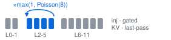
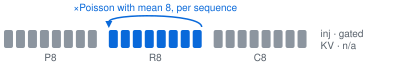

<!-- Generated by scripts/build.py from the YAML files. Do not edit by hand. -->

<p align="center"></p>

<h1 align="center">Awesome Loop</h1>

<p align="center">Looped and recurrent-depth language models: papers, open models, and the evidence behind their claims, recorded the same way for every paper so that results can be compared.</p>

<p align="center">    <a href="https://github.com/sjy1203/awesome-loop/actions/workflows/ci.yml"></a></p>

<p align="center"><b>English</b> · <a href="README.zh-CN.md">简体中文</a></p>

<p align="center"><a href="#deep-cards">Deep cards</a> · <a href="#all-papers">All papers</a> · <a href="#design-space">Design space</a> · <a href="#open-questions">Open questions</a> · <a href="#open-models">Open models</a></p>

## What this list adds

- Each deep card stores the loop layout as data; the fingerprint figures in the tables are drawn from it.
- Each card records what the main comparison holds fixed (parameters, FLOPs, KV, tokens, depth) and whether the baseline was tuned separately.
- Every number is copied from the paper with its table or figure reference. Nothing is converted or extrapolated.
- Caveats come from the paper itself: scale, context length, what was not matched, how evaluation was run.
- Open questions put the evidence for and against from different papers side by side.
- Everything is YAML and JSON, with an llms.txt index for agents.

## Deep cards

Grouped by category, newest first. Click a name for the full card. In the loop fingerprint, grey blocks run once, blue blocks are the looped core, the arrow carries the number of passes used in training, and the right side gives the input injection and the KV policy.

### Architecture: where to loop, what to share

| Paper | Loop | TL;DR | Held fixed | Links | Impact |
|---|---|---|---|---|---|
| **[Inkling 2 Mini](docs/en/tml-inkling-2-mini.md)**<br><sub>2026-11-20 · Thinking Machines Lab</sub> |  | Open-weight MoE (26.4B total, 3.4B active) that runs the middle 12 of its 24 layers three times with shared weights, released with a variable-loop research twin used to measure how pass count affects capability and CoT monitorability. | **F** | [paper](https://thinkingmachines.ai/news/inkling-2-mini/) · [project](https://thinkingmachines.ai/model-card/inkling-2-mini/) · [blog](https://huggingface.co/blog/inkling2mini) · [weights](https://huggingface.co/thinkingmachines/Inkling-2-Mini) | - |
| **[Looped CED](docs/en/2611.13378.md)**<br><sub>2026-11-09 · University of California, San Diego, Tsinghua University +1</sub> |  | Loop the CED encoder layers that produce global KV, train with random depth, and keep only the last round's KV. | **N** **D** **KV** ~~F~~ ~~L~~ | [paper](https://arxiv.org/abs/2611.13378) | cites 0 |
| **[YOCO-U](docs/en/2604.01220.md)**<br><sub>2026-04-01 · Microsoft Research, Tsinghua University</sub> |  | Loop only YOCO's self-decoder, whose layers use sliding-window attention, so extra depth costs compute while the cross-decoder's global KV is still computed once. | **N** **A** **F** ~~D~~ ~~L~~ ~~KV~~ | [paper](https://arxiv.org/abs/2604.01220) | cites 3 · HF upvotes 18 |
| **[Huginn](docs/en/2502.05171.md)**<br><sub>2025-02-07 · ELLIS Institute Tübingen, Max-Planck Institute for Intelligent Systems +3</sub> |  | Pretrain a 3.5B prelude-core-coda transformer with a randomly sampled number of core iterations, so test-time compute scales by iterating the core more. | **N** **D** ~~F~~ ~~L~~ | [paper](https://arxiv.org/abs/2502.05171) · [code](https://github.com/seal-rg/recurrent-pretraining) · [weights](https://huggingface.co/tomg-group-umd/huginn-0125) | cites 578 · stars 998 · HF upvotes 162 |

### Depth control

| Paper | Loop | TL;DR | Held fixed | Links | Impact |
|---|---|---|---|---|---|
| **[Ouro (LoopLM)](docs/en/2510.25741.md)**<br><sub>2025-10-29 · ByteDance Seed, UC Santa Cruz +9</sub> |  | Pre-train a weight-tied layer stack that repeats 4 times, with a learned exit gate, on 7.7T tokens; the authors report that the 1.4B and 2.6B models match dense models of up to 12B parameters. | ~~N~~ ~~D~~ | [paper](https://arxiv.org/abs/2510.25741) · [project](https://ouro-llm.github.io) · [weights](https://huggingface.co/ByteDance/Ouro-1.4B) | cites 245 · HF upvotes 146 |
| **[MoR](docs/en/2507.10524.md)**<br><sub>2025-07-14 · KAIST AI, Mila +4</sub> |  | Routers give each token its own number of passes through a shared middle block, and each pass caches KV only for its active tokens; at equal training FLOPs MoR beats fixed-depth recursive baselines and often vanilla, with fewer parameters. | **F** ~~N~~ ~~D~~ ~~L~~ ~~KV~~ | [paper](https://arxiv.org/abs/2507.10524) · [code](https://github.com/raymin0223/mixture_of_recursions) · [weights](https://drive.google.com/drive/folders/1pYKJOu2aBGC-jgoWbfP6T_vqEYtUVxa4) | cites 204 · stars 652 · HF upvotes 74 |

### Training and retrofitting

| Paper | Loop | TL;DR | Held fixed | Links | Impact |
|---|---|---|---|---|---|
| **[Retrofitted Recurrence](docs/en/2511.07384.md)**<br><sub>2025-11-10 · University of Maryland, New York University +6</sub> |  | Turn pretrained 1B models into prelude-core-coda recurrent models by dropping middle layers and looping a block, then keep training while a curriculum raises the mean recurrence. | **D** ~~N~~ ~~F~~ ~~L~~ | [paper](https://arxiv.org/abs/2511.07384) · [code](https://github.com/mcleish7/retrofitting-recurrence) · [weights](https://huggingface.co/collections/tomg-group-umd/retrofitting-recurrence) | cites 79 · stars 72 · HF upvotes 21 |

### Scaling and budget

| Paper | Loop | TL;DR | Held fixed | Links | Impact |
|---|---|---|---|---|---|
| **[SMELT](docs/en/2609.01343.md)**<br><sub>2026-09-01 · Tsinghua University, ByteDance Seed +2</sub> |  | With per-token FLOPs, total parameters and KV cache matched, looping the middle half of an MoE Transformer twice lowers loss at four scales up to 54B non-embedding parameters and saves 6.8-18.0% of training FLOPs on the fitted frontier. | **F** **N** **KV** **D** ~~A~~ ~~L~~ | [paper](https://arxiv.org/abs/2609.01343) | cites 31 · HF upvotes 91 |
| **[Parcae](docs/en/2604.12946.md)**<br><sub>2026-04-14 · University of California, San Diego, Together AI</sub> |  | Constrain the loop's injection to a stable negative-diagonal form, sample depth per sequence, and fit training and test-time scaling laws for looping at fixed parameter count. | **N** **D** ~~F~~ ~~L~~ | [paper](https://arxiv.org/abs/2604.12946) · [code](https://github.com/sandyresearch/parcae) · [project](https://sandyresearch.github.io/parcae/) · [weights](https://huggingface.co/SandyResearch/parcae-140m) | cites 89 · stars 194 · HF upvotes 11 |

### Systems and inference

| Paper | Loop | TL;DR | Held fixed | Links | Impact |
|---|---|---|---|---|---|
| **[LoopDuet](docs/en/2611.07211.md)**<br><sub>2026-11-04 · Duke University</sub> |  | Serve looped Transformers with fewer core loops for ordinary prompt tokens than for the last prompt token and the decoded tokens, run the deep tail as a compact batch in vLLM, and lower prefilling depth when the queue grows. | **N** **D** **KV** ~~L~~ ~~W~~ | [paper](https://arxiv.org/abs/2611.07211) | cites 0 |
| **[PLT](docs/en/2510.24824.md)**<br><sub>2025-10-28 · ByteDance Seed</sub> |  | Run loop l of token i in the same forward pass as loop l+1 of token i-1, let later loops reuse the first loop's KV plus a gated SWA, and a looped model decodes at close to unlooped latency and KV. | **N** **A** **D** ~~F~~ ~~L~~ ~~KV~~ | [paper](https://arxiv.org/abs/2510.24824) | cites 34 · HF upvotes 18 |

Held fixed: **N** unique parameters · **A** active parameters · **F** training FLOPs · **KV** KV cache per token · **D** training tokens · **L** executed layers per token · **W** wall-clock. ~~Struck through~~ = differs between the looped model and its baseline.

## All papers

Every paper in the collection, deep cards included, grouped by category and newest first. New arXiv candidates are queued in [data/candidates.json](data/candidates.json) and added after a scope check.

### Theory and capability (1)

| Date | Paper | TL;DR | Links | Impact |
|---|---|---|---|---|
| 2026-11-01 | [How Does Chain-of-Thought Supervision Teach Models to Reason? A Theoretical Analysis](https://arxiv.org/abs/2611.01740)<br><sub>Kaito Takanami et al.</sub> | Studies an in-context linear-regression weight predictor trained on gradient-descent trajectories and run recursively beyond them; long-horizon reasoning has phase transitions in context length and training CoT budget, and overthinking splits into error accumulation and amplification. | [paper](https://arxiv.org/abs/2611.01740) | cites 0 |

### Architecture: where to loop, what to share (7)

| Date | Paper | TL;DR | Links | Impact |
|---|---|---|---|---|
| 2026-11-20 | [Introducing Inkling 2 Mini](https://thinkingmachines.ai/news/inkling-2-mini/) · **[deep card](docs/en/tml-inkling-2-mini.md)**<br><sub>Thinking Machines Lab blog</sub> | Open-weight MoE (26.4B total, 3.4B active) that runs the middle 12 of its 24 layers three times with shared weights, released with a variable-loop research twin used to measure how pass count affects capability and CoT monitorability. | [paper](https://thinkingmachines.ai/news/inkling-2-mini/) · [project](https://thinkingmachines.ai/model-card/inkling-2-mini/) · [blog](https://huggingface.co/blog/inkling2mini) · [weights](https://huggingface.co/thinkingmachines/Inkling-2-Mini) | - |
| 2026-11-20 | [Model Carving: Training Transformers That Optimize Their Own Topology](https://arxiv.org/abs/2611.27962)<br><sub>Kaden Zheng et al.</sub> | Puts learnable scalar gates on every sublayer of standard and looped Transformers so training removes the unneeded ones; carved models reach lower validation loss than dense models trained with up to 1.7 times more compute. | [paper](https://arxiv.org/abs/2611.27962) | - |
| 2026-11-09 | [Looping Deeper Without Growing the KV Cache: Recurrent Depth for Causal Encoder-Decoders](https://arxiv.org/abs/2611.13378) · **[deep card](docs/en/2611.13378.md)**<br><sub>Jiaqi Leng et al.</sub> | Loop the CED encoder layers that produce global KV, train with random depth, and keep only the last round's KV. | [paper](https://arxiv.org/abs/2611.13378) | cites 0 |
| 2026-11-04 | [LooM: Loop-Invariant Memory for Causal Encoder-Decoder Language Models](https://arxiv.org/abs/2611.06835)<br><sub>Lele Yang et al.</sub> | Loops the decoder layers of a causal encoder-decoder, storing each token's KV only on its first visit; one model covers 3 to 21 layer executions per token and, with enough loops, beats a single-pass baseline. | [paper](https://arxiv.org/abs/2611.06835) | cites 0 |
| 2026-11-02 | [Library of Layers (LoL): Adaptively Ordering Transformer Layers at Runtime](https://arxiv.org/abs/2611.03526)<br><sub>Abdellah Rahmani et al.</sub> | Library of Layers uses a router to choose and order blocks from a global library at inference, covering dense, depth-recurrent and MoE designs; it is competitive with all three when pretrained on text. | [paper](https://arxiv.org/abs/2611.03526) · [code](https://github.com/arahmani1/library-of-layers) | cites 0 · stars 23 · HF upvotes 12 |
| 2026-04-01 | [Universal YOCO for Efficient Depth Scaling](https://arxiv.org/abs/2604.01220) · **[deep card](docs/en/2604.01220.md)**<br><sub>Yutao Sun et al.</sub> | Loop only YOCO's self-decoder, whose layers use sliding-window attention, so extra depth costs compute while the cross-decoder's global KV is still computed once. | [paper](https://arxiv.org/abs/2604.01220) | cites 3 · HF upvotes 18 |
| 2025-02-07 | [Scaling up Test-Time Compute with Latent Reasoning: A Recurrent Depth Approach](https://arxiv.org/abs/2502.05171) · **[deep card](docs/en/2502.05171.md)**<br><sub>Jonas Geiping et al.</sub> | Pretrain a 3.5B prelude-core-coda transformer with a randomly sampled number of core iterations, so test-time compute scales by iterating the core more. | [paper](https://arxiv.org/abs/2502.05171) · [code](https://github.com/seal-rg/recurrent-pretraining) · [weights](https://huggingface.co/tomg-group-umd/huginn-0125) | cites 578 · stars 998 · HF upvotes 162 |

### Architecture: cross-pass state and residuals (6)

| Date | Paper | TL;DR | Links | Impact |
|---|---|---|---|---|
| 2026-11-18 | [Simpler Tiny Recursive Models](https://arxiv.org/abs/2611.23677)<br><sub>Torben Glass et al.</sub> | STRM simplifies TRM to a single uniformly updated state, using jittered-rate exponential moving updates and slow-channel readout; under TRM's data, parameters and compute it gains 3.8 points on Sudoku-Extreme and matches TRM on Maze-Hard. | [paper](https://arxiv.org/abs/2611.23677) | cites 0 |
| 2026-11-17 | [InfuseLoop: Cross-Trajectory Latent Injection for Scalable Parallel Looped Transformers](https://arxiv.org/abs/2611.22426)<br><sub>Zhaofeng Sun et al.</sub> | Adds cross-trajectory latent injection to Parallel Looped Transformers, so each loop aggregates causally available hidden states from later trajectories via attention residuals; this eliminates training-loss spikes and improves validation-loss scaling up to eight loops. | [paper](https://arxiv.org/abs/2611.22426) | cites 0 |
| 2026-11-12 | [Rectified Looped Transformer](https://arxiv.org/abs/2611.16265)<br><sub>Musheng Li et al.</sub> | Feeds each loop a linear interpolation between the current state and the block's prediction; at matched depth this lowers perplexity versus a standard looped Transformer and keeps hidden-state norms more stable, with no extra parameters. | [paper](https://arxiv.org/abs/2611.16265) | cites 0 |
| 2026-11-04 | [Loopback Transformer: Towards a Unified View of Residual Looped Transformers](https://arxiv.org/abs/2611.07226)<br><sub>Xuan Ouyang et al.</sub> | Loopback Transformer reads each shared-block update separately, using geometric decay for total update weight and attention to allocate it; it reaches lower validation loss than standard Transformers with 40-75% of their Transformer parameters. | [paper](https://arxiv.org/abs/2611.07226) · [code](https://github.com/yancyou/Loopback) | cites 0 · stars 17 · HF upvotes 28 |
| 2026-11-03 | [ARLoop: Fully-Open Pre-trained Looped Transformers with Attention Residuals](https://arxiv.org/abs/2611.05234)<br><sub>Yuekun Yao et al.</sub> | ARLoop gives each layer of a looped transformer attention over earlier outputs across depth; sliding-window depth attention matches full history, and a 1.2B model trained on 0.5T tokens beats Huginn-3.5B on all evaluated tasks. | [paper](https://arxiv.org/abs/2611.05234) | cites 0 · HF upvotes 4 |
| 2026-10-26 | [StateLoop: Persistent State for Looped Transformers](https://arxiv.org/abs/2610.35544)<br><sub>Feichen Song et al.</sub> | StateLoop gives each token a gated persistent state carried across looped-Transformer iterations and projected back into the backbone output; it lowers Pile perplexity versus vanilla looping, with a gap that grows with trained loop depth. | [paper](https://arxiv.org/abs/2610.35544) | cites 0 |

### Depth control (7)

| Date | Paper | TL;DR | Links | Impact |
|---|---|---|---|---|
| 2026-11-09 | [Depth as a Candidate Source: Portfolio Allocation for Recurrent Test-Time Scaling in Large Language Models](https://arxiv.org/abs/2611.12293)<br><sub>Chaoyuan Hao et al.</sub> | Shows deeper recurrence in a frozen Huginn can lose correct answers found at shallower depths, and proposes Depth Portfolio Allocation, which spreads a test-time budget across depths and expands oracle coverage at matched candidate counts. | [paper](https://arxiv.org/abs/2611.12293) · [code](https://anonymous.4open.science/r/LLM-latent-B7BC/) | cites 0 |
| 2026-11-05 | [AlterNet: Adaptive-Depth Mixture-of-Experts with Learned Halting for Elastic Inference](https://arxiv.org/abs/2611.08741)<br><sub>Alexander Kastius</sub> | AlterNet loops over a shared pool of shallow MoE experts, picked by a depth-aware router, with per-expert halt heads for early stopping, so depth adapts and can be cut without retraining; results are preliminary. | [paper](https://arxiv.org/abs/2611.08741) | cites 0 |
| 2026-11-02 | [Dory1.0-4B: A Looped Normalized-GPT](https://arxiv.org/abs/2611.03998)<br><sub>Maxim Fishman et al.</sub> | Dory1.0-4B is a looped nGPT language model with elastic depth, pre-trained on 6 trillion tokens; more loops raise accuracy, and caching only last-loop KV keeps most gains at a non-looped KV footprint. | [paper](https://arxiv.org/abs/2611.03998) | cites 0 · HF upvotes 15 |
| 2026-11-02 | [When Does Adaptive Halting Win? Selection Rules Matter in Looped Language Models](https://arxiv.org/abs/2611.02333)<br><sub>Mahesh Reddy Pagadala</sub> | On a frozen Ouro-1.4B, pre-registered tests show the winner between a trained stability probe and Ouro's exit gate flips with the operating-point selection rule; the probe shows no demonstrated advantage over an untrained KL baseline. | [paper](https://arxiv.org/abs/2611.02333) · [code](https://github.com/lonewolf15116/lookahead-halting) | cites 0 · stars 0 |
| 2026-10-28 | [Compute Has Shape: Self-Morphing the Internal Computation of Frozen LLMs](https://arxiv.org/abs/2610.38382)<br><sub>Junxi Wu et al.</sub> | SelfMorph trains a selector that picks, per input, whether a frozen LLM keeps its forward path, repeats a layer span or branches hidden states; this gives an 8.06% mean relative improvement on five in-distribution benchmarks. | [paper](https://arxiv.org/abs/2610.38382) · [code](https://github.com/creator-xi/SelfMorph) | cites 0 · stars 2 |
| 2025-10-29 | [Scaling Latent Reasoning via Looped Language Models](https://arxiv.org/abs/2510.25741) · **[deep card](docs/en/2510.25741.md)**<br><sub>Rui-Jie Zhu et al.</sub> | Pre-train a weight-tied layer stack that repeats 4 times, with a learned exit gate, on 7.7T tokens; the authors report that the 1.4B and 2.6B models match dense models of up to 12B parameters. | [paper](https://arxiv.org/abs/2510.25741) · [project](https://ouro-llm.github.io) · [weights](https://huggingface.co/ByteDance/Ouro-1.4B) | cites 245 · HF upvotes 146 |
| 2025-07-14 | [Mixture-of-Recursions: Learning Dynamic Recursive Depths for Adaptive Token-Level Computation](https://arxiv.org/abs/2507.10524) · **[deep card](docs/en/2507.10524.md)**<br><sub>Sangmin Bae et al. · NeurIPS 2025</sub> | Routers give each token its own number of passes through a shared middle block, and each pass caches KV only for its active tokens; at equal training FLOPs MoR beats fixed-depth recursive baselines and often vanilla, with fewer parameters. | [paper](https://arxiv.org/abs/2507.10524) · [code](https://github.com/raymin0223/mixture_of_recursions) · [weights](https://drive.google.com/drive/folders/1pYKJOu2aBGC-jgoWbfP6T_vqEYtUVxa4) | cites 204 · stars 652 · HF upvotes 74 |

### Training and retrofitting (10)

| Date | Paper | TL;DR | Links | Impact |
|---|---|---|---|---|
| 2026-11-19 | [GLiDE: A Fast, Calibrated Decision Model Distilled from Reasoning Teachers](https://arxiv.org/abs/2611.26509)<br><sub>Sahibzada Allahyar et al.</sub> | Converts Qwen hybrid LMs into single-pass decision models via bidirectional full attention and multi-teacher distillation; checkpoint averaging plus parameter-free recurrent depth (reapplying middle layers) raises the 27B hidden-set score from 71.52 to 73.37. | [paper](https://arxiv.org/abs/2611.26509) | cites 0 · HF upvotes 1 |
| 2026-11-13 | [Folding Language Models into Themselves](https://arxiv.org/abs/2611.18113)<br><sub>Ziyang Zhang et al.</sub> | Concertina folds every N adjacent teacher layers into one shared block run N times with low-rank corrections; distilled from Qwen3-4B on 22B tokens, a 2.27B model retains 84% of the teacher averaged over eight benchmarks. | [paper](https://arxiv.org/abs/2611.18113) · [code](https://github.com/myboker/concertina) | cites 0 · stars 6 · HF upvotes 0 |
| 2026-11-12 | [Classical Energies Learn to Reason 1,000x Faster than Looped Models](https://arxiv.org/abs/2611.17309)<br><sub>Benjamin Hoover et al.</sub> | CRAM, a learned Hopfield-Tank energy minimized at inference, solves 99.996% of Sudoku-Extreme and 100% of Maze-Unique test puzzles with training at least 1,000x faster than looped models; the authors call these benchmarks trivially solvable. | [paper](https://arxiv.org/abs/2611.17309) | cites 0 · HF upvotes 0 |
| 2026-11-05 | [Extending Reasoning in Typed Decision Models via Looping](https://arxiv.org/abs/2611.07736)<br><sub>David Berghaus et al.</sub> | RELOAD fine-tunes pretrained encoders or decoders with a damped loop over their middle block; looping improves accuracy and calibration, mostly on reasoning chains longer than in training, where encoders gain up to 23 points. | [paper](https://arxiv.org/abs/2611.07736) | cites 0 |
| 2026-11-03 | [Best-of-Depth: Learning Exploratory Dynamics in Looped Transformers](https://arxiv.org/abs/2611.04663)<br><sub>Shota Takashiro et al.</sub> | Best-of-Depth trains a looped Transformer's recurrent trajectory as a candidate set by minimizing prediction loss across depths; on N-Queens, coverage reaches 91.03% versus 45.75% for final-depth training. | [paper](https://arxiv.org/abs/2611.04663) | cites 0 |
| 2026-10-30 | [UpLoop: Training Looped Transformers via Upcycling at No Extra Pretraining Compute](https://arxiv.org/abs/2610.41720)<br><sub>Cheng Liang et al.</sub> | Grows a shallow Transformer by copying layers and spends the saved compute on looping a shared middle block, at matched parameters, tokens and FLOPs; the 1.3B model's 22-task average rises from 22.99 to 27.52. | [paper](https://arxiv.org/abs/2610.41720) | cites 0 |
| 2026-10-28 | [Deeper Backpropagation or More Updates? Training Looped Language Models Across Budgets](https://arxiv.org/abs/2610.38422)<br><sub>Jiarun Shen et al.</sub> | Compares shorter and longer truncated-backprop windows for training looped language models at roughly equal training time; the advantage of shorter windows shrinks as training budgets grow, so the preferred window can change. | [paper](https://arxiv.org/abs/2610.38422) | cites 1 |
| 2026-10-27 | [Think Twice: The Metis-1.6 Technical Report](https://arxiv.org/abs/2610.37903)<br><sub>Giulianno Vollmer</sub> | Metis-1.6 technical report on Praxis and Logos, two from-scratch models that run a hybrid Mamba-2 and attention MoE stack twice per token; Logos averages 52.93 across 40 post-trained benchmarks, and the report documents training failures. | [paper](https://arxiv.org/abs/2610.37903) · [code](https://github.com/lernex/dromos) | cites 0 · stars 0 · HF upvotes 5 |
| 2026-10-24 | [One Model, Two Paths: Balancing Single-Pass and Looped Performance in Language Models](https://arxiv.org/abs/2610.33517)<br><sub>Jiarun Shen et al.</sub> | Adapts a pretrained model to support both single-pass and looped inference by reusing middle-layer weights, and shows joint weighted losses with frozen-model guidance reduce single-pass degradation while keeping looped gains over continued training. | [paper](https://arxiv.org/abs/2610.33517) | cites 0 |
| 2025-11-10 | [Teaching Pretrained Language Models to Think Deeper with Retrofitted Recurrence](https://arxiv.org/abs/2511.07384) · **[deep card](docs/en/2511.07384.md)**<br><sub>Sean McLeish et al.</sub> | Turn pretrained 1B models into prelude-core-coda recurrent models by dropping middle layers and looping a block, then keep training while a curriculum raises the mean recurrence. | [paper](https://arxiv.org/abs/2511.07384) · [code](https://github.com/mcleish7/retrofitting-recurrence) · [weights](https://huggingface.co/collections/tomg-group-umd/retrofitting-recurrence) | cites 79 · stars 72 · HF upvotes 21 |

### Scaling and budget (6)

| Date | Paper | TL;DR | Links | Impact |
|---|---|---|---|---|
| 2026-11-16 | [Latent Feedback Is a Compute and Data Amplifier](https://arxiv.org/abs/2611.20404)<br><sub>Benhao Huang et al.</sub> | Tests latent feedback, which feeds each token's top-layer state into the next token's input, against compute-matched multi-epoch Transformers; it saves at most 48% of the compute and 47% of the unique data. | [paper](https://arxiv.org/abs/2611.20404) · [code](https://github.com/ifm-ai/LoRM) | cites 0 · stars 25 · HF upvotes 7 |
| 2026-11-04 | [Loop Before You Leap: What Recurrent Depth Can and Cannot Buy in Data-Limited Pretraining](https://arxiv.org/abs/2611.06206)<br><sub>Daichi Hotta et al. · BabyLM Challenge 2026</sub> | Compares standard and looped Transformers under a 100M-word budget; text-only, a 12-layer stack repeated four times beats a 48-layer Transformer by 5.4 BLiMP points, but recurrence does not clearly mitigate the multimodal-training drop. | [paper](https://arxiv.org/abs/2611.06206) | cites 0 |
| 2026-10-30 | [There Is No Free Loop: When Does Looping a Trained Model Pay for Its Inference Compute?](https://arxiv.org/abs/2610.42030)<br><sub>Rhea Sanjay Sukthanker et al.</sub> | Adds loops to pretrained Qwen3 and Qwen3.5 models (0.8B to 9B) and compares them with equal-parameter and equal-FLOPs unlooped baselines; only the looped 0.8B model beats both, so post-pretraining loops pay only for small models. | [paper](https://arxiv.org/abs/2610.42030) | cites 0 |
| 2026-10-29 | [How to Loop Your Transformer: Loop Scaling, Specialization, and Parallel Inference](https://arxiv.org/abs/2610.40325)<br><sub>Chanakya Ekbote et al.</sub> | In looped decoders up to 1B parameters, full-stack looping is best at fixed parameters and middle-block looping at fixed training FLOPs; per-loop low-rank adapters help, and a normalization fix recovers Parallel Loop Transformer quality. | [paper](https://arxiv.org/abs/2610.40325) | cites 0 |
| 2026-09-01 | [SMELT: Scaling Laws for Compute-Matched MoE Looped Transformers](https://arxiv.org/abs/2609.01343) · **[deep card](docs/en/2609.01343.md)**<br><sub>Shaowen Wang et al.</sub> | With per-token FLOPs, total parameters and KV cache matched, looping the middle half of an MoE Transformer twice lowers loss at four scales up to 54B non-embedding parameters and saves 6.8-18.0% of training FLOPs on the fitted frontier. | [paper](https://arxiv.org/abs/2609.01343) | cites 31 · HF upvotes 91 |
| 2026-04-14 | [Parcae: Scaling Laws For Stable Looped Language Models](https://arxiv.org/abs/2604.12946) · **[deep card](docs/en/2604.12946.md)**<br><sub>Hayden Prairie et al.</sub> | Constrain the loop's injection to a stable negative-diagonal form, sample depth per sequence, and fit training and test-time scaling laws for looping at fixed parameter count. | [paper](https://arxiv.org/abs/2604.12946) · [code](https://github.com/sandyresearch/parcae) · [project](https://sandyresearch.github.io/parcae/) · [weights](https://huggingface.co/SandyResearch/parcae-140m) | cites 89 · stars 194 · HF upvotes 11 |

### Systems and inference (19)

| Date | Paper | TL;DR | Links | Impact |
|---|---|---|---|---|
| 2026-11-19 | [dLoop: Looped Diffusion Language Models via Recurrent Latent Refinement](https://arxiv.org/abs/2611.26275)<br><sub>Handa Li et al.</sub> | Restructures a pretrained diffusion language model into a Prelude-Loop-Coda design that reapplies a shared middle block before tokens are committed, reaching the highest or tied-highest accuracy on GSM8K, MATH, MBPP and HumanEval. | [paper](https://arxiv.org/abs/2611.26275) | cites 0 |
| 2026-11-19 | [Fold the Loop: Decoding-Time KV Memory for Looped Vision-Language Models](https://arxiv.org/abs/2611.25369)<br><sub>Kun Zhou et al.</sub> | FoldCache lets groups of recurrent steps in a looped VLM share the group's final visual KV during decoding; on LoopVL it approximately halves prefix KV memory while matching full-cache accuracy on five open-ended benchmarks. | [paper](https://arxiv.org/abs/2611.25369) | cites 0 |
| 2026-11-18 | [Late Entry in Looped Language Models](https://arxiv.org/abs/2611.24576)<br><sub>Ziqi Jin et al.</sub> | Late entry lets new tokens in looped language models skip early passes and run only the final passes over a deep context cache, outperforming matched early exit; Wake verification reaches 5.2x greedy-exact speedup on Ouro-2.6B. | [paper](https://arxiv.org/abs/2611.24576) · [code](https://github.com/Xalp/LateComer) | cites 0 · stars 3 · HF upvotes 9 |
| 2026-11-18 | [LoopCache: Accelerating Long-Context Self-Speculative Decoding for Looped Transformers](https://arxiv.org/abs/2611.24301)<br><sub>Zizhuo Fu et al.</sub> | Proposes LoopCache, self-speculative decoding for long-context looped Transformers that updates drafts across intermediate loops by confidence and rotates loop-specific KV caches; reports average 10.25x and 14.56x speedup over WFD and LoopSpec. | [paper](https://arxiv.org/abs/2611.24301) | cites 0 · HF upvotes 1 |
| 2026-11-17 | [LoopZip: Visual Token Compression for Efficient Looped Vision-Language Models](https://arxiv.org/abs/2611.22728)<br><sub>Weizhong Huang et al.</sub> | LoopZip compresses visual tokens in looped vision-language models without training, selecting tokens by attention from two calls of the same shared layer; on LoopVL-1B it keeps 97.16% of the original performance at 50% pruning ratio. | [paper](https://arxiv.org/abs/2611.22728) | cites 0 |
| 2026-11-15 | [LoopSkim: Lossless Multi-Depth Speculative Decoding for Looped Language Models](https://arxiv.org/abs/2611.19896)<br><sub>Muhan Xiao et al.</sub> | Proposes lossless speculative decoding for looped LMs in which each loop's readout checks draft tokens copied from the context and only full-depth readouts commit; without training, its speedup averages 1.73x that of LoopSpec. | [paper](https://arxiv.org/abs/2611.19896) | cites 0 |
| 2026-11-14 | [LoopFill: Pipelined Multi-Token Speculative Decoding for Looped Transformers](https://arxiv.org/abs/2611.19649)<br><sub>Siqi Zhu et al.</sub> | A training-free speculative decoding method for looped LLMs that puts multi-token suffix drafts and shallow-loop predictions in one draft tree; average speedup over greedy decoding is 5.85x on Ouro-2.6B and 5.13x on Huginn-3.5B. | [paper](https://arxiv.org/abs/2611.19649) | cites 0 · HF upvotes 5 |
| 2026-11-14 | [Architectures and KV Replay for Depth-Recurrent Language Models](https://arxiv.org/abs/2611.19446)<br><sub>Lucia Licakova et al. · NeurIPS 2026 LIGHT Workshop</sub> | Studies how to cut decoding KV memory in depth-recurrent LMs: looped hybrids need frequent attention anchors, and training with recurrent KV replay lets iterations share KV states with performance close to separate per-iteration caches. | [paper](https://arxiv.org/abs/2611.19446) | cites 0 |
| 2026-11-04 | [Not All Loops Cost the Same: Phase-Dependent Depth for Serving Looped Transformers](https://arxiv.org/abs/2611.07211) · **[deep card](docs/en/2611.07211.md)**<br><sub>Zhixu Du et al.</sub> | Serve looped Transformers with fewer core loops for ordinary prompt tokens than for the last prompt token and the decoded tokens, run the deep tail as a compact batch in vLLM, and lower prefilling depth when the queue grows. | [paper](https://arxiv.org/abs/2611.07211) | cites 0 |
| 2026-11-03 | [Give the Drafter a Second Chance to Guess: Parallel Reconsideration for Speculative Decoding](https://arxiv.org/abs/2611.05724)<br><sub>Hoang Anh Duy Le et al.</sub> | Lets a speculative-decoding drafter deepen uncertain guesses with extra passes of its shared block, run in parallel with the one-pass draft; this improves acceptance length by 5.3% to 10.2% and speedup by 3.5% to 9.2%. | [paper](https://arxiv.org/abs/2611.05724) | cites 0 |
| 2026-11-03 | [LoopVQ: Sub 1-bit KV Cache Quantization for Looped Transformers](https://arxiv.org/abs/2611.05304)<br><sub>Minsoo Cheong et al.</sub> | LoopVQ vector-quantizes the KV cache of looped transformers, coding channels of several loop steps jointly; with Ouro and Huginn at 0.5 bits per element, it outperforms KV vector quantization methods built for standard LLMs. | [paper](https://arxiv.org/abs/2611.05304) · [code](https://github.com/mscheong01/LoopVQ) | cites 0 · stars 3 · HF upvotes 10 |
| 2026-11-03 | [What Sets the Serving Speed of Looped Language Models? Measurements and Optimizations Graded by Exactness](https://arxiv.org/abs/2611.05150)<br><sub>Dezhen Lu et al.</sub> | Measures serving of looped LMs Ouro and Huginn-0125, grading optimizations by exactness; the many small kernels per token set the cost, and fusing them behind rounding fences raises throughput 1.11-1.59x with identical outputs. | [paper](https://arxiv.org/abs/2611.05150) | cites 0 |
| 2026-11-03 | [LoopKV: Loop-Aware KV Cache Compression for Serving Looped Transformers](https://arxiv.org/abs/2611.04137)<br><sub>Tianle Zhou et al.</sub> | Chooses 4-bit, 2-bit or final-loop KV reuse for each (loop, layer) cell of Ouro from an offline profile; serving Ouro-1.4B, the LoopKV-M plan stores 35% less KV than KIVI-4 and sustains 1.7-2.2x its goodput. | [paper](https://arxiv.org/abs/2611.04137) | cites 0 · HF upvotes 0 |
| 2026-10-30 | [Where KV-Cache Error Lives in Looped Language Models: A Diagnostic Study of Ouro and Huginn](https://arxiv.org/abs/2610.41825)<br><sub>Dezhen Lu et al.</sub> | Studies how KV and shared-weight quantization error changes next-token distributions in looped LMs Ouro and Huginn-0125; per unit of error, values carry 94% of diagonal Fisher mass, but keys dominate measured KL. | [paper](https://arxiv.org/abs/2610.41825) | cites 0 |
| 2026-10-28 | [CopyLoop: Fast Looped Transformer Decoding via Context Copying and Shallow Screening](https://arxiv.org/abs/2610.38822)<br><sub>Wenyu Du et al.</sub> | CopyLoop, a training-free decoding algorithm for looped Transformers, proposes multi-token suffixes from repeated context, screens them at shallow recurrent depth and verifies at full depth, reaching 2.98x--10.70x speedups on Base models. | [paper](https://arxiv.org/abs/2610.38822) | cites 0 |
| 2026-10-26 | [LoopFold: Parallelizing Recurrent Depth in Looped Transformers](https://arxiv.org/abs/2610.35556)<br><sub>Feichen Song et al.</sub> | LoopFold runs several recurrent depths of a looped Transformer in parallel batches, using a predictor for later-loop inputs and a corrector for their outputs; versus a nine-loop vanilla model it cuts decoding latency by 46%. | [paper](https://arxiv.org/abs/2610.35556) | cites 2 |
| 2026-10-25 | [Recency Is the Wrong Axis: A Negative Result on Windowed Deepest-Plane KV Caching in Looped Language Models](https://arxiv.org/abs/2610.34436)<br><sub>Dezhen Lu et al.</sub> | Tests a KV policy for looped models that keeps every loop's plane for recent positions and shares the deepest plane elsewhere; across three models, sharing cost depends on late-loop convergence and position, not recency. | [paper](https://arxiv.org/abs/2610.34436) | cites 0 |
| 2026-10-25 | [ScaleRLT: Exact Log-Probabilities and Fast Deferred Rollouts for Reinforcement Learning on Looped Transformers](https://arxiv.org/abs/2610.34427)<br><sub>Dezhen Lu et al.</sub> | ScaleRLT removes the log-probability mismatch between deferred rollouts and the learner's dense pass in RL on looped transformers, using a stop-gradient hybrid that replays the rollout schedule bit for bit and keeps the dense gradient. | [paper](https://arxiv.org/abs/2610.34427) | cites 0 |
| 2025-10-28 | [Parallel Loop Transformer for Efficient Test-Time Computation Scaling](https://arxiv.org/abs/2510.24824) · **[deep card](docs/en/2510.24824.md)**<br><sub>Bohong Wu et al.</sub> | Run loop l of token i in the same forward pass as loop l+1 of token i-1, let later loops reuse the first loop's KV plus a gated SWA, and a looped model decodes at close to unlooped latency and KV. | [paper](https://arxiv.org/abs/2510.24824) | cites 34 · HF upvotes 18 |

### Mechanisms and failure modes (3)

| Date | Paper | TL;DR | Links | Impact |
|---|---|---|---|---|
| 2026-11-16 | [Latent Fact Composition under Next-Token Training](https://arxiv.org/abs/2611.21921)<br><sub>Tianyi Zhang et al.</sub> | Baton looped transformers pass the intermediate entity to the second loop as a token embedding; trained only on answers, two variants almost solve held-out two-hop questions, but next-token training makes accuracy rise then decline. | [paper](https://arxiv.org/abs/2611.21921) | cites 0 |
| 2026-11-15 | [When Does Reusing Layers Help Multimodal Embeddings?](https://arxiv.org/abs/2611.19827)<br><sub>Zhizhang Hu et al.</sub> | Tests eleven loop designs for multimodal embeddings, proving that under forward-only attention repeated layers cannot make earlier image states query-dependent; on MMEB-V2 an added loop loses 0.46 points, while native recurrence gains +4.23 points. | [paper](https://arxiv.org/abs/2611.19827) | cites 0 |
| 2026-10-25 | [Cross-Loop Query Handoff: How Later Loops Redirect Two-Hop Retrieval in the Ouro Looped Language Models](https://arxiv.org/abs/2610.34639)<br><sub>Ziyu Mu et al.</sub> | Transplants attention queries between loops of Ouro-1.4B and Ouro-2.6B; loop-3 queries injected into loop 1 rescue 90% and 97% of synthetic two-hop loop-1 failures that loop 3 fixes, versus 24% and 21% with shuffled donors. | [paper](https://arxiv.org/abs/2610.34639) · [code](https://github.com/Muuzzziiy/cql-handoff) | cites 0 · stars 1 · HF upvotes 1 |

### Applications beyond language modeling (15)

| Date | Paper | TL;DR | Links | Impact |
|---|---|---|---|---|
| 2026-11-19 | [LoopedWAM: Looped World Action Models for Elastic Inference](https://arxiv.org/abs/2611.25595)<br><sub>Anh Dao et al.</sub> | LoopedWAM loops a shared six-block core in each expert of a robot world action model, and elastic self-distillation lets one checkpoint serve several action-depth and sampling-step budgets; it reaches 96.1% success on LIBERO. | [paper](https://arxiv.org/abs/2611.25595) | cites 0 · HF upvotes 0 |
| 2026-11-17 | [Proximal Targets: Training Looped Refiners on Problems with Many Correct Answers](https://arxiv.org/abs/2611.22737)<br><sub>Syed Affan Daimi</sub> | Proves that a single stored target sets a loss floor for looped refiners (HRM, TRM) on puzzles with many answers; training each pass toward the nearest correct answer solves 98.8% of multi-answer Sudoku versus 2.5%. | [paper](https://arxiv.org/abs/2611.22737) | cites 0 |
| 2026-11-16 | [Déjà-Events: Multi-view 3D Geometry with Event Cameras via Sparsity-Aware Adaptive Gating](https://arxiv.org/abs/2611.21302)<br><sub>Arda Cinar Demirtas et al.</sub> | Distils an event-camera 3D model from the RGB teacher Déjà View, which repeatedly applies one shared transformer block, and gates that block by event density; it has the lowest pointmap error among evaluated event-based methods. | [paper](https://arxiv.org/abs/2611.21302) | cites 0 |
| 2026-11-16 | [Efficient Multi-View Generation with Iterative Global-Local Proxy Attention](https://arxiv.org/abs/2611.20703)<br><sub>Wei Tan et al.</sub> | GLPA sends cross-view information in multi-view diffusion through compact proxies and refines them by reusing the same attention parameters within a denoising step; on FLUX, attention runs 2.65× faster than dense attention and reconstruction improves. | [paper](https://arxiv.org/abs/2611.20703) | cites 0 |
| 2026-11-14 | [Wireless Edge-Assisted Adaptive Latent Reasoning for Vision-Language-Action Models in Physical AI](https://arxiv.org/abs/2611.19131)<br><sub>Fatih Temiz et al.</sub> | Uses constrained deep RL (TRPO-Lag) to jointly choose local or edge execution and the latent-reasoning convergence threshold of a recurrent-depth VLA, reaching up to 23% higher feasibility-weighted task success than benchmark constrained RL methods. | [paper](https://arxiv.org/abs/2611.19131) | cites 0 |
| 2026-11-11 | [One Block Is Enough: LoopMR for Accelerated MRI Reconstruction](https://arxiv.org/abs/2611.14947)<br><sub>Yimeng He et al.</sub> | Reuses one Restormer block at every iteration of unrolled MRI reconstruction and beats PromptMR+ with about 1/9 of its parameters; shared transformer blocks match or beat distinct-weight ones, while shared CNN blocks do worse. | [paper](https://arxiv.org/abs/2611.14947) · [code](https://github.com/hym97/LoopMR) | cites 0 · stars 0 |
| 2026-11-08 | [WiFo-R: Wireless Foundation Model with Recurrent Channel Representation](https://arxiv.org/abs/2611.11275)<br><sub>Xuanyu Liu et al.</sub> | Builds a wireless channel foundation model whose parameter-shared recurrent updates refine CSI features and add latent tokens; multi-depth pretraining trains intermediate states to reconstruct CSI, and selectable depth improves the accuracy-complexity trade-off. | [paper](https://arxiv.org/abs/2611.11275) | cites 0 |
| 2026-11-06 | [Energy-Based Reasoners: Your Recurrent Reasoner Should Be an Energy-Based Model](https://arxiv.org/abs/2611.08977)<br><sub>William Xingxu Chen et al.</sub> | Learns an energy over latent reasoning states and makes each loop a gradient step on it, giving a stopping signal; reaches 99.9% accuracy on Sudoku-Extreme with 345× less inference compute than the next-best model. | [paper](https://arxiv.org/abs/2611.08977) · [code](https://github.com/wwillchen/ebr) | cites 1 · stars 94 · HF upvotes 10 |
| 2026-11-05 | [ARC-VLN: Adaptive Recursive Computing-based Visual-Language Navigation](https://arxiv.org/abs/2611.18696)<br><sub>Xiang Zhang et al.</sub> | ARC-VLN runs a shared-parameter language backbone recursively for aerial VLN, letting only visual tokens exit early; on OpenFly it has the lowest navigation error of the compared methods and reduces FLOPs and GPU memory. | [paper](https://arxiv.org/abs/2611.18696) | cites 0 |
| 2026-11-05 | [Beyond Quadratic Attention: Separable Gaussian Operators for ODE Vision Transformers](https://arxiv.org/abs/2611.08236)<br><sub>Carlos Boned Riera et al.</sub> | Replaces ViT self-attention with a separable sum-of-Gaussians operator, globally Lipschitz with fixed kernels, across discrete, looped and Neural ODE ViTs; in the looped setting it raises CIFAR-100 Top-1 accuracy by 5.4-8.1 points. | [paper](https://arxiv.org/abs/2611.08236) | cites 0 |
| 2026-11-05 | [BRIDGE: Bridging the Semantic Quantization Gap for Generative Recommendation](https://arxiv.org/abs/2611.07425)<br><sub>Yatong Xiao et al. · WSDM 2027</sub> | For generative recommendation, BRIDGE adds latent reasoning, self-distillation and effort-aware recurrence, which runs a shared loop decoder more times at early Semantic ID levels; it improves Recall@10 and NDCG@10 on three Amazon benchmarks. | [paper](https://arxiv.org/abs/2611.07425) | cites 0 |
| 2026-11-02 | [Solv3R: 3D Looped Transformer as a Multi-view Solver](https://arxiv.org/abs/2611.02857)<br><sub>Jeong-gi Kwak et al.</sub> | Trains a looped transformer whose update operator, independent of the iteration count, keeps refining multi-view geometry from its current state, so one solver handles offline and incremental reconstruction, relocalization and streaming without task-specific training. | [paper](https://arxiv.org/abs/2611.02857) · [code](https://github.com/ubc-vision/solv3r) | cites 1 · stars 337 · HF upvotes 12 |
| 2026-10-30 | [ElTab: Elastically Looped Tabular Transformers](https://arxiv.org/abs/2610.41819)<br><sub>Mieszko Komisarczyk et al.</sub> | ElTab trains one looped tabular transformer with supervision at randomly sampled early exits; on 30 OpenML datasets it matches six depth-specific looped models and a 12-layer TabPFN-style baseline with 25% fewer inference FLOPs. | [paper](https://arxiv.org/abs/2610.41819) | cites 0 |
| 2026-10-25 | [Recursive CLIP: Vision-Language Distillation with Looped Transformer Blocks](https://arxiv.org/abs/2610.34563)<br><sub>Szymon Mazurek et al.</sub> | Trains and distills CLIP models with recursive encoders that apply N transformer blocks M times at fixed ViT-B depth; CLIP tolerates substantial recurrent block reuse, though the effect depends on the encoder and downstream task. | [paper](https://arxiv.org/abs/2610.34563) | cites 0 |
| 2026-10-25 | [LoopGR: Parameter-Efficient Scaling for Generative Recommendation via Recurrent Depth](https://arxiv.org/abs/2610.34157)<br><sub>Huizhe Zhang et al.</sub> | For generative recommendation, LoopGR alternates a shared generative decoder with a lightweight context updater over recurrent depth and self-distills a low-budget student; it beats an encoder-decoder baseline while reducing model size by up to 52%. | [paper](https://arxiv.org/abs/2610.34157) | cites 0 |

## Design space

Where the loop sits (rows) × how the number of passes is set in training (columns). Empty cells have no deep card yet.

|  | fixed | sampled | scheduled curriculum | learned / adaptive |
|---|---|---|---|---|
| whole stack |  |  |  | [Ouro (LoopLM)](docs/en/2510.25741.md) |
| middle core (prelude-core-coda) | [SMELT](docs/en/2609.01343.md), [Inkling 2 Mini](docs/en/tml-inkling-2-mini.md) | [Huginn](docs/en/2502.05171.md), [Parcae](docs/en/2604.12946.md) | [Retrofitted Recurrence](docs/en/2511.07384.md) | [MoR](docs/en/2507.10524.md) |
| KV-producing half (CED encoder / YOCO self-decoder) | [YOCO-U](docs/en/2604.01220.md) | [Looped CED](docs/en/2611.13378.md) |  |  |
| KV-reading half (CED decoder / YOCO cross-decoder) |  |  |  |  |
| partial (one early/late block or sub-module) |  |  |  |  |
| hierarchical (coupled loops at different rates) |  |  |  |  |
| shifted / parallel across tokens | [PLT](docs/en/2510.24824.md) |  |  |  |
| implicit fixed point |  |  |  |  |

## Open questions

| Question | Status | Evidence (+ supports, - against, ~ partly) |
|---|---|---|
| [Does running more passes at test time than in training keep improving quality?](docs/en/questions.md#extra-passes-at-test-time) | mixed | Huginn (~), Parcae (~), Looped CED (~), Retrofitted Recurrence (~), Inkling 2 Mini (~), Ouro (LoopLM) (-) |
| [Where in the stack should the loop sit?](docs/en/questions.md#loop-placement) | consistent | SMELT (+), Inkling 2 Mini (+), Looped CED (+), YOCO-U (+), MoR (~) |
| [With training compute held fixed, do more passes help?](docs/en/questions.md#more-passes-fixed-compute) | mixed | SMELT (-), MoR (-), Ouro (LoopLM) (-), Ouro (LoopLM) (+), Parcae (~), Retrofitted Recurrence (~) |
| [Can later passes reuse one KV cache instead of keeping KV for every pass?](docs/en/questions.md#shared-kv-across-passes) | mixed | Looped CED (~), Ouro (LoopLM) (~), PLT (~), YOCO-U (+), MoR (~), Huginn (+) |

Settings, numbers and references for every item: [docs/en/questions.md](docs/en/questions.md).

## Open models

| Model | Paper | Params | Training tokens | Passes (default / range) | KV | Context | License | Runs on | Downloads · likes |
|---|---|---|---|---|---|---|---|---|---|
| [Huginn-0125](https://huggingface.co/tomg-group-umd/huginn-0125) +10 more | [Huginn](docs/en/2502.05171.md) | 3.5B | 800B | 32 / any num_steps; card says under 4 is very coarse and benchmarks improve up to about 64 | per-pass KV | 4096 (training sequence length) | apache-2.0 | transformers (trust_remote_code) | downloads 22,435 · likes 322 |
| [Inkling 2 Mini](https://huggingface.co/thinkingmachines/Inkling-2-Mini) | [Inkling 2 Mini](docs/en/tml-inkling-2-mini.md) | 26.4B<br>active 3.4B; 5.4B effective at 3 passes | not stated | 3 / fixed | per-pass KV | 1M | apache-2.0 | transformers, vLLM, SGLang, GGUF | downloads 41,888 · likes 5,274 |
| [Ouro-1.4B](https://huggingface.co/ByteDance/Ouro-1.4B) +1 more | [Ouro (LoopLM)](docs/en/2510.25741.md) | 1.4B | 7.7T | 4 / total_ut_steps is adjustable, with early exit; paper tests 1-8 | per-pass KV | Base card: 4K (training), extendable to 64K; Thinking card: 32K (SFT) | apache-2.0 | transformers (trust_remote_code), vLLM | downloads 41,646 · likes 223 |
| [Ouro-2.6B](https://huggingface.co/ByteDance/Ouro-2.6B) +1 more | [Ouro (LoopLM)](docs/en/2510.25741.md) | 2.6B | 7.7T | 4 / total_ut_steps is adjustable, with early exit; paper tests 1-8 | per-pass KV | Base card: 4K (training), extendable to 64K; Thinking card: 32K (SFT) | apache-2.0 | transformers (trust_remote_code), vLLM | downloads 17,775 · likes 258 |
| [Parcae](https://huggingface.co/SandyResearch/parcae-140m) +3 more | [Parcae](docs/en/2604.12946.md) | 140M / 370M / 770M / 1.3B | 11.2B / 29.6B / 61.6B / 104B | 8 / 1-16 (evaluated in the paper) | per-pass KV | 2,048 | not stated on the model cards | custom code | downloads 1,728 · likes 18 |
| [Recurrent-Llama-3.2 (4,6,4)](https://huggingface.co/smcleish/Recurrent-Llama-3.2-train-recurrence-4) +4 more | [Retrofitted Recurrence](docs/en/2511.07384.md) | 851,501,056 excluding embeddings (Table 8) | about 50B (Nemotron-CC-Math-v1) | 32 / num_steps; paper tests 1, 2, 4, 8, 16, 32 | per-pass KV | 1024 (training context length) | apache-2.0 | transformers (trust_remote_code) | downloads 2,881 · likes 1 |
| [Recurrent-OLMo-2-0425 (4,6,4)](https://huggingface.co/smcleish/Recurrent-OLMo-2-0425-train-recurrence-4) +4 more | [Retrofitted Recurrence](docs/en/2511.07384.md) | 939,638,784 excluding embeddings (Table 8) | about 50B (Nemotron-CC-Math-v1-4plus) | 32 / num_steps; paper tests 1, 2, 4, 8, 16, 32 | per-pass KV | 1024 (training context length) | apache-2.0 | transformers (trust_remote_code) | downloads 612 · likes 4 |
| [Recurrent-TinyLlama-3T (4,8,4)](https://huggingface.co/smcleish/Recurrent-TinyLlama-3T-train-recurrence-4) +6 more | [Retrofitted Recurrence](docs/en/2511.07384.md) | 704,708,608 excluding embeddings (Table 8) | about 50B (train-recurrence-k repos); 26B single phase, 52B two phase | 32 / num_steps; paper tests 1, 2, 4, 8, 16, 32 | per-pass KV | 1024 (training context length) | apache-2.0 | transformers (trust_remote_code) | downloads 858 · likes 3 |
| [TML-d24-varloop-research](https://huggingface.co/thinkingmachines/TML-d24-varloop-research) | [Inkling 2 Mini](docs/en/tml-inkling-2-mini.md) | 26.4B<br>active 3.4B at 1 pass, 5.4B at 3 passes, 7.4B at 5 passes | not stated | 3 / 1-5 trained, set at inference; blog also runs 10 | per-pass KV | 1M | apache-2.0 | transformers, vLLM, SGLang, GGUF | downloads 1,755 · likes 57 |

## Data for agents

- [llms.txt](llms.txt) is the index; [llms-full.txt](llms-full.txt) has every deep card in one file.
- [data/papers.json](data/papers.json), [data/models.json](data/models.json) and [data/claims.json](data/claims.json) hold all entries; citation and star counts are in [data/metrics/latest.json](data/metrics/latest.json).
- Schemas and allowed values: [schema/](schema/).

## Contributing

See [CONTRIBUTING.md](CONTRIBUTING.md). Agents should follow [AGENTS.md](AGENTS.md).

## Related collections

Broader catalogs of loop-model papers, useful for coverage:

- [Awesome Loop Models (huskydoge)](https://github.com/huskydoge/Awesome-Loop-Models)
- [Awesome Loop Transformers (Mrkkew)](https://github.com/Mrkkew/Awesome-Loop-Transformers)
- [Awesome Loop Transformer (asimfish)](https://github.com/asimfish/awesome_loop_transformer)

## Citation

If this collection helps your research, please cite it. GitHub can also export the reference from [CITATION.cff](CITATION.cff).

```bibtex
@misc{awesome-loop,
  title        = {Awesome Loop: Papers, Open Models and Evidence on Looped Language Models},
  author       = {{Awesome Loop contributors}},
  year         = {2026},
  howpublished = {\url{https://github.com/sjy1203/awesome-loop}}
}
```
