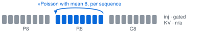

<!-- Generated by scripts/build.py from the YAML files. Do not edit by hand. -->

<p align="center"></p>

<h1 align="center">Awesome Loop</h1>

<p align="center">循环（looped / recurrent-depth）语言模型的论文、开源模型，以及结论背后的证据。每篇论文按同一套字段记录，方便跨论文比较。</p>

<p align="center">    <a href="https://github.com/sjy1203/awesome-loop/actions/workflows/ci.yml"></a></p>

<p align="center"><b>简体中文</b> · <a href="README.md">English</a></p>

<p align="center"><a href="#精读卡">精读卡</a> · <a href="#全部论文">全部论文</a> · <a href="#设计空间">设计空间</a> · <a href="#开放问题">开放问题</a> · <a href="#开源模型">开源模型</a></p>

## 这份清单的特点

- 每张精读卡把循环结构存成数据，表格里的结构指纹图由它生成。
- 记录主对照对齐了什么（参数、FLOPs、KV、token、执行层数），以及基线有没有单独调参。
- 数字都从原文照抄，并注明表格或图的编号，不做换算和外推。
- 保留意见只写原文里看得到的局限：规模、上下文长度、哪些没对齐、评测怎么跑的。
- 开放问题把不同论文的正反证据放在一起。
- 所有数据都是 YAML 和 JSON，另有给 agent 读的 llms.txt。

## 精读卡

按类别分组，组内从新到旧。点名称看完整卡片。结构指纹里，灰色块只跑一遍，蓝色块是循环部分，箭头上是训练时的遍数，右侧是输入注入方式和 KV 策略。

### 结构：放哪循环、共享什么

| 论文 | 结构 | 一句话 | 对齐项 | 链接 | 影响力 |
|---|---|---|---|---|---|
| **[Inkling 2 Mini](docs/zh/tml-inkling-2-mini.md)**<br><sub>2026-11-20 · Thinking Machines Lab</sub> |  | 开源权重的 MoE（总参数 26.4B、激活 3.4B），24 层中的中间 12 层共享权重跑三遍；同时发布一个可变循环的研究版，用来测遍数对能力和 CoT 可监控性的影响。 | **F** | [论文](https://thinkingmachines.ai/news/inkling-2-mini/) · [项目页](https://thinkingmachines.ai/model-card/inkling-2-mini/) · [博客](https://huggingface.co/blog/inkling2mini) · [权重](https://huggingface.co/thinkingmachines/Inkling-2-Mini) | - |
| **[Looped CED](docs/zh/2611.13378.md)**<br><sub>2026-11-09 · University of California, San Diego, Tsinghua University +1</sub> |  | 循环产出全局 KV 的 CED encoder 层，随机遍数训练，推理只存最后一遍的 KV。 | **N** **D** **KV** ~~F~~ ~~L~~ | [论文](https://arxiv.org/abs/2611.13378) | 引用 0 |
| **[YOCO-U](docs/zh/2604.01220.md)**<br><sub>2026-04-01 · Microsoft Research, Tsinghua University</sub> |  | 只循环 YOCO 的 self-decoder（这些层用 SWA），加深只多花计算，cross-decoder 用的全局 KV 仍只算一次。 | **N** **A** **F** ~~D~~ ~~L~~ ~~KV~~ | [论文](https://arxiv.org/abs/2604.01220) | 引用 3 · HF 点赞 18 |
| **[Huginn](docs/zh/2502.05171.md)**<br><sub>2025-02-07 · ELLIS Institute Tübingen, Max-Planck Institute for Intelligent Systems +3</sub> |  | 用随机采样的核心块迭代次数预训练 3.5B 的 prelude-core-coda Transformer，测试时多迭代核心块即可增加算力。 | **N** **D** ~~F~~ ~~L~~ | [论文](https://arxiv.org/abs/2502.05171) · [代码](https://github.com/seal-rg/recurrent-pretraining) · [权重](https://huggingface.co/tomg-group-umd/huginn-0125) | 引用 578 · star 998 · HF 点赞 162 |

### 深度控制

| 论文 | 结构 | 一句话 | 对齐项 | 链接 | 影响力 |
|---|---|---|---|---|---|
| **[Ouro (LoopLM)](docs/zh/2510.25741.md)**<br><sub>2025-10-29 · ByteDance Seed, UC Santa Cruz +9</sub> |  | 在 7.7T token 上预训练共享权重、重复 4 遍的层栈，并学习退出门；作者称 1.4B 和 2.6B 模型可比肩最大 12B 参数的 dense 模型。 | ~~N~~ ~~D~~ | [论文](https://arxiv.org/abs/2510.25741) · [项目页](https://ouro-llm.github.io) · [权重](https://huggingface.co/ByteDance/Ouro-1.4B) | 引用 245 · HF 点赞 146 |
| **[MoR](docs/zh/2507.10524.md)**<br><sub>2025-07-14 · KAIST AI, Mila +4</sub> |  | 路由器给每个 token 分配穿过共享中段的遍数，每一遍只为仍在计算的 token 存 KV；同等训练 FLOPs 下，MoR 优于固定深度的递归基线，也常优于 vanilla，且参数更少。 | **F** ~~N~~ ~~D~~ ~~L~~ ~~KV~~ | [论文](https://arxiv.org/abs/2507.10524) · [代码](https://github.com/raymin0223/mixture_of_recursions) · [权重](https://drive.google.com/drive/folders/1pYKJOu2aBGC-jgoWbfP6T_vqEYtUVxa4) | 引用 204 · star 652 · HF 点赞 74 |

### 训练与改造

| 论文 | 结构 | 一句话 | 对齐项 | 链接 | 影响力 |
|---|---|---|---|---|---|
| **[Retrofitted Recurrence](docs/zh/2511.07384.md)**<br><sub>2025-11-10 · University of Maryland, New York University +6</sub> |  | 从预训练 1B 模型中删掉中间几层、把一段层改为循环块，得到 prelude-core-coda 循环模型，再继续训练，并按课程逐步提高平均递归次数。 | **D** ~~N~~ ~~F~~ ~~L~~ | [论文](https://arxiv.org/abs/2511.07384) · [代码](https://github.com/mcleish7/retrofitting-recurrence) · [权重](https://huggingface.co/collections/tomg-group-umd/retrofitting-recurrence) | 引用 79 · star 72 · HF 点赞 21 |

### Scaling 与预算

| 论文 | 结构 | 一句话 | 对齐项 | 链接 | 影响力 |
|---|---|---|---|---|---|
| **[SMELT](docs/zh/2609.01343.md)**<br><sub>2026-09-01 · Tsinghua University, ByteDance Seed +2</sub> |  | 每 token FLOPs、总参数和 KV 都对齐时，把 MoE Transformer 中间一半的层循环两遍，在最大 54B 非 embedding 参数的四个规模上都降低了 loss，并在拟合前沿上省下 6.8-18.0% 的训练 FLOPs。 | **F** **N** **KV** **D** ~~A~~ ~~L~~ | [论文](https://arxiv.org/abs/2609.01343) | 引用 31 · HF 点赞 91 |
| **[Parcae](docs/zh/2604.12946.md)**<br><sub>2026-04-14 · University of California, San Diego, Together AI</sub> |  | 把循环的注入约束成稳定的负对角形式，按序列采样遍数训练，并在固定参数量下拟合循环的训练和推理 scaling law。 | **N** **D** ~~F~~ ~~L~~ | [论文](https://arxiv.org/abs/2604.12946) · [代码](https://github.com/sandyresearch/parcae) · [项目页](https://sandyresearch.github.io/parcae/) · [权重](https://huggingface.co/SandyResearch/parcae-140m) | 引用 89 · star 194 · HF 点赞 11 |

### 系统与推理

| 论文 | 结构 | 一句话 | 对齐项 | 链接 | 影响力 |
|---|---|---|---|---|---|
| **[LoopDuet](docs/zh/2611.07211.md)**<br><sub>2026-11-04 · Duke University</sub> |  | 服务循环 Transformer 时，普通 prompt token 少跑几遍，最后一个 prompt token 和 decode token 跑满；在 vLLM 里把需要继续循环的位置收成紧凑 batch，排队变长时再降低 prefill 深度。 | **N** **D** **KV** ~~L~~ ~~W~~ | [论文](https://arxiv.org/abs/2611.07211) | 引用 0 |
| **[PLT](docs/zh/2510.24824.md)**<br><sub>2025-10-28 · ByteDance Seed</sub> |  | 让 token i 的第 l 遍和 token i-1 的第 l+1 遍在同一次前向里执行，后续遍复用首遍 KV 并加门控 SWA，循环模型的解码延迟和 KV 接近不循环模型。 | **N** **A** **D** ~~F~~ ~~L~~ ~~KV~~ | [论文](https://arxiv.org/abs/2510.24824) | 引用 34 · HF 点赞 18 |

对齐项：**N** 唯一参数 · **A** 激活参数 · **F** 训练 FLOPs · **KV** 每 token KV · **D** 训练 token · **L** 每 token 执行层数 · **W** 墙钟时间。~~删除线~~ 表示循环模型和基线在这一项上不同。

## 全部论文

收录的全部论文（含精读卡），按类别分组，组内从新到旧。每天从 arXiv 检索到的候选先放进 [data/candidates.json](data/candidates.json)，确认属于循环模型后再收录。

### 理论与能力 (1)

| 日期 | 论文 | 一句话 | 链接 | 影响力 |
|---|---|---|---|---|
| 2026-11-01 | [How Does Chain-of-Thought Supervision Teach Models to Reason? A Theoretical Analysis](https://arxiv.org/abs/2611.01740)<br><sub>Kaito Takanami 等</sub> | 研究一个在梯度下降轨迹上训练、测试时递归应用并超出训练步数的线性回归上下文权重预测模型；长程推理的成败随上下文长度和训练 CoT 总量出现相变，过度思考分为误差累积和误差放大两种机制。 | [论文](https://arxiv.org/abs/2611.01740) | 引用 0 |

### 结构：放哪循环、共享什么 (7)

| 日期 | 论文 | 一句话 | 链接 | 影响力 |
|---|---|---|---|---|
| 2026-11-20 | [Introducing Inkling 2 Mini](https://thinkingmachines.ai/news/inkling-2-mini/) · **[精读卡](docs/zh/tml-inkling-2-mini.md)**<br><sub>Thinking Machines Lab blog</sub> | 开源权重的 MoE（总参数 26.4B、激活 3.4B），24 层中的中间 12 层共享权重跑三遍；同时发布一个可变循环的研究版，用来测遍数对能力和 CoT 可监控性的影响。 | [论文](https://thinkingmachines.ai/news/inkling-2-mini/) · [项目页](https://thinkingmachines.ai/model-card/inkling-2-mini/) · [博客](https://huggingface.co/blog/inkling2mini) · [权重](https://huggingface.co/thinkingmachines/Inkling-2-Mini) | - |
| 2026-11-20 | [Model Carving: Training Transformers That Optimize Their Own Topology](https://arxiv.org/abs/2611.27962)<br><sub>Kaden Zheng 等</sub> | 在标准与循环 Transformer 的每个子层上加可学习的标量门控，让训练自行删去不需要的子层；裁出的模型验证损失低于用多至 1.7 倍算力训练的稠密模型。 | [论文](https://arxiv.org/abs/2611.27962) | - |
| 2026-11-09 | [Looping Deeper Without Growing the KV Cache: Recurrent Depth for Causal Encoder-Decoders](https://arxiv.org/abs/2611.13378) · **[精读卡](docs/zh/2611.13378.md)**<br><sub>Jiaqi Leng 等</sub> | 循环产出全局 KV 的 CED encoder 层，随机遍数训练，推理只存最后一遍的 KV。 | [论文](https://arxiv.org/abs/2611.13378) | 引用 0 |
| 2026-11-04 | [LooM: Loop-Invariant Memory for Causal Encoder-Decoder Language Models](https://arxiv.org/abs/2611.06835)<br><sub>Lele Yang 等</sub> | 在因果 encoder-decoder 中循环 decoder 层，每个 token 的 KV 只在首次经过时写入；一个模型覆盖每 token 3 到 21 次层执行，循环足够多时优于单遍基线。 | [论文](https://arxiv.org/abs/2611.06835) | 引用 0 |
| 2026-11-02 | [Library of Layers (LoL): Adaptively Ordering Transformer Layers at Runtime](https://arxiv.org/abs/2611.03526)<br><sub>Abdellah Rahmani 等</sub> | Library of Layers 用路由器在推理时从全局块库中选择并排列要执行的 Transformer 块，涵盖 dense、深度循环和 MoE 架构；在文本上预训练时与这三类基线表现相当。 | [论文](https://arxiv.org/abs/2611.03526) · [代码](https://github.com/arahmani1/library-of-layers) | 引用 0 · star 23 · HF 点赞 12 |
| 2026-04-01 | [Universal YOCO for Efficient Depth Scaling](https://arxiv.org/abs/2604.01220) · **[精读卡](docs/zh/2604.01220.md)**<br><sub>Yutao Sun 等</sub> | 只循环 YOCO 的 self-decoder（这些层用 SWA），加深只多花计算，cross-decoder 用的全局 KV 仍只算一次。 | [论文](https://arxiv.org/abs/2604.01220) | 引用 3 · HF 点赞 18 |
| 2025-02-07 | [Scaling up Test-Time Compute with Latent Reasoning: A Recurrent Depth Approach](https://arxiv.org/abs/2502.05171) · **[精读卡](docs/zh/2502.05171.md)**<br><sub>Jonas Geiping 等</sub> | 用随机采样的核心块迭代次数预训练 3.5B 的 prelude-core-coda Transformer，测试时多迭代核心块即可增加算力。 | [论文](https://arxiv.org/abs/2502.05171) · [代码](https://github.com/seal-rg/recurrent-pretraining) · [权重](https://huggingface.co/tomg-group-umd/huginn-0125) | 引用 578 · star 998 · HF 点赞 162 |

### 结构：遍间状态与残差 (6)

| 日期 | 论文 | 一句话 | 链接 | 影响力 |
|---|---|---|---|---|
| 2026-11-18 | [Simpler Tiny Recursive Models](https://arxiv.org/abs/2611.23677)<br><sub>Torben Glass 等</sub> | STRM 把 TRM 简化为单一状态和统一更新，状态采用训练时速率抖动的指数滑动更新，只从慢速更新的通道读出解；在与 TRM 相同的数据、参数和算力下，Sudoku-Extreme 提高 3.8 分，Maze-Hard 与 TRM 持平。 | [论文](https://arxiv.org/abs/2611.23677) | 引用 0 |
| 2026-11-17 | [InfuseLoop: Cross-Trajectory Latent Injection for Scalable Parallel Looped Transformers](https://arxiv.org/abs/2611.22426)<br><sub>Zhaofeng Sun 等</sub> | 为并行循环 Transformer（PLT）加入跨轨迹隐状态注入，让每个循环通过注意力残差汇聚后续轨迹中因果可用的隐状态；该方法消除了训练损失尖峰，并改善了最多八个循环时验证损失的 scaling。 | [论文](https://arxiv.org/abs/2611.22426) | 引用 0 |
| 2026-11-12 | [Rectified Looped Transformer](https://arxiv.org/abs/2611.16265)<br><sub>Musheng Li 等</sub> | 把下一遍循环的输入改为当前状态与本遍预测之间的线性插值；在相同深度下，困惑度低于标准循环 Transformer，隐状态范数更稳定，且不增加参数。 | [论文](https://arxiv.org/abs/2611.16265) | 引用 0 |
| 2026-11-04 | [Loopback Transformer: Towards a Unified View of Residual Looped Transformers](https://arxiv.org/abs/2611.07226)<br><sub>Xuan Ouyang 等</sub> | Loopback Transformer 把共享块每次的更新量单独读出，用几何衰减设定更新总权重、用注意力分配权重；它用标准 Transformer 40-75% 的 Transformer 参数达到更低的验证损失。 | [论文](https://arxiv.org/abs/2611.07226) · [代码](https://github.com/yancyou/Loopback) | 引用 0 · star 17 · HF 点赞 28 |
| 2026-11-03 | [ARLoop: Fully-Open Pre-trained Looped Transformers with Attention Residuals](https://arxiv.org/abs/2611.05234)<br><sub>Yuekun Yao 等</sub> | ARLoop 让循环 Transformer 的每一层对深度方向上更早的输出做注意力；滑窗深度注意力与完整历史效果相当，在 0.5T token 上训练的 1.2B 模型在所有评测任务上都超过 Huginn-3.5B。 | [论文](https://arxiv.org/abs/2611.05234) | 引用 0 · HF 点赞 4 |
| 2026-10-26 | [StateLoop: Persistent State for Looped Transformers](https://arxiv.org/abs/2610.35544)<br><sub>Feichen Song 等</sub> | StateLoop 为每个 token 维护一个门控的持久状态，跨循环迭代保留信息并投影回加到 backbone 输出上；相比普通循环模型 Pile 困惑度更低，且优势随训练时的循环深度增大。 | [论文](https://arxiv.org/abs/2610.35544) | 引用 0 |

### 深度控制 (7)

| 日期 | 论文 | 一句话 | 链接 | 影响力 |
|---|---|---|---|---|
| 2026-11-09 | [Depth as a Candidate Source: Portfolio Allocation for Recurrent Test-Time Scaling in Large Language Models](https://arxiv.org/abs/2611.12293)<br><sub>Chaoyuan Hao 等</sub> | 发现在冻结的 Huginn 上加深循环可能丢掉较浅深度已找到的正确解，并提出 Depth Portfolio Allocation，把测试时预算分配到多个深度上，在候选数相同时扩大 oracle 覆盖率。 | [论文](https://arxiv.org/abs/2611.12293) · [代码](https://anonymous.4open.science/r/LLM-latent-B7BC/) | 引用 0 |
| 2026-11-05 | [AlterNet: Adaptive-Depth Mixture-of-Experts with Learned Halting for Elastic Inference](https://arxiv.org/abs/2611.08741)<br><sub>Alexander Kastius</sub> | AlterNet 在共享的浅层 MoE 专家池上循环计算，由感知深度的路由器挑选专家，用每个专家的停止头提前结束，使深度可自适应，且无需重新训练即可降低；结果仍是初步的。 | [论文](https://arxiv.org/abs/2611.08741) | 引用 0 |
| 2026-11-02 | [Dory1.0-4B: A Looped Normalized-GPT](https://arxiv.org/abs/2611.03998)<br><sub>Maxim Fishman 等</sub> | Dory1.0-4B 是基于 nGPT 的弹性深度循环语言模型，预训练 6 万亿 token；循环次数越多准确率越高，只缓存最后一遍的 KV 时，KV 占用与不循环模型相同，并保留大部分收益。 | [论文](https://arxiv.org/abs/2611.03998) | 引用 0 · HF 点赞 15 |
| 2026-11-02 | [When Does Adaptive Halting Win? Selection Rules Matter in Looped Language Models](https://arxiv.org/abs/2611.02333)<br><sub>Mahesh Reddy Pagadala</sub> | 在冻结的 Ouro-1.4B 上，预注册实验显示，训练的稳定性探针与 Ouro 原生退出门控孰优孰劣会随工作点选择规则而反转；该探针相对未训练的 KL 基线没有显示出优势。 | [论文](https://arxiv.org/abs/2611.02333) · [代码](https://github.com/lonewolf15116/lookahead-halting) | 引用 0 · star 0 |
| 2026-10-28 | [Compute Has Shape: Self-Morphing the Internal Computation of Frozen LLMs](https://arxiv.org/abs/2610.38382)<br><sub>Junxi Wu 等</sub> | SelfMorph 训练一个选择器，按输入决定冻结的 LLM 走原始前向路径、重复执行一段层，还是在局部分叉隐藏状态；在五个分布内基准上平均相对提升 8.06%。 | [论文](https://arxiv.org/abs/2610.38382) · [代码](https://github.com/creator-xi/SelfMorph) | 引用 0 · star 2 |
| 2025-10-29 | [Scaling Latent Reasoning via Looped Language Models](https://arxiv.org/abs/2510.25741) · **[精读卡](docs/zh/2510.25741.md)**<br><sub>Rui-Jie Zhu 等</sub> | 在 7.7T token 上预训练共享权重、重复 4 遍的层栈，并学习退出门；作者称 1.4B 和 2.6B 模型可比肩最大 12B 参数的 dense 模型。 | [论文](https://arxiv.org/abs/2510.25741) · [项目页](https://ouro-llm.github.io) · [权重](https://huggingface.co/ByteDance/Ouro-1.4B) | 引用 245 · HF 点赞 146 |
| 2025-07-14 | [Mixture-of-Recursions: Learning Dynamic Recursive Depths for Adaptive Token-Level Computation](https://arxiv.org/abs/2507.10524) · **[精读卡](docs/zh/2507.10524.md)**<br><sub>Sangmin Bae 等 · NeurIPS 2025</sub> | 路由器给每个 token 分配穿过共享中段的遍数，每一遍只为仍在计算的 token 存 KV；同等训练 FLOPs 下，MoR 优于固定深度的递归基线，也常优于 vanilla，且参数更少。 | [论文](https://arxiv.org/abs/2507.10524) · [代码](https://github.com/raymin0223/mixture_of_recursions) · [权重](https://drive.google.com/drive/folders/1pYKJOu2aBGC-jgoWbfP6T_vqEYtUVxa4) | 引用 204 · star 652 · HF 点赞 74 |

### 训练与改造 (10)

| 日期 | 论文 | 一句话 | 链接 | 影响力 |
|---|---|---|---|---|
| 2026-11-19 | [GLiDE: A Fast, Calibrated Decision Model Distilled from Reasoning Teachers](https://arxiv.org/abs/2611.26509)<br><sub>Sahibzada Allahyar 等</sub> | 把 Qwen 混合架构语言模型改造成单次前向的决策模型，做法是让全注意力层变为双向并做多教师蒸馏；再加上 checkpoint 平均和无参数的循环深度（重复执行中间层），27B 模型的隐藏集得分从 71.52 提高到 73.37。 | [论文](https://arxiv.org/abs/2611.26509) | 引用 0 · HF 点赞 1 |
| 2026-11-13 | [Folding Language Models into Themselves](https://arxiv.org/abs/2611.18113)<br><sub>Ziyang Zhang 等</sub> | Concertina 把教师模型每 N 个相邻层折叠成一个执行 N 次的共享块，并加低秩修正；从 Qwen3-4B 用 22B token 蒸馏出的 2.27B 模型在八个基准上平均保留教师 84% 的能力。 | [论文](https://arxiv.org/abs/2611.18113) · [代码](https://github.com/myboker/concertina) | 引用 0 · star 6 · HF 点赞 0 |
| 2026-11-12 | [Classical Energies Learn to Reason 1,000x Faster than Looped Models](https://arxiv.org/abs/2611.17309)<br><sub>Benjamin Hoover 等</sub> | CRAM 是可学习的 Hopfield-Tank 能量函数，推理时沿能量下降求解；它解出 Sudoku-Extreme 99.996% 和 Maze-Unique 100% 的测试题，训练至少比循环模型快 1,000 倍；作者认为这类基准可以被轻易解决。 | [论文](https://arxiv.org/abs/2611.17309) | 引用 0 · HF 点赞 0 |
| 2026-11-05 | [Extending Reasoning in Typed Decision Models via Looping](https://arxiv.org/abs/2611.07736)<br><sub>David Berghaus 等</sub> | RELOAD 在预训练 encoder 或 decoder 的中间块上加阻尼循环并微调；循环提升了准确率和校准，主要体现在比训练中更长的推理链上，encoder 最多提升 23 个点。 | [论文](https://arxiv.org/abs/2611.07736) | 引用 0 |
| 2026-11-03 | [Best-of-Depth: Learning Exploratory Dynamics in Looped Transformers](https://arxiv.org/abs/2611.04663)<br><sub>Shota Takashiro 等</sub> | Best-of-Depth 通过在各个深度上最小化预测损失，把循环 Transformer 的递归轨迹当作候选集来训练；在 N-Queens 上覆盖率达到 91.03%，而只训练最终深度为 45.75%。 | [论文](https://arxiv.org/abs/2611.04663) | 引用 0 |
| 2026-10-30 | [UpLoop: Training Looped Transformers via Upcycling at No Extra Pretraining Compute](https://arxiv.org/abs/2610.41720)<br><sub>Cheng Liang 等</sub> | 通过复制已学到的层把浅层 Transformer 逐步加深，并把早期省下的算力用于反复执行共享的中间块，参数量、训练 token 数和训练 FLOPs 均与稠密基线一致；1.3B 模型在 22 个下游任务上的平均分从 22.99 提升到 27.52。 | [论文](https://arxiv.org/abs/2610.41720) | 引用 0 |
| 2026-10-28 | [Deeper Backpropagation or More Updates? Training Looped Language Models Across Budgets](https://arxiv.org/abs/2610.38422)<br><sub>Jiarun Shen 等</sub> | 在大致相同的训练时间下比较循环语言模型训练中较短与较长的截断反传窗口；随着训练预算增大，较短窗口的优势缩小，更优的窗口可能随之改变。 | [论文](https://arxiv.org/abs/2610.38422) | 引用 1 |
| 2026-10-27 | [Think Twice: The Metis-1.6 Technical Report](https://arxiv.org/abs/2610.37903)<br><sub>Giulianno Vollmer</sub> | Metis-1.6 技术报告介绍从头训练的 Praxis 和 Logos 两个模型，它们对每个 token 将 Mamba-2 与注意力混合的 MoE 堆栈运行两遍；Logos 在 40 个后训练基准上平均 52.93 分，报告还记录了训练中的失败。 | [论文](https://arxiv.org/abs/2610.37903) · [代码](https://github.com/lernex/dromos) | 引用 0 · star 0 · HF 点赞 5 |
| 2026-10-24 | [One Model, Two Paths: Balancing Single-Pass and Looped Performance in Language Models](https://arxiv.org/abs/2610.33517)<br><sub>Jiarun Shen 等</sub> | 通过复用中间层权重让预训练模型同时支持单遍和循环推理，并表明在两个输出上加权联合训练、配合冻结原模型的引导，可减少单遍性能下降，同时保留循环相对普通继续训练的收益。 | [论文](https://arxiv.org/abs/2610.33517) | 引用 0 |
| 2025-11-10 | [Teaching Pretrained Language Models to Think Deeper with Retrofitted Recurrence](https://arxiv.org/abs/2511.07384) · **[精读卡](docs/zh/2511.07384.md)**<br><sub>Sean McLeish 等</sub> | 从预训练 1B 模型中删掉中间几层、把一段层改为循环块，得到 prelude-core-coda 循环模型，再继续训练，并按课程逐步提高平均递归次数。 | [论文](https://arxiv.org/abs/2511.07384) · [代码](https://github.com/mcleish7/retrofitting-recurrence) · [权重](https://huggingface.co/collections/tomg-group-umd/retrofitting-recurrence) | 引用 79 · star 72 · HF 点赞 21 |

### Scaling 与预算 (6)

| 日期 | 论文 | 一句话 | 链接 | 影响力 |
|---|---|---|---|---|
| 2026-11-16 | [Latent Feedback Is a Compute and Data Amplifier](https://arxiv.org/abs/2611.20404)<br><sub>Benhao Huang 等</sub> | 把每个 token 的顶层状态送入下一个 token 输入的 latent feedback，与用同等算力多训几个 epoch 的 Transformer 对比；latent feedback 最多省下 48% 的算力和 47% 的不重复数据。 | [论文](https://arxiv.org/abs/2611.20404) · [代码](https://github.com/ifm-ai/LoRM) | 引用 0 · star 25 · HF 点赞 7 |
| 2026-11-04 | [Loop Before You Leap: What Recurrent Depth Can and Cannot Buy in Data-Limited Pretraining](https://arxiv.org/abs/2611.06206)<br><sub>Daichi Hotta 等 · BabyLM Challenge 2026</sub> | 在 100M 词的预算下比较标准与循环 Transformer；纯文本时，12 层堆叠重复四次比 48 层 Transformer 高 5.4 个 BLiMP 点，但循环没有明显缓解多模态训练带来的下降。 | [论文](https://arxiv.org/abs/2611.06206) | 引用 0 |
| 2026-10-30 | [There Is No Free Loop: When Does Looping a Trained Model Pay for Its Inference Compute?](https://arxiv.org/abs/2610.42030)<br><sub>Rhea Sanjay Sukthanker 等</sub> | 在 0.8B 到 9B 的预训练 Qwen3 和 Qwen3.5 模型中加入循环，并与等参数、等 FLOPs 的不循环基线比较；只有循环后的 0.8B 模型同时胜过两者，说明预训练后再加循环只对小模型划算。 | [论文](https://arxiv.org/abs/2610.42030) | 引用 0 |
| 2026-10-29 | [How to Loop Your Transformer: Loop Scaling, Specialization, and Parallel Inference](https://arxiv.org/abs/2610.40325)<br><sub>Chanakya Ekbote 等</sub> | 在最多 1B 参数的循环 decoder 上，固定参数量时循环整栈最好，固定训练 FLOPs 时循环中间块更好；每遍的低秩 adapter 有帮助，一个归一化上的改动能恢复 Parallel Loop Transformer 的质量。 | [论文](https://arxiv.org/abs/2610.40325) | 引用 0 |
| 2026-09-01 | [SMELT: Scaling Laws for Compute-Matched MoE Looped Transformers](https://arxiv.org/abs/2609.01343) · **[精读卡](docs/zh/2609.01343.md)**<br><sub>Shaowen Wang 等</sub> | 每 token FLOPs、总参数和 KV 都对齐时，把 MoE Transformer 中间一半的层循环两遍，在最大 54B 非 embedding 参数的四个规模上都降低了 loss，并在拟合前沿上省下 6.8-18.0% 的训练 FLOPs。 | [论文](https://arxiv.org/abs/2609.01343) | 引用 31 · HF 点赞 91 |
| 2026-04-14 | [Parcae: Scaling Laws For Stable Looped Language Models](https://arxiv.org/abs/2604.12946) · **[精读卡](docs/zh/2604.12946.md)**<br><sub>Hayden Prairie 等</sub> | 把循环的注入约束成稳定的负对角形式，按序列采样遍数训练，并在固定参数量下拟合循环的训练和推理 scaling law。 | [论文](https://arxiv.org/abs/2604.12946) · [代码](https://github.com/sandyresearch/parcae) · [项目页](https://sandyresearch.github.io/parcae/) · [权重](https://huggingface.co/SandyResearch/parcae-140m) | 引用 89 · star 194 · HF 点赞 11 |

### 系统与推理 (19)

| 日期 | 论文 | 一句话 | 链接 | 影响力 |
|---|---|---|---|---|
| 2026-11-19 | [dLoop: Looped Diffusion Language Models via Recurrent Latent Refinement](https://arxiv.org/abs/2611.26275)<br><sub>Handa Li 等</sub> | 将预训练扩散语言模型改造为 Prelude-Loop-Coda 结构，在提交 token 之前重复执行共享的中间块，在 GSM8K、MATH、MBPP 和 HumanEval 上均取得最高或并列最高的准确率。 | [论文](https://arxiv.org/abs/2611.26275) | 引用 0 |
| 2026-11-19 | [Fold the Loop: Decoding-Time KV Memory for Looped Vision-Language Models](https://arxiv.org/abs/2611.25369)<br><sub>Kun Zhou 等</sub> | FoldCache 让循环 VLM 中同一组循环步在 decode 时共享该组最后一步的视觉 KV；在 LoopVL 上，prefix KV 显存约减半，五个开放式基准上的准确率与完整 cache 持平。 | [论文](https://arxiv.org/abs/2611.25369) | 引用 0 |
| 2026-11-18 | [Late Entry in Looped Language Models](https://arxiv.org/abs/2611.24576)<br><sub>Ziqi Jin 等</sub> | Late entry 让循环语言模型中的新 token 跳过前几遍、只在深层上下文缓存上运行最后几遍，优于匹配的 early exit；Wake 验证在 Ouro-2.6B 上达到 5.2x 的 greedy-exact 加速。 | [论文](https://arxiv.org/abs/2611.24576) · [代码](https://github.com/Xalp/LateComer) | 引用 0 · star 3 · HF 点赞 9 |
| 2026-11-18 | [LoopCache: Accelerating Long-Context Self-Speculative Decoding for Looped Transformers](https://arxiv.org/abs/2611.24301)<br><sub>Zizhuo Fu 等</sub> | 提出 LoopCache，一种面向长上下文循环 Transformer 的自推测解码方法，按置信度在各中间循环更新草稿，并轮流使用各循环的 KV cache；相对 WFD 和 LoopSpec 平均加速 10.25x 和 14.56x。 | [论文](https://arxiv.org/abs/2611.24301) | 引用 0 · HF 点赞 1 |
| 2026-11-17 | [LoopZip: Visual Token Compression for Efficient Looped Vision-Language Models](https://arxiv.org/abs/2611.22728)<br><sub>Weizhong Huang 等</sub> | LoopZip 无需训练即可压缩循环视觉语言模型中的视觉 token，依据同一共享层两次调用的注意力选择 token；在 LoopVL-1B 上以 50% 剪枝率保留原模型 97.16% 的性能。 | [论文](https://arxiv.org/abs/2611.22728) | 引用 0 |
| 2026-11-15 | [LoopSkim: Lossless Multi-Depth Speculative Decoding for Looped Language Models](https://arxiv.org/abs/2611.19896)<br><sub>Muhan Xiao 等</sub> | 为循环语言模型提出无损投机解码：从上下文复制的草稿 token 在每一遍循环的读出处接受检查，只有完整深度的读出才提交 token；无需训练时，其加速平均为 LoopSpec 的 1.73x。 | [论文](https://arxiv.org/abs/2611.19896) | 引用 0 |
| 2026-11-14 | [LoopFill: Pipelined Multi-Token Speculative Decoding for Looped Transformers](https://arxiv.org/abs/2611.19649)<br><sub>Siqi Zhu 等</sub> | 面向循环 LLM 的免训练投机解码方法，把多 token 后缀草稿和浅层循环预测放进同一棵草稿树；相对贪心解码的平均加速在 Ouro-2.6B 上为 5.85x，在 Huginn-3.5B 上为 5.13x。 | [论文](https://arxiv.org/abs/2611.19649) | 引用 0 · HF 点赞 5 |
| 2026-11-14 | [Architectures and KV Replay for Depth-Recurrent Language Models](https://arxiv.org/abs/2611.19446)<br><sub>Lucia Licakova 等 · NeurIPS 2026 LIGHT Workshop</sub> | 研究如何降低深度循环语言模型 decode 时的 KV 显存：looped hybrid 需要足够频繁的注意力锚点；用 recurrent KV replay 训练后，多个迭代可共享 KV 状态，性能接近每个迭代单独存 KV 的做法。 | [论文](https://arxiv.org/abs/2611.19446) | 引用 0 |
| 2026-11-04 | [Not All Loops Cost the Same: Phase-Dependent Depth for Serving Looped Transformers](https://arxiv.org/abs/2611.07211) · **[精读卡](docs/zh/2611.07211.md)**<br><sub>Zhixu Du 等</sub> | 服务循环 Transformer 时，普通 prompt token 少跑几遍，最后一个 prompt token 和 decode token 跑满；在 vLLM 里把需要继续循环的位置收成紧凑 batch，排队变长时再降低 prefill 深度。 | [论文](https://arxiv.org/abs/2611.07211) | 引用 0 |
| 2026-11-03 | [Give the Drafter a Second Chance to Guess: Parallel Reconsideration for Speculative Decoding](https://arxiv.org/abs/2611.05724)<br><sub>Hoang Anh Duy Le 等</sub> | 让推测解码的 drafter 对没把握的猜测用共享块多跑几遍以加深特征，并与单遍草稿并行执行；接受长度提升 5.3% 到 10.2%，加速比提升 3.5% 到 9.2%。 | [论文](https://arxiv.org/abs/2611.05724) | 引用 0 |
| 2026-11-03 | [LoopVQ: Sub 1-bit KV Cache Quantization for Looped Transformers](https://arxiv.org/abs/2611.05304)<br><sub>Minsoo Cheong 等</sub> | LoopVQ 对循环 Transformer 的 KV cache 做向量量化，把多个循环步的通道联合编码；在 Ouro 和 Huginn 上、每元素 0.5 bit 时，它优于为标准 LLM 设计的 KV 向量量化方法。 | [论文](https://arxiv.org/abs/2611.05304) · [代码](https://github.com/mscheong01/LoopVQ) | 引用 0 · star 3 · HF 点赞 10 |
| 2026-11-03 | [What Sets the Serving Speed of Looped Language Models? Measurements and Optimizations Graded by Exactness](https://arxiv.org/abs/2611.05150)<br><sub>Dezhen Lu 等</sub> | 测量循环语言模型 Ouro 和 Huginn-0125 的服务性能，并按精确程度为优化分级；每 token 的大量小 kernel 才是主要开销，在舍入屏障后融合这些 kernel 使吞吐提高 1.11-1.59x，且输出完全一致。 | [论文](https://arxiv.org/abs/2611.05150) | 引用 0 |
| 2026-11-03 | [LoopKV: Loop-Aware KV Cache Compression for Serving Looped Transformers](https://arxiv.org/abs/2611.04137)<br><sub>Tianle Zhou 等</sub> | 依据离线 profile 为 Ouro 的每个（循环，层）KV 单元选择 4-bit、2-bit 存储或复用末遍 KV；服务 Ouro-1.4B 时，LoopKV-M 方案比 KIVI-4 少存 35% 的 KV，goodput 为其 1.7-2.2x。 | [论文](https://arxiv.org/abs/2611.04137) | 引用 0 · HF 点赞 0 |
| 2026-10-30 | [Where KV-Cache Error Lives in Looped Language Models: A Diagnostic Study of Ouro and Huginn](https://arxiv.org/abs/2610.41825)<br><sub>Dezhen Lu 等</sub> | 研究 KV 与共享权重的量化误差如何改变循环语言模型 Ouro 和 Huginn-0125 的下一 token 分布；按单位误差计，value 占对角 Fisher 质量的 94%，但实测 KL 主要来自 key。 | [论文](https://arxiv.org/abs/2610.41825) | 引用 0 |
| 2026-10-28 | [CopyLoop: Fast Looped Transformer Decoding via Context Copying and Shallow Screening](https://arxiv.org/abs/2610.38822)<br><sub>Wenyu Du 等</sub> | CopyLoop 是面向循环 Transformer 的免训练解码算法，从重复上下文中提出多 token 后缀，先在浅层循环深度筛选、再在完整深度验证，在 Base 模型上取得 2.98x--10.70x 的加速。 | [论文](https://arxiv.org/abs/2610.38822) | 引用 0 |
| 2026-10-26 | [LoopFold: Parallelizing Recurrent Depth in Looped Transformers](https://arxiv.org/abs/2610.35556)<br><sub>Feichen Song 等</sub> | LoopFold 把循环 Transformer 多个循环深度的计算折叠进并行批次，用预测器估计后续循环的输入、用校正器修正其输出；与九遍循环的普通模型相比，解码延迟降低 46%。 | [论文](https://arxiv.org/abs/2610.35556) | 引用 2 |
| 2026-10-25 | [Recency Is the Wrong Axis: A Negative Result on Windowed Deepest-Plane KV Caching in Looped Language Models](https://arxiv.org/abs/2610.34436)<br><sub>Dezhen Lu 等</sub> | 检验一种循环模型 KV 缓存策略：最近位置保留每个循环的 KV 平面，其余位置共享最深一遍的平面；在三个模型上，共享代价取决于后期循环平面的收敛程度和共享的位置，而非是否最近。 | [论文](https://arxiv.org/abs/2610.34436) | 引用 0 |
| 2026-10-25 | [ScaleRLT: Exact Log-Probabilities and Fast Deferred Rollouts for Reinforcement Learning on Looped Transformers](https://arxiv.org/abs/2610.34427)<br><sub>Dezhen Lu 等</sub> | ScaleRLT 针对循环 Transformer 的 RL，消除延迟 rollout 与学习器 dense 前向之间的 log-probability 不一致：用一个 stop-gradient 混合项，数值上逐位重放 rollout 的调度，梯度仍取 dense 前向的梯度。 | [论文](https://arxiv.org/abs/2610.34427) | 引用 0 |
| 2025-10-28 | [Parallel Loop Transformer for Efficient Test-Time Computation Scaling](https://arxiv.org/abs/2510.24824) · **[精读卡](docs/zh/2510.24824.md)**<br><sub>Bohong Wu 等</sub> | 让 token i 的第 l 遍和 token i-1 的第 l+1 遍在同一次前向里执行，后续遍复用首遍 KV 并加门控 SWA，循环模型的解码延迟和 KV 接近不循环模型。 | [论文](https://arxiv.org/abs/2510.24824) | 引用 34 · HF 点赞 18 |

### 机理与失败模式 (3)

| 日期 | 论文 | 一句话 | 链接 | 影响力 |
|---|---|---|---|---|
| 2026-11-16 | [Latent Fact Composition under Next-Token Training](https://arxiv.org/abs/2611.21921)<br><sub>Tianyi Zhang 等</sub> | Baton 循环 Transformer 把中间实体作为 token embedding 传给第二遍循环；只用答案训练时，三个变体中的两个几乎全部答对留出的两跳问题，但改用 next-token 训练后准确率先升后降。 | [论文](https://arxiv.org/abs/2611.21921) | 引用 0 |
| 2026-11-15 | [When Does Reusing Layers Help Multimodal Embeddings?](https://arxiv.org/abs/2611.19827)<br><sub>Zhizhang Hu 等</sub> | 在多模态 embedding 上测试十一种循环设计，证明在只向前传递信息的注意力下，重复层无法让排在 query 之前的图像状态依赖 query；在 MMEB-V2 上，新增循环下降 0.46 分，原生循环提升 +4.23 分。 | [论文](https://arxiv.org/abs/2611.19827) | 引用 0 |
| 2026-10-25 | [Cross-Loop Query Handoff: How Later Loops Redirect Two-Hop Retrieval in the Ouro Looped Language Models](https://arxiv.org/abs/2610.34639)<br><sub>Ziyu Mu 等</sub> | 在 Ouro-1.4B 和 Ouro-2.6B 中跨循环移植注意力 query；把第 3 遍的 query 注入第 1 遍，可挽救 90% 和 97% 第 1 遍答错而第 3 遍答对的合成两跳问题，打乱的供体只有 24% 和 21%。 | [论文](https://arxiv.org/abs/2610.34639) · [代码](https://github.com/Muuzzziiy/cql-handoff) | 引用 0 · star 1 · HF 点赞 1 |

### 语言模型以外的应用 (15)

| 日期 | 论文 | 一句话 | 链接 | 影响力 |
|---|---|---|---|---|
| 2026-11-19 | [LoopedWAM: Looped World Action Models for Elastic Inference](https://arxiv.org/abs/2611.25595)<br><sub>Anh Dao 等</sub> | LoopedWAM 在机器人世界动作模型的每个专家里循环一个由六个 block 组成的共享核心，并用弹性自蒸馏让单个 checkpoint 适配多种动作深度和采样步数预算，在 LIBERO 上成功率为 96.1%。 | [论文](https://arxiv.org/abs/2611.25595) | 引用 0 · HF 点赞 0 |
| 2026-11-17 | [Proximal Targets: Training Looped Refiners on Problems with Many Correct Answers](https://arxiv.org/abs/2611.22737)<br><sub>Syed Affan Daimi</sub> | 证明在有多个正确答案的谜题上，HRM、TRM 等循环精炼器朝单一存储答案训练会留下任何模型容量都消除不了的损失下限；改为让每一遍朝离自身输入最近的正确答案训练后，多解 Sudoku 的求解率为 98.8%，标准目标为 2.5%。 | [论文](https://arxiv.org/abs/2611.22737) | 引用 0 |
| 2026-11-16 | [Déjà-Events: Multi-view 3D Geometry with Event Cameras via Sparsity-Aware Adaptive Gating](https://arxiv.org/abs/2611.21302)<br><sub>Arda Cinar Demirtas 等</sub> | 从 RGB 教师模型 Déjà View（反复应用同一个共享 transformer block）蒸馏出事件相机 3D 模型，并按事件密度调整该 block 的门控；在所评测的事件相机方法中点图误差最低。 | [论文](https://arxiv.org/abs/2611.21302) | 引用 0 |
| 2026-11-16 | [Efficient Multi-View Generation with Iterative Global-Local Proxy Attention](https://arxiv.org/abs/2611.20703)<br><sub>Wei Tan 等</sub> | GLPA 在多视角扩散中通过紧凑的代理 token 交换跨视角信息，并在单个去噪步内复用同一组注意力参数迭代细化代理；在 FLUX 上，注意力计算比稠密注意力快 2.65×，重建质量也有提升。 | [论文](https://arxiv.org/abs/2611.20703) | 引用 0 |
| 2026-11-14 | [Wireless Edge-Assisted Adaptive Latent Reasoning for Vision-Language-Action Models in Physical AI](https://arxiv.org/abs/2611.19131)<br><sub>Fatih Temiz 等</sub> | 用约束深度强化学习（TRPO-Lag）为循环深度 VLA 联合选择本地或边缘执行以及隐式推理的收敛阈值，可行性加权任务成功率比基准约束强化学习方法最多高 23%。 | [论文](https://arxiv.org/abs/2611.19131) | 引用 0 |
| 2026-11-11 | [One Block Is Enough: LoopMR for Accelerated MRI Reconstruction](https://arxiv.org/abs/2611.14947)<br><sub>Yimeng He 等</sub> | 在展开式 MRI 重建中每次迭代复用同一个 Restormer 块，参数量约为 PromptMR+ 的 1/9 而效果更好；共享的 Transformer 块与独立权重版本持平或更好，共享的 CNN 块则更差。 | [论文](https://arxiv.org/abs/2611.14947) · [代码](https://github.com/hym97/LoopMR) | 引用 0 · star 0 |
| 2026-11-08 | [WiFo-R: Wireless Foundation Model with Recurrent Channel Representation](https://arxiv.org/abs/2611.11275)<br><sub>Xuanyu Liu 等</sub> | 构建无线信道基础模型，用参数共享的循环更新细化 CSI 特征并加入新的潜在 token；多深度预训练让中间状态也能重建 CSI，可选的循环深度改善了精度与复杂度的权衡。 | [论文](https://arxiv.org/abs/2611.11275) | 引用 0 |
| 2026-11-06 | [Energy-Based Reasoners: Your Recurrent Reasoner Should Be an Energy-Based Model](https://arxiv.org/abs/2611.08977)<br><sub>William Xingxu Chen 等</sub> | 学习潜在推理状态上的能量函数，把每次循环写成对该能量的一步梯度下降，并由此得到停止信号；在 Sudoku-Extreme 上达到 99.9% 准确率，推理算力比次优模型少 345×。 | [论文](https://arxiv.org/abs/2611.08977) · [代码](https://github.com/wwillchen/ebr) | 引用 1 · star 94 · HF 点赞 10 |
| 2026-11-05 | [ARC-VLN: Adaptive Recursive Computing-based Visual-Language Navigation](https://arxiv.org/abs/2611.18696)<br><sub>Xiang Zhang 等</sub> | ARC-VLN 在共享参数的语言骨干上做递归计算来完成空中视觉语言导航，只让视觉 token 提前退出；在 OpenFly 上，它的导航误差在对比方法中最低，并减少了 FLOPs 和显存占用。 | [论文](https://arxiv.org/abs/2611.18696) | 引用 0 |
| 2026-11-05 | [Beyond Quadratic Attention: Separable Gaussian Operators for ODE Vision Transformers](https://arxiv.org/abs/2611.08236)<br><sub>Carlos Boned Riera 等</sub> | 用可分离的高斯和算子替换 ViT 的自注意力（固定核时全局 Lipschitz），并在离散、循环和 Neural ODE 三种 ViT 中测试；在循环设置下 CIFAR-100 Top-1 准确率提高 5.4-8.1 个点。 | [论文](https://arxiv.org/abs/2611.08236) | 引用 0 |
| 2026-11-05 | [BRIDGE: Bridging the Semantic Quantization Gap for Generative Recommendation](https://arxiv.org/abs/2611.07425)<br><sub>Yatong Xiao 等 · WSDM 2027</sub> | 面向生成式推荐，BRIDGE 加入隐式推理、自蒸馏和按难度分配的循环，后者在靠前的 Semantic ID 层级上让共享的循环解码器执行更多次；在三个 Amazon 基准上提升了 Recall@10 和 NDCG@10。 | [论文](https://arxiv.org/abs/2611.07425) | 引用 0 |
| 2026-11-02 | [Solv3R: 3D Looped Transformer as a Multi-view Solver](https://arxiv.org/abs/2611.02857)<br><sub>Jeong-gi Kwak 等</sub> | 训练一个与迭代次数无关的循环 transformer 更新算子，从当前状态继续求解多视角几何，使同一个求解器无需针对任务训练即可用于离线重建、增量重建、重定位和流式处理。 | [论文](https://arxiv.org/abs/2611.02857) · [代码](https://github.com/ubc-vision/solv3r) | 引用 1 · star 337 · HF 点赞 12 |
| 2026-10-30 | [ElTab: Elastically Looped Tabular Transformers](https://arxiv.org/abs/2610.41819)<br><sub>Mieszko Komisarczyk 等</sub> | ElTab 在随机采样的 early exit 处加监督，训练出单个循环表格 Transformer；在 30 个 OpenML 数据集上，它与六个按深度单独训练的循环模型相当，并以少 25% 的推理 FLOPs 追平 12 层 TabPFN 式基线。 | [论文](https://arxiv.org/abs/2610.41819) | 引用 0 |
| 2026-10-25 | [Recursive CLIP: Vision-Language Distillation with Looped Transformer Blocks](https://arxiv.org/abs/2610.34563)<br><sub>Szymon Mazurek 等</sub> | 训练并蒸馏编码器为递归结构的 CLIP 模型，用 N 个 transformer 块重复 M 次并保持 ViT-B 的深度；CLIP 能承受大量递归块复用，但效果取决于编码器和下游任务。 | [论文](https://arxiv.org/abs/2610.34563) | 引用 0 |
| 2026-10-25 | [LoopGR: Parameter-Efficient Scaling for Generative Recommendation via Recurrent Depth](https://arxiv.org/abs/2610.34157)<br><sub>Huizhe Zhang 等</sub> | LoopGR 面向生成式推荐，在循环深度上交替使用共享的生成式 decoder 和轻量的上下文更新器，并自蒸馏出低预算的学生模型；相比编码器-解码器基线效果更好，同时模型规模最多减少 52%。 | [论文](https://arxiv.org/abs/2610.34157) | 引用 0 |

## 设计空间

行是循环位置，列是训练时遍数怎么定。空格子表示还没有精读卡。

|  | 固定 | 随机采样 | 按课程递增 | 学习或自适应 |
|---|---|---|---|---|
| 整栈循环 |  |  |  | [Ouro (LoopLM)](docs/zh/2510.25741.md) |
| 中段循环（prelude-core-coda） | [SMELT](docs/zh/2609.01343.md), [Inkling 2 Mini](docs/zh/tml-inkling-2-mini.md) | [Huginn](docs/zh/2502.05171.md), [Parcae](docs/zh/2604.12946.md) | [Retrofitted Recurrence](docs/zh/2511.07384.md) | [MoR](docs/zh/2507.10524.md) |
| 产出共享 KV 的前半段（CED encoder / YOCO self-decoder） | [YOCO-U](docs/zh/2604.01220.md) | [Looped CED](docs/zh/2611.13378.md) |  |  |
| 读共享 KV 的后半段（CED decoder / YOCO cross-decoder） |  |  |  |  |
| 局部（前段、后段或子模块） |  |  |  |  |
| 分层（不同频率的耦合循环） |  |  |  |  |
| 跨 token 错位或并行 | [PLT](docs/zh/2510.24824.md) |  |  |  |
| 隐式不动点 |  |  |  |  |

## 开放问题

| 问题 | 状态 | 证据（+ 支持，- 反对，~ 部分支持） |
|---|---|---|
| [推理时跑得比训练时更多遍，质量还会继续提升吗？](docs/zh/questions.md#extra-passes-at-test-time) | 有分歧 | Huginn (~), Parcae (~), Looped CED (~), Retrofitted Recurrence (~), Inkling 2 Mini (~), Ouro (LoopLM) (-) |
| [循环应该放在网络的哪一段？](docs/zh/questions.md#loop-placement) | 一致 | SMELT (+), Inkling 2 Mini (+), Looped CED (+), YOCO-U (+), MoR (~) |
| [训练算力固定时，遍数越多越好吗？](docs/zh/questions.md#more-passes-fixed-compute) | 有分歧 | SMELT (-), MoR (-), Ouro (LoopLM) (-), Ouro (LoopLM) (+), Parcae (~), Retrofitted Recurrence (~) |
| [后续各遍能否共用一份 KV，而不是每遍各存一份？](docs/zh/questions.md#shared-kv-across-passes) | 有分歧 | Looped CED (~), Ouro (LoopLM) (~), PLT (~), YOCO-U (+), MoR (~), Huginn (+) |

每条证据的设置、数字和出处见 [docs/zh/questions.md](docs/zh/questions.md)。

## 开源模型

| 模型 | 论文 | 参数 | 训练 token | 遍数（默认 / 范围） | KV | 上下文 | License | 推理支持 | 下载 · 点赞 |
|---|---|---|---|---|---|---|---|---|---|
| [Huginn-0125](https://huggingface.co/tomg-group-umd/huginn-0125) 另有 10 个 | [Huginn](docs/zh/2502.05171.md) | 3.5B | 800B | 32 / any num_steps; card says under 4 is very coarse and benchmarks improve up to about 64 | 每遍各存 KV | 4096 (training sequence length) | apache-2.0 | transformers（trust_remote_code） | 下载 22,435 · 点赞 322 |
| [Inkling 2 Mini](https://huggingface.co/thinkingmachines/Inkling-2-Mini) | [Inkling 2 Mini](docs/zh/tml-inkling-2-mini.md) | 26.4B<br>激活 3.4B; 5.4B effective at 3 passes | not stated | 3 / fixed | 每遍各存 KV | 1M | apache-2.0 | transformers, vLLM, SGLang, GGUF | 下载 41,888 · 点赞 5,274 |
| [Ouro-1.4B](https://huggingface.co/ByteDance/Ouro-1.4B) 另有 1 个 | [Ouro (LoopLM)](docs/zh/2510.25741.md) | 1.4B | 7.7T | 4 / total_ut_steps is adjustable, with early exit; paper tests 1-8 | 每遍各存 KV | Base card: 4K (training), extendable to 64K; Thinking card: 32K (SFT) | apache-2.0 | transformers（trust_remote_code）, vLLM | 下载 41,646 · 点赞 223 |
| [Ouro-2.6B](https://huggingface.co/ByteDance/Ouro-2.6B) 另有 1 个 | [Ouro (LoopLM)](docs/zh/2510.25741.md) | 2.6B | 7.7T | 4 / total_ut_steps is adjustable, with early exit; paper tests 1-8 | 每遍各存 KV | Base card: 4K (training), extendable to 64K; Thinking card: 32K (SFT) | apache-2.0 | transformers（trust_remote_code）, vLLM | 下载 17,775 · 点赞 258 |
| [Parcae](https://huggingface.co/SandyResearch/parcae-140m) 另有 3 个 | [Parcae](docs/zh/2604.12946.md) | 140M / 370M / 770M / 1.3B | 11.2B / 29.6B / 61.6B / 104B | 8 / 1-16 (evaluated in the paper) | 每遍各存 KV | 2,048 | not stated on the model cards | 自带代码 | 下载 1,728 · 点赞 18 |
| [Recurrent-Llama-3.2 (4,6,4)](https://huggingface.co/smcleish/Recurrent-Llama-3.2-train-recurrence-4) 另有 4 个 | [Retrofitted Recurrence](docs/zh/2511.07384.md) | 851,501,056 excluding embeddings (Table 8) | about 50B (Nemotron-CC-Math-v1) | 32 / num_steps; paper tests 1, 2, 4, 8, 16, 32 | 每遍各存 KV | 1024 (training context length) | apache-2.0 | transformers（trust_remote_code） | 下载 2,881 · 点赞 1 |
| [Recurrent-OLMo-2-0425 (4,6,4)](https://huggingface.co/smcleish/Recurrent-OLMo-2-0425-train-recurrence-4) 另有 4 个 | [Retrofitted Recurrence](docs/zh/2511.07384.md) | 939,638,784 excluding embeddings (Table 8) | about 50B (Nemotron-CC-Math-v1-4plus) | 32 / num_steps; paper tests 1, 2, 4, 8, 16, 32 | 每遍各存 KV | 1024 (training context length) | apache-2.0 | transformers（trust_remote_code） | 下载 612 · 点赞 4 |
| [Recurrent-TinyLlama-3T (4,8,4)](https://huggingface.co/smcleish/Recurrent-TinyLlama-3T-train-recurrence-4) 另有 6 个 | [Retrofitted Recurrence](docs/zh/2511.07384.md) | 704,708,608 excluding embeddings (Table 8) | about 50B (train-recurrence-k repos); 26B single phase, 52B two phase | 32 / num_steps; paper tests 1, 2, 4, 8, 16, 32 | 每遍各存 KV | 1024 (training context length) | apache-2.0 | transformers（trust_remote_code） | 下载 858 · 点赞 3 |
| [TML-d24-varloop-research](https://huggingface.co/thinkingmachines/TML-d24-varloop-research) | [Inkling 2 Mini](docs/zh/tml-inkling-2-mini.md) | 26.4B<br>激活 3.4B at 1 pass, 5.4B at 3 passes, 7.4B at 5 passes | not stated | 3 / 1-5 trained, set at inference; blog also runs 10 | 每遍各存 KV | 1M | apache-2.0 | transformers, vLLM, SGLang, GGUF | 下载 1,755 · 点赞 57 |

## 给 Agent 用的数据

- [llms.txt](llms.txt) 是索引，[llms-full.txt](llms-full.txt) 把所有精读卡放在一个文件里。
- [data/papers.json](data/papers.json)、[data/models.json](data/models.json)、[data/claims.json](data/claims.json) 是全部条目；引用数和 star 数在 [data/metrics/latest.json](data/metrics/latest.json)。
- 字段定义和允许的取值见 [schema/](schema/)。

## 参与贡献

见 [CONTRIBUTING.md](CONTRIBUTING.md)。Agent 请按 [AGENTS.md](AGENTS.md) 操作。

## 相关清单

覆盖面更广的循环模型论文目录：

- [Awesome Loop Models (huskydoge)](https://github.com/huskydoge/Awesome-Loop-Models)
- [Awesome Loop Transformers (Mrkkew)](https://github.com/Mrkkew/Awesome-Loop-Transformers)
- [Awesome Loop Transformer (asimfish)](https://github.com/asimfish/awesome_loop_transformer)

## 引用

如果这份清单对你的研究有帮助，欢迎引用。GitHub 页面也可以根据 [CITATION.cff](CITATION.cff) 直接导出引用格式。

```bibtex
@misc{awesome-loop,
  title        = {Awesome Loop: Papers, Open Models and Evidence on Looped Language Models},
  author       = {{Awesome Loop contributors}},
  year         = {2026},
  howpublished = {\url{https://github.com/sjy1203/awesome-loop}}
}
```
