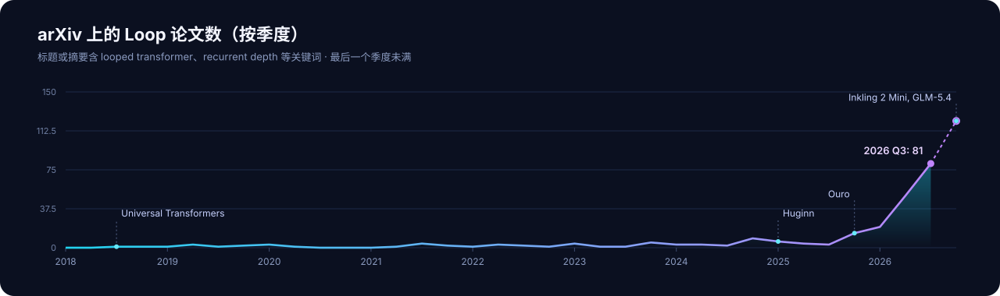

<!-- Generated by scripts/build.py from the YAML files. Do not edit by hand. -->

<p align="center"></p>

<h1 align="center">Awesome Loop</h1>

<p align="center">循环（looped / recurrent-depth）语言模型的论文、开源模型，以及结论背后的证据。每篇论文按同一套字段记录，方便跨论文比较。</p>

<p align="center">    <a href="LICENSE"></a> <a href="https://github.com/sjy1203/awesome-loop/actions/workflows/ci.yml"></a></p>

<p align="center"><b>简体中文</b> · <a href="README.md">English</a></p>

<p align="center"><a href="#论文数量趋势">论文数量</a> · <a href="#最新趋势榜">趋势榜</a> · <a href="#top-10-必读榜">必读榜</a> · <a href="#精读卡">精读卡</a> · <a href="#全部论文">全部论文</a> · <a href="#设计空间">设计空间</a> · <a href="#开放问题">开放问题</a> · <a href="#开源模型">开源模型</a></p>

## 论文数量趋势



每季度标题或摘要含 Loop 关键词的 arXiv 论文数（关键词和数据见 [data/trend.json](data/trend.json)），最后一个季度未满。关键词匹配反映领域热度，不是人工筛选后的数量。

## 最新趋势榜

| # | 论文 | 发布 | 日均 | 点赞 | Star |
|---:|---|---|---:|---:|---:|
| 1 | [Introducing Inkling 2 Mini](https://thinkingmachines.ai/news/inkling-2-mini/) · **[精读卡](docs/zh/tml-inkling-2-mini.md)**<br><sub>Thinking Machines Lab blog</sub> | 2026-11-20 | **1,477** | 7,387 | - |
| 2 | [GLM-5.4: Toward Generalized Coding with Our First Loop Transformer](https://z.ai/blog/glm-5.4) · **[精读卡](docs/zh/zai-glm-5-4.md)**<br><sub>Z.ai blog</sub> | 2026-11-23 | **584** | 1,167 | - |
| 3 | [SenseNova-Loop-9B: Deeper Computation with Fewer Parameters](https://huggingface.co/sensenova/SenseNova-Loop-9B)<br><sub>SenseNova · Hugging Face model card</sub> | 2026-11-17 | **200** | 1,290 | 308 |
| 4 | [Dory1.0-4B: A Looped Normalized-GPT](https://arxiv.org/abs/2611.03998)<br><sub>Maxim Fishman 等</sub> | 2026-11-02 | **19.7** | 453 | - |
| 5 | [Latent Feedback Is a Compute and Data Amplifier](https://arxiv.org/abs/2611.20404)<br><sub>Benhao Huang 等</sub> | 2026-11-16 | **3.7** | 7 | 26 |
| 6 | [Loopback Transformer: Towards a Unified View of Residual Looped Transformers](https://arxiv.org/abs/2611.07226)<br><sub>Xuan Ouyang 等</sub> | 2026-11-04 | **2.3** | 29 | 19 |
| 7 | [Late Entry in Looped Language Models](https://arxiv.org/abs/2611.24576)<br><sub>Ziqi Jin 等</sub> | 2026-11-18 | **1.7** | 9 | 3 |
| 8 | [Library of Layers (LoL): Adaptively Ordering Transformer Layers at Runtime](https://arxiv.org/abs/2611.03526)<br><sub>Abdellah Rahmani 等</sub> | 2026-11-02 | **1.5** | 12 | 23 |
| 9 | [ARLoop: Fully-Open Pre-trained Looped Transformers with Attention Residuals](https://arxiv.org/abs/2611.05234)<br><sub>Yuekun Yao 等</sub> | 2026-11-03 | **0.9** | 20 | - |
| 10 | [Folding Language Models into Themselves](https://arxiv.org/abs/2611.18113)<br><sub>Ziyang Zhang 等</sub> | 2026-11-13 | **0.8** | 3 | 7 |

<sub>2026-10-27 至 2026-11-25 发布的核心论文（循环 Transformer 语言模型），按发布以来日均点赞和 GitHub star 排名。点赞包括 Hugging Face 论文点赞和模型点赞，以及 Hacker News 得分。这么新的论文几乎还没有引用，所以这里只看早期关注度。</sub>

## TOP-10 必读榜

| # | 论文 | 年均引用 | 总引用 | Star | 下载（30 天） |
|---:|---|---:|---:|---:|---:|
| 1 | **Huginn**：[Scaling up Test-Time Compute with Latent Reasoning: A Recurrent Depth Approach](https://arxiv.org/abs/2502.05171) · **[精读卡](docs/zh/2502.05171.md)**<br><sub>2025-02-07 · Jonas Geiping 等</sub> | **331** | 594 | 1,000 | 22,605 |
| 2 | **Ouro (LoopLM)**：[Scaling Latent Reasoning via Looped Language Models](https://arxiv.org/abs/2510.25741) · **[精读卡](docs/zh/2510.25741.md)**<br><sub>2025-10-29 · Rui-Jie Zhu 等</sub> | **249** | 267 | - | 60,775 |
| 3 | [Reasoning with Latent Thoughts: On the Power of Looped Transformers](https://arxiv.org/abs/2502.17416)<br><sub>2025-02-24 · Nikunj Saunshi 等 · ICLR 2025</sub> | **197** | 345 | - | - |
| 4 | **MoR**：[Mixture-of-Recursions: Learning Dynamic Recursive Depths for Adaptive Token-Level Computation](https://arxiv.org/abs/2507.10524) · **[精读卡](docs/zh/2507.10524.md)**<br><sub>2025-07-14 · Sangmin Bae 等 · NeurIPS 2025</sub> | **155** | 212 | 652 | - |
| 5 | [Deep Equilibrium Models](https://arxiv.org/abs/1909.01377)<br><sub>2019-09-03 · Shaojie Bai 等 · NeurIPS 2019</sub> | **154** | 1,112 | 815 | - |
| 6 | [Universal Transformers](https://arxiv.org/abs/1807.03819)<br><sub>2018-07-10 · Mostafa Dehghani 等 · ICLR 2019</sub> | **150** | 1,257 | - | - |
| 7 | [LoopFormer: Elastic-Depth Looped Transformers for Latent Reasoning via Shortcut Modulation](https://arxiv.org/abs/2602.11451)<br><sub>2026-02-11 · Ahmadreza Jeddi 等 · ICLR 2026</sub> | **99** | 99 | 66 | 151 |
| 8 | [Parcae: Scaling Laws For Stable Looped Language Models](https://arxiv.org/abs/2604.12946) · **[精读卡](docs/zh/2604.12946.md)**<br><sub>2026-04-14 · Hayden Prairie 等</sub> | **94** | 94 | 195 | 1,861 |
| 9 | [Looped Transformers as Programmable Computers](https://arxiv.org/abs/2301.13196)<br><sub>2023-01-30 · Angeliki Giannou 等</sub> | **89** | 339 | - | - |
| 10 | [Teaching Pretrained Language Models to Think Deeper with Retrofitted Recurrence](https://arxiv.org/abs/2511.07384) · **[精读卡](docs/zh/2511.07384.md)**<br><sub>2025-11-10 · Sean McLeish 等</sub> | **76** | 79 | 73 | 4,454 |

<sub>不限年份的核心论文（循环 Transformer 语言模型），按年均引用排名：总引用数（取 Semantic Scholar 和 OpenAlex 中较高的一个）除以首个公开版本到 2026-11-25 的年数，不满一年按一年算。官方代码的 GitHub star 和开源权重近 30 天的 Hugging Face 下载量只作参考，不影响排名。</sub>

## 这份清单的特点

- 每张精读卡把循环结构存成数据，表格里的结构指纹图由它生成。
- 记录主对照对齐了什么（参数、FLOPs、KV、token、执行层数），以及基线有没有单独调参。
- 数字都从原文照抄，并注明表格或图的编号，不做换算和外推。
- 保留意见只写原文里看得到的局限：规模、上下文长度、哪些没对齐、评测怎么跑的。
- 开放问题把不同论文的正反证据放在一起。
- 所有数据都是 YAML 和 JSON，另有给 agent 读的 llms.txt。

## 精读卡

按类别分组，组内从新到旧。点名称看完整卡片。结构指纹里，灰色块只跑一遍，蓝色块是循环部分，箭头上是训练时的遍数，右侧是输入注入方式和 KV 策略。

### 结构：放哪循环、共享什么

| 论文 | 结构 | 一句话 | 对齐项 | 链接 | 影响力 |
|---|---|---|---|---|---|
| **[Inkling 2 Mini](docs/zh/tml-inkling-2-mini.md)**<br><sub>2026-11-20 · Thinking Machines Lab</sub> |  | 开源权重的 MoE（总参数 26.4B、激活 3.4B），24 层中的中间 12 层共享权重跑三遍；同时发布一个可变循环的研究版，用来测遍数对能力和 CoT 可监控性的影响。 | **F** | [论文](https://thinkingmachines.ai/news/inkling-2-mini/) · [项目页](https://thinkingmachines.ai/model-card/inkling-2-mini/) · [博客](https://huggingface.co/blog/inkling2mini) · [权重](https://huggingface.co/thinkingmachines/Inkling-2-Mini) | HN 得分 1,482 |
| **[Looped CED](docs/zh/2611.13378.md)**<br><sub>2026-11-09 · University of California, San Diego, Tsinghua University +1</sub> |  | 循环产出全局 KV 的 CED encoder 层，随机遍数训练，推理只存最后一遍的 KV。 | **N** **D** **KV** ~~F~~ ~~L~~ | [论文](https://arxiv.org/abs/2611.13378) | 引用 0 |
| **[YOCO-U](docs/zh/2604.01220.md)**<br><sub>2026-04-01 · Microsoft Research, Tsinghua University</sub> |  | 只循环 YOCO 的 self-decoder（这些层用 SWA），加深只多花计算，cross-decoder 用的全局 KV 仍只算一次。 | **N** **A** **F** ~~D~~ ~~L~~ ~~KV~~ | [论文](https://arxiv.org/abs/2604.01220) | 引用 4 · HF 点赞 18 |
| **[Huginn](docs/zh/2502.05171.md)**<br><sub>2025-02-07 · ELLIS Institute Tübingen, Max-Planck Institute for Intelligent Systems +3</sub> |  | 用随机采样的核心块迭代次数预训练 3.5B 的 prelude-core-coda Transformer，测试时多迭代核心块即可增加算力。 | **N** **D** ~~F~~ ~~L~~ | [论文](https://arxiv.org/abs/2502.05171) · [代码](https://github.com/seal-rg/recurrent-pretraining) · [权重](https://huggingface.co/tomg-group-umd/huginn-0125) | 引用 594 · star 1,000 · HF 点赞 162 · HN 得分 150 |

### 深度控制

| 论文 | 结构 | 一句话 | 对齐项 | 链接 | 影响力 |
|---|---|---|---|---|---|
| **[Ouro (LoopLM)](docs/zh/2510.25741.md)**<br><sub>2025-10-29 · ByteDance Seed, UC Santa Cruz +9</sub> |  | 在 7.7T token 上预训练共享权重、重复 4 遍的层栈，并学习退出门；作者称 1.4B 和 2.6B 模型可比肩最大 12B 参数的 dense 模型。 | ~~N~~ ~~D~~ | [论文](https://arxiv.org/abs/2510.25741) · [项目页](https://ouro-llm.github.io) · [权重](https://huggingface.co/ByteDance/Ouro-1.4B) | 引用 267 · HF 点赞 146 · HN 得分 84 |
| **[MoR](docs/zh/2507.10524.md)**<br><sub>2025-07-14 · KAIST AI, Mila +4</sub> |  | 路由器给每个 token 分配穿过共享中段的遍数，每一遍只为仍在计算的 token 存 KV；同等训练 FLOPs 下，MoR 优于固定深度的递归基线，也常优于 vanilla，且参数更少。 | **F** ~~N~~ ~~D~~ ~~L~~ ~~KV~~ | [论文](https://arxiv.org/abs/2507.10524) · [代码](https://github.com/raymin0223/mixture_of_recursions) · [权重](https://drive.google.com/drive/folders/1pYKJOu2aBGC-jgoWbfP6T_vqEYtUVxa4) | 引用 212 · star 652 · HF 点赞 74 · HN 得分 5 |

### 训练与改造

| 论文 | 结构 | 一句话 | 对齐项 | 链接 | 影响力 |
|---|---|---|---|---|---|
| **[GLM-5.4](docs/zh/zai-glm-5-4.md)**<br><sub>2026-11-23 · Z.ai</sub> |  | Z.ai 通过继续训练，把已预训练的 GLM-5 基座中的 28 层改成跑两遍的循环（750B 规模），配合逐 token 门控、共享加滑窗的 KV cache 和复用的稀疏注意力索引。 | **N** ~~F~~ | [论文](https://z.ai/blog/glm-5.4) | HN 得分 1,167 |
| **[Retrofitted Recurrence](docs/zh/2511.07384.md)**<br><sub>2025-11-10 · University of Maryland, New York University +6</sub> |  | 从预训练 1B 模型中删掉中间几层、把一段层改为循环块，得到 prelude-core-coda 循环模型，再继续训练，并按课程逐步提高平均递归次数。 | **D** ~~N~~ ~~F~~ ~~L~~ | [论文](https://arxiv.org/abs/2511.07384) · [代码](https://github.com/mcleish7/retrofitting-recurrence) · [权重](https://huggingface.co/collections/tomg-group-umd/retrofitting-recurrence) | 引用 79 · star 73 · HF 点赞 21 |

### Scaling 与预算

| 论文 | 结构 | 一句话 | 对齐项 | 链接 | 影响力 |
|---|---|---|---|---|---|
| **[SMELT](docs/zh/2609.01343.md)**<br><sub>2026-09-01 · Tsinghua University, ByteDance Seed +2</sub> |  | 每 token FLOPs、总参数和 KV 都对齐时，把 MoE Transformer 中间一半的层循环两遍，在最大 54B 非 embedding 参数的四个规模上都降低了 loss，并在拟合前沿上省下 6.8-18.0% 的训练 FLOPs。 | **F** **N** **KV** **D** ~~A~~ ~~L~~ | [论文](https://arxiv.org/abs/2609.01343) | 引用 34 · HF 点赞 92 |
| **[Parcae](docs/zh/2604.12946.md)**<br><sub>2026-04-14 · University of California, San Diego, Together AI</sub> |  | 把循环的注入约束成稳定的负对角形式，按序列采样遍数训练，并在固定参数量下拟合循环的训练和推理 scaling law。 | **N** **D** ~~F~~ ~~L~~ | [论文](https://arxiv.org/abs/2604.12946) · [代码](https://github.com/sandyresearch/parcae) · [项目页](https://sandyresearch.github.io/parcae/) · [权重](https://huggingface.co/SandyResearch/parcae-140m) | 引用 94 · star 195 · HF 点赞 11 |

### 系统与推理

| 论文 | 结构 | 一句话 | 对齐项 | 链接 | 影响力 |
|---|---|---|---|---|---|
| **[LoopDuet](docs/zh/2611.07211.md)**<br><sub>2026-11-04 · Duke University</sub> |  | 服务循环 Transformer 时，普通 prompt token 少跑几遍，最后一个 prompt token 和 decode token 跑满；在 vLLM 里把需要继续循环的位置收成紧凑 batch，排队变长时再降低 prefill 深度。 | **N** **D** **KV** ~~L~~ ~~W~~ | [论文](https://arxiv.org/abs/2611.07211) | 引用 0 |
| **[PLT](docs/zh/2510.24824.md)**<br><sub>2025-10-28 · ByteDance Seed</sub> |  | 让 token i 的第 l 遍和 token i-1 的第 l+1 遍在同一次前向里执行，后续遍复用首遍 KV 并加门控 SWA，循环模型的解码延迟和 KV 接近不循环模型。 | **N** **A** **D** ~~F~~ ~~L~~ ~~KV~~ | [论文](https://arxiv.org/abs/2510.24824) | 引用 37 · HF 点赞 18 · HN 得分 3 |

对齐项：**N** 唯一参数 · **A** 激活参数 · **F** 训练 FLOPs · **KV** 每 token KV · **D** 训练 token · **L** 每 token 执行层数 · **W** 墙钟时间。~~删除线~~ 表示循环模型和基线在这一项上不同。

## 全部论文

收录的全部核心论文（含精读卡），按类别分组，组内从新到旧，点击类别名展开。另有 165 篇相关论文（语言模型以外的循环、HRM 和 TRM 这类谜题推理模型、早期的前身工作和相关方向）单独列在 [docs/zh/related.md](docs/zh/related.md)。每天从 arXiv 检索到的候选先放进 [data/candidates.json](data/candidates.json)，确认属于循环模型后再收录。

<details><summary><b>理论与能力 (36)</b></summary>

| 日期 | 论文 | 一句话 | 链接 | 影响力 |
|---|---|---|---|---|
| 2026-11-01 | [How Does Chain-of-Thought Supervision Teach Models to Reason? A Theoretical Analysis](https://arxiv.org/abs/2611.01740)<br><sub>Kaito Takanami 等</sub> | 研究一个在梯度下降轨迹上训练、测试时递归应用并超出训练步数的线性回归上下文权重预测模型；长程推理的成败随上下文长度和训练 CoT 总量出现相变，过度思考分为误差累积和误差放大两种机制。 | [论文](https://arxiv.org/abs/2611.01740) | 引用 0 |
| 2026-10-19 | [Internalizing Chain-of-thought into Looped Transformers](https://arxiv.org/abs/2610.25998)<br><sub>Kehang Zhou 等</sub> | 构造常数位宽的循环 Transformer：每生成一个 token 就把同一个共享解码器块应用 L 次，并读取每次迭代各自的 KV cache；在模拟时间 t(n)、空间 s(n) 的图灵机时，与不循环的队列机模拟相比，它们把上下文窗口和 CoT token 数都缩小 L 倍。 | [论文](https://arxiv.org/abs/2610.25998) | 引用 0 |
| 2026-10-10 | [Learning to Extrapolate in Depth with Looped Transformers](https://arxiv.org/abs/2610.14456)<br><sub>Huitao Yang 等</sub> | 针对全点对图连通性任务上的循环 Transformer，证明在深度 K 上训练会收敛到只由一个有效参数控制的更新规则，从而形成端点明确的有限外推窗口；仅依据训练分布选定的测试深度即可保证在难得多的图上恢复连通性。 | [论文](https://arxiv.org/abs/2610.14456) | 引用 0 |
| 2026-10-07 | [Executing Causal Structure Learning with Linear-Attention Transformers](https://arxiv.org/abs/2610.10395)<br><sub>Amartya Roy 等</sub> | 构造一个固定权重的线性注意力 Transformer 块，其一次前向传播精确执行带无环约束的连续因果发现方法的一步更新，重复该块即可复现其优化轨迹；在更新之间保留乘子是精确执行的必要条件，而经过训练的普通注意力模型无法可靠地执行该更新。 | [论文](https://arxiv.org/abs/2610.10395) · [代码](https://github.com/Amartya-Roy/Amartya-Roy-Executing-Causal-Structure-Learning-with-Linear-Attention-Transformers) | 引用 0 · star 0 |
| 2026-10-01 | [Universal interpolation for deep residual self-attention networks](https://arxiv.org/abs/2610.01981)<br><sub>Sibylle Marcotte 等</sub> | 证明强参数复用下深层残差 softmax 自注意力的通用插值性：两个投影矩阵为高斯初始化的冻结单头注意力块，只需按任务设定其应用顺序、符号和持续时长，就能把任意 N 条含 n 个 token 的序列映射为任意另外 N 条序列，在连续深度和有限深度下均成立。 | [论文](https://arxiv.org/abs/2610.01981) · [代码](https://github.com/sibyllema/attention_universality) | 引用 0 · star 0 |
| 2026-09-22 | [Statistical Gains from Looped Estimation under Parameter Budgets](https://arxiv.org/abs/2609.25778)<br><sub>Xinyu Tian 等</sub> | 循环同一个共享块使残差前馈网络和 post-LN Transformer 只用固定数量的有界参数，就能对 Hölder 光滑目标达到极小极大多项式速率（至多相差对数因子）；而在足够大的固定预算下，最优的不共享参数网络族的最坏情况风险始终有正的下界。 | [论文](https://arxiv.org/abs/2609.25778) | 引用 0 |
| 2026-08-31 | [Universal Transformers for Circuit Computations: Perfect Length Generalization in Tiny Transformers](https://arxiv.org/abs/2608.31067)<br><sub>Takuya Ito 等</sub> | 一个可证明正确的 Universal Transformer（Boolean 代数任务只有 280 个可学习参数）借助追踪电路深度的位置编码，每次迭代把电路深度削减一层，对深度为 d 的输入在 d 次迭代后停止；只在深度 1 和深度 2 上训练，它就在更深的 Boolean、模运算和 ListOps 问题上达到 100% 准确率。 | [论文](https://arxiv.org/abs/2608.31067) | 引用 1 |
| 2026-05-30 | [Looped Transformers with Layer Normalization Provably Learn the Power Method](https://arxiv.org/abs/2606.00605)<br><sub>Lyumin Wu 等</sub> | 证明带 layer normalization（LN）的循环线性 Transformer 只以主成分预测为目标、用梯度下降训练时，会收敛到幂迭代法（power method），每个 self-attention 层执行一次幂迭代；不带 LN 的 Transformer 即使有逐层指导也无法精确学到该方法。 | [论文](https://arxiv.org/abs/2606.00605) | 引用 5 · HF 点赞 0 |
| 2026-05-29 | [Chain-of-Thought and Compressed Looped Transformers: A Memory-Budget Separation](https://arxiv.org/abs/2605.30757)<br><sub>Haozhou Zhang</sub> | 证明循环状态只有少量隐变量槽位的循环 Transformer 无论运行多少步都仍是小空间推理器，因此在标准复杂度假设下无法判定多项式长度 CoT 能判定的 P 完全问题；在每个输入位置都保存状态的循环不受此限制。 | [论文](https://arxiv.org/abs/2605.30757) | 引用 4 |
| 2026-05-28 | [Revisiting Padded Transformer Expressivity: Which Architectural Choices Matter and Which Don't](https://arxiv.org/abs/2605.30523)<br><sub>Anej Svete 等</sub> | 论文证明 padded Transformer 的表达能力对注意力类型、宽度和一致性假设都很稳健，主要取决于数值精度和深度；循环带来类似电路的顺序处理，log^d N 次循环的常数精度 Transformer 达到 FO-uniform AC^d，增长精度的则达到 FO-uniform TC^d。 | [论文](https://arxiv.org/abs/2605.30523) | 引用 3 |
| 2026-05-11 | [Minimum Neural Weight Norm = Kolmogorov Complexity](https://arxiv.org/abs/2605.10878)<br><sub>Tiberiu Musat</sub> | 证明在常数精度权重的循环神经网络中（定理以循环 Transformer 块表述），计算某函数的网络的最小权重范数渐近等价于该函数的 Kolmogorov 复杂度除以其对数，从而把范数最小化与算法简单性联系起来。 | [论文](https://arxiv.org/abs/2605.10878) | 引用 2 |
| 2026-05-07 | [Transformers Efficiently Perform In-Context Logistic Regression via Normalized Gradient Descent](https://arxiv.org/abs/2605.06609)<br><sub>Chenyang Zhang 等</sub> | 构造出每层执行一步归一化梯度下降、用于 in-context 逻辑回归的 softmax Transformer，并证明用一步梯度下降监督训练单个自注意力层再循环应用即可得到这种模型，同时给出收敛和分布外泛化保证。 | [论文](https://arxiv.org/abs/2605.06609) | 引用 4 · HF 点赞 0 |
| 2026-04-16 | [Stability and Generalization in Looped Transformers](https://arxiv.org/abs/2604.15259)<br><sub>Asher Labovich · NeurIPS 2026</sub> | 对循环 Transformer 的不动点分析证明，没有 recall 的模型无法获得强输入依赖，而 recall 加外层归一化能得到稳定且依赖输入的不动点；在国际象棋、数独和前缀和任务上训练的小模型符合这些预测。 | [论文](https://arxiv.org/abs/2604.15259) | 引用 18 |
| 2026-04-09 | [Loom: A Scalable Analytical Neural Computer Architecture](https://arxiv.org/abs/2604.08816)<br><sub>Mehmet Kerem Turkcan</sub> | Loom 在权重经解析推导的循环 Transformer 中运行由 C 编译的程序：每次通过 8 层执行 22 个操作码指令集中的一条指令，反复迭代直到程序计数器归零；默认配置 d = 155、n = 1024 有 4.7M 参数和 928 个指令槽。 | [论文](https://arxiv.org/abs/2604.08816) · [代码](https://github.com/mkturkcan/Loom) | 引用 2 · star 7 · HF 点赞 0 |
| 2026-01-31 | [Beyond What Seems Necessary: Hidden Gains from Scaling Training-Time Reasoning Length under Outcome Supervision](https://arxiv.org/abs/2602.00927)<br><sub>Yihao Xue 等</sub> | 从理论和实验两方面表明，在仅有结果监督时，随着训练时推理长度（循环 Transformer 的循环次数、RL 的 token 预算）增加，OOD 性能在 ID 性能饱和后仍持续提升；在一个合成归纳任务上，ID 准确率在约 2 次循环时饱和，而 OOD 准确率继续上升。 | [论文](https://arxiv.org/abs/2602.00927) | 引用 2 |
| 2026-01-05 | [Context-Free Recognition with Transformers](https://arxiv.org/abs/2601.01754)<br><sub>Selim Jerad 等</sub> | 证明带 O(log(N)) 个循环层和 O(N^6) 个 padding 符号的循环 Transformer 能识别所有上下文无关语言（CFL），无歧义 CFL 只需 O(N^3) padding；实验中，循环且加 padding 的 Transformer 识别 CFL 的效果优于固定深度 Transformer。 | [论文](https://arxiv.org/abs/2601.01754) | 引用 6 |
| 2026-01-01 | [Context Collapse: In-Context Learning and Model Collapse](https://arxiv.org/abs/2601.00923)<br><sub>Josef Ott</sub> | 论文研究各层共享同一权重矩阵的线性 Transformer 做上下文线性回归，把其前向计算化归为预条件梯度下降，证明上下文长度超过临界值后最优解会出现斜对称分量；论文还研究了模型坍缩。 | [论文](https://arxiv.org/abs/2601.00923) | 引用 1 |
| 2025-10-15 | [On the Reasoning Abilities of Masked Diffusion Language Models](https://arxiv.org/abs/2510.13117)<br><sub>Anej Svete 等</sub> | 证明在有限精度、对数宽度设定下，掩码扩散语言模型（MDM）与重复中间层块的多项式填充循环 Transformer 等价；MDM 还能解决 CoT Transformer 可解的所有问题，并在包括正则语言在内的某些问题类上效率更高。 | [论文](https://arxiv.org/abs/2510.13117) | 引用 11 |
| 2025-09-25 | [A Formal Comparison Between Chain of Thought and Latent Thought](https://arxiv.org/abs/2509.25239)<br><sub>Kevin Xu 等 · ICML 2026</sub> | 形式化比较循环 Transformer 中的 latent thought 与思维链：latent thought 比本质上串行的 CoT 更能高效并行计算，而 CoT 借助随机解码可以做近似计数和采样，由此指出哪些任务更适合深度递归。 | [论文](https://arxiv.org/abs/2509.25239) · [代码](https://github.com/kevin671/cot-vs-loop) | 引用 19 · star 10 · HF 点赞 0 |
| 2025-05-25 | [Exact Expressive Power of Transformers with Padding](https://arxiv.org/abs/2505.18948)<br><sub>William Merrill 等 · NeurIPS 2025</sub> | 证明带多项式 padding 的 averaging-hard-attention Transformer 恰好识别 FO-uniform TC^0，把中间层块循环 O(log^d n) 次后恰好识别 FO-uniform TC^d，因此多对数次循环加多项式 padding 可达到 FO-uniform NC。 | [论文](https://arxiv.org/abs/2505.18948) | 引用 24 |
| 2025-03-05 | [A Little Depth Goes a Long Way: The Expressive Power of Log-Depth Transformers](https://arxiv.org/abs/2503.03961)<br><sub>William Merrill 等 · NeurIPS 2025</sub> | 证明中间层重复 Θ(log n) 次的循环 transformer 能识别正则语言并求解图连通性，而在标准复杂性猜想下固定深度 transformer 做不到；增加深度比增加宽度或 chain-of-thought 步数更高效。 | [论文](https://arxiv.org/abs/2503.03961) | 引用 76 |
| 2025-02-28 | [Transformers Learn to Implement Multi-step Gradient Descent with Chain of Thought](https://arxiv.org/abs/2502.21212)<br><sub>Jianhao Huang 等 · ICLR 2025</sub> | 证明借助 CoT，单层线性 Transformer 能在上下文中学会多步梯度下降，不用 CoT 时只能执行一步；用同样的技术还证明，在上下文线性回归中，当 L≥2 时循环 Transformer 的渐近损失严格低于不循环的单层 Transformer。 | [论文](https://arxiv.org/abs/2502.21212) | 引用 40 · HF 点赞 0 · HN 得分 1 |
| 2025-02-24 | [Reasoning with Latent Thoughts: On the Power of Looped Transformers](https://arxiv.org/abs/2502.17416)<br><sub>Nikunj Saunshi 等 · ICLR 2025</sub> | 表明 k 层 Transformer 循环 L 次在合成推理任务上接近 kL 层模型，在语言模型的下游推理任务上也能与之竞争，并证明 T 次循环可以模拟 T 步 CoT。 | [论文](https://arxiv.org/abs/2502.17416) | 引用 345 · HF 点赞 0 |
| 2025-01-18 | [Neural Algorithmic Reasoning for Hypergraphs with Looped Transformers](https://arxiv.org/abs/2501.10688)<br><sub>Zekai Huang 等</sub> | 通过构造证明，循环 Transformer 只需常数层数和常数特征维度即可模拟超图算法：借助把关联矩阵退化为邻接矩阵的机制模拟 Dijkstra、BFS 和 DFS，借助感知超边的编码方案模拟 Helly 算法。 | [论文](https://arxiv.org/abs/2501.10688) | 引用 18 · HF 点赞 0 |
| 2024-10-29 | [On the Role of Depth and Looping for In-Context Learning with Task Diversity](https://arxiv.org/abs/2410.21698)<br><sub>Khashayar Gatmiry 等</sub> | 针对条件数位于 [1, κ] 的 in-context 线性回归，证明需要 log(κ)（或 √κ）层线性注意力的下界；多层 Transformer 能达到该下界，但连小至 O(e^{-L}) 的分布偏移都不鲁棒；循环 Transformer 表达能力相当、可证明鲁棒，且只有它的损失随深度单调变化。 | [论文](https://arxiv.org/abs/2410.21698) | 引用 13 |
| 2024-10-23 | [ALTA: Compiler-Based Analysis of Transformers](https://arxiv.org/abs/2410.18077)<br><sub>Peter Shaw 等 · TMLR 2025</sub> | ALTA 把带循环的程序编译成各层共享全部注意力和 MLP 权重的 Transformer，包括带动态停止的 Universal Transformer；它构造出与长度无关的奇偶校验和加法算法以及 SCAN 的解法，并用执行轨迹监督研究端到端训练为何学不到这些算法。 | [论文](https://arxiv.org/abs/2410.18077) · [代码](https://github.com/google-deepmind/alta) | 引用 10 · star 36 · HF 点赞 0 · HN 得分 2 |
| 2024-10-15 | [Bypassing the Exponential Dependency: Looped Transformers Efficiently Learn In-context by Multi-step Gradient Descent](https://arxiv.org/abs/2410.11268)<br><sub>Bo Chen 等 · AISTATS 2025</sub> | 证明线性循环 Transformer 在线性向量生成任务的 in-context learning 中能高效实现多步梯度下降：只要输入数据的条件数为常数（例如 n = O(d)），就能达到较小误差，不再需要以往结果对 T 次循环所要求的 n = exp(Ω(T)) 个上下文示例。 | [论文](https://arxiv.org/abs/2410.11268) | 引用 31 · HF 点赞 0 |
| 2024-10-10 | [Can Looped Transformers Learn to Implement Multi-step Gradient Descent for In-context Learning?](https://arxiv.org/abs/2410.08292)<br><sub>Khashayar Gatmiry 等</sub> | 证明在 in-context 线性回归中，线性循环 Transformer 总体训练损失的全局最小点实现了多步预条件梯度下降，且尽管损失非凸，梯度流仍能快速收敛；合成实验与理论一致。 | [论文](https://arxiv.org/abs/2410.08292) | 引用 83 |
| 2024-10-02 | [On Expressive Power of Looped Transformers: Theoretical Analysis and Enhancement via Timestep Encoding](https://arxiv.org/abs/2410.01405)<br><sub>Kevin Xu 等 · ICML 2025</sub> | 推导循环 Transformer 的逼近速率，揭示循环结构特有的局限，并据此加入以时间步编码为条件的每遍缩放参数；实验中循环次数越多效果越好，时间步编码带来进一步提升。 | [论文](https://arxiv.org/abs/2410.01405) | 引用 44 · HF 点赞 0 |
| 2024-09-24 | [Looped Transformers for Length Generalization](https://arxiv.org/abs/2409.15647)<br><sub>Ying Fan 等 · ICLR 2025</sub> | 在有已知迭代 RASP-L 解法的任务上训练循环 decoder-only Transformer，只在与输入相关的步数之后监督最终答案；测试时按输入调整循环步数可以改善长度泛化。 | [论文](https://arxiv.org/abs/2409.15647) · [代码](https://github.com/UW-Madison-Lee-Lab/looped-tf) | 引用 123 · star 15 · HF 点赞 0 |
| 2024-09-03 | [On the Design Space Between Transformers and Recursive Neural Nets](https://arxiv.org/abs/2409.01531)<br><sub>Jishnu Ray Chowdhury 等</sub> | 把 Neural Data Router（一种跨层共享参数的 Universal Transformer 变体）和 Continuous Recursive Neural Network 都形式化为同一个共享函数的反复应用，说明这两个算法泛化能力很强的模型是连接 Transformer 与递归神经网络的桥梁模型，并讨论了它们的局限。 | [论文](https://arxiv.org/abs/2409.01531) | 引用 1 |
| 2024-02-21 | [AlgoFormer: An Efficient Transformer Framework with Algorithmic Structures](https://arxiv.org/abs/2402.13572)<br><sub>Yihang Gao 等 · TMLR 2025</sub> | AlgoFormer 在前置 Transformer 与后置 Transformer 之间放一个权重共享的循环 Transformer，对应先预处理、再迭代、后处理的算法结构；构造性结果表明它能执行梯度下降和牛顿法，在 IWSLT 2015 德英翻译上 BLEU 为 14.72，标准 Transformer 为 9.30，普通循环 Transformer 为 10.56。 | [论文](https://arxiv.org/abs/2402.13572) | 引用 14 · HF 点赞 0 |
| 2024-02-02 | [Simulation of Graph Algorithms with Looped Transformers](https://arxiv.org/abs/2402.01107)<br><sub>Artur Back de Luca 等</sub> | 通过构造证明，带额外读图注意力头的循环 Transformer 能以与图大小无关的参数量模拟 BFS、DFS、Dijkstra 和 Kosaraju 算法，但受有限精度限制，并且在常数宽度下图灵完备。 | [论文](https://arxiv.org/abs/2402.01107) | 引用 40 · HF 点赞 1 |
| 2023-11-21 | [Looped Transformers are Better at Learning Learning Algorithms](https://arxiv.org/abs/2311.12424)<br><sub>Liu Yang 等 · ICLR 2024</sub> | 训练带输入注入的循环 Transformer，在上下文中求解线性回归等数据拟合问题；其表现与标准 Transformer 相当，参数量不到后者的 10%。 | [论文](https://arxiv.org/abs/2311.12424) · [代码](https://github.com/leiay/looped_transformer) | 引用 210 · star 74 · HF 点赞 1 |
| 2023-01-30 | [Looped Transformers as Programmable Computers](https://arxiv.org/abs/2301.13196)<br><sub>Angeliki Giannou 等</sub> | 证明一个权重经过编程设定的循环 13 层 transformer 能从输入中读取指令和内存，模拟一台小型指令集计算机，并运行计算器、线性代数例程和 in-context learning 算法。 | [论文](https://arxiv.org/abs/2301.13196) | 引用 339 · HF 点赞 1 · HN 得分 4 |
| 2018-12-05 | [Attending to Mathematical Language with Transformers](https://arxiv.org/abs/1812.02825)<br><sub>Artit Wangperawong</sub> | 在带符号变量的字符级数学表达式求值任务上，标准 Transformer、带循环的 Universal Transformer 和带循环与自适应计算时间的自适应 Universal Transformer 的测试准确率最高分别达到 76.1%、78.8% 和 84.9%。 | [论文](https://arxiv.org/abs/1812.02825) · [代码](https://github.com/artitw/tensor2tensor) | 引用 29 · star 2 |

</details>

<details><summary><b>结构：放哪循环、共享什么 (51)</b></summary>

| 日期 | 论文 | 一句话 | 链接 | 影响力 |
|---|---|---|---|---|
| 2026-11-20 | [Introducing Inkling 2 Mini](https://thinkingmachines.ai/news/inkling-2-mini/) · **[精读卡](docs/zh/tml-inkling-2-mini.md)**<br><sub>Thinking Machines Lab blog</sub> | 开源权重的 MoE（总参数 26.4B、激活 3.4B），24 层中的中间 12 层共享权重跑三遍；同时发布一个可变循环的研究版，用来测遍数对能力和 CoT 可监控性的影响。 | [论文](https://thinkingmachines.ai/news/inkling-2-mini/) · [项目页](https://thinkingmachines.ai/model-card/inkling-2-mini/) · [博客](https://huggingface.co/blog/inkling2mini) · [权重](https://huggingface.co/thinkingmachines/Inkling-2-Mini) | HN 得分 1,482 |
| 2026-11-20 | [Model Carving: Training Transformers That Optimize Their Own Topology](https://arxiv.org/abs/2611.27962)<br><sub>Kaden Zheng 等</sub> | 在标准与循环 Transformer 的每个子层上加可学习的标量门控，让训练自行删去不需要的子层；裁出的模型验证损失低于用多至 1.7 倍算力训练的稠密模型。 | [论文](https://arxiv.org/abs/2611.27962) | 引用 0 |
| 2026-11-09 | **Looped CED**：[Looping Deeper Without Growing the KV Cache: Recurrent Depth for Causal Encoder-Decoders](https://arxiv.org/abs/2611.13378) · **[精读卡](docs/zh/2611.13378.md)**<br><sub>Jiaqi Leng 等</sub> | 循环产出全局 KV 的 CED encoder 层，随机遍数训练，推理只存最后一遍的 KV。 | [论文](https://arxiv.org/abs/2611.13378) | 引用 0 |
| 2026-11-04 | [LooM: Loop-Invariant Memory for Causal Encoder-Decoder Language Models](https://arxiv.org/abs/2611.06835)<br><sub>Lele Yang 等</sub> | 在因果 encoder-decoder 中循环 decoder 层，每个 token 的 KV 只在首次经过时写入；一个模型覆盖每 token 3 到 21 次层执行，循环足够多时优于单遍基线。 | [论文](https://arxiv.org/abs/2611.06835) | 引用 0 |
| 2026-11-02 | [Library of Layers (LoL): Adaptively Ordering Transformer Layers at Runtime](https://arxiv.org/abs/2611.03526)<br><sub>Abdellah Rahmani 等</sub> | Library of Layers 用路由器在推理时从全局块库中选择并排列要执行的 Transformer 块，涵盖 dense、深度循环和 MoE 架构；在文本上预训练时与这三类基线表现相当。 | [论文](https://arxiv.org/abs/2611.03526) · [代码](https://github.com/arahmani1/library-of-layers) | 引用 0 · star 23 · HF 点赞 12 |
| 2026-10-20 | [Asymmetric Looped Transformers: Fixed Global Representations for an Iterative Decoder](https://arxiv.org/abs/2610.28489)<br><sub>Cheng Liang 等</sub> | AsymLoop 让因果编码器只运行一次，生成各层在迭代间保持不变的 Global KV，权重共享的解码器循环执行，并在同一个 softmax 中同时关注 Global KV 和由当前状态生成的 Local KV；在 1B 规模上，七个常识推理基准的平均 zero-shot 准确率从 Full Loop 的 49.58% 提高到 50.85%。 | [论文](https://arxiv.org/abs/2610.28489) | 引用 4 |
| 2026-10-20 | [Meta Expert: Cross-Layer Expert Sharing for Storage- and Retrieval-Efficient MoE](https://arxiv.org/abs/2610.27598)<br><sub>Ermo Hua 等</sub> | Meta Expert 是被所有层共享、而非某一层私有的 MoE 专家；它降低了交叉熵损失、提高了下游准确率，在激活专家数和专家粒度不变时，只用 70-80% 的专家就达到 Vanilla MoE 的性能。 | [论文](https://arxiv.org/abs/2610.27598) | 引用 0 · HF 点赞 28 |
| 2026-10-18 | [Block Recursive Transformers for Structured Parameter Sharing](https://arxiv.org/abs/2610.24998)<br><sub>Josep Marques 等 · EMNLP 2026 Findings</sub> | Block Recursive Transformers 把首尾独立层之间的共享核心划分为若干连续块，每个块重复执行后再进入下一个块；在最大 1.7B 参数的 decoder-only 模型上，这种方式的验证 NLL 和下游准确率都优于静态递归共享基线。 | [论文](https://arxiv.org/abs/2610.24998) | 引用 1 |
| 2026-10-16 | [Towards Looped Models Done Right, Part I: Topology, Input Injection, Recurrent-State Design](https://arxiv.org/abs/2610.23036)<br><sub>Benhao Huang 等</sub> | 在从头训练、参数规模、逻辑深度和 token 预算都匹配的循环语言模型中分别考察循环位置、输入注入和递归状态设计；在 730M 参数、336B token 规模下，完整的 Huginn 式 prelude-recurrent-coda 设计在全部十个基准上优于 Ouro，且这一优势可迁移到 MoE 模型。 | [论文](https://arxiv.org/abs/2610.23036) · [代码](https://github.com/ifm-ai/xllm-loop) | 引用 12 · star 68 · HF 点赞 17 |
| 2026-10-14 | [LatentLoop: Scaling Looped MoE Models with Asymmetric Compute Allocation](https://arxiv.org/abs/2610.19975)<br><sub>Zefeng He 等</sub> | 在中间块访问两次的循环 MoE 中，LatentLoop 让第一次访问只处理压缩后的序列，跨访问只共享 MoE 权重，并用省下的计算加宽模型；它在 1.3B–7B 规模上都降低了验证 NLL，预测比 vanilla MoE 和循环基线分别节省 19.0% 和 7.9% 的计算。 | [论文](https://arxiv.org/abs/2610.19975) · [权重](https://huggingface.co/yhx12/LatentLoop) | 引用 1 · HF 点赞 44 |
| 2026-10-12 | [DeepThink: A Conceptual Model for Knowledge-Addressable Recurrent Language Modeling](https://arxiv.org/abs/2610.16171)<br><sub>Weiguo Chen</sub> | DeepThink 是一个面向循环语言模型的概念框架（没有实验）：每一步由 Knowledge Activator 从 Knowledge Bank 中选出知识单元，组装成 Shared Thinking Operator 来更新状态；对兼容的模板，已有的固定深度模型可以在固定调度下被精确实现。 | [论文](https://arxiv.org/abs/2610.16171) | 引用 0 |
| 2026-09-29 | [LoopVL: Recurrent Visual Intelligence](https://arxiv.org/abs/2609.38426)<br><sub>Zhe Qian 等</sub> | LoopVL-1B 让统一的视觉-语言状态按 [L×3→H]×2 的顺序反复经过两个共享的 16 层 Transformer 栈，每次前向共 128 次层调用；它用 0.14T token 从头训练，在多模态理解和视觉推理基准上超过一系列规模相近或更大的非循环模型。 | [论文](https://arxiv.org/abs/2609.38426) · [代码](https://github.com/Tier-Flow/LoopVL) · [权重](https://huggingface.co/TierFlow/LoopVL) | 引用 5 · star 252 · HF 点赞 40 |
| 2026-09-28 | [How to Loop MoE: Flatten the Experts, Untie the Attention](https://arxiv.org/abs/2609.35751)<br><sub>Shouren Wang 等</sub> | Foil 循环一个 MoE 核心块，专家和路由器在各遍之间共享、每遍有独立的注意力，并在专家参数和计算量固定时把它展平为层数更少、每层更宽、遍数更多的结构；在 100B token 时，展平程度最高的 Foil 比未展平的循环基线低 0.012 nat。 | [论文](https://arxiv.org/abs/2609.35751) · [代码](https://github.com/SR-A-W/how-to-loop-moe) · [权重](https://huggingface.co/ShourenWSR/how-to-loop-moe) | 引用 2 · star 6 · HF 点赞 11 |
| 2026-09-16 | [MoRE: Mixture of Reused Experts](https://arxiv.org/abs/2609.18176)<br><sub>Eric S. Qiu 等 · COLM 2026</sub> | MoRE 让相邻层组共享 MoE 专家池，每层保留自己的 router，并在路由前加入可学习的深度嵌入；在 114M-1.15B 参数规模上，它在计算量和参数量相同的条件下，比标准 MoE 和最先进的权重共享架构困惑度更低、下游表现更强。 | [论文](https://arxiv.org/abs/2609.18176) · [代码](https://github.com/EricQiu6/MoRE) | 引用 4 · star 1 |
| 2026-09-01 | [Latent Recurrent Thoughts: Recurrent Refinement of Proposed Latents for Reasoning with Frozen LLMs](https://arxiv.org/abs/2609.01117)<br><sub>Zhaoliang Chen 等</sub> | LRT 冻结 Qwen3-8B 解码器，由任务专用的提议网络生成初始潜变量，再由一个很小的 TRM 式循环推理器多步细化后输入解码器；它优于已有的冻结解码器连续空间推理方法，并以非思考模式 CoT 提示一小部分的推理算力超过后者。 | [论文](https://arxiv.org/abs/2609.01117) · [代码](https://github.com/czl-david/latent-recurrent-thoughts) | 引用 0 · star 4 |
| 2026-08-22 | [TANGO: Treating Tokens as Operators](https://arxiv.org/abs/2608.22117)<br><sub>Joshua Nunley</sub> | TANGO 把循环模型共享块中的注意力和 FFN 合并为一个算子：注意力对各源 token 的门控取平均，再用来缩放目标位置的特征；在参数量和训练数据相同时，它在全部 16 个设置中平均测试 NLL 最低，深度从 4 增至 8 再到 16 时其开发集损失从未上升。 | [论文](https://arxiv.org/abs/2608.22117) | 引用 0 |
| 2026-08-18 | [Allocating Recurrent Compute in Looped Language Models](https://arxiv.org/abs/2608.18230)<br><sub>Ruhai Lin 等</sub> | MixerLoop 在每层中重复执行 Gated DeltaNet mixer，而 dense FFN 只执行一次；它在 15M 规模的总体 CORE 上超过整块循环，在 110M 规模保留整块循环 41.5% 的 CORE 提升，同时把循环主干的投影 FLOPs 减少 45.9%。 | [论文](https://arxiv.org/abs/2608.18230) · [代码](https://github.com/ruhai-lin/MixerLoop) | 引用 5 · star 1 |
| 2026-08-14 | [Intern-S2-Mobius: Foundation Model with Decoupled Knowledge and Reasoning](https://arxiv.org/abs/2608.14290)<br><sub>Kai Chen 等</sub> | Mobius-v0 让所有层共享一个全局 FFN 记忆，多个 self-attention 推理器通过隐状态反复查询它；从头训练的 7B 模型只用 7B Transformer 基线 62.6% 的训练数据就达到相近的下游得分，从 Qwen3.5-35B 继续预训练的 Intern-S2-Mobius 下游得分相近，端到端推理加速接近 4x。 | [论文](https://arxiv.org/abs/2608.14290) · [权重](https://huggingface.co/internlm/Intern-S2-Mobius) | 引用 1 · HF 点赞 36 · HN 得分 2 |
| 2026-07-28 | [Penelope: Localized Latent Recurrence for Efficient Structured Reasoning](https://arxiv.org/abs/2607.25915)<br><sub>Yutong Chen 等</sub> | Penelope 让预训练的 decoder-only Transformer 下层只运行一次，之后只在固定大小的记忆状态上循环一个靠后的区间（Llama-3.2-1B 的 [11,16) 层）；经 CoT 到潜在推理的渐进课程训练后，其准确率与已有潜在推理模型相当，实测延迟更低。 | [论文](https://arxiv.org/abs/2607.25915) | 引用 0 · HF 点赞 0 |
| 2026-07-20 | [Mobius Learning: Cyclic Depth Folding in Transformers](https://arxiv.org/abs/2607.17843)<br><sub>Tongtian Zhu</sub> | Mobius Learning 让不同 worker 的数据以循环移位的块顺序依次经过循环 Transformer 的各个块组，使每个块组同时在浅层和深层角色上得到训练；在用 2.5B FineWeb token 训练的 124M modded GPT-2 上，它在 6、10 和 15 遍时的验证损失低于固定顺序的循环 Transformer。 | [论文](https://arxiv.org/abs/2607.17843) | 引用 0 |
| 2026-07-16 | [T^2MLR: Transformer with Temporal Middle-Layer Recurrence](https://arxiv.org/abs/2607.15178)<br><sub>Ziyang Cai 等</sub> | T2MLR 把上一个 token 缓存的中间层表示融合进当前 token 的较早层；它优于数据和参数匹配的 Transformer 基线，而且只在中间一段层上做循环往往优于全层循环。 | [论文](https://arxiv.org/abs/2607.15178) | 引用 19 · HF 点赞 0 |
| 2026-06-15 | [Tying the Loop -- Tied Expert Layers in Mixture-of-Experts Language Models](https://arxiv.org/abs/2606.16825)<br><sub>Martin Jaggi</sub> | Expert Tying 让连续若干层共享 MoE 专家权重，同时保留逐层独立的路由和注意力；在 OLMoE、Qwen3 和 DeepSeek 式 MoE 上，它把内存占用降低近 2x，按每四层一组共享时总参数最多减少 52%，质量损失可忽略。 | [论文](https://arxiv.org/abs/2606.16825) · [代码](https://github.com/epfml/looped-moe) | 引用 5 · star 15 · HF 点赞 0 |
| 2026-06-03 | [LoopMoE: Unifying Iterative Computation with Mixture-of-Experts for Language Modeling](https://arxiv.org/abs/2606.04438)<br><sub>Wenkai Chen 等 · EMNLP 2026</sub> | LoopMoE 循环复用一个 MoE 块，并用同时以迭代序号和每个 token 隐状态为条件的归一化（IterAdaLN）区分各次迭代；与总参数和每 token FLOPs 相同的 vanilla MoE 相比，平均提升从 3B 规模的 1 分以上增至 9B 规模的约 3 分。 | [论文](https://arxiv.org/abs/2606.04438) | 引用 18 · HF 点赞 2 |
| 2026-05-31 | [CART: Context-Anchored Recurrent Transformer -- A Parameter-Efficient Architecture with Learned Stability](https://arxiv.org/abs/2606.01495)<br><sub>Chad A. Capps</sub> | CART 让一个共享核心块循环 R 次，核心块只交叉注意由多层 prelude 一次性算出的 K 和 V，并用可学习的 LTI 门保持稳定；prelude 深度 P 比循环次数 R 更关键，在 d=1024 时，它在存储参数对齐下比参数匹配的 dense 基线差 1-2%，在有效参数对齐下差 ~10%。 | [论文](https://arxiv.org/abs/2606.01495) · [代码](https://github.com/ccapps42/CART) | 引用 6 · star 1 · HF 点赞 0 |
| 2026-05-29 | [Fixed-Point Masked Generative Modeling](https://arxiv.org/abs/2605.31215)<br><sub>Andrea Miele 等</sub> | FP-MGM 把掩码生成模型去噪器的中间层换成在共享注意力层上迭代求不动点的模块，并加入跨步一致性损失和求解器热启动；在 OpenWebText 上与 MDLM 相比，参数减少 38.8%，在 96 次 Transformer 块前向的预算下生成困惑度从 830.8 降到 101.8。 | [论文](https://arxiv.org/abs/2605.31215) · [代码](https://github.com/andreamiele/fp-mgm) | 引用 7 · star 6 · HF 点赞 0 |
| 2026-05-28 | [A Dual-Path Architecture for Scaling Compute and Capacity in LLMs](https://arxiv.org/abs/2605.30202)<br><sub>Markus Frey 等</sub> | 每层并行放置一个以共享参数重复 K 次的深子层和一个只算一次、FFN 加宽的宽子层，并用按 token 的门控组合两者；在两个 FLOP 预算下，它优于同 FLOP 的纯循环和纯加宽对照，参数比加宽基线少 17-33%。 | [论文](https://arxiv.org/abs/2605.30202) | 引用 2 · HF 点赞 1 |
| 2026-05-25 | [Looped Diffusion Language Models](https://arxiv.org/abs/2605.26106)<br><sub>Sanghyun Lee 等</sub> | LoopMDM 循环掩码扩散语言模型中靠前的几个中间层，训练时随机采样循环次数；它达到同规模 MDM 的性能所需的训练 FLOPs 最多少 3.3×，在 GSM8K 上最多高出 8.5 分，并能通过增加循环次数扩展推理计算。 | [论文](https://arxiv.org/abs/2605.26106) | 引用 8 · HF 点赞 1 |
| 2026-05-12 | [Solve the Loop: Attractor Models for Language and Reasoning](https://arxiv.org/abs/2605.12466)<br><sub>Jacob Fein-Ashley 等</sub> | Attractor Models 先由 backbone 给出输出嵌入，再由 attractor 模块求解不动点进行精炼，并用隐式微分求梯度，训练显存不随有效深度增长；770M 的 Attractor Model 超过用两倍 token 训练的 1.3B Transformer。 | [论文](https://arxiv.org/abs/2605.12466) · [代码](https://github.com/jacobfa/Attractor) · [权重](https://huggingface.co/jacobfa1/attractor-140m) | 引用 22 · star 32 · HF 点赞 5 · HN 得分 2 |
| 2026-05-08 | [Revisiting Transformer Layer Parameterization Through Causal Energy Minimization](https://arxiv.org/abs/2605.07588)<br><sub>Jin Xu 等</sub> | CEM 把权重绑定的注意力和门控 MLP 视为能量函数上的梯度步，并在同一层内重复这些步；T=2 稳定优于 T=1，递归 CEM 注意力能以更少参数超过 Llama 基线，而简单地重复使用同一个块几乎没有收益。 | [论文](https://arxiv.org/abs/2605.07588) | 引用 0 · HF 点赞 0 |
| 2026-04-15 | [Hierarchical vs. Flat Iteration in Shared-Weight Transformers](https://arxiv.org/abs/2604.14442)<br><sub>Sang-Il Han</sub> | HRM-LM 用跨步共享参数的两速循环模块对替代独立 Transformer 层：Fast 模块每步运行，Slow 模块每 T 步运行；在 OpenWebText 上约 1.2B 参数规模下，扁平迭代的 Universal Transformer（UniTF）在五次运行中都停在 ≈7.6 nats，而 HRM-LM 收敛到 4.18。 | [论文](https://arxiv.org/abs/2604.14442) | 引用 6 |
| 2026-04-02 | [Ouroboros: Dynamic Weight Generation for Recursive Transformers via Input-Conditioned LoRA Modulation](https://arxiv.org/abs/2604.02051)<br><sub>Jaber Jaber 等</sub> | Ouroboros 加入一个 Controller 超网络，通过调制冻结的、SVD 初始化的 LoRA 基，让递归块的每一步都依赖输入；在切分为 Prelude/Recurrent/Coda（保留 36 层中的 17 层）的 Qwen2.5-3B 上，训练损失比 17 层基线降低 43.4%，但留出文本上的损失没有改善。 | [论文](https://arxiv.org/abs/2604.02051) · [代码](https://github.com/RightNow-AI/ouroboros) | 引用 2 · star 37 · HN 得分 2 |
| 2026-04-01 | [Associative-State Universal Transformers: Sparse Retrieval Meets Structured Recurrence](https://arxiv.org/abs/2604.25930)<br><sub>Liu Xiao</sub> | UniMatrix 是 Universal Transformer 式的字节级 LM，在深度上反复复用同一个共享的矩阵状态循环块；在 WikiText-2 上它略优于参数匹配的 Transformer（5.084 和 5.083 对 5.124 bits-per-byte），但在联想回忆上接近随机水平，直到加入稀疏指针检索后才达到 75.6%。 | [论文](https://arxiv.org/abs/2604.25930) | 引用 0 · HF 点赞 0 |
| 2026-04-01 | **YOCO-U**：[Universal YOCO for Efficient Depth Scaling](https://arxiv.org/abs/2604.01220) · **[精读卡](docs/zh/2604.01220.md)**<br><sub>Yutao Sun 等</sub> | 只循环 YOCO 的 self-decoder（这些层用 SWA），加深只多花计算，cross-decoder 用的全局 KV 仍只算一次。 | [论文](https://arxiv.org/abs/2604.01220) | 引用 4 · HF 点赞 18 |
| 2026-03-25 | [Sparse Growing Transformer: Training-Time Sparse Depth Allocation via Progressive Attention Looping](https://arxiv.org/abs/2603.23998)<br><sub>Yao Chen 等</sub> | SGT 只对熵最高的注意力头做循环，并在训练中把循环从深层逐步扩展到浅层；它优于训练期静态的块级循环基线，同时把相对标准 Transformer 的额外训练 FLOPs 从约 16–20% 降到 1–3%。 | [论文](https://arxiv.org/abs/2603.23998) | 引用 5 · HF 点赞 1 |
| 2026-03-09 | [Adaptive Loops and Memory in Transformers: Think Harder or Know More?](https://arxiv.org/abs/2603.08391)<br><sub>Markus Frey 等 · ICLR 2026 Latent & Implicit Thinking Workshop</sub> | 让每个 Transformer 块借助学习的停止机制自适应循环，并加入门控记忆库；循环主要提升数学推理，记忆库有助于常识任务，两者结合后在数学基准上超过层数为其三倍的等 FLOP 基线。 | [论文](https://arxiv.org/abs/2603.08391) | 引用 16 · HF 点赞 2 |
| 2026-03-05 | [Mixture of Universal Experts: Scaling Virtual Width via Depth-Width Transformation](https://arxiv.org/abs/2603.04971)<br><sub>Yilong Chen 等</sub> | MoUE 在固定的激活预算下让多个 MoE 层复用同一个通用专家池；它比匹配的 MoE 基线最多高 1.3%，并能把已有 MoE checkpoint 转换过来，最多带来 4.2% 的提升。 | [论文](https://arxiv.org/abs/2603.04971) | 引用 12 · HF 点赞 4 |
| 2026-02-12 | [SpiralFormer: Looped Transformers Can Learn Hierarchical Dependencies via Multi-Resolution Recursion](https://arxiv.org/abs/2602.11698)<br><sub>Chengting Yu 等</sub> | SpiralFormer 让循环 Transformer 的共享核心在每次迭代中以不同的序列分辨率运行（由粗到细）；在 160M 到 1.4B 规模上，其参数效率和计算效率都优于循环与非循环基线。 | [论文](https://arxiv.org/abs/2602.11698) | 引用 14 · HF 点赞 0 |
| 2025-12-16 | [VersatileFFN: Achieving Parameter Efficiency in LLMs via Adaptive Wide-and-Deep Reuse](https://arxiv.org/abs/2512.14531)<br><sub>Ying Nie 等</sub> | VersatileFFN 用同一个 FFN 既构造子专家（宽度路径），又按 token 学习循环次数递归应用（深度路径），并用难度感知门控融合两条路径；在 1.21B 规模上，其平均 zero-shot 准确率为 60.47%，高于 MoE 的 59.65% 和 6-Loop 的 60.05%。 | [论文](https://arxiv.org/abs/2512.14531) · [代码](https://github.com/huawei-noah/noah-research/tree/master/VersatileFFN) | 引用 3 · star 1,018 · HF 点赞 16 |
| 2025-11-26 | [Closed-Loop Transformers: Autoregressive Modeling as Iterative Latent Equilibrium](https://arxiv.org/abs/2511.21882)<br><sub>Akbar Anbar Jafari 等</sub> | Equilibrium Transformer 在每一层加入一个模块，对学到的能量函数做近端梯度下降，在输出每个 token 前迭代精炼隐藏状态；在二进制累积奇偶任务的困难长度上，它平均比标准 Transformer 高 +3.28%，最高高出 +8.07%。 | [论文](https://arxiv.org/abs/2511.21882) | 引用 4 |
| 2025-10-20 | [ReXMoE: Reusing Experts with Minimal Overhead in Mixture-of-Experts](https://arxiv.org/abs/2510.17483)<br><sub>Zheyue Tan 等</sub> | ReXMoE 让每层的 MoE 路由器从相邻多层组成的专家池中选择专家，使同一专家可在多个深度复用，并在训练中逐步扩大候选池；在 MoE-2.3BA0.3B 上，以 4 层为一组复用专家的 ReXMoE 把下游平均准确率从 49.15% 提高到 50.23%。 | [论文](https://arxiv.org/abs/2510.17483) | 引用 11 · HF 点赞 0 |
| 2025-06-23 | [Chain-of-Experts: Unlocking the Communication Power of Mixture-of-Experts Models](https://arxiv.org/abs/2506.18945)<br><sub>Zihan Wang 等</sub> | Chain-of-Experts 在每个 MoE 层内迭代，每次迭代用专属路由器在该层的专家中为 token 重新选择专家；在固定计算量下，它把数学验证损失从标准 MoE 的 1.20 降到 1.12，2x 迭代即可匹配 3x 专家选择数的效果，内存占用比其他扩展策略低 17.6-42%。 | [论文](https://arxiv.org/abs/2506.18945) · [代码](https://github.com/ZihanWang314/coe) | 引用 13 · star 232 · HF 点赞 43 |
| 2025-05-03 | [Intra-Layer Recurrence in Transformers for Language Modeling](https://arxiv.org/abs/2505.01855)<br><sub>Anthony Nguyen 等 · Canadian AI 2025</sub> | Intra-Layer Recurrence（ILR）按逐层复用表在一次前向中重复执行 LLaMA 式解码器的单个层；复用靠前的层收益最大，复用表 [4,2,1,1] 使小模型困惑度在 NoPE 下从 16.57 降至 14.62，在 ALiBi 下从 14.38 降至 13.63。 | [论文](https://arxiv.org/abs/2505.01855) · [代码](https://github.com/ant-8/Layer-Recurrent-Transformers) | 引用 5 · star 7 · HF 点赞 0 |
| 2025-02-11 | [Recursive Inference Scaling: A Winning Path to Scalable Inference in Language and Multimodal Systems](https://arxiv.org/abs/2502.07503)<br><sub>Ibrahim Alabdulmohsin 等</sub> | RINS 把模型分成两个等大的块，先让第一个块对自身输出递归应用多次，再送入第二个块；在训练计算量相同时，它在语言建模上优于 +55 种其他递归变体，改善了数据 scaling law 的渐近极限和指数，并使 SigLIP-B/16 的 0-shot ImageNet 准确率提升 +2%。 | [论文](https://arxiv.org/abs/2502.07503) | 引用 16 |
| 2025-02-10 | [Implicit Language Models are RNNs: Balancing Parallelization and Expressivity](https://arxiv.org/abs/2502.07827)<br><sub>Mark Schöne 等</sub> | 隐式 Mamba2 和 Llama3 模型把整个层栈自迭代到近似不动点，获得类似 RNN 的非线性状态转移，能解决 S5 word problem；采用先限定迭代步数、再放开迭代的课程训练，规模达到 1.3B 参数、207B token，在标准基准上优于对应的显式模型。 | [论文](https://arxiv.org/abs/2502.07827) · [代码](https://github.com/microsoft/implicit_languagemodels) | 引用 31 · star 9 · HF 点赞 1 · HN 得分 1 |
| 2025-02-07 | **Huginn**：[Scaling up Test-Time Compute with Latent Reasoning: A Recurrent Depth Approach](https://arxiv.org/abs/2502.05171) · **[精读卡](docs/zh/2502.05171.md)**<br><sub>Jonas Geiping 等</sub> | 用随机采样的核心块迭代次数预训练 3.5B 的 prelude-core-coda Transformer，测试时多迭代核心块即可增加算力。 | [论文](https://arxiv.org/abs/2502.05171) · [代码](https://github.com/seal-rg/recurrent-pretraining) · [权重](https://huggingface.co/tomg-group-umd/huginn-0125) | 引用 594 · star 1,000 · HF 点赞 162 · HN 得分 150 |
| 2024-05-25 | [MoEUT: Mixture-of-Experts Universal Transformers](https://arxiv.org/abs/2405.16039)<br><sub>Róbert Csordás 等 · NeurIPS 2024</sub> | MoEUT 是在前馈层和注意力层都使用 MoE 的共享层 Transformer，并采用层分组和 peri-layernorm 方案；它在 BLiMP、PIQA 等语言建模任务上略优于标准 Transformer，同时计算和内存更少。 | [论文](https://arxiv.org/abs/2405.16039) · [代码](https://github.com/robertcsordas/moeut) | 引用 89 · star 93 · HF 点赞 2 · HN 得分 1 |
| 2023-10-13 | [Adaptivity and Modularity for Efficient Generalization Over Task Complexity](https://arxiv.org/abs/2310.08866)<br><sub>Samira Abnar 等</sub> | Hyper-UT 在带逐 token ACT 的 Universal Transformer 中加入超网络模块，由跨层共享的权重嵌入池生成每层权重；在条件指针取值（C-PVR）任务上它对更多计算步数泛化得更好，在图像识别上与 ViT 性能相当，平均节省超过 70% 的计算。 | [论文](https://arxiv.org/abs/2310.08866) | 引用 8 · HN 得分 2 |
| 2023-10-11 | [Sparse Universal Transformer](https://arxiv.org/abs/2310.07096)<br><sub>Shawn Tan 等</sub> | 在 Universal Transformer 中加入稀疏 MoE 和基于 stick-breaking 的动态停止机制，在 WMT'14 上以一半的计算量和参数量达到强基线水平；停止机制在形式语言任务上节省约 50% 的推理计算，性能下降很小。 | [论文](https://arxiv.org/abs/2310.07096) · [代码](https://github.com/shawntan/SUT) | 引用 55 · star 20 · HF 点赞 0 |
| 2019-09-03 | [Deep Equilibrium Models](https://arxiv.org/abs/1909.01377)<br><sub>Shaojie Bai 等 · NeurIPS 2019</sub> | DEQ 通过求根直接求出权重共享层的不动点，并用隐式微分反传；在 WikiText-103 等语言建模任务上，它常常优于参数量相近的模型，内存最多减少 88%。 | [论文](https://arxiv.org/abs/1909.01377) · [代码](https://github.com/locuslab/deq) | 引用 1,112 · star 815 · HF 点赞 1 |
| 2019-05-16 | [Latent Universal Task-Specific BERT](https://arxiv.org/abs/1905.06638)<br><sub>Alon Rozental 等</sub> | Latent Universal Task-Specific BERT 仿照 Universal Transformer，把 BERT 依次堆叠的自注意力块换成一个循环使用的三层块并加入 ACT；在推文上，Universal Model 有 46.3M 参数（基础模型为 110.1M），masked LM 准确率为 0.508（基础模型为 0.507）。 | [论文](https://arxiv.org/abs/1905.06638) | 引用 4 |
| 2018-07-10 | [Universal Transformers](https://arxiv.org/abs/1807.03819)<br><sub>Mostafa Dehghani 等 · ICLR 2019</sub> | Universal Transformer 在深度方向上循环使用同一个 Transformer 块，并按位置动态停止；在一定假设下它是图灵完备的，在算法和语言任务上优于标准 Transformer，在 WMT14 En-De 上提高 0.9 BLEU。 | [论文](https://arxiv.org/abs/1807.03819) | 引用 1,257 · HF 点赞 2 |

</details>

<details><summary><b>结构：遍间状态与残差 (44)</b></summary>

| 日期 | 论文 | 一句话 | 链接 | 影响力 |
|---|---|---|---|---|
| 2026-11-17 | [SenseNova-Loop-9B: Deeper Computation with Fewer Parameters](https://huggingface.co/sensenova/SenseNova-Loop-9B)<br><sub>SenseNova · Hugging Face model card</sub> | SenseNova-Loop-9B 的模型卡：约 9B 参数的多模态模型（输入文本和图像，输出文本），第 4-27 层共享权重跑两遍，循环块内用双流 mHC 混合残差，32 层存储权重每次前向执行 56 次层计算；在训练与推理遍数一致的循环 scaling 实验中，3 或 4 遍效果最好。 | [论文](https://huggingface.co/sensenova/SenseNova-Loop-9B) · [代码](https://github.com/OpenSenseNova/SenseNova-Loop) · [权重](https://huggingface.co/sensenova/SenseNova-Loop-9B) | star 308 · HN 得分 6 |
| 2026-11-17 | [InfuseLoop: Cross-Trajectory Latent Injection for Scalable Parallel Looped Transformers](https://arxiv.org/abs/2611.22426)<br><sub>Zhaofeng Sun 等</sub> | 为并行循环 Transformer（PLT）加入跨轨迹隐状态注入，让每个循环通过注意力残差汇聚后续轨迹中因果可用的隐状态；该方法消除了训练损失尖峰，并改善了最多八个循环时验证损失的 scaling。 | [论文](https://arxiv.org/abs/2611.22426) | 引用 0 |
| 2026-11-12 | [Rectified Looped Transformer](https://arxiv.org/abs/2611.16265)<br><sub>Musheng Li 等</sub> | 把下一遍循环的输入改为当前状态与本遍预测之间的线性插值；在相同深度下，困惑度低于标准循环 Transformer，隐状态范数更稳定，且不增加参数。 | [论文](https://arxiv.org/abs/2611.16265) | 引用 0 |
| 2026-11-04 | [Loopback Transformer: Towards a Unified View of Residual Looped Transformers](https://arxiv.org/abs/2611.07226)<br><sub>Xuan Ouyang 等</sub> | Loopback Transformer 把共享块每次的更新量单独读出，用几何衰减设定更新总权重、用注意力分配权重；它用标准 Transformer 40-75% 的 Transformer 参数达到更低的验证损失。 | [论文](https://arxiv.org/abs/2611.07226) · [代码](https://github.com/yancyou/Loopback) | 引用 0 · star 19 · HF 点赞 29 |
| 2026-11-03 | [ARLoop: Fully-Open Pre-trained Looped Transformers with Attention Residuals](https://arxiv.org/abs/2611.05234)<br><sub>Yuekun Yao 等</sub> | ARLoop 让循环 Transformer 的每一层对深度方向上更早的输出做注意力；滑窗深度注意力与完整历史效果相当，在 0.5T token 上训练的 1.2B 模型在所有评测任务上都超过 Huginn-3.5B。 | [论文](https://arxiv.org/abs/2611.05234) · [权重](https://huggingface.co/osunlp/ARLoop-1.2B) | 引用 0 · HF 点赞 4 |
| 2026-10-26 | [StateLoop: Persistent State for Looped Transformers](https://arxiv.org/abs/2610.35544)<br><sub>Feichen Song 等</sub> | StateLoop 为每个 token 维护一个门控的持久状态，跨循环迭代保留信息并投影回加到 backbone 输出上；相比普通循环模型 Pile 困惑度更低，且优势随训练时的循环深度增大。 | [论文](https://arxiv.org/abs/2610.35544) | 引用 0 |
| 2026-10-18 | [Dual-Slot: From Serial Loops to Parallel Slots in Language Models](https://arxiv.org/abs/2610.25086)<br><sub>Yiqin Hao 等</sub> | Dual-Slot 把循环中间块的两次循环改成并行的潜在槽和预测槽，预测槽加入上一个 token 的潜在状态，训练时用 Jacobi 迭代并行细化；1B 稠密模型的 Pile 验证困惑度从 7.25 降到 7.00，同时保留 93.1-96.5% 的原始解码吞吐量。 | [论文](https://arxiv.org/abs/2610.25086) · [代码](https://github.com/LUMIA-Group/Dual-Slot) | 引用 1 |
| 2026-10-18 | [P2N: Reusing Deep Representations for Greater Effective Depth](https://arxiv.org/abs/2610.25076)<br><sub>Yiqin Hao 等</sub> | P2N 把上一个 token 中间层核心的输出加到当前 token 的核心输入上，每个解码步只多一次向量加法即可跨 token 延伸有效深度，训练时用并行 Jacobi 更新；在 1.5B 参数规模下，GSM8K 准确率提高超过 10 个百分点，解码延迟几乎不变。 | [论文](https://arxiv.org/abs/2610.25076) · [代码](https://github.com/LUMIA-Group/P2N) | 引用 1 · star 4 |
| 2026-10-16 | [Causal Latent Workspaces for Looped Transformers](https://arxiv.org/abs/2610.22796)<br><sub>Ilia Zaznov</sub> | causal latent workspace Transformer 把一个共享块运行四轮，每轮之前每个位置都把门控向量写入按前缀划分的潜在槽位，并读取按内容寻址的摘要；在六个字节级设置中的五个上，它的平均留出困惑度优于五种 Transformer 对照模型。 | [论文](https://arxiv.org/abs/2610.22796) · [代码](https://github.com/izaznov/causal-latent-workspace-transformer) | 引用 0 · star 1 |
| 2026-10-06 | [Recurrent Looped Transformer](https://arxiv.org/abs/2610.07591)<br><sub>Yifan Zhang 等</sub> | RLT 把各层分为并行的因果编码器和循环解码器，解码器还接收前一 token 的最终解码器状态；在最多 40 位上训练后，两种层划分在 256 位奇偶校验上达到 100% 准确率，在八倍训练长度的基于交换的 S_5 置换跟踪上达到 97%，而 Transformer 不到 1%。 | [论文](https://arxiv.org/abs/2610.07591) · [代码](https://github.com/yifanzhang-pro/recurrent-looped-tranformer) | 引用 1 · star 1,152 · HF 点赞 25 |
| 2026-10-01 | [Looping Beyond Twice: A Scalable Recipe for Looped Mixture-of-Experts](https://arxiv.org/abs/2610.01153)<br><sub>Di He 等</sub> | LOOM 循环整个 MoE 解码器，并采用残差缩放、每次循环重新注入输入嵌入、在共享专家之上为每次循环配独立路由器，以及 Looping Residual；在接近等 FLOPs 的条件下，700M 模型在 5 次循环时表现最好，相对不循环基线把困惑度从 18.36 降到 16.54。 | [论文](https://arxiv.org/abs/2610.01153) · [代码](https://github.com/hed-ucas/LOOM) | 引用 5 · star 11 · HF 点赞 14 |
| 2026-09-30 | [Rotate the Loop: Blockwise Conformality for Looped Transformers](https://arxiv.org/abs/2610.14030)<br><sub>Alexey Zemtsov 等 · NeurIPS 2026 Transitioning from Pre-Training to Post-Training Workshop</sub> | Blockwise conformal injection 让循环步之间作用于残差的线性映射在按坐标划分的各组内旋转，每组有各自的速率；在 A5 word problem 上，T=32 时的最后 token 准确率从 Parcae 对角映射的 0.692 提高到 0.894，FineWeb 困惑度和 LAMBADA 也有改善。 | [论文](https://arxiv.org/abs/2610.14030) | 引用 0 |
| 2026-09-29 | [Pretraining Latent Information Feedback Transformers with Teacher Supervision](https://arxiv.org/abs/2609.38149)<br><sub>Dor Tirosh 等</sub> | LIFT 把每个位置预测的状态（下一 token 分布）作为输入送回下一个位置，训练时使用预训练教师 LM 预先算好的状态，因此可在各位置上并行；在 135M 到 1B 参数规模上，它在 token 数相同时优于标准 Transformer，并与算力相同的 Transformer 持平或更好。 | [论文](https://arxiv.org/abs/2609.38149) · [代码](https://github.com/dortirosh1/LIFT) | 引用 1 · star 2 · HN 得分 3 |
| 2026-09-29 | [Looped Transformers as Optimizers](https://arxiv.org/abs/2609.37379)<br><sub>Yulong Huang 等</sub> | 该文把循环隐藏状态视为由局部梯度步更新的 fast weight，由投影、局部目标和优化器更新规则推导循环转移；据此设计的 OperLoop 在训练 FLOPs 相同时，平均生成性能超过对比的循环与非循环基线。 | [论文](https://arxiv.org/abs/2609.37379) | 引用 1 · HF 点赞 2 |
| 2026-09-29 | [Scheduling Recursive Reasoning in Looped Transformers](https://arxiv.org/abs/2609.36653)<br><sub>Boyuan Wang 等</sub> | TAPS 依据持续进展与波动的平衡在线调整每次循环更新的步长，取代固定的单位步长；无需重新训练即可提升 TRM 在数独和迷宫上、Ouro 和 Huginn 在语言基准上的准确率，结合训练时在准确率持平的情况下最高带来 1.56 倍的实际运行时间加速。 | [论文](https://arxiv.org/abs/2609.36653) | 引用 1 · HF 点赞 14 |
| 2026-09-26 | [Write Back the $Δ$: Revisiting the Same Tokens with Fresh Representations](https://arxiv.org/abs/2609.32457)<br><sub>Wencheng Ye 等</sub> | ReFlux 在冻结的 Transformer 上训练稀疏路由器，把深度增量 Δ 写回较早的层，可用于同一 token 的第二遍遍历，也可流式传给下一个 token；它在十个语料上降低困惑度，准确率提高 2.1-2.3 个点，多跳推理上最高提高 4.7 个点。 | [论文](https://arxiv.org/abs/2609.32457) · [代码](https://github.com/gooogleshanghai/reflux) | 引用 0 · star 3 |
| 2026-09-23 | [Stream Recursion Model (SRM)](https://arxiv.org/abs/2609.28809)<br><sub>Asael Sorensen 等</sub> | SRM 是为可解释性设计的 HRM 变体，用权重共享的层函数和可学习的 stream-wise attention 递归精炼多条潜在流；在 OpenWebText 上，68M 参数的 SRM-base 以 7 倍计算时间达到 3.18 的训练损失，124M 参数的 GPT-2 为 3.20。 | [论文](https://arxiv.org/abs/2609.28809) | 引用 0 |
| 2026-09-17 | [Storing Is Not Remembering: LSTM-UT and Bounded Gated Memory for Looped Transformers](https://arxiv.org/abs/2609.19521)<br><sub>Aras Kavuncu 等</sub> | 在 Rule 30 任务上，只保留当前状态的 Block Universal Transformer（BUT）在深度外推和延迟回忆上优于缓存每一步 KV 的 CoTFormer；LSTM-UT 给共享块加入一个小而有界的门控 cell state，训练到深度 12 后在深度 60 仍保持 99.7% 的整行准确率，并在 OpenWebText2 语言建模上优于 BUT。 | [论文](https://arxiv.org/abs/2609.19521) | 引用 0 |
| 2026-08-18 | [Recirculation](https://arxiv.org/abs/2608.17981)<br><sub>Michael C. Mozer 等</sub> | Recirculation 把深层激活的一部分送入冻结的预训练 transformer 的浅层，形成跨深度和跨 token 的循环；在 Gemma3 上，adaptive recirculation 降低了困惑度，并使 GSM8k 的相对准确率提高 21%。 | [论文](https://arxiv.org/abs/2608.17981) | 引用 13 |
| 2026-08-15 | [Gated Recurrent Transformers: Expressive Depth through Recurrent Modulation](https://arxiv.org/abs/2608.15062)<br><sub>Amr Hegazy 等</sub> | Gated Recurrent Transformer 在 prelude 与 coda 块之间迭代一个共享核心，并以隐藏状态、prelude 输出和噪声为条件对每次更新做门控；3 层模型在相近 FLOPs 下与 12 层 GPT-2 Small 精度相当，在大规模下参数减少 63%、峰值解码内存减少 59%，延迟只增加 10%。 | [论文](https://arxiv.org/abs/2608.15062) · [权重](https://huggingface.co/Amr-Hegazy/grt-medium-isoparam) | 引用 8 · HF 点赞 12 |
| 2026-08-09 | [Full-bandwidth transformer](https://arxiv.org/abs/2608.08888)<br><sub>Xi Wang 等</sub> | 把每一步的顶层状态与采样 token 的 embedding 经门控融合后送回作为下一步输入；1B 模型的效果达到或接近用约 1.5x token 训练的标准 Transformer。 | [论文](https://arxiv.org/abs/2608.08888) · [代码](https://github.com/xidulu/Full-bandwidth-transformer) | 引用 14 · star 23 · HF 点赞 17 · HN 得分 1 |
| 2026-07-30 | [Looped Transformers with Source-Centered State Evolution](https://arxiv.org/abs/2607.27656)<br><sub>Bum Jun Kim 等</sub> | SCSE 去掉了循环 Transformer 每一步重复的输入注入：共享块只演化隐藏状态相对于可学习的输入条件锚点的偏差，零偏差掩码保证锚点是精确的不动点；它在 WikiText、网页文本和 LAMBADA 基准上改善了受控的循环质量前沿。 | [论文](https://arxiv.org/abs/2607.27656) | 引用 2 |
| 2026-07-22 | [Memoir: Should a Model Write to Its Memory While It Thinks?](https://arxiv.org/abs/2607.20792)<br><sub>Jaber Jaber 等</sub> | Memoir 研究可变深度的每次 pondering 迭代是否应改写它所读取的逐样本快速记忆；在带键干扰的联想回忆任务上，训练 240 步后只读 pondering 优于耦合写入（回忆率 0.6557 对 0.5203，12 个种子中赢 10 个），训练 960 步后两者都达到 1.0000。 | [论文](https://arxiv.org/abs/2607.20792) · [代码](https://github.com/RightNow-AI/Memoir) | 引用 0 · star 15 |
| 2026-07-01 | [DiscoLoop: Looping Discrete Embeddings and Continuous Hidden States for Multi-hop Reasoning](https://arxiv.org/abs/2607.00341)<br><sub>Hengyu Fu 等</sub> | 发现循环 Transformer 第一遍循环后两跳问题的桥接实体已可解码，但隐藏状态与其 token embedding 不对齐；DiscoLoop 在循环之间增加一条解码后的 embedding 通道，在多跳任务和预训练中都优于循环基线。 | [论文](https://arxiv.org/abs/2607.00341) | 引用 11 · HF 点赞 0 |
| 2026-05-26 | [Latent Recurrent Transformer: Architecture Exploration, Training Strategies, and Scaling Behavior](https://arxiv.org/abs/2605.26797)<br><sub>Zeyi Huang 等</sub> | LRT 把前一个 token 的高层隐藏状态送入下一个 token 的各层；在等效算力相同时提升 BPB 和 CORE，BPB 与三遍循环 Transformer 持平，且每个 token 仍只需一次前向。 | [论文](https://arxiv.org/abs/2605.26797) | 引用 12 · HF 点赞 1 |
| 2026-05-25 | [Do Language Models Need Sleep? Offline Recurrence for Improved Online Inference](https://arxiv.org/abs/2605.26099)<br><sub>Sangyun Lee 等</sub> | SSM-attention 混合模型在清空 KV cache 前进入“睡眠”，在累积的上下文上把整个层栈循环 N 次以更新 SSM 快速权重，之后用单次前向完成预测；在元胞自动机任务上，不循环的模型精确准确率约为 10%，三次和四次睡眠循环则超过 30%。 | [论文](https://arxiv.org/abs/2605.26099) | 引用 4 · HF 点赞 12 · HN 得分 212 |
| 2026-05-11 | [Simply Stabilizing the Loop via Fully Looped Transformer](https://arxiv.org/abs/2605.18797)<br><sub>Rao Fu 等</sub> | Fully Looped Transformer 通过复用 self-attention 把上一遍循环的输出注入每一层，不增加参数；它抑制残差爆炸和梯度振荡，可稳定训练到 12 次循环，而基线循环模型在这一设置下会崩溃。 | [论文](https://arxiv.org/abs/2605.18797) | 引用 12 · HF 点赞 0 |
| 2026-04-30 | [State Stream Transformer (SST) V2: Parallel Training of Nonlinear Recurrence for Latent Space Reasoning](https://arxiv.org/abs/2605.00206)<br><sub>Thea Aviss</sub> | SST V2 在每个解码器层加入由 FFN 驱动的潜在状态流，状态在位置之间以及同一 token 上重复运行整个层栈时传递；共训练进 27B 主干后，由 oracle 为每个 token 选择一到四次前向，它在 GPQA-Diamond 上的能力上界为 61.11%，比匹配的微调基线高 15.15 个百分点。 | [论文](https://arxiv.org/abs/2605.00206) | 引用 0 · HF 点赞 0 |
| 2026-04-23 | [Hyperloop Transformers](https://arxiv.org/abs/2604.21254)<br><sub>Abbas Zeitoun 等</sub> | Hyperloop Transformer 只循环中段模块，并在每次循环后用 hyper-connections 写入矩阵形式的多路残差流；在多个规模上，它用约 50% 更少的参数，与深度匹配的 Transformer 和 mHC 基线相比表现良好。 | [论文](https://arxiv.org/abs/2604.21254) | 引用 27 · HF 点赞 3 |
| 2026-03-11 | [SCORE: Replacing Layer Stacking with Contractive Recurrent Depth](https://arxiv.org/abs/2603.10544)<br><sub>Guillaume Godin</sub> | SCORE 用一个共享块按固定步数迭代取代逐层堆叠，采用收缩式更新 ht+1 = (1 - dt) * ht + dt * F(ht)；在 ESOL 上的 GNN、MLP 和 nanoGPT 中，它通常加快收敛并减少参数，简单的 Euler 积分在计算成本与性能之间折中最好。 | [论文](https://arxiv.org/abs/2603.10544) · [代码](https://github.com/guillaume-osmo/autosearch-mlx) | 引用 2 · HF 点赞 0 |
| 2026-03-09 | [Tiny Autoregressive Recursive Models](https://arxiv.org/abs/2603.08082)<br><sub>Paulius Rauba 等 · ICLR 2026 RSI Workshop</sub> | 把 TRM 的双流嵌套细化改造成因果 next-token 解码器，在 block 计算次数相同的条件下，于字符级算法任务上与非共享深度和 Universal Transformer 变体比较；部分两级细化基线表现很强，但完整的 Autoregressive TRM 没有带来可靠提升。 | [论文](https://arxiv.org/abs/2603.08082) · [代码](https://github.com/pauliusrauba/autoregressive-TRM) | 引用 8 · star 5 · HF 点赞 0 |
| 2026-02-20 | [Turbo Connection: Reasoning as Information Flow from Higher to Lower Layers](https://arxiv.org/abs/2602.17993)<br><sub>Mohan Tang 等</sub> | TurboConn 在微调预训练 LLM 时，把 token t 多个高层的隐藏状态通过密集残差连接送入 token t+1 的低层；它在 GSM8K、Parity 和多步算术上提升 0.9% 到 10% 以上，并把 Qwen-3-1.7B 在 Parity 上的准确率从 53.78% 提高到 100%。 | [论文](https://arxiv.org/abs/2602.17993) | 引用 4 |
| 2026-02-09 | [Looping Back to Move Forward: Recursive Transformers for Efficient and Flexible Large Multimodal Models](https://arxiv.org/abs/2602.09080)<br><sub>Ruihan Xu 等</sub> | RecursiveVLM 循环多模态模型的 LLM 主干，加入按模态融合中间层状态的 Recursive Connector 和 Monotonic Recursion Loss；相比标准 Transformer 提升 +3%，相比普通递归基线提升 +7%。 | [论文](https://arxiv.org/abs/2602.09080) | 引用 12 · HF 点赞 0 |
| 2026-02-05 | [Multimodal Latent Reasoning via Hierarchical Visual Cues Injection](https://arxiv.org/abs/2602.05359)<br><sub>Yiming Zhang 等</sub> | HIVE 在 Huginn 的循环核心块上构建多模态模型，把 ViT 第 6、12、18、24 层的特征注入前几次循环迭代，每步一层；在 ScienceQA-Img 上，准确率从 r=1 时的 32.82% 升至 r=32 时的 91.57%，不用层级视觉线索时为 89.39%。 | [论文](https://arxiv.org/abs/2602.05359) | 引用 7 |
| 2026-01-29 | [Depth-Recurrent Attention Mixture (Dreamer): Giving Latent Reasoning the Attention it Deserves](https://arxiv.org/abs/2601.21582)<br><sub>Jonas Knupp 等 · NeurIPS 2026</sub> | Dreamer 在深度循环模型中结合序列注意力、沿深度的注意力和稀疏专家注意力；与 FLOP、参数和显存都匹配的基线相比，在语言推理基准上达到相同准确率所需的训练 token 少 2 到 8 倍。 | [论文](https://arxiv.org/abs/2601.21582) | 引用 16 · HF 点赞 1 |
| 2025-10-09 | [MeSH: Memory-as-State-Highways for Recursive Transformers](https://arxiv.org/abs/2510.07739)<br><sub>Chengting Yu 等 · ICLR 2026</sub> | MeSH 把循环 Transformer 的状态管理外置到显式记忆缓冲区，并用轻量路由器让各次迭代的计算有所区分；在 Pythia（160M-6.9B）上它稳定优于循环基线，在 1.4B 规模上以少 33% 的非 embedding 参数超过更大的非循环模型，平均下游准确率提高 +1.06%。 | [论文](https://arxiv.org/abs/2510.07739) · [代码](https://github.com/LivingFutureLab/MeSH) | 引用 15 · star 8 |
| 2025-09-27 | [PonderLM-2: Pretraining LLM with Latent Thoughts in Continuous Space](https://arxiv.org/abs/2509.23184)<br><sub>Boyi Zeng 等</sub> | PonderLM-2 把当前位置的最后隐藏状态作为潜在思维、以相同的位置编码送回同一个模型来预测下一个 token；在相同推理成本下，用 Pile 的 300B token 预训练的 PonderLM-2-Pythia-1.4B 超过用相同数据训练的 vanilla Pythia-2.8B。 | [论文](https://arxiv.org/abs/2509.23184) · [代码](https://github.com/LUMIA-Group/PonderLM-2) · [权重](https://huggingface.co/zeng123/PonderLM-2-Pythia-1.4b) | 引用 21 · star 18 · HF 点赞 2 |
| 2025-07-11 | [AbbIE: Autoregressive Block-Based Iterative Encoder for Efficient Sequence Modeling](https://arxiv.org/abs/2507.08567)<br><sub>Preslav Aleksandrov 等</sub> | AbbIE 在 Head 和 Tail 之间循环一个由 Transformer 块组成的 Body，并借助残差流携带输入；训练时只用 2 次迭代，测试时能向上泛化到更多迭代，在最大 350M 参数的模型上，zero-shot 上下文学习任务最多提升 12%，语言困惑度最多改善 5%。 | [论文](https://arxiv.org/abs/2507.08567) | 引用 9 · HF 点赞 1 |
| 2025-05-27 | [PonderLM: Pretraining Language Models to Ponder in Continuous Space](https://arxiv.org/abs/2505.20674)<br><sub>Boyi Zeng 等 · ICLR 2026</sub> | PonderLM 在预测每个 token 时，把按预测分布加权的 token 嵌入之和加回输入，再送入同一个模型做下一次前向，并通过自监督预训练学会这种思考；PonderPythia-2.8B 超过 Pythia-6.9B，并与 Pythia-12B 相当。 | [论文](https://arxiv.org/abs/2505.20674) · [代码](https://github.com/LUMIA-Group/PonderingLM) · [权重](https://huggingface.co/zeng123/PonderingPythia-1.4B) | 引用 57 · star 29 · HF 点赞 3 |
| 2024-09-21 | [Loop Neural Networks for Parameter Sharing](https://arxiv.org/abs/2409.14199)<br><sub>Kei-Sing Ng 等</sub> | Loop Neural Network 循环复用 GPT-2 的 Transformer 层，每次迭代以残差方式更新隐状态；6 层循环 6 次（81M 参数）的模型在 OpenWebText 上验证损失为 3.11，与 12 层 GPT-2 124M 的 3.12 相当。 | [论文](https://arxiv.org/abs/2409.14199) | 引用 14 · HF 点赞 0 |
| 2023-10-16 | [CoTFormer: A Chain-of-Thought Driven Architecture with Budget-Adaptive Computation Cost at Inference](https://arxiv.org/abs/2310.10845)<br><sub>Amirkeivan Mohtashami 等</sub> | CoTFormer 多次重复应用同一组层，并像 chain-of-thought 一样让每一遍都能关注前几遍产生的 token；准确率接近大得多的模型，按 token 自适应深度的变体能在不损失准确率的情况下降低计算成本。 | [论文](https://arxiv.org/abs/2310.10845) | 引用 36 |
| 2021-10-14 | [The Neural Data Router: Adaptive Control Flow in Transformers Improves Systematic Generalization](https://arxiv.org/abs/2110.07732)<br><sub>Róbert Csordás 等 · ICLR 2022</sub> | Neural Data Router 在层间共享权重的 Transformer 中加入可让某列跳过一步的 copy gate 和几何注意力（geometric attention）；它在组合查表任务上达到 100% 的长度泛化准确率，在简单算术任务和一个 ListOps 变体上准确率接近完美。 | [论文](https://arxiv.org/abs/2110.07732) · [代码](https://github.com/robertcsordas/ndr) | 引用 77 · star 34 |
| 2021-06-08 | [Staircase Attention for Recurrent Processing of Sequences](https://arxiv.org/abs/2106.04279)<br><sub>Da Ju 等</sub> | Staircase attention 让共享的 Transformer 核心逐 chunk 处理序列，并在步与步之间传递 backward token，使每个 token 经过核心 N 次（Ladder 变体则在完整序列上重复该核心）；参数量相同时，它能解决 Transformer 做不到的追踪任务，并降低语言建模和对话任务的困惑度。 | [论文](https://arxiv.org/abs/2106.04279) | 引用 22 |
| 2020-02-21 | [Addressing Some Limitations of Transformers with Feedback Memory](https://arxiv.org/abs/2002.09402)<br><sub>Angela Fan 等</sub> | Feedback Transformer 让每一层都关注逐时间步的记忆向量，该向量由各层过去的表示加权求和得到，使低层也能看到过去的高层表示；小而浅的模型在语言建模、机器翻译和强化学习上优于可比的 Transformer。 | [论文](https://arxiv.org/abs/2002.09402) | 引用 118 · HF 点赞 0 |

</details>

<details><summary><b>深度控制 (34)</b></summary>

| 日期 | 论文 | 一句话 | 链接 | 影响力 |
|---|---|---|---|---|
| 2026-11-20 | [Mixture of Latent Recursions for Low-Rank Adaptation](https://arxiv.org/abs/2611.27823)<br><sub>Weixun Luo 等</sub> | MoLR 用一个共享变换对每个 token 经 LoRA 降维后的潜在表示做递归细化，并由基于阈值的路由器逐 token 决定是否继续递归；在 Llama-3.2-3B 的推理任务微调中平均得分 61.21，高于 LoRA 的 59.21，参数开销可忽略。 | [论文](https://arxiv.org/abs/2611.27823) | 引用 0 |
| 2026-11-09 | [Depth as a Candidate Source: Portfolio Allocation for Recurrent Test-Time Scaling in Large Language Models](https://arxiv.org/abs/2611.12293)<br><sub>Chaoyuan Hao 等</sub> | 发现在冻结的 Huginn 上加深循环可能丢掉较浅深度已找到的正确解，并提出 Depth Portfolio Allocation，把测试时预算分配到多个深度上，在候选数相同时扩大 oracle 覆盖率。 | [论文](https://arxiv.org/abs/2611.12293) · [代码](https://anonymous.4open.science/r/LLM-latent-B7BC/) | 引用 0 · HF 点赞 0 |
| 2026-11-05 | [AlterNet: Adaptive-Depth Mixture-of-Experts with Learned Halting for Elastic Inference](https://arxiv.org/abs/2611.08741)<br><sub>Alexander Kastius</sub> | AlterNet 在共享的浅层 MoE 专家池上循环计算，由感知深度的路由器挑选专家，用每个专家的停止头提前结束，使深度可自适应，且无需重新训练即可降低；结果仍是初步的。 | [论文](https://arxiv.org/abs/2611.08741) | 引用 0 |
| 2026-11-02 | [Dory1.0-4B: A Looped Normalized-GPT](https://arxiv.org/abs/2611.03998)<br><sub>Maxim Fishman 等</sub> | Dory1.0-4B 是基于 nGPT 的弹性深度循环语言模型，预训练 6 万亿 token；循环次数越多准确率越高，只缓存最后一遍的 KV 时，KV 占用与不循环模型相同，并保留大部分收益。 | [论文](https://arxiv.org/abs/2611.03998) · [权重](https://huggingface.co/nvidia/NVIDIA-Nemotron-Labs-Dory1.0-4B-BF16) | 引用 1 · HF 点赞 15 · HN 得分 1 |
| 2026-11-02 | [When Does Adaptive Halting Win? Selection Rules Matter in Looped Language Models](https://arxiv.org/abs/2611.02333)<br><sub>Mahesh Reddy Pagadala</sub> | 在冻结的 Ouro-1.4B 上，预注册实验显示，训练的稳定性探针与 Ouro 原生退出门控孰优孰劣会随工作点选择规则而反转；该探针相对未训练的 KL 基线没有显示出优势。 | [论文](https://arxiv.org/abs/2611.02333) · [代码](https://github.com/lonewolf15116/lookahead-halting) | 引用 0 · star 0 |
| 2026-10-28 | [Compute Has Shape: Self-Morphing the Internal Computation of Frozen LLMs](https://arxiv.org/abs/2610.38382)<br><sub>Junxi Wu 等</sub> | SelfMorph 训练一个选择器，按输入决定冻结的 LLM 走原始前向路径、重复执行一段层，还是在局部分叉隐藏状态；在五个分布内基准上平均相对提升 8.06%。 | [论文](https://arxiv.org/abs/2610.38382) · [代码](https://github.com/creator-xi/SelfMorph) | 引用 0 · star 2 |
| 2026-10-23 | [Accordion: Elastic-Depth Inference via Fixed-Prefix Layer Looping](https://arxiv.org/abs/2610.32492)<br><sub>Yudong Zhang 等</sub> | Accordion 是一个 MoE LLM，通过重复中间窗口内固定前缀的若干单层来提供五种推理预算，训练时每个 micro-batch 采样一种预算；经过 3.6T token 预训练后，增加推理深度使 Accordion-6B-A0.5B 在 37 个任务上的五类宏平均提高 3.01 个百分点，中间预算获得其中 89% 的提升。 | [论文](https://arxiv.org/abs/2610.32492) · [权重](https://huggingface.co/btzyd/Accordion-6B-A0.5B-RL) | 引用 0 · HF 点赞 0 |
| 2026-10-23 | [Do Halting Heads Really Save Compute in Looped Language Models?](https://arxiv.org/abs/2610.32246)<br><sub>Tsung-Han Wu 等</sub> | 该文从头预训练最大 1.3B 参数的循环语言模型，发现用所有迭代混合训练的停止头预测 token 只需不到一半的迭代，但 token 实际几乎跑满所有迭代；在需等待最慢 token 的批量生成中，不带停止头的模型在同等开销下几乎一样好。 | [论文](https://arxiv.org/abs/2610.32246) | 引用 0 |
| 2026-10-14 | [LEV: Thinking Fast and Deep with Looped Decision Models](https://arxiv.org/abs/2610.20951)<br><sub>Dingjie Song 等</sub> | LEV 把原生循环的语言模型改造成决策模型，在每次循环后都对选项打分，并联合训练所有循环步；2.6B 的 LEV 在 JevBench 上从深度一的 63.2% 提升到深度四的 76.2%，用无标注请求拟合阈值的 stopper 可节省 15% 到 24% 的计算，准确率损失不到一个点。 | [论文](https://arxiv.org/abs/2610.20951) · [代码](https://github.com/OpenLAIR/lev) | 引用 2 · star 27 · HF 点赞 62 |
| 2026-10-03 | [Dynamic Routing as a New Dimension for Test-time Versatility of LLMs](https://arxiv.org/abs/2610.04751)<br><sub>Michal Štefánik 等</sub> | 无需训练的动态路由从 3 或 10 个示例中为冻结的 LLM 拟合跳过某些层或重复若干层块的执行程序，并由模型自身的置信度仲裁；它在 MMLU 的 49 个任务上平均带来提升，在 CoT 失效的 ARC-AGI 上让一个 7B 模型的准确率翻倍，并与 CoT 互补。 | [论文](https://arxiv.org/abs/2610.04751) | 引用 0 |
| 2026-10-03 | [ALoDLM: Adaptively Looped Diffusion Language Models](https://arxiv.org/abs/2610.04198)<br><sub>Liancheng Fang 等</sub> | ALoDLM 把 Qwen3 转换为扩散语言模型：循环核心对未确定的 token 继续做额外循环精炼，已确定的 token 作为离散上下文提交，退出调度通过 NELBO 学习；在 1.7B 和 8B 规模上，它在十一个基准上的平均分超过所有评测的 DLM 和对应的 AR 基线。 | [论文](https://arxiv.org/abs/2610.04198) · [代码](https://github.com/amazon-science/ALoDLM) · [权重](https://huggingface.co/amazon/ALoDLM-8B) | 引用 1 · star 59 · HF 点赞 68 |
| 2026-09-28 | [Improving Test-Time Scaling with Adaptive Looped Transformers](https://arxiv.org/abs/2609.35748)<br><sub>Yichen You 等</sub> | TaH2 对循环的 Qwen3 骨干和 token 级迭代决策器进行联合后训练，决策器由在线前瞻深度标签监督，只让受益的 token 获得额外迭代；在 AIME 上，它相对非循环基线把准确率-计算斜率提高 53%（2.74 vs. 1.79）。 | [论文](https://arxiv.org/abs/2609.35748) · [代码](https://github.com/thu-nics/TaH) · [权重](https://huggingface.co/nics-efc/TaH2-1.7B-max2) | 引用 7 · star 118 · HF 点赞 64 |
| 2026-09-27 | [MoR-MLLM: Mixture of Recursions for Efficient Multimodal Large Language Models](https://arxiv.org/abs/2610.08830)<br><sub>Pengcheng Zheng 等</sub> | MoR-MLLM 把 Mixture-of-Recursions 引入多模态大模型，为每个 token 自适应分配递归深度，并用三阶段 MoR-Tuning 策略和鼓励路由多样性的熵正则化损失稳定训练；与近期的小型 MLLM 相比，它降低了训练显存和计算量，同时在多种视觉语言任务上保持高性能。 | [论文](https://arxiv.org/abs/2610.08830) | 引用 1 |
| 2026-09-14 | [T-LoopFormer: Token-Level Elastic-Depth Looped Transformers with Dynamic Routing](https://arxiv.org/abs/2609.15160)<br><sub>Mingqian Yu 等</sub> | T-LoopFormer 的路由器根据每个 token 的初始隐状态为其分配通过共享块的循环次数，recursion-wise KV cache 只为仍在该次循环中的 token 保存逐循环的 KV；其解码速度比 LoopFormer 快 2.24×，解码延迟在各基线中最低。 | [论文](https://arxiv.org/abs/2609.15160) · [代码](https://github.com/YuMingQian1234/T-LoopFormer) | 引用 5 · star 3 · HF 点赞 1 |
| 2026-09-03 | [RecurTrace: Adaptive Latent Reasoning with Loop-Time Memory](https://arxiv.org/abs/2609.03379)<br><sub>Yuxiang Wang 等</sub> | 在语言模型中循环一个中间层块，加入对先前各遍状态的注意力（Loop Memory Attention）和由 oracle 监督的停止头；在 MathQA 上以平均 2.0 遍达到 56.9% 准确率，比最佳固定循环深度高 2.2 个点。 | [论文](https://arxiv.org/abs/2609.03379) | 引用 9 · HF 点赞 1 |
| 2026-08-25 | [Can a Dynamic Internal Field Govern a Transformer's Cognition? Certifiability, not Superiority, in Homeostatic Compute Control](https://arxiv.org/abs/2608.24319)<br><sub>Francisco M. Arrabal-Campos 等</sub> | 一个由模块图上的 PDE 控制的稳态场，在 S5 状态追踪任务上调节 4.2–5.6M 参数 Transformer 中 PonderNet 式循环推理块的停止阈值和块增益；波动、扩散、门控和 Navier-Stokes 物理在准确率上打平，它的优势在于可做精确的运行时稳定性检查。 | [论文](https://arxiv.org/abs/2608.24319) · [代码](https://github.com/fmarrabal/miuracognitive) | 引用 1 · star 0 |
| 2026-08-06 | [MACRO: Markov Chain Routing of Transformer Layers](https://arxiv.org/abs/2608.05872)<br><sub>Paweł Batorski 等</sub> | MACRO 在冻结 LLM 的各层之上学习任务级 Markov 策略，支持跳层、重复层和隐藏状态相加，并用 top-k Viterbi 解码路由；它比未路由基线平均准确率高 +5.0%，比 Dr. LLM 高 +7.2%，路由搜索时间缩短 9.4x（从 14.8 小时降到 1.6 小时）。 | [论文](https://arxiv.org/abs/2608.05872) · [代码](https://github.com/Batorskq/MACRO) | 引用 2 · star 4 |
| 2026-07-15 | [Per-Token Fixed-Point Convergence in Depth-Recurrent Transformers](https://arxiv.org/abs/2607.14427)<br><sub>Joe Logan</sub> | 用随机循环次数训练的 135M 级深度循环 Transformer，其循环状态会收敛到逐 token 的不动点；一种无需训练、在 token 输出稳定后即停止该 token 的规则，以平均 4.94 次循环达到统一深度 8 的质量，而训练得到的线性路由器没有减少任何深度。 | [论文](https://arxiv.org/abs/2607.14427) · [代码](https://github.com/jlognn/depth-recurrent-convergence) · [权重](https://huggingface.co/joelogan/depth-recurrent-convergence) | 引用 5 · star 1 |
| 2026-07-11 | [CHASE: Cache-Hole-Adapted Skip Exit for Looped State-Space Language Models](https://arxiv.org/abs/2607.10110)<br><sub>Zhenxuan Yu 等</sub> | 循环复用一个共享的 Mamba（或 Mamba-Transformer 混合）块，并移植 Ouro 的退出门；由于跳过的步不会写入循环状态而留下缓存空洞，CHASE 在与缓存空洞一致的前向过程上继续训练，使困惑度接近完整计算，同时只执行约一半的循环步。 | [论文](https://arxiv.org/abs/2607.10110) | 引用 2 · HF 点赞 1 |
| 2026-07-08 | [Adaptive Depth in Looped Transformers: Diagnosing Learned Halting Gates and Trajectory Readouts](https://arxiv.org/abs/2607.20519)<br><sub>Andrei Cristian Popescu 等</sub> | 把循环 Transformer 的自适应深度拆成轨迹形成和退出读出两部分；固定先验的深度监督配合置信度读出常常追平或超过学到的停止门控，Ouro 预训练的门控有竞争力但并非处处 Pareto 最优。 | [论文](https://arxiv.org/abs/2607.20519) | 引用 17 · HF 点赞 8 |
| 2026-06-29 | [Stabilizing Extrapolation in Looped Transformers via Learned Stochastic Stopping](https://arxiv.org/abs/2606.29983)<br><sub>Hsun-Yu Kuo 等 · NeurIPS 2026</sub> | 把循环 Transformer 在长度泛化上分布外方差高的问题归因于序列长度与循环次数之间的虚假相关；训练时随机化循环次数可降低这一方差，学习得到的随机停止（RL-Halting）在 binary addition、Dyck-1、Unique Set 和 Copy 上常能改善准确率与稳定性之间的权衡。 | [论文](https://arxiv.org/abs/2606.29983) | 引用 7 |
| 2026-06-04 | [Skip a Layer or Loop It? Learning Program-of-Layers in LLMs](https://arxiv.org/abs/2606.06574)<br><sub>Ziyue Li 等 · ICML 2026</sub> | 发现冻结的预训练 LLM 对每个输入都存在跳过或重复层段的执行程序，并训练一个轻量预测网络生成这类程序，在数学推理上比标准推理更准确，且常常执行更少的层。 | [论文](https://arxiv.org/abs/2606.06574) · [代码](https://github.com/tianyi-lab/PoLar) | 引用 15 · star 50 · HF 点赞 25 |
| 2026-03-02 | [PonderLM-3: Adaptive Token-Wise Pondering with Differentiable Masking](https://arxiv.org/abs/2603.02023)<br><sub>He Li 等</sub> | PonderLM-3 加入路由器，决定每个 token 使用多少个 PonderLM-2 式 pondering 步（把最后隐藏状态送回同一个模型再算一次）；预训练时用可微注意力掩码，推理时用与之匹配的硬停止规则，在相同推理 FLOPs 下预训练困惑度低于已有的循环或自适应基线。 | [论文](https://arxiv.org/abs/2603.02023) | 引用 6 |
| 2026-03-02 | [AdaPonderLM: Gated Pondering Language Models with Token-Wise Adaptive Depth](https://arxiv.org/abs/2603.01914)<br><sub>Shixiang Song 等</sub> | AdaPonderLM 是一种循环语言模型，用每次迭代专属的 MLP 门控学习按 token 停止，并复用已停止 token 的 KV；在困惑度相当的情况下推理计算量减少约 10%，并把更多计算分配给高 NLL 的 token。 | [论文](https://arxiv.org/abs/2603.01914) | 引用 15 |
| 2026-02-11 | [LoopFormer: Elastic-Depth Looped Transformers for Latent Reasoning via Shortcut Modulation](https://arxiv.org/abs/2602.11451)<br><sub>Ahmadreza Jeddi 等 · ICLR 2026</sub> | 通过时间与步长条件化和 shortcut-consistency 损失，让同一个循环 Transformer 适配多种深度；它在较紧的计算预算下仍能在语言建模和推理上表现良好，并随预算增加而提升。 | [论文](https://arxiv.org/abs/2602.11451) · [代码](https://github.com/armenjeddi/loopformer) · [权重](https://huggingface.co/armenjeddi/LoopFormer-3block-8iterations) | 引用 99 · star 66 · HF 点赞 18 |
| 2026-02-09 | [Understanding Dynamic Compute Allocation in Recurrent Transformers](https://arxiv.org/abs/2602.08864)<br><sub>Ibraheem Muhammad Moosa 等</sub> | ANIRA 的决策器在 prelude 之后提前设定、或在每次迭代后在线停止，以决定每个 token 的循环块迭代次数；在难度可控的任务上，计算分配无需难度标注即与复杂度一致（Spearman 相关最高 +0.666），但在训练未覆盖的输入规模上准确率急剧下降。 | [论文](https://arxiv.org/abs/2602.08864) | 引用 8 · HF 点赞 0 |
| 2025-11-11 | [Think-at-Hard: Dynamic Looped Transformers for Improved Reasoning](https://arxiv.org/abs/2511.08577)<br><sub>Tianyu Fu 等 · ICML 2026</sub> | TaH 只在轻量神经决策器判定可能出错的 token 上让 Qwen3 主干再迭代，并用 duo-causal attention 关注之前的位置和更浅的迭代深度；参数量相同时，它比每个 token 都迭代的基线高 3.8-4.4%，同时 93% 的 token 跳过迭代。 | [论文](https://arxiv.org/abs/2511.08577) · [代码](https://github.com/thu-nics/TaH) · [权重](https://huggingface.co/nics-efc/TaH-plus-1.7B) | 引用 36 · star 118 · HF 点赞 110 |
| 2025-10-29 | **Ouro (LoopLM)**：[Scaling Latent Reasoning via Looped Language Models](https://arxiv.org/abs/2510.25741) · **[精读卡](docs/zh/2510.25741.md)**<br><sub>Rui-Jie Zhu 等</sub> | 在 7.7T token 上预训练共享权重、重复 4 遍的层栈，并学习退出门；作者称 1.4B 和 2.6B 模型可比肩最大 12B 参数的 dense 模型。 | [论文](https://arxiv.org/abs/2510.25741) · [项目页](https://ouro-llm.github.io) · [权重](https://huggingface.co/ByteDance/Ouro-1.4B) | 引用 267 · HF 点赞 146 · HN 得分 84 |
| 2025-10-14 | [Dr.LLM: Dynamic Layer Routing in LLMs](https://arxiv.org/abs/2510.12773)<br><sub>Ahmed Heakl 等 · ICLR 2026</sub> | Dr.LLM 为冻结的预训练 LLM 的每一层配备轻量路由器，决定跳过、执行还是重复该块，路由器用 MCTS 搜得的层配置训练；在 ARC 和 DART 上，它把准确率最多提高 +3.4%p，同时平均每个样本少执行 5 层。 | [论文](https://arxiv.org/abs/2510.12773) · [代码](https://github.com/parameterlab/dr-llm) | 引用 16 · star 60 · HF 点赞 26 |
| 2025-10-13 | [DND: Boosting Large Language Models with Dynamic Nested Depth](https://arxiv.org/abs/2510.11001)<br><sub>Tieyuan Chen 等 · ICLR 2026</sub> | DND 在预训练 LLM 每个中间层的末尾加入路由器，被选中的 token 再经同一层处理一遍，结果与第一遍输出融合；在后训练阶段接入后，稠密模型 Qwen3-1.7B 提升 1.88%，MoE 模型 Qwen3-30B-A3B 提升 0.87%。 | [论文](https://arxiv.org/abs/2510.11001) | 引用 2 |
| 2025-07-14 | **MoR**：[Mixture-of-Recursions: Learning Dynamic Recursive Depths for Adaptive Token-Level Computation](https://arxiv.org/abs/2507.10524) · **[精读卡](docs/zh/2507.10524.md)**<br><sub>Sangmin Bae 等 · NeurIPS 2025</sub> | 路由器给每个 token 分配穿过共享中段的遍数，每一遍只为仍在计算的 token 存 KV；同等训练 FLOPs 下，MoR 优于固定深度的递归基线，也常优于 vanilla，且参数更少。 | [论文](https://arxiv.org/abs/2507.10524) · [代码](https://github.com/raymin0223/mixture_of_recursions) · [权重](https://drive.google.com/drive/folders/1pYKJOu2aBGC-jgoWbfP6T_vqEYtUVxa4) | 引用 212 · star 652 · HF 点赞 74 · HN 得分 5 |
| 2025-02-19 | [Inner Thinking Transformer: Leveraging Dynamic Depth Scaling to Foster Adaptive Internal Thinking](https://arxiv.org/abs/2502.13842)<br><sub>Yilong Chen 等 · ACL 2025</sub> | ITT 把每隔一层换成循环层，由学到的路由器挑出 token 在同一层上多算几步，再用 Residual Thinking Connection 累加各步结果；162M 的 ITT 达到 466M Transformer 96.5% 的性能，训练数据省 43.2%，在 11 个基准上超过 Transformer 和 Loop 变体。 | [论文](https://arxiv.org/abs/2502.13842) | 引用 76 · HF 点赞 0 |
| 2025-02-17 | [Zero Token-Driven Deep Thinking in LLMs: Unlocking the Full Potential of Existing Parameters via Cyclic Refinement](https://arxiv.org/abs/2502.12214)<br><sub>Guanghao Li 等</sub> | Zero Token Transformer 让首层和末层不参与参数循环，只循环中间层，并在每次循环中加入带可训练 key 的 zero token，其注意力分数指导每次循环的计算并触发提前退出；在 6 个计算周期的预算下，其平均分为 33.52，循环全部层的基线为 32.79。 | [论文](https://arxiv.org/abs/2502.12214) | 引用 7 |
| 2024-02-01 | [Investigating Recurrent Transformers with Dynamic Halt](https://arxiv.org/abs/2402.00976)<br><sub>Jishnu Ray Chowdhury 等</sub> | 比较 Universal Transformer 的深度循环与 Temporal Latent Bottleneck 的分块时间循环，并提出带全局均值动态停止机制的门控 UT（GUT）；GUT 在 ListOps 和 Logical Inference 上总体优于 UT，而分块循环在 flip-flop 语言建模和长度泛化上更稳健。 | [论文](https://arxiv.org/abs/2402.00976) · [代码](https://github.com/JRC1995/InvestigatingRecurrentTransformers) | 引用 8 · star 2 |

</details>

<details><summary><b>训练与改造 (53)</b></summary>

| 日期 | 论文 | 一句话 | 链接 | 影响力 |
|---|---|---|---|---|
| 2026-11-23 | [GLM-5.4: Toward Generalized Coding with Our First Loop Transformer](https://z.ai/blog/glm-5.4) · **[精读卡](docs/zh/zai-glm-5-4.md)**<br><sub>Z.ai blog</sub> | Z.ai 通过继续训练，把已预训练的 GLM-5 基座中的 28 层改成跑两遍的循环（750B 规模），配合逐 token 门控、共享加滑窗的 KV cache 和复用的稀疏注意力索引。 | [论文](https://z.ai/blog/glm-5.4) | HN 得分 1,167 |
| 2026-11-22 | [Loop-Count Schedules in Looped Transformers: An Empirical Study](https://arxiv.org/abs/2611.29704)<br><sub>Konstantin Kolokolov</sub> | 论文在带可学习残差门控的循环 Transformer 上比较三种循环次数调度，发现采样范围的下界起决定作用：从 {1,...,6} 采样 R 时门控塌缩到 0.1-0.5，从 {2,3,4} 采样时门控保持在 0.6-0.9，并得到最好的模型，验证损失 2.909 nats，参数匹配的普通模型为 2.951。 | [论文](https://arxiv.org/abs/2611.29704) · [代码](https://github.com/kvoyager/gatedloop-transformer) | 引用 0 · star 0 |
| 2026-11-19 | [GLiDE: A Fast, Calibrated Decision Model Distilled from Reasoning Teachers](https://arxiv.org/abs/2611.26509)<br><sub>Sahibzada Allahyar 等</sub> | 把 Qwen 混合架构语言模型改造成单次前向的决策模型，做法是让全注意力层变为双向并做多教师蒸馏；再加上 checkpoint 平均和无参数的循环深度（重复执行中间层），27B 模型的隐藏集得分从 71.52 提高到 73.37。 | [论文](https://arxiv.org/abs/2611.26509) | 引用 1 · HF 点赞 1 |
| 2026-11-13 | [Folding Language Models into Themselves](https://arxiv.org/abs/2611.18113)<br><sub>Ziyang Zhang 等</sub> | Concertina 把教师模型每 N 个相邻层折叠成一个执行 N 次的共享块，并加低秩修正；从 Qwen3-4B 用 22B token 蒸馏出的 2.27B 模型在八个基准上平均保留教师 84% 的能力。 | [论文](https://arxiv.org/abs/2611.18113) · [代码](https://github.com/myboker/concertina) · [权重](https://huggingface.co/myboker/Concertina-2.27B) | 引用 0 · star 7 · HF 点赞 0 |
| 2026-11-05 | [Extending Reasoning in Typed Decision Models via Looping](https://arxiv.org/abs/2611.07736)<br><sub>David Berghaus 等</sub> | RELOAD 在预训练 encoder 或 decoder 的中间块上加阻尼循环并微调；循环提升了准确率和校准，主要体现在比训练中更长的推理链上，encoder 最多提升 23 个点。 | [论文](https://arxiv.org/abs/2611.07736) | 引用 1 |
| 2026-10-30 | [UpLoop: Training Looped Transformers via Upcycling at No Extra Pretraining Compute](https://arxiv.org/abs/2610.41720)<br><sub>Cheng Liang 等</sub> | 通过复制已学到的层把浅层 Transformer 逐步加深，并把早期省下的算力用于反复执行共享的中间块，参数量、训练 token 数和训练 FLOPs 均与稠密基线一致；1.3B 模型在 22 个下游任务上的平均分从 22.99 提升到 27.52。 | [论文](https://arxiv.org/abs/2610.41720) | 引用 0 |
| 2026-10-28 | [Deeper Backpropagation or More Updates? Training Looped Language Models Across Budgets](https://arxiv.org/abs/2610.38422)<br><sub>Jiarun Shen 等</sub> | 在大致相同的训练时间下比较循环语言模型训练中较短与较长的截断反传窗口；随着训练预算增大，较短窗口的优势缩小，更优的窗口可能随之改变。 | [论文](https://arxiv.org/abs/2610.38422) | 引用 1 |
| 2026-10-27 | [Think Twice: The Metis-1.6 Technical Report](https://arxiv.org/abs/2610.37903)<br><sub>Giulianno Vollmer</sub> | Metis-1.6 技术报告介绍从头训练的 Praxis 和 Logos 两个模型，它们对每个 token 将 Mamba-2 与注意力混合的 MoE 堆栈运行两遍；Logos 在 40 个后训练基准上平均 52.93 分，报告还记录了训练中的失败。 | [论文](https://arxiv.org/abs/2610.37903) · [代码](https://github.com/lernex/dromos) · [权重](https://huggingface.co/Lernex/Metis-1.6-Logos) | 引用 0 · star 0 · HF 点赞 5 |
| 2026-10-24 | [One Model, Two Paths: Balancing Single-Pass and Looped Performance in Language Models](https://arxiv.org/abs/2610.33517)<br><sub>Jiarun Shen 等</sub> | 通过复用中间层权重让预训练模型同时支持单遍和循环推理，并表明在两个输出上加权联合训练、配合冻结原模型的引导，可减少单遍性能下降，同时保留循环相对普通继续训练的收益。 | [论文](https://arxiv.org/abs/2610.33517) | 引用 0 |
| 2026-10-21 | [Looped Uniform Diffusion Language Models](https://arxiv.org/abs/2610.30066)<br><sub>Saiteja Utpala 等</sub> | Looped UDLM 在每个去噪步内重复执行去噪器中由两个 Transformer 块组成的切片；它们以最多少 2.8x 的训练 FLOPs（OpenWebText）和少 3.3x 的训练 FLOPs（FineWeb-Edu）达到在约 0.5 万亿个 token 上训练的不循环 UDLM 的验证 NLL，并在相同 NFE 下把生成困惑度最多降低 9.8%。 | [论文](https://arxiv.org/abs/2610.30066) · [权重](https://huggingface.co/saitejautpala/looped_udlm) | 引用 0 · HF 点赞 6 |
| 2026-10-20 | [How Much Gradient Does Truncated Backprop Lose in Looped Transformers?](https://arxiv.org/abs/2610.28871)<br><sub>Aur Shalev Merin</sub> | 在九个循环语言模型上，只对最后 k 次循环反向传播所丢失的权重梯度几乎不随循环次数变化（从 32 到 64 次循环变化约在 0.03 以内）；在 Ouro 上，保留四次循环中的两次仍会丢失最终输出 81% 的梯度，而微调 300 步内丢失比例下降 0.07-0.22。 | [论文](https://arxiv.org/abs/2610.28871) · [代码](https://github.com/Aur-Shalev-Merin/lost-gradient-looped-transformers) | 引用 0 · star 0 |
| 2026-10-20 | [PAR: Progress-Aligned Recurrence for Length Generalization in State Tracking](https://arxiv.org/abs/2610.27628)<br><sub>Pan Wang 等</sub> | PAR 训练循环化的 Qwen2.5-0.5B，使第 k 次迭代预测执行前 k 个操作后的状态，并把循环状态重新缩放到第一次迭代时的范数；只用最多 32 步的 swap-S_5 训练，它在 512 步时达到 95.5% 的完整状态准确率，而 RLT 的报告值为 55.7%，显式思维链为 0.8%。 | [论文](https://arxiv.org/abs/2610.27628) | 引用 5 · HF 点赞 44 |
| 2026-10-20 | [Exploring Recurrent-Depth Language Models for Multitask Clinical Text Processing](https://arxiv.org/abs/2610.27559)<br><sub>Xi Yang 等</sub> | 在 9 个临床 NLP 数据集上联合微调循环深度语言模型（固定四个循环步的 Ouro，以及 HRM-Text-1B）和 Qwen3 基线；在 13 个数据集中，Ouro-1.4B-Thinking 在 11 个上超过 Qwen3-1.7B，Ouro-2.6B-Thinking 在多数任务上与 Qwen3-8B 相当。 | [论文](https://arxiv.org/abs/2610.27559) · [代码](https://github.com/uf-hobi-informatics-lab/Med-Flan) | 引用 0 · star 0 |
| 2026-10-18 | [UpLoop: Upcycling Large Language Models with Gated Loop](https://arxiv.org/abs/2610.25004)<br><sub>Tieyuan Chen 等</sub> | UpLoop 把预训练的非循环 LLM 中选定的中间层各自就地循环，并对后续循环的 attention 和 MLP 残差写入施加按隐藏维度学习的门控；从 Qwen3-4B Base 出发经 SFT 后，R=3 时 20 个基准的平均准确率提升 6.17%，突破了常见的两遍循环饱和。 | [论文](https://arxiv.org/abs/2610.25004) | 引用 1 |
| 2026-10-16 | [ReLaDrift: Recurrent Language Generation via Drifting for Test-Time Scaling](https://arxiv.org/abs/2610.23225)<br><sub>Yuki Otsuka 等</sub> | ReLaDrift 多轮复用同一个 Drifting Model：先从噪声生成初稿，再在连续隐空间中迭代细化；训练时随机采样轮数，只在最后一轮计算损失并停止此前各轮的梯度；在 Sudoku Hard 和 GSM8K 上，它可用更多测试时计算换取更好的生成质量，与扩散和 flow 语言模型相当或更优。 | [论文](https://arxiv.org/abs/2610.23225) · [代码](https://github.com/Yuki-Ots/ReLaDrift) | 引用 0 · star 0 · HF 点赞 0 |
| 2026-10-15 | [Retrofitting Recurrent Vision-Language Models from Pretrained Backbones](https://arxiv.org/abs/2610.22075)<br><sub>Madhav Iyengar 等</sub> | 把 TinyLLaVA-1.4B 改造成循环视觉语言模型：剪掉语言骨干中的部分层，经线性 adapter 循环剩余层中的一段，并用三阶段恢复训练和蒸馏恢复性能；它优于用相同恢复数据训练的未剪枝基线，同时语言参数少 23.3%。 | [论文](https://arxiv.org/abs/2610.22075) | 引用 1 |
| 2026-10-13 | [LoOPSD: On-Policy Self-Distillation with Looped Teachers](https://arxiv.org/abs/2610.18162)<br><sub>Wei Fan 等</sub> | LoOPSD 保持权重不变，搜索一段连续的层让它执行两次，以此用同一个 LLM 构造教师，再在多轮中把教师对学生生成前缀的预测蒸馏回按标准顺序执行的学生；在 GSM8K、400-token 思考预算下，Qwen3-1.7B 的准确率从 42.30% 提高到 79.61%。 | [论文](https://arxiv.org/abs/2610.18162) | 引用 0 |
| 2026-10-09 | [Adaptive-Depth Is a Finishing Stage](https://arxiv.org/abs/2610.14252)<br><sub>Andrei Piterbarg 等 · NeurIPS 2026 AXIOM Workshop</sub> | Fixed-first 训练让循环 Transformer 先保持单一深度，只在最后一小段训练中改变深度；在 200M 规模上，前 67% 训练用深度 2 可把建模计算量减少 45%，各推理深度的平均 NLL 与全程多深度训练相差不超过 0.5%；在 1B 规模上可节省 31% 到 37% 的计算量，最终 NLL 相差不超过 0.8%。 | [论文](https://arxiv.org/abs/2610.14252) | 引用 0 |
| 2026-10-08 | [One Model to Loop Them All: Elastic Latent Recurrence for Language Models](https://arxiv.org/abs/2610.12582)<br><sub>Faisal Ladhak 等</sub> | ELR 用带学习步长的门控状态更新、在每次优化器更新内混合多种循环次数、并以循环序号和预算为条件来训练循环语言模型，避免单循环时落后于同规模非循环模型；在 4B dense 和 30B-A3B MoE 混合模型上，单循环时十项任务平均分别比匹配基线低 0.52 分和高 1.04 分，四次循环再提高 7.25 和 4.75 分。 | [论文](https://arxiv.org/abs/2610.12582) | 引用 7 · HF 点赞 12 |
| 2026-10-08 | [From Chain-of-Thought to Loops: Non-Autoregressive Latent Reasoning via Looped Transformers](https://arxiv.org/abs/2610.11472)<br><sub>Gerard Grau García 等</sub> | LLoCoT 在固定的潜在槽位工作区上循环复用完整的 Qwen3-1.7B-Base 主干，再并行采样全部潜在思维来引导答案解码；在 HumanEval 和 MBPP 上，它与显式 CoT 的 Reasoning SFT 表现相当，首个答案 token 的时间缩短约 36×。 | [论文](https://arxiv.org/abs/2610.11472) | 引用 0 |
| 2026-10-07 | [Recurrent Self-Improvement: Dynamic Cross-Loop On-Policy Distillation for Looped Language Models](https://arxiv.org/abs/2610.10623)<br><sub>Yi Wang 等</sub> | LoopOPD 在学生自己生成的 rollout 上，把循环语言模型冻结的最后一遍循环策略蒸馏给中间一遍循环的学生策略，D-LoopOPD 则随共享参数更新不断刷新这个教师；在 Ouro-2.6B-Thinking 上，D-LoopOPD 把最后一遍循环的 AIME 2024 Avg@16 从 62.08 提高到 71.67。 | [论文](https://arxiv.org/abs/2610.10623) | 引用 1 · HF 点赞 1 |
| 2026-10-06 | [SanSi: A Looped Typed Decision Model for System 1.5 Thinking](https://arxiv.org/abs/2610.07730)<br><sub>Shuyu Gan 等</sub> | SanSi 把预训练循环语言模型 Ouro 改造成 typed decision model，每次循环后读出各选项概率，并用 proper scoring rule 训练每次循环；在 10,027 个测试决策上准确率为 72.0%，比同形状、同配方训练的非循环模型高 13.5 个点。 | [论文](https://arxiv.org/abs/2610.07730) | 引用 4 · HF 点赞 17 |
| 2026-10-05 | [Towards Looped Models Done Right, Part II: Rethinking at Fixed Points](https://arxiv.org/abs/2610.06833)<br><sub>Benhao Huang 等</sub> | 说明循环语言模型的状态接近不动点时，训练、解码、prefill 和 RL 都可以跳过递归路径；文中学习的深度先验和正交输入注入在 100M 到 1.6B 参数规模上都比已有做法困惑度更低。 | [论文](https://arxiv.org/abs/2610.06833) · [代码](https://github.com/ifm-ai/xllm-loop) | 引用 11 · star 68 · HF 点赞 25 |
| 2026-09-30 | [Closing the Loop: Practical Training Recipes for Looped Language Models](https://arxiv.org/abs/2610.00673)<br><sub>Andrei Marchenko 等</sub> | Closing the Loop 用 310B token（Ouro 用 7.7T）从头训练 1.4B 循环语言模型，在全部 12 个基准上超过参数匹配的稠密模型（GSM8K +14 分、MATH +10、DROP +22），并只用一个可学习的输入混合标量和平滑退出损失把 Qwen3-1.7B-Base 转换为 Looped Qwen。 | [论文](https://arxiv.org/abs/2610.00673) · [权重](https://huggingface.co/ai-forever/OrbitLM-1.8B-Thinking) | 引用 6 · HF 点赞 1 |
| 2026-09-29 | [Thinking in Depth, Speaking Directly: Recurrent Latent Reasoning for Paralinguistically Grounded Spoken Dialogue](https://arxiv.org/abs/2609.37818)<br><sub>Shengbo Cai 等</sub> | LoopSLM 把 Qwen2.5-Omni-7B 的 L9–11 层循环执行四次，并让每一遍重新锚定到声学记忆，采用从 CoT 到直接回复的两阶段训练；与 CoT-SFT 基线相比，推理准确率提高超过 20 分，同时生成的 token 少 64.5%，延迟减半。 | [论文](https://arxiv.org/abs/2609.37818) | 引用 2 |
| 2026-09-28 | [Loop Dropout: Regularizing Shared Updates in Looped Language Models](https://arxiv.org/abs/2609.34218)<br><sub>Zirui Zhu 等</sub> | Loop Dropout 在循环语言模型的各次循环中随机屏蔽共享 LoRA 适配器的应用，并按存活概率的倒数缩放保留的应用；在 Ouro-1.4B 上做数学微调时，它把 MATH-500 准确率从 LoRA 的 38.87% 提高到 47.53%，推理时仍为标准 LoRA。 | [论文](https://arxiv.org/abs/2609.34218) · [代码](https://github.com/NUS-HPC-AI-Lab/loop-dropout) | 引用 0 · star 11 · HF 点赞 1 |
| 2026-08-13 | [Mimir: A Sub-2B Hierarchical Reasoning Model Trained on Permissible Data Punches Above Its Weight Class](https://arxiv.org/abs/2608.13517)<br><sub>Peter Schneider-Kamp 等</sub> | Mimir 是基于 HRM-Text 的 1.78B 模型，其低层栈和高层栈按交错顺序重复应用，并在 161 个符合许可要求的数据集上从头训练；在 20 个基准上，Mimir v1.5 在每个领域的平均分都是所有 2B 以下模型中最高的，超过 HRM-Text 1B、Ouro 1.4B 和 Ouro 2.6B。 | [论文](https://arxiv.org/abs/2608.13517) · [代码](https://github.com/schneiderkamplab/HRM-Text) · [权重](https://huggingface.co/danish-foundation-models/DFM-Mimir-v1.5) | 引用 1 · star 12 · HF 点赞 32 |
| 2026-08-08 | [Think Deep, Speak Once: Relit, A Recursive Latent Implicit Transformer Framework](https://arxiv.org/abs/2608.08113)<br><sub>Abhishek Panwar 等</sub> | ReLIT 在冻结的 TinyLlama-1.1B 主干和冻结的 LM head 之间放入一个可训练、带学习式停止的递归 Transformer 块，通过多次迭代细化潜在状态；只训练这个块，它在 ProofWriter 上达到 98.60% 的准确率，在 RuleTaker 上达到 97.60%。 | [论文](https://arxiv.org/abs/2608.08113) · [代码](https://github.com/mdgspace/Think-Deep-Speak-Once-ReLIT) | 引用 1 · star 3 |
| 2026-08-04 | [LoopMTP: A looped transformer guided by latent multi-token prediction](https://arxiv.org/abs/2608.03624)<br><sub>Behzad Shomali 等</sub> | LoopMTP 循环整个 Transformer 堆叠，把第 t 次循环的隐状态软对齐到 t 步之后 token 的 embedding，并用轻量门控在各次迭代间保留有用信息；相对不循环基线，平均准确率最多相对提升 8.1%，训练在最多 15 次循环时仍保持稳定。 | [论文](https://arxiv.org/abs/2608.03624) | 引用 5 · HF 点赞 1 |
| 2026-07-31 | [Retrofitting Recurrent Depth into a Pretrained Language Model: Installation, Extrapolation, Transfer, and Retention at Two Parameter Budgets](https://arxiv.org/abs/2608.11233)<br><sub>Mark Shapiro</sub> | 把 Qwen2.5-0.5B-Instruct 拆成 prelude、权重共享的循环块和 coda；在中间步骤监督下，模型每遍循环完成一步任务，可外推到约 1.5 倍的监督深度，总体准确率以 84% 对 72% 胜过 scratchpad 训练的模型。 | [论文](https://arxiv.org/abs/2608.11233) | 引用 10 · HF 点赞 1 |
| 2026-07-24 | [Nanbeige4.2-3B: Unlocking Agentic Capabilities in a Compact Model](https://arxiv.org/abs/2607.22083)<br><sub>Nanbeige Lab 等</sub> | Nanbeige4.2-3B 采用复用整个层栈的 Looped Transformer，在 28T token 上从头预训练，再经 SFT 和 RL 后训练；在 agentic 基准上超过 Qwen3.5-9B 和 Gemma4-12B 等更大的模型。 | [论文](https://arxiv.org/abs/2607.22083) · [权重](https://huggingface.co/Nanbeige/Nanbeige4.2-3B) | 引用 20 · HF 点赞 13 |
| 2026-07-21 | [LatentMT: Machine Translation with Latent Reasoning](https://arxiv.org/abs/2607.18618)<br><sub>Wei-Rui Chen 等</sub> | LatentMT 在冻结的 2.6B 参数循环语言模型（Ouro-2.6B-Thinking）上为每个语言对训练 LoRA adapter，并固定循环步数；在 32 个翻译方向上，它的表现与大三到五倍的模型相当，增加循环步数的收益在前几步之后很快饱和。 | [论文](https://arxiv.org/abs/2607.18618) | 引用 1 · HF 点赞 0 |
| 2026-07-15 | [DeepLoop: Depth Scaling for Looped Transformers](https://arxiv.org/abs/2607.13491)<br><sub>Shuzhen Li 等</sub> | DeepLoop 为循环 Transformer 推导出考虑共享块被重复访问的残差缩放规则；在 GPT-2 small 和 medium 规模的循环语言模型上，一旦块被重复使用，它就能改善验证损失和下游准确率。 | [论文](https://arxiv.org/abs/2607.13491) | 引用 12 · HF 点赞 14 |
| 2026-06-30 | [CHERRY: Compressed Hierarchical Experts with Recurrent Representational Yield](https://arxiv.org/abs/2606.31796)<br><sub>Dohyeon Kwon 等</sub> | CHERRY 把 48 层韩语语言模型的相邻层合并为 6 个独立块，将中间层作为循环核心展开，并用选定 token 监督修复性能；227M 模型的损失为 2.934，566M 稠密模型为 2.926，压缩模型经 MoEE 融合后达到 2.789。 | [论文](https://arxiv.org/abs/2606.31796) | 引用 2 · HF 点赞 1 |
| 2026-06-30 | [Bridging the Gap Between Latent and Explicit Reasoning with Looped Transformers](https://arxiv.org/abs/2606.31779)<br><sub>Ying Fan 等</sub> | LOTUS 让预训练语言模型在填充的 latent 块上循环计算，并用对应 CoT 步骤的 gold token 逐位置监督每个 latent；在 3B 规模上它弥合了与显式 CoT 的差距，同时把思考阶段延迟降低 2.5x-6.9x。 | [论文](https://arxiv.org/abs/2606.31779) · [代码](https://github.com/yingfan-bot/lotus) | 引用 16 · star 57 · HF 点赞 4 · HN 得分 3 |
| 2026-06-16 | [Loop-$μ$P: Residual Scaling and Hyperparameter Transfer in Looped Transformers](https://arxiv.org/abs/2606.18524)<br><sub>Shaowen Wang 等</sub> | Loop-μP 指出共享层在每次循环都加入正相关的增量，因此把循环 Transformer 的每个残差分支按循环次数 N 乘以 1/N，并与 Depth-μP 针对深度 L 的 L^{-1/2} 因子结合；在语言建模中，在最小模型上调好的基础学习率在最多 8 次循环、执行深度最多 384 层时仍然最优。 | [论文](https://arxiv.org/abs/2606.18524) | 引用 13 · HF 点赞 1 |
| 2026-06-12 | [Dense Supervision Is Not Enough: The Readout Blind Spot in Looped Language Models](https://arxiv.org/abs/2606.24898)<br><sub>Rituraj Sharma 等</sub> | 经 RMSNorm 读出的逐循环交叉熵看不到隐状态尺度，因此没有循环间归一化的 44M 和 129M 循环 Transformer 的最终隐状态范数会增长到数千甚至数万；可见尺度的读出或范数惩罚能把范数控制在几十，并在相同推理深度下降低困惑度。 | [论文](https://arxiv.org/abs/2606.24898) · [代码](https://github.com/Rituraj003/readout-blind-spot) | 引用 6 · star 0 |
| 2026-05-26 | [Stabilizing Recurrent Dynamics for Test-Time Scalable Latent Reasoning in Looped Language Models](https://arxiv.org/abs/2605.26733)<br><sub>Xiao-Wen Yang 等 · ICML 2026</sub> | STARS 用 Jacobian 谱半径正则和随机循环次数采样训练循环语言模型，使隐状态趋向稳定不动点；在算术任务上实现可靠的 test-time scaling，在数学推理中循环加深时性能下降更少。 | [论文](https://arxiv.org/abs/2605.26733) · [代码](https://github.com/njuyxw/STARS) | 引用 33 · star 13 · HF 点赞 0 |
| 2026-05-22 | [Training-Free Looped Transformers](https://arxiv.org/abs/2605.23872)<br><sub>Lizhang Chen 等</sub> | 在推理时不经训练地循环冻结 checkpoint 中一段连续的中间层块；朴素重复通常会降低性能，而把循环看作该块 ODE 更新的阻尼子步则能带来提升，例如 Qwen3-4B-Instruct 在 MMLU-Pro 上提高 +2.64 pp。 | [论文](https://arxiv.org/abs/2605.23872) | 引用 25 · HF 点赞 2 |
| 2026-05-20 | [HRM-Text: Efficient Pretraining Beyond Scaling](https://arxiv.org/abs/2605.20613)<br><sub>Guan Wang 等</sub> | HRM-Text 用 MagicNorm、warmup deep credit assignment 和基于指令-回复对的任务完成目标预训练分层循环语言模型；在 40 billion 个不重复 token 上训练的 1B 模型与 2-7B 参数的开源模型表现相当。 | [论文](https://arxiv.org/abs/2605.20613) · [代码](https://github.com/sapientinc/HRM-Text) · [权重](https://huggingface.co/sapientinc/HRM-Text-1B) | 引用 16 · star 2,354 · HF 点赞 91 · HN 得分 9 |
| 2026-05-10 | [LoopUS: Recasting Pretrained LLMs into Looped Latent Refinement Models](https://arxiv.org/abs/2605.11011)<br><sub>Taekhyun Park 等</sub> | LoopUS 把预训练 LLM 拆成 encoder、循环的推理块和 decoder，并加入选择性门控、随机深度监督和用于提前退出的置信度头；无需从头训练循环模型即可提升偏推理任务的表现。 | [论文](https://arxiv.org/abs/2605.11011) · [代码](https://github.com/Thrillcrazyer/LoopUS) · [权重](https://huggingface.co/Thrillcrazyer/Qwen3_1.7B_LoopUS) | 引用 20 · star 15 · HF 点赞 9 |
| 2026-03-23 | [Thinking Deeper, Not Longer: Memory-Efficient Test-Time Reasoning with Depth-Recurrent Transformers for Compositional Generalization](https://arxiv.org/abs/2603.21676)<br><sub>Hung-Hsuan Chen</sub> | 一个共享权重的 Transformer 块被反复迭代，靠只监督最终输出、LayerScale 初始化和偏向恒等的门控在 20+ 个思考步内保持稳定；它能外推到训练范围之外，在两个序列任务上与参数多 4-6.4× 的固定深度 Transformer 相差不到两个点。 | [论文](https://arxiv.org/abs/2603.21676) · [代码](https://github.com/hhchen1105/Depth-Recurrent-Transformer) | 引用 10 · star 0 · HF 点赞 0 |
| 2026-03-20 | [LoopRPT: Reinforcement Pre-Training for Looped Language Models](https://arxiv.org/abs/2603.19714)<br><sub>Guo Tang 等</sub> | LoopRPT 为循环语言模型引入强化预训练，借助 EMA teacher 和带噪声的 latent rollout 为每个潜在循环步分配奖励并训练退出策略；在 Ouro-2.6B 上，它把 Hard Peak 下一 token 推理准确率提高 +3.58，同时把平均步数从 3.51 降到 2.28。 | [论文](https://arxiv.org/abs/2603.19714) | 引用 12 · HF 点赞 16 |
| 2026-03-17 | [IQuest-Coder-V1 Technical Report](https://arxiv.org/abs/2603.16733)<br><sub>Jian Yang 等</sub> | IQuest-Coder-V1 dense 代码模型系列（7B-40B）的技术报告；其中 40B Loop 版本以共享参数把全部 80 层跑两遍，第二遍用门控混合对第一遍 KV 的全局注意力和局部注意力；40B-Loop-Instruct 在 SWE-bench Verified 上得 76.2，不循环的 40B-Instruct 为 70.4。 | [论文](https://arxiv.org/abs/2603.16733) · [代码](https://github.com/IQuestLab/IQuest-Coder-V1) · [权重](https://huggingface.co/IQuestLab/IQuest-Coder-V1-40B-Loop-Instruct) | 引用 19 · star 1,393 · HF 点赞 16 |
| 2026-02-16 | [Inner Loop Inference for Pretrained Transformers: Unlocking Latent Capabilities Without Training](https://arxiv.org/abs/2602.14759)<br><sub>Jonathan Lys 等</sub> | Inner looping 在推理时对冻结的预训练语言模型重复应用中间的一段层，并把循环状态与之前的状态插值以减轻分布偏移；在 Gemma 2-2B 上用均匀插值循环第 10–13 层，GSM8K 从 25.02 提升到 26.00，而 Llama 3-8B 的效果波动较大。 | [论文](https://arxiv.org/abs/2602.14759) · [代码](https://github.com/jonathanlys01/looped-transformer) | 引用 4 · star 0 · HF 点赞 0 |
| 2026-02-11 | [Prioritize the Process, Not Just the Outcome: Rewarding Latent Thought Trajectories Improves Reasoning in Looped Language Models](https://arxiv.org/abs/2602.10520)<br><sub>Jonathan Williams 等 · ICML 2026</sub> | RLTT 不再像 GRPO 那样只给最终隐状态分配信用，而是把奖励分配到循环语言模型的整条隐式思考轨迹上；在 Ouro-Thinking 上，数学基准平均准确率比 GRPO 在 1.4B 规模提高 +5.8%，在 2.6B 规模提高 +10.9%。 | [论文](https://arxiv.org/abs/2602.10520) · [代码](https://github.com/jonwill8/RLTT) | 引用 14 · star 17 · HF 点赞 0 |
| 2026-01-14 | [Energy-Entropy Regularization: The True Power of Minimal Looped Transformers](https://arxiv.org/abs/2601.09588)<br><sub>Wai-Lun Lam</sub> | Energy-Entropy Regularization 利用 Tsallis 熵和哈密顿动力学重塑单头循环 Transformer 的损失地形；借助它，模型维度 d = 8 的单头循环 Transformer 能在输入序列长度为 1000 个 token 时解决 induction head 任务。 | [论文](https://arxiv.org/abs/2601.09588) | 引用 3 |
| 2025-11-10 | [Teaching Pretrained Language Models to Think Deeper with Retrofitted Recurrence](https://arxiv.org/abs/2511.07384) · **[精读卡](docs/zh/2511.07384.md)**<br><sub>Sean McLeish 等</sub> | 从预训练 1B 模型中删掉中间几层、把一段层改为循环块，得到 prelude-core-coda 循环模型，再继续训练，并按课程逐步提高平均递归次数。 | [论文](https://arxiv.org/abs/2511.07384) · [代码](https://github.com/mcleish7/retrofitting-recurrence) · [权重](https://huggingface.co/collections/tomg-group-umd/retrofitting-recurrence) | 引用 79 · star 73 · HF 点赞 21 |
| 2025-10-08 | [Encode, Think, Decode: Scaling test-time reasoning with recursive latent thoughts](https://arxiv.org/abs/2510.07358)<br><sub>Yeskendir Koishekenov 等</sub> | Encode-Think-Decode（ETD）在 mid-training 阶段训练 OLMo-2 1B Base 循环一个位于 7 层编码器和 5 层解码器之间、与推理相关的 4 层块，不增加参数和数据；它在 17 个推理基准上带来提升，其中 GSM8K 相对准确率提高 +28.4%，MATH 提高 +36%。 | [论文](https://arxiv.org/abs/2510.07358) | 引用 32 · HF 点赞 5 |
| 2025-06-17 | [DiffusionBlocks: Block-wise Neural Network Training via Diffusion Interpretation](https://arxiv.org/abs/2506.14202)<br><sub>Makoto Shing 等 · ICLR 2026</sub> | DiffusionBlocks 把残差网络的每个块作为各自噪声区间的去噪器独立训练；用于循环深度模型 Huginn 时，它把平均 32 次循环迭代的训练换成单次前向的去噪训练，推理仍多次迭代，LM1B 上的 MAUVE 从 0.49 提高到 0.70。 | [论文](https://arxiv.org/abs/2506.14202) · [代码](https://github.com/SakanaAI/DiffusionBlocks) | 引用 13 · star 326 · HF 点赞 10 · HN 得分 3 |
| 2025-02-12 | [Enhancing Auto-regressive Chain-of-Thought through Loop-Aligned Reasoning](https://arxiv.org/abs/2502.08482)<br><sub>Qifan Yu 等</sub> | RELAY 把循环 Transformer 的每次循环迭代与一步 CoT 推理对齐，并对每次迭代施加中间监督，在保持长度泛化能力的同时输出显式推理链；它为超出训练长度的问题生成的推理链被用来微调自回归模型，提升了后者的表现。 | [论文](https://arxiv.org/abs/2502.08482) · [代码](https://github.com/qifanyu/RELAY) | 引用 23 · star 7 |
| 2024-10-28 | [Relaxed Recursive Transformers: Effective Parameter Sharing with Layer-wise LoRA](https://arxiv.org/abs/2410.20672)<br><sub>Sangmin Bae 等 · ICLR 2025</sub> | 把预训练 LLM 转换为循环复用同一组共享层的 Recursive Transformer，并可用逐深度 LoRA 放松权重共享；recursive Gemma 1B 优于 TinyLlama 1.1B、Pythia 1B 和知识蒸馏基线，并恢复了原始 Gemma 2B 的大部分性能。 | [论文](https://arxiv.org/abs/2410.20672) | 引用 139 · HF 点赞 10 · HN 得分 1 |
| 2021-06-28 | [Stabilizing Equilibrium Models by Jacobian Regularization](https://arxiv.org/abs/2106.14342)<br><sub>Shaojie Bai 等 · ICML 2021</sub> | 对 DEQ 不动点更新的 Jacobian 做正则化，可以稳定前向和反向收敛；在 WikiText-103 上，不加正则时会发散的 Pre-LN DEQ-Transformer 达到 24.5 的困惑度，DEQ-Transformer 的训练时间从 Transformer-XL 的 3.1× 降到 1.5×。 | [论文](https://arxiv.org/abs/2106.14342) · [代码](https://github.com/locuslab/deq) | 引用 113 · star 815 |

</details>

<details><summary><b>Scaling 与预算 (18)</b></summary>

| 日期 | 论文 | 一句话 | 链接 | 影响力 |
|---|---|---|---|---|
| 2026-11-16 | [Latent Feedback Is a Compute and Data Amplifier](https://arxiv.org/abs/2611.20404)<br><sub>Benhao Huang 等</sub> | 把每个 token 的顶层状态送入下一个 token 输入的 latent feedback，与用同等算力多训几个 epoch 的 Transformer 对比；latent feedback 最多省下 48% 的算力和 47% 的不重复数据。 | [论文](https://arxiv.org/abs/2611.20404) · [代码](https://github.com/ifm-ai/LoRM) | 引用 2 · star 26 · HF 点赞 7 |
| 2026-11-04 | [Loop Before You Leap: What Recurrent Depth Can and Cannot Buy in Data-Limited Pretraining](https://arxiv.org/abs/2611.06206)<br><sub>Daichi Hotta 等 · BabyLM Challenge 2026</sub> | 在 100M 词的预算下比较标准与循环 Transformer；纯文本时，12 层堆叠重复四次比 48 层 Transformer 高 5.4 个 BLiMP 点，但循环没有明显缓解多模态训练带来的下降。 | [论文](https://arxiv.org/abs/2611.06206) | 引用 0 |
| 2026-10-30 | [There Is No Free Loop: When Does Looping a Trained Model Pay for Its Inference Compute?](https://arxiv.org/abs/2610.42030)<br><sub>Rhea Sanjay Sukthanker 等</sub> | 在 0.8B 到 9B 的预训练 Qwen3 和 Qwen3.5 模型中加入循环，并与等参数、等 FLOPs 的不循环基线比较；只有循环后的 0.8B 模型同时胜过两者，说明预训练后再加循环只对小模型划算。 | [论文](https://arxiv.org/abs/2610.42030) | 引用 1 |
| 2026-10-29 | [How to Loop Your Transformer: Loop Scaling, Specialization, and Parallel Inference](https://arxiv.org/abs/2610.40325)<br><sub>Chanakya Ekbote 等</sub> | 在最多 1B 参数的循环 decoder 上，固定参数量时循环整栈最好，固定训练 FLOPs 时循环中间块更好；每遍的低秩 adapter 有帮助，一个归一化上的改动能恢复 Parallel Loop Transformer 的质量。 | [论文](https://arxiv.org/abs/2610.40325) | 引用 0 |
| 2026-10-19 | [Truncate or Not? A Scaling Study of Looped Transformers with Truncated Backpropagation](https://arxiv.org/abs/2610.26030)<br><sub>Xuyuan Xiong 等</sub> | 基于近 600 次训练拟合的循环 Transformer scaling law 显示，在联合优化前向和反向循环次数时，完整 BPTT 优于截断；两个完整训练的循环在非 embedding 参数少约 27%、算力只多 8% 的情况下，验证损失低于算力最优的非循环模型。 | [论文](https://arxiv.org/abs/2610.26030) | 引用 4 · HF 点赞 33 |
| 2026-09-30 | [Scaling Laws for Looped Mixture of Experts](https://arxiv.org/abs/2609.40316)<br><sub>Yanbei Chen 等</sub> | Loop Scaling Laws 联合建模循环、MoE 稀疏度、模型规模和数据量；循环中间块在推理任务上带来 ~2x 的总参数效率，稀疏带来 ~3x 的激活参数效率；在万亿 token 规模和相同训练算力下，循环 MoE 在推理基准上追平规模大 ~2x 的非循环 MoE。 | [论文](https://arxiv.org/abs/2609.40316) | 引用 3 · HF 点赞 17 · HN 得分 2 |
| 2026-09-18 | [Trading Depth for Time in Recurrent Transformers](https://arxiv.org/abs/2609.21605)<br><sub>Zeyi Huang 等</sub> | 在 Latent Recurrent Transformer 的每个词表 token 后插入一个潜在思考 token，让隐藏状态再经同一主干细化一次；训练 FLOPs 相同时，它优于 PonderLM-2，并随算力增加超过两遍循环 Transformer，平均收回 LRT 深度加倍所带来收益的 89%。 | [论文](https://arxiv.org/abs/2609.21605) · [代码](https://github.com/OoDBag/Latent_recurrent_transformer) | 引用 0 · star 60 · HF 点赞 0 |
| 2026-09-16 | [How Model Growth, Recursion, and Boundary Operators Influence Scaling Exponents](https://arxiv.org/abs/2609.19107)<br><sub>Zixi Chen 等</sub> | 在 prelude-core-coda 结构的循环 Transformer 中，训练过程中增加核心块的遍数（无论是否共享权重）以及先归一化再注入的边界算子都能提高预训练的 scaling 指数；一个 7.4B 的不共享权重增长模型用少约 20× 的算力在 CORE 上追平 GPT-3 13B。 | [论文](https://arxiv.org/abs/2609.19107) · [代码](https://github.com/qlabs-eng/scaling-exponents) | 引用 7 · star 23 · HF 点赞 2 |
| 2026-09-11 | [Temporal Recurrence Favors Fewer Layers](https://arxiv.org/abs/2609.12531)<br><sub>Ivan Anokhin 等</sub> | 针对在步与步之间传递潜在状态的模型（其中 Transformer 把最终残差流送入下一个 token 的第一层），在每步算力大致相同的条件下扫描每步内的层数、专家宽度和每层专家数；在 Sokoban 和 FineWeb 上，循环使最佳观测分配明显偏向更少的层。 | [论文](https://arxiv.org/abs/2609.12531) | 引用 1 |
| 2026-09-09 | [Looped GPT-BERT: Trading Parameters for Computation in Small Language Modeling](https://arxiv.org/abs/2609.09691)<br><sub>Tingshuo Fan 等</sub> | Looped GPT-BERT 在 BabyLM 2026 Strict-small 设置下结合 GPT-BERT 的 MNTP 与 CLM 目标，让四个物理层循环十二遍；12.18M 参数的 4×12 模型 BLiMP 得分 71.19，接近 GPT-BERT causal-focus 的 71.66，高于 GPT-2 的 65.23，但 GLUE 低于两者。 | [论文](https://arxiv.org/abs/2609.09691) · [代码](https://github.com/Survivor613/BabyLM-2026) · [权重](https://huggingface.co/Survivor613/BabyLM2026-Strict-Small-looped_GPT-BERT) | 引用 1 · star 2 |
| 2026-09-01 | [SMELT: Scaling Laws for Compute-Matched MoE Looped Transformers](https://arxiv.org/abs/2609.01343) · **[精读卡](docs/zh/2609.01343.md)**<br><sub>Shaowen Wang 等</sub> | 每 token FLOPs、总参数和 KV 都对齐时，把 MoE Transformer 中间一半的层循环两遍，在最大 54B 非 embedding 参数的四个规模上都降低了 loss，并在拟合前沿上省下 6.8-18.0% 的训练 FLOPs。 | [论文](https://arxiv.org/abs/2609.01343) | 引用 34 · HF 点赞 92 |
| 2026-08-27 | [Squeezing More from Limited Data with Recursive Transformers](https://arxiv.org/abs/2608.26973)<br><sub>Serdar Gülbahar 等</sub> | RecursiveGPT 把一个共享 Transformer 块重复应用 R 次，配合每步独立的归一化参数和分解嵌入；在 BabyLM 规模的预训练中，404.1M 的 RecursiveGPT-Large 在 100M 词预算下平均分为 63.93，高于 1.22B 标准 Transformer 的 63.47；27.6M 的模型在 10M 词预算下赢下全部三项评测。 | [论文](https://arxiv.org/abs/2608.26973) · [代码](https://github.com/serdardoesml/recursive-lm) | 引用 1 · star 3 |
| 2026-07-17 | [Loop the Loopies!](https://arxiv.org/abs/2607.16051)<br><sub>Zitian Gao 等</sub> | Loopie 包括两个开源的循环 MoE Transformer（20B 总参数、2B 激活，以及 6B 总参数、0.6B 激活），每一层原地重复执行；消融实验显示它们优于相同训练算力下的 vanilla Transformer 基线。 | [论文](https://arxiv.org/abs/2607.16051) · [权重](https://huggingface.co/zitian-gao/Loopie-20B-A2B-preview) | 引用 24 · HF 点赞 52 · HN 得分 2 |
| 2026-06-16 | [Recursive Scaling in Masked Diffusion Models](https://arxiv.org/abs/2606.18022)<br><sub>Alba Carballo-Castro 等</sub> | R-MDM 在掩码扩散模型的每个去噪步内把同一个共享去噪 Transformer 重复应用 L 次；在 FLOPs 相同时，递归可追平大得多的非递归模型，而用熵决定循环次数和提交哪些 token 的自适应规则在 Sudoku、Countdown、RNA 和可执行数学程序生成上改善了质量与算力的权衡。 | [论文](https://arxiv.org/abs/2606.18022) | 引用 6 |
| 2026-05-09 | [Sparse Layers are Critical to Scaling Looped Language Models](https://arxiv.org/abs/2605.09165)<br><sub>Ryan Lee 等</sub> | 比较带循环和不带循环的 dense 与 MoE Transformer；Looped-MoE 的 scaling 优于标准基线而 dense 循环模型不然，原因是路由在每一遍激活不同的专家；循环边界也是更好的 early exit 点。 | [论文](https://arxiv.org/abs/2605.09165) | 引用 20 · HF 点赞 0 |
| 2026-04-22 | [How Much Is One Recurrence Worth? Iso-Depth Scaling Laws for Looped Language Models](https://arxiv.org/abs/2604.21106)<br><sub>Kristian Schwethelm 等 · NeurIPS 2026</sub> | 在循环语言模型的等深度预训练扫描上拟合联合 scaling law，测得 recurrence-equivalence 指数为 0.46，说明在训练算力匹配时用共享的循环替换独立块会提高验证损失。 | [论文](https://arxiv.org/abs/2604.21106) · [代码](https://github.com/kschwethelm/looped-lm-scaling) | 引用 47 · star 12 · HF 点赞 10 |
| 2026-04-14 | [Parcae: Scaling Laws For Stable Looped Language Models](https://arxiv.org/abs/2604.12946) · **[精读卡](docs/zh/2604.12946.md)**<br><sub>Hayden Prairie 等</sub> | 把循环的注入约束成稳定的负对角形式，按序列采样遍数训练，并在固定参数量下拟合循环的训练和推理 scaling law。 | [论文](https://arxiv.org/abs/2604.12946) · [代码](https://github.com/sandyresearch/parcae) · [项目页](https://sandyresearch.github.io/parcae/) · [权重](https://huggingface.co/SandyResearch/parcae-140m) | 引用 94 · star 195 · HF 点赞 11 |
| 2025-06-23 | [Beyond Parameters: Exploring Virtual Logic Depth for Scaling Laws](https://arxiv.org/abs/2506.18233)<br><sub>Ruike Zhu 等</sub> | 虚拟逻辑深度（VLD）按顺序、循环或逆循环模式复用层，在不增加参数的情况下增加有效深度；知识容量几乎不变而推理能力提升，例如循环模式在 VLD 因子为 5 时把 4 层模型的准确率从 46.3% 提高到 70.7%。 | [论文](https://arxiv.org/abs/2506.18233) · [代码](https://anonymous.4open.science/r/virtual_logical_depth-8024/) | 引用 10 |

</details>

<details><summary><b>系统与推理 (47)</b></summary>

| 日期 | 论文 | 一句话 | 链接 | 影响力 |
|---|---|---|---|---|
| 2026-11-23 | [PackLoop: Row-Packed Self-Speculative Decoding for Looped Language Models under Concurrency](https://arxiv.org/abs/2611.30205)<br><sub>Runguo Li 等</sub> | PackLoop 针对并发场景下循环语言模型的自推测解码，只在本来就要读取该循环 KV cache 的行（一个请求在一个循环上前进）内做推测；它在 FP32 下与自回归解码逐 token 一致，在 164 个负载点中有 161 个快于逐点挑选的最佳现有调度（中位数 1.25x，最高 1.76x）。 | [论文](https://arxiv.org/abs/2611.30205) | 引用 0 |
| 2026-11-19 | [dLoop: Looped Diffusion Language Models via Recurrent Latent Refinement](https://arxiv.org/abs/2611.26275)<br><sub>Handa Li 等</sub> | 将预训练扩散语言模型改造为 Prelude-Loop-Coda 结构，在提交 token 之前重复执行共享的中间块，在 GSM8K、MATH、MBPP 和 HumanEval 上均取得最高或并列最高的准确率。 | [论文](https://arxiv.org/abs/2611.26275) | 引用 0 |
| 2026-11-19 | [Fold the Loop: Decoding-Time KV Memory for Looped Vision-Language Models](https://arxiv.org/abs/2611.25369)<br><sub>Kun Zhou 等</sub> | FoldCache 让循环 VLM 中同一组循环步在 decode 时共享该组最后一步的视觉 KV；在 LoopVL 上，prefix KV 显存约减半，五个开放式基准上的准确率与完整 cache 持平。 | [论文](https://arxiv.org/abs/2611.25369) | 引用 0 |
| 2026-11-18 | [Late Entry in Looped Language Models](https://arxiv.org/abs/2611.24576)<br><sub>Ziqi Jin 等</sub> | Late entry 让循环语言模型中的新 token 跳过前几遍、只在深层上下文缓存上运行最后几遍，优于匹配的 early exit；Wake 验证在 Ouro-2.6B 上达到 5.2x 的 greedy-exact 加速。 | [论文](https://arxiv.org/abs/2611.24576) · [代码](https://github.com/Xalp/LateComer) | 引用 0 · star 3 · HF 点赞 9 |
| 2026-11-18 | [LoopCache: Accelerating Long-Context Self-Speculative Decoding for Looped Transformers](https://arxiv.org/abs/2611.24301)<br><sub>Zizhuo Fu 等</sub> | 提出 LoopCache，一种面向长上下文循环 Transformer 的自推测解码方法，按置信度在各中间循环更新草稿，并轮流使用各循环的 KV cache；相对 WFD 和 LoopSpec 平均加速 10.25x 和 14.56x。 | [论文](https://arxiv.org/abs/2611.24301) | 引用 0 · HF 点赞 1 |
| 2026-11-17 | [LoopZip: Visual Token Compression for Efficient Looped Vision-Language Models](https://arxiv.org/abs/2611.22728)<br><sub>Weizhong Huang 等</sub> | LoopZip 无需训练即可压缩循环视觉语言模型中的视觉 token，依据同一共享层两次调用的注意力选择 token；在 LoopVL-1B 上以 50% 剪枝率保留原模型 97.16% 的性能。 | [论文](https://arxiv.org/abs/2611.22728) | 引用 0 |
| 2026-11-15 | [LoopSkim: Lossless Multi-Depth Speculative Decoding for Looped Language Models](https://arxiv.org/abs/2611.19896)<br><sub>Muhan Xiao 等</sub> | 为循环语言模型提出无损投机解码：从上下文复制的草稿 token 在每一遍循环的读出处接受检查，只有完整深度的读出才提交 token；无需训练时，其加速平均为 LoopSpec 的 1.73x。 | [论文](https://arxiv.org/abs/2611.19896) | 引用 1 · HF 点赞 0 |
| 2026-11-14 | [LoopFill: Pipelined Multi-Token Speculative Decoding for Looped Transformers](https://arxiv.org/abs/2611.19649)<br><sub>Siqi Zhu 等</sub> | 面向循环 LLM 的免训练投机解码方法，把多 token 后缀草稿和浅层循环预测放进同一棵草稿树；相对贪心解码的平均加速在 Ouro-2.6B 上为 5.85x，在 Huginn-3.5B 上为 5.13x。 | [论文](https://arxiv.org/abs/2611.19649) | 引用 1 · HF 点赞 5 |
| 2026-11-14 | [Architectures and KV Replay for Depth-Recurrent Language Models](https://arxiv.org/abs/2611.19446)<br><sub>Lucia Licakova 等 · NeurIPS 2026 LIGHT Workshop</sub> | 研究如何降低深度循环语言模型 decode 时的 KV 显存：looped hybrid 需要足够频繁的注意力锚点；用 recurrent KV replay 训练后，多个迭代可共享 KV 状态，性能接近每个迭代单独存 KV 的做法。 | [论文](https://arxiv.org/abs/2611.19446) | 引用 0 |
| 2026-11-04 | **LoopDuet**：[Not All Loops Cost the Same: Phase-Dependent Depth for Serving Looped Transformers](https://arxiv.org/abs/2611.07211) · **[精读卡](docs/zh/2611.07211.md)**<br><sub>Zhixu Du 等</sub> | 服务循环 Transformer 时，普通 prompt token 少跑几遍，最后一个 prompt token 和 decode token 跑满；在 vLLM 里把需要继续循环的位置收成紧凑 batch，排队变长时再降低 prefill 深度。 | [论文](https://arxiv.org/abs/2611.07211) | 引用 0 |
| 2026-11-03 | [Give the Drafter a Second Chance to Guess: Parallel Reconsideration for Speculative Decoding](https://arxiv.org/abs/2611.05724)<br><sub>Hoang Anh Duy Le 等</sub> | 让推测解码的 drafter 对没把握的猜测用共享块多跑几遍以加深特征，并与单遍草稿并行执行；接受长度提升 5.3% 到 10.2%，加速比提升 3.5% 到 9.2%。 | [论文](https://arxiv.org/abs/2611.05724) | 引用 0 |
| 2026-11-03 | [LoopVQ: Sub 1-bit KV Cache Quantization for Looped Transformers](https://arxiv.org/abs/2611.05304)<br><sub>Minsoo Cheong 等</sub> | LoopVQ 对循环 Transformer 的 KV cache 做向量量化，把多个循环步的通道联合编码；在 Ouro 和 Huginn 上、每元素 0.5 bit 时，它优于为标准 LLM 设计的 KV 向量量化方法。 | [论文](https://arxiv.org/abs/2611.05304) · [代码](https://github.com/mscheong01/LoopVQ) | 引用 0 · star 3 · HF 点赞 10 |
| 2026-11-03 | [What Sets the Serving Speed of Looped Language Models? Measurements and Optimizations Graded by Exactness](https://arxiv.org/abs/2611.05150)<br><sub>Dezhen Lu 等</sub> | 测量循环语言模型 Ouro 和 Huginn-0125 的服务性能，并按精确程度为优化分级；每 token 的大量小 kernel 才是主要开销，在舍入屏障后融合这些 kernel 使吞吐提高 1.11-1.59x，且输出完全一致。 | [论文](https://arxiv.org/abs/2611.05150) | 引用 1 |
| 2026-11-03 | [LoopKV: Loop-Aware KV Cache Compression for Serving Looped Transformers](https://arxiv.org/abs/2611.04137)<br><sub>Tianle Zhou 等</sub> | 依据离线 profile 为 Ouro 的每个（循环，层）KV 单元选择 4-bit、2-bit 存储或复用末遍 KV；服务 Ouro-1.4B 时，LoopKV-M 方案比 KIVI-4 少存 35% 的 KV，goodput 为其 1.7-2.2x。 | [论文](https://arxiv.org/abs/2611.04137) | 引用 0 · HF 点赞 0 |
| 2026-10-30 | [Where KV-Cache Error Lives in Looped Language Models: A Diagnostic Study of Ouro and Huginn](https://arxiv.org/abs/2610.41825)<br><sub>Dezhen Lu 等</sub> | 研究 KV 与共享权重的量化误差如何改变循环语言模型 Ouro 和 Huginn-0125 的下一 token 分布；按单位误差计，value 占对角 Fisher 质量的 94%，但实测 KL 主要来自 key。 | [论文](https://arxiv.org/abs/2610.41825) | 引用 0 |
| 2026-10-28 | [CopyLoop: Fast Looped Transformer Decoding via Context Copying and Shallow Screening](https://arxiv.org/abs/2610.38822)<br><sub>Wenyu Du 等</sub> | CopyLoop 是面向循环 Transformer 的免训练解码算法，从重复上下文中提出多 token 后缀，先在浅层循环深度筛选、再在完整深度验证，在 Base 模型上取得 2.98x--10.70x 的加速。 | [论文](https://arxiv.org/abs/2610.38822) | 引用 1 |
| 2026-10-26 | [LoopFold: Parallelizing Recurrent Depth in Looped Transformers](https://arxiv.org/abs/2610.35556)<br><sub>Feichen Song 等</sub> | LoopFold 把循环 Transformer 多个循环深度的计算折叠进并行批次，用预测器估计后续循环的输入、用校正器修正其输出；与九遍循环的普通模型相比，解码延迟降低 46%。 | [论文](https://arxiv.org/abs/2610.35556) | 引用 2 |
| 2026-10-25 | [Recency Is the Wrong Axis: A Negative Result on Windowed Deepest-Plane KV Caching in Looped Language Models](https://arxiv.org/abs/2610.34436)<br><sub>Dezhen Lu 等</sub> | 检验一种循环模型 KV 缓存策略：最近位置保留每个循环的 KV 平面，其余位置共享最深一遍的平面；在三个模型上，共享代价取决于后期循环平面的收敛程度和共享的位置，而非是否最近。 | [论文](https://arxiv.org/abs/2610.34436) | 引用 0 |
| 2026-10-25 | [ScaleRLT: Exact Log-Probabilities and Fast Deferred Rollouts for Reinforcement Learning on Looped Transformers](https://arxiv.org/abs/2610.34427)<br><sub>Dezhen Lu 等</sub> | ScaleRLT 针对循环 Transformer 的 RL，消除延迟 rollout 与学习器 dense 前向之间的 log-probability 不一致：用一个 stop-gradient 混合项，数值上逐位重放 rollout 的调度，梯度仍取 dense 前向的梯度。 | [论文](https://arxiv.org/abs/2610.34427) | 引用 1 |
| 2026-10-23 | [LSTM-Style Looped Transformers with Shared KV Caches](https://arxiv.org/abs/2610.33360)<br><sub>Andreas Kirsch</sub> | 一种 LSTM 式循环 Transformer 在整个循环核心中共享同一个 KV cache，把持久缓存组数从十五组减到四组，宽度 1024 时参数比不共享权重的对照少 40.4%；在训练最后 10% 的 token 预算中加入一致性损失，可消除 81–89% 的续写损失惩罚。 | [论文](https://arxiv.org/abs/2610.33360) | 引用 1 |
| 2026-10-22 | [BeNice! Closing Looping's Inference-Memory Gap via KV-Sharing](https://arxiv.org/abs/2610.31633)<br><sub>Hayden Prairie 等</sub> | BeNice! 让循环语言模型的前几遍循环共用最后一遍的 KV cache：先用随机深度预训练使残差动态收缩，再用后训练把最后一遍的 KV cache 广播到第一遍；在模拟的长上下文推理中，吞吐量最多提升 23.6%，p90 首 token 延迟最多降低 83.6%。 | [论文](https://arxiv.org/abs/2610.31633) | 引用 4 |
| 2026-10-15 | [LoopAhead: Speculating Ahead for Faster Decoding in Looped Language Models](https://arxiv.org/abs/2610.21594)<br><sub>Zixuan Liu 等</sub> | LoopAhead 用轻量的前瞻 drafter 基于循环语言模型的早期循环状态起草多个未来 token，用更深循环的反馈决定继续或暂停各草稿分支，再由完整深度模型验证；在保持输出分布不变的情况下，解码速度最高达到自回归解码的 7.82 倍。 | [论文](https://arxiv.org/abs/2610.21594) | 引用 9 · HF 点赞 0 |
| 2026-10-12 | [LoopQuant: Accurate and Efficient Post-Training Quantization for Looped Transformers](https://arxiv.org/abs/2610.16368)<br><sub>Zhixiong Zhao 等</sub> | LoopQuant 是面向循环语言模型的 loop-aware PTQ 框架，在各循环间学习共享的易量化表示，并按循环分配激活精度；在 Ouro-2.6B 上，其 W4A4 超过所有 W4A8 基线，模型内存减少 65.3%，解码速度达到 BF16 的 1.7 倍。 | [论文](https://arxiv.org/abs/2610.16368) · [代码](https://github.com/Kishon-zzx/LoopQuant) | 引用 1 · star 4 |
| 2026-10-09 | [RAMP: Recurrent Adaptive Mixed Precision for Efficient Prefill in Recurrent-Depth Language Models](https://arxiv.org/abs/2610.13041)<br><sub>Ke Wan 等</sub> | RAMP 让 Huginn-0125 的 32 个循环步中前 24 步用 FP8 权重与激活计算、后 8 步恢复 BF16，因为较早引入的量化误差会被后续循环步衰减；在最长 4K 的上下文中，它保持接近全精度的 prefill 质量，在 NVIDIA H100 上首次 prefill 最多加速 1.16×。 | [论文](https://arxiv.org/abs/2610.13041) | 引用 1 |
| 2026-10-07 | [ResidualQuant: KV Cache Quantization for Looped Transformers with 2-Bit Residuals](https://arxiv.org/abs/2610.10381)<br><sub>Heejun Kim 等</sub> | ResidualQuant 以循环 Transformer 末遍的 KV 为参照，把其余各遍的 KV 存成低精度残差，并结合最小二乘缩放、旋转量化和按循环的混合精度；准确率接近 BF16，理论 KV 存储减少 80.7%，峰值吞吐最高提升至 5.38x。 | [论文](https://arxiv.org/abs/2610.10381) | 引用 8 · HF 点赞 9 |
| 2026-10-06 | [Enabling Dynamic Computation in Looped LMs](https://arxiv.org/abs/2610.09013)<br><sub>Aayush Mishra 等</sub> | Ragged KV 是一种“最佳可用”KV 缓存策略：提前退出的 token 不再继续计算，更深循环所需的 KV 条目直接复用其退出深度的缓存，在 Ouro 类循环语言模型上把 FLOPs 和 KV 内存最多减少 30%，同时保持全深度性能；修正早退先验的施加方式后，token 会按难度在不同深度退出。 | [论文](https://arxiv.org/abs/2610.09013) | 引用 4 |
| 2026-10-06 | [Hybrid Latent Attention for Looped Language Models](https://arxiv.org/abs/2610.07940)<br><sub>Yuhan Chen 等</sub> | HLA 只为最近窗口内的 token 保留精确的 key 和 value，较早的 token 存成紧凑的 latent，由每次循环的 query 直接读取；在冻结的 Ouro 循环模型（T=4）上 uptrain 后，每 token 缓存缩小 10.7x，16K 上下文的 decode 吞吐最高提升 7.4x，并在数学、知识和推理基准上保留 97% 以上的原始准确率。 | [论文](https://arxiv.org/abs/2610.07940) | 引用 4 · HF 点赞 0 |
| 2026-10-04 | [Loopy: Low-Bit Quantization Framework for Looped Language Models](https://arxiv.org/abs/2610.05265)<br><sub>Zeyu Li 等</sub> | Loopy 对循环语言模型的共享核心做训练后量化，按目标部署深度下的最终预测损失选择通道缩放和正交旋转配置，并把校准窗口分配给有希望的候选；在 Ouro-1.4B 的 W4A4 设置下，它的 LAMBADA 困惑度比 SpinQuant 降低 36.5%。 | [论文](https://arxiv.org/abs/2610.05265) · [代码](https://github.com/Shameless0817/Loopy-review) | 引用 1 |
| 2026-10-01 | [The Surprising Effectiveness of Shared Memory in Looped Transformers](https://arxiv.org/abs/2610.02383)<br><sub>Giovanni Monea 等</sub> | LPT 预训练的循环语言模型只让第一次递归写入 KV cache，后续递归读取它并只保留一个短的局部窗口；在 150M-1B 参数、五次递归下，混合变体在 FineWeb-Edu 上的验证困惑度比同规模标准 Transformer 低 1.12-1.82，上下文内存少用 76-79%。 | [论文](https://arxiv.org/abs/2610.02383) | 引用 6 · HF 点赞 1 |
| 2026-10-01 | [Decoding Looped Transformers Better for (Almost) Free](https://arxiv.org/abs/2610.02185)<br><sub>Weihao Liu 等</sub> | LoopCD 是免训练的对比解码方法，用循环 Transformer 较早一遍循环的预测与最终预测作对比来选 token；它把 Ouro-2.6B-Thinking 的 AIME 2024 pass@1 从 61.88% 提高到 73.33%，循环次数减半时仍能达到或超过未引导的全深度基线，前向 FLOPs 减少 22.5% 到 48.2%。 | [论文](https://arxiv.org/abs/2610.02185) | 引用 4 · HF 点赞 23 · HN 得分 2 |
| 2026-09-30 | [A Tilted Bowl Is Not a Slippery Slope: Compressing Looped Models](https://arxiv.org/abs/2609.39277)<br><sub>Steven Kolawole 等</sub> | 在五个家族的 30 多个压缩循环模型上，固定的舍入误差只会移动会收敛的循环最终停驻的位置，而不会累积；在 halting head 触发时停止、再用 8-bit 权重跑几次收尾循环，在 Sudoku-Extreme 和 Maze-Hard 上比固定深度最多高 15 分，权重访存量不到三分之一。 | [论文](https://arxiv.org/abs/2609.39277) | 引用 0 |
| 2026-09-28 | [Shallow Queries, Mature Values: Depth-Asynchronous Self-Speculation for Looped Transformers](https://arxiv.org/abs/2609.34538)<br><sub>Guanghao Li 等</sub> | DAS 让循环 Transformer 的浅层草稿直接读取已验证前缀的全深度 value（Mature-V），无需额外的循环计算；DAS-Wave 再加入并行精炼、渐进式块增长和独立的全深度验证器，相对全深度自回归解码取得 4.00-6.96× 的平均吞吐加速。 | [论文](https://arxiv.org/abs/2609.34538) | 引用 7 |
| 2026-09-25 | [Quantizing Looped Transformers: Feedback Exposure and Calibration Blindness](https://arxiv.org/abs/2609.30820)<br><sub>Nux Li</sub> | 在循环 Transformer 的训练后量化中，Huginn-3.5B 的 per-channel INT4 主要在没有残差通路的 loop 入口 adapter 处失效，单步 GPTQ 在九个 checkpoint 中有五个不如 RTN；把 GPTQ 的 Hessian 在各递归步上累积后，在全部九个 checkpoint 上都优于两者，并在 Huginn 上恢复到 bf16 水平的准确率。 | [论文](https://arxiv.org/abs/2609.30820) | 引用 3 |
| 2026-09-24 | [FlashLoop: Fast and Memory-Efficient Looped Transformers via Lazy Updates](https://arxiv.org/abs/2609.29812)<br><sub>Wanqi Yang 等</sub> | FlashLoop 是一个无需训练的推理框架，通过 token 稀疏更新、稀疏注意力和 KV 残差量化减少循环 Transformer 的跨遍冗余，在基本保持精度的同时带来最高 1.64x 的加速和 6x 的 KV 缓存内存降低。 | [论文](https://arxiv.org/abs/2609.29812) | 引用 13 · HF 点赞 3 |
| 2026-09-23 | [Attention Routing Stabilizes Early: Working-Set Inference for Recurrent Language Models](https://arxiv.org/abs/2609.27373)<br><sub>Ke Wan 等</sub> | WISE 无需训练：在循环深度语言模型的前几个循环步中用完整注意力找出块稀疏的工作集，之后的循环步复用这一注意力支撑；它在多跳 QA 上基本保持完整注意力的性能，并在 4K 上下文下使后期步注意力比原生 FlashAttention 最多快 1.76x。 | [论文](https://arxiv.org/abs/2609.27373) · [代码](https://github.com/tbn5pj/WISE_code) | 引用 3 · star 5 · HF 点赞 1 |
| 2026-09-21 | [LoopCD: Loop-wise Contrastive Decoding for Improving Reasoning in Looped Language Models](https://arxiv.org/abs/2609.24196)<br><sub>Byeongho Yu 等 · EMNLP 2026</sub> | LoopCD 在循环语言模型解码时，用较早一次循环迭代的 logits 与最后一次迭代的 logits 做对比，无需训练即可修正不确定的难 token；它在算术推理、代码生成和问答任务上提升了 Huginn-0125 和 Ouro-1.4B 的表现，额外开销可忽略。 | [论文](https://arxiv.org/abs/2609.24196) · [代码](https://github.com/hoeng4/LoopCD) | 引用 2 · star 7 · HF 点赞 1 |
| 2026-09-19 | [WaveFront Decoding: Parallelized Self-Speculative Decoding for Looped Language Models](https://arxiv.org/abs/2609.23033)<br><sub>Hyeongju Ha 等</sub> | Wavefront Decoding 是面向循环语言模型的免训练自推测解码方法，在同一次批量循环块调用中同时做浅层起草和全深度验证，相对自回归解码在 Ouro-2.6B 上加速 2.42x、在 Huginn-3.5B 上加速 3.54x。 | [论文](https://arxiv.org/abs/2609.23033) · [代码](https://github.com/summerbro-hhj/wavefront-decoding) | 引用 12 · star 3 · HF 点赞 9 |
| 2026-09-15 | [LoopSpec: Pipelined Self-Speculative Decoding for Looped Transformers](https://arxiv.org/abs/2609.17184)<br><sub>SangLyul Cho 等</sub> | LoopSpec 是面向循环 Transformer 的免训练自投机解码方法，从较早循环深度的状态中取 draft token，并把后续 token 的起草与当前 token 的验证流水线重叠；在 greedy 和采样解码下均无损，最高加速 6.83×。 | [论文](https://arxiv.org/abs/2609.17184) | 引用 13 · HF 点赞 2 |
| 2026-08-14 | [Nanbeige4.2-3B on Apple Silicon: Fixing Deployment Bugs and Decreasing Looped Transformer Memory Overhead](https://arxiv.org/abs/2608.13987)<br><sub>John T. Halloran</sub> | 修复五个使循环 Transformer Nanbeige4.2-3B（同一层栈运行两遍）无法在 Apple Silicon 上运行的 bug，并用 chunked prefill 缓解层复用带来的双倍峰值注意力内存，在 32 GiB 共享内存上把可用上下文长度扩大 2.7×；修复后的模型在 MCPMark 子集上最多完成 30% 的任务。 | [论文](https://arxiv.org/abs/2608.13987) · [代码](https://github.com/johnhalloran321/Nanbeige4.2-3B-mps-fix) | 引用 0 · star 1 · HF 点赞 5 |
| 2026-08-10 | [Depth-adaptive Inference of Looped Language Models via Continuous Depth Batching](https://arxiv.org/abs/2608.09444)<br><sub>Kristian Schwethelm 等</sub> | Continuous depth batching 在循环步之间重新组 batch，使循环语言模型能同时处理在不同深度退出的 token；在 Ouro 1.4B 和 Huginn 3.5B 上最多实现估计最大加速的 99%。 | [论文](https://arxiv.org/abs/2608.09444) · [代码](https://github.com/kschwethelm/continuous-depth-batching) | 引用 17 · star 7 · HF 点赞 6 |
| 2026-07-16 | [Looped Latent Attention: Cross-Loop KV Compression for Looped Transformers](https://arxiv.org/abs/2607.15456)<br><sub>James O' Neill 等</sub> | Looped Latent Attention 是一种在模型训练后加装的 KV 缓存编解码器，把循环 Transformer 每遍的 KV 缓存存成紧凑的 latent，在注意力读取时再重建各遍的 K/V；在相同缓存预算下，它优于 head 维度的 MLA、跨层共享、KV 量化和复用末遍 KV。 | [论文](https://arxiv.org/abs/2607.15456) | 引用 18 · HF 点赞 2 |
| 2026-05-20 | [LT2: Linear-Time Looped Transformers](https://arxiv.org/abs/2605.20670)<br><sub>Chunyuan Deng 等</sub> | LT2 把循环 Transformer 中的 softmax 注意力换成线性或稀疏注意力；循环会迭代细化线性注意力的记忆并扩大稀疏注意力的有效感受野，混合变体以更低成本达到或超过标准循环 Transformer。 | [论文](https://arxiv.org/abs/2605.20670) | 引用 14 · HF 点赞 0 |
| 2026-05-08 | [LoopQ: Quantization for Looped Language Models](https://arxiv.org/abs/2605.16343)<br><sub>Rui Fang 等</sub> | LoopQ 对循环语言模型做训练后量化，保留一个共享的量化主干，并加入循环感知的激活缩放、跨循环状态对齐和轨迹感知校准；在 W4A4 下，相比最强的静态 PTQ 基线，它在四个主干上的五任务平均准确率平均相对提升 67.8%。 | [论文](https://arxiv.org/abs/2605.16343) | 引用 11 · HF 点赞 0 |
| 2026-05-08 | [Memory-Efficient Looped Transformer: Decoupling Compute from Memory in Looped Language Models](https://arxiv.org/abs/2605.07721)<br><sub>Victor Conchello Vendrell 等</sub> | MELT 从 Ouro 微调而来，每层只保留一份跨循环共享、由可学习门控更新的 KV cache；它优于参数规模相当的标准 LLM，显存占用与之相近，远小于 Ouro。 | [论文](https://arxiv.org/abs/2605.07721) | 引用 27 · HF 点赞 30 |
| 2025-10-28 | **PLT**：[Parallel Loop Transformer for Efficient Test-Time Computation Scaling](https://arxiv.org/abs/2510.24824) · **[精读卡](docs/zh/2510.24824.md)**<br><sub>Bohong Wu 等</sub> | 让 token i 的第 l 遍和 token i-1 的第 l+1 遍在同一次前向里执行，后续遍复用首遍 KV 并加门控 SWA，循环模型的解码延迟和 KV 接近不循环模型。 | [论文](https://arxiv.org/abs/2510.24824) | 引用 37 · HF 点赞 18 · HN 得分 3 |
| 2025-10-16 | [Efficient Parallel Samplers for Recurrent-Depth Models and Their Connection to Diffusion Language Models](https://arxiv.org/abs/2510.14961)<br><sub>Jonas Geiping 等</sub> | 为循环深度模型设计的 diffusion forcing 采样器在每次前向时都解码新 token，并通过循环并行地继续细化这些 token 的潜状态；无需任何调参直接用于现有的 3.5B 循环深度 Transformer，最高带来 5x 加速。 | [论文](https://arxiv.org/abs/2510.14961) · [代码](https://github.com/seal-rg/recurrent-pretraining) | 引用 16 · star 1,000 · HF 点赞 8 |
| 2025-01-26 | [StagFormer: Time Staggering Transformer Decoding for RunningLayers In Parallel](https://arxiv.org/abs/2501.15665)<br><sub>Dylan Cutler 等</sub> | StagFormer 让后一个 Transformer 栈只能看到前一个栈对过去 token 的输出，使各栈在解码时并行执行；当 2 个交错的 18 层栈共享除 cross-attention 外的全部权重时，Pile 困惑度为 3.896，18 层和 36 层基线分别为 4.026 和 3.780。 | [论文](https://arxiv.org/abs/2501.15665) | 引用 3 |

</details>

<details><summary><b>机理与失败模式 (44)</b></summary>

| 日期 | 论文 | 一句话 | 链接 | 影响力 |
|---|---|---|---|---|
| 2026-11-22 | [What Makes Recurrence Generalize Across Lengths?](https://arxiv.org/abs/2611.29171)<br><sub>Yoonsung Jung 等 · NeurIPS 2026 AXIOM Workshop</sub> | 在状态追踪任务上，循环 Transformer 使用原子操作 token 时能够外推，多 token 模板和绝对位置编码则会限制外推；扩大循环算子后，只在 2-10 步操作上训练即可在 20-40 步上达到 35.1% 的精确匹配率，更大的固定深度 Transformer 仍为 0%。 | [论文](https://arxiv.org/abs/2611.29171) | 引用 0 |
| 2026-11-21 | [When do stored facts become available in looped transformers?](https://arxiv.org/abs/2611.28808)<br><sub>Fabio Valerio Massoli 等</sub> | 仅以最后一次循环监督时，循环 Transformer 会逐步暴露存储的合成事实，记忆负载越重越晚，但比展开深度相同的非共享模型更早；在多跳链中，替换实体成分会改变下游实体和答案，而经不同关系到达同一实体的替换在超过 99.5% 的测试样例中保留原答案。 | [论文](https://arxiv.org/abs/2611.28808) | 引用 1 |
| 2026-11-16 | [Latent Fact Composition under Next-Token Training](https://arxiv.org/abs/2611.21921)<br><sub>Tianyi Zhang 等</sub> | Baton 循环 Transformer 把中间实体作为 token embedding 传给第二遍循环；只用答案训练时，三个变体中的两个几乎全部答对留出的两跳问题，但改用 next-token 训练后准确率先升后降。 | [论文](https://arxiv.org/abs/2611.21921) | 引用 0 |
| 2026-10-25 | [Cross-Loop Query Handoff: How Later Loops Redirect Two-Hop Retrieval in the Ouro Looped Language Models](https://arxiv.org/abs/2610.34639)<br><sub>Ziyu Mu 等</sub> | 在 Ouro-1.4B 和 Ouro-2.6B 中跨循环移植注意力 query；把第 3 遍的 query 注入第 1 遍，可挽救 90% 和 97% 第 1 遍答错而第 3 遍答对的合成两跳问题，打乱的供体只有 24% 和 21%。 | [论文](https://arxiv.org/abs/2610.34639) · [代码](https://github.com/Muuzzziiy/cql-handoff) | 引用 0 · star 1 · HF 点赞 1 |
| 2026-10-22 | [Agreement rather than normalisation keeps depth reusable in looped language models](https://arxiv.org/abs/2610.31943)<br><sub>Ivan Viakhirev 等</sub> | 去掉循环步之间的状态归一化后，Ouro-1.4B 和 Ouro-2.6B 在平衡二分类任务上到训练预算深度时准确率降为零，而不带该归一化从头训练的 19M 参数循环模型从不更差且外推更好，说明保持深度可复用的是训练与推理时循环的一致性。 | [论文](https://arxiv.org/abs/2610.31943) | 引用 0 |
| 2026-10-22 | [How Depth Growth and Looping Shape In-Context Learning in Language Models](https://arxiv.org/abs/2610.31421)<br><sub>Ferdinand Kapl 等</sub> | 在最大 3B 参数的语言模型和受控任务上比较稠密、深度增长和循环模型；与全深度稠密参照相比，增长和循环模型更依赖上下文信息，更早习得 ICL 且保持得更牢，few-shot 表现也更依赖按 induction 排名的注意力头。 | [论文](https://arxiv.org/abs/2610.31421) | 引用 0 |
| 2026-10-20 | [Copied, Mixed or Computed? Testing Latent Intermediate Values with Minimal Pairs](https://arxiv.org/abs/2610.28498)<br><sub>Aur Shalev Merin</sub> | 论文用只差一个 token 的提示对表明，在两个循环和两个标准语言模型中，答案位置上的探针可能读到的是从输入复制来的信息，并给出把候选中间值分别与输入副本、一般性混合和实际使用对照检验的方法；在循环模型 Ouro-1.4B 中，这些检验找到了未写出的中间值的一个小编码，但模型是否使用它仍无定论。 | [论文](https://arxiv.org/abs/2610.28498) · [代码](https://github.com/Aur-Shalev-Merin/present-but-hard-to-read) | 引用 1 · star 0 |
| 2026-10-16 | [Inside the Loop: A Mechanistic Study of Looped Transformers on Permutation Traversal](https://arxiv.org/abs/2610.24135)<br><sub>Magnus Sesodia 等 · NeurIPS 2026</sub> | 在有向置换遍历任务上，四层块循环八次的模型在每个种子下都能解出任务，而训练方式相同、有效深度相同的非共享 Transformer 从未解出；探针显示循环模型逐步推进中间节点，形成随迭代预算调整的阶梯。 | [论文](https://arxiv.org/abs/2610.24135) · [代码](https://github.com/magnus-sesodia/insidetheloop) | 引用 0 · star 0 |
| 2026-10-14 | [Learning to Compute Is Not Learning to Retain or Reuse in Looped Transformers](https://arxiv.org/abs/2610.19768)<br><sub>Peilong Zhou 等</sub> | 在上下文执行 Mealy 机的任务上区分循环 Transformer 的计算、保持与复用：训练成在第 32 次循环作答的模型到第 64 次循环只保留 22% 的答案（每例随机监督一个位置时为 99.8%），而从第 k 次循环起冻结位置 k 会使准确率降到 4–6%。 | [论文](https://arxiv.org/abs/2610.19768) | 引用 1 |
| 2026-10-13 | [Monitoring latent reasoning in looped language models](https://arxiv.org/abs/2610.18127)<br><sub>Pawel Olszowiec 等</sub> | 研究用五种机制可解释性视角考察四个系列的八个循环语言模型，发现 carry loop 模型（Ouro、LoopUS）在训练深度内预测最好，注入噪声后会丢失答案、语言能力或拒答对齐，而 re-read loop 模型（Parcae、Rec-OLMo、Huginn）随迭代增多而提升或持平，且不受噪声影响。 | [论文](https://arxiv.org/abs/2610.18127) | 引用 3 |
| 2026-10-07 | [Input-Blind Controls Produce Substantial Oracle Headroom for Layer Programs in Multiple-Choice Evaluation](https://arxiv.org/abs/2610.10368)<br><sub>Yibei Guo 等</sub> | 在 Qwen3-4B-Base 和 Llama-3.1-8B 上比较 32 个跳层与重复层程序，选项顺序共享时，输入无关的对照扰动给出 10.2-11.8 和 15.6-19.4 个百分点的 oracle headroom，超过真实程序的 9.0 和 10.1，因此 headroom 不能证明所选层计算带来特定收益。 | [论文](https://arxiv.org/abs/2610.10368) | 引用 0 · HF 点赞 0 |
| 2026-09-30 | [Shared Weights, Selected Computations: How Looped Transformers Route What Each Loop Does](https://arxiv.org/abs/2609.39892)<br><sub>Jiaju Wu 等</sub> | 在图游走任务上训练的循环 Transformer 中，每次循环不一定执行同一步：预测每次前进的图步数不同；对进入循环的隐藏状态施加学习得到的线性映射 J，可把冻结的循环引向不同转移，activation patching 表明这一效果经由注意力路由实现。 | [论文](https://arxiv.org/abs/2609.39892) · [代码](https://github.com/wjjpku/howloop) | 引用 1 · star 4 · HF 点赞 0 |
| 2026-09-29 | [What Makes Recurrence Effective in Looped Language Models?](https://arxiv.org/abs/2609.36636)<br><sub>Xinlin Zhuang 等</sub> | 以固定循环次数从头预训练循环语言模型，并在少于、等于和超过训练循环次数时测试：额外循环有助于推理但损害知识类任务，非循环的输出层提高了循环次数不足时的稳健性，按通道的历史状态注入加 timestep 条件化在延长展开时能更好地保留知识。 | [论文](https://arxiv.org/abs/2609.36636) | 引用 2 · HF 点赞 8 |
| 2026-09-29 | [Transformers Stop Thinking Too Early, and a Tiny LoRA Fixes It](https://arxiv.org/abs/2609.36585)<br><sub>Zehao Jin 等</sub> | 十三个预训练基础模型只能可靠地追踪 1.4-3.6 行上下文引用，预训练模型的额外循环帮助不大；冻结全部权重、只在一个早期层加 rank-8 LoRA，就能把 Qwen3-8B 在 24 行链上的精确准确率从 15.5% 提高到 99%，并让 Ouro-1.4B 在四次循环后追踪 60 行、八次循环后至少 160 行。 | [论文](https://arxiv.org/abs/2609.36585) | 引用 0 · HF 点赞 25 |
| 2026-09-27 | [Beyond the Training Horizon: Mechanisms and Limits of Length Generalization in Looped Transformers](https://arxiv.org/abs/2609.33144)<br><sub>Jia Liang 等</sub> | 对比两种循环 Transformer 的机制：MR-Loop 在固定读出位置更新中间状态，DR-Loop 沿推进的计算前沿传递中间状态；两者在更深的步数上都会失效，live-consumed 与 fresh-aged 两类残差方向因果地控制信息能否参与后续计算，包括超出训练范围时。 | [论文](https://arxiv.org/abs/2609.33144) · [代码](https://github.com/jialiang19/looped-transformer-mechanism-lengthGen) | 引用 1 · star 0 |
| 2026-09-25 | [Programs-of-Layers in LLMs through the Lens of Cortical Areas](https://arxiv.org/abs/2609.31360)<br><sub>Justus Westerhoff 等</sub> | 复现 PoLar：让冻结的 LLM 按每个输入的程序跳过或重复层块，并在 6 个模型上用 MCTS 搜索；重复优于跳过，两者结合优于任一单独操作，但在已固定答案格式的提示下，路由器的首选预测退化为标准前向，不过其前 5 个程序合起来仍有提升。 | [论文](https://arxiv.org/abs/2609.31360) · [代码](https://github.com/DATEXIS/RE-PoLar) | 引用 1 · star 9 · HF 点赞 0 |
| 2026-09-18 | [Prediction Dynamics in Depth-Recurrent Language Models](https://arxiv.org/abs/2609.21383)<br><sub>Xinyue Luo 等</sub> | 分析 Huginn-3.5B 和 Ouro-1.4B 的答案分数如何随循环深度变化，并推导出精确的 margin 刻画；考虑更新方向和竞争项配对后，平均最早合格深度在去除平移之外还能再减少总深度的 22.5-34.4%。 | [论文](https://arxiv.org/abs/2609.21383) | 引用 2 |
| 2026-09-17 | [Beyond Depth Truncation: Controlled Evaluation of Depth Utilization in Recursive Language Models](https://arxiv.org/abs/2609.19934)<br><sub>Ha Van Dau 等</sub> | Depth Control Protocol 对深度循环语言模型的深度截断曲线进行分解；在 542.8M 参数的 Sona 模型上，1.4251 nat 的朴素深度效应拆分为 47.9% 的块执行次数、-2.8% 的不同深度和 54.8% 的块间组合，而采样深度训练能消除校准混杂因素。 | [论文](https://arxiv.org/abs/2609.19934) | 引用 1 |
| 2026-09-15 | [Right Direction, Wrong Step: Geometric Analysis of Finite-Step Failure in Looped Transformers](https://arxiv.org/abs/2609.16665)<br><sub>Zhihao Guo 等</sub> | 论文分析 Ouro-1.4B、Ouro-2.6B 和 Huginn-0125，发现造成损害的额外循环迭代往往方向在局部有益但步长过大；固定取四分之一步长，可在四种设置中让 72.2–83.2% 的选定失败样本恢复正的参考效用。 | [论文](https://arxiv.org/abs/2609.16665) | 引用 2 |
| 2026-09-01 | [Looped Transformers under the Jacobian Lens: Does the Global Workspace Survive Recurrence?](https://arxiv.org/abs/2609.01924)<br><sub>Wenlong Wang 等</sub> | 把扩展后的 Jacobian lens 用于 Ouro-2.6B 和 Huginn-0125：两者都在迭代部分形成工作空间，但 Ouro 在每个 loop 中重建其内容，Huginn 则把内容向后续递归传递，而干预只在大约两次递归的窗口内起作用。 | [论文](https://arxiv.org/abs/2609.01924) | 引用 8 · HF 点赞 0 |
| 2026-08-29 | [Evaluating Tiny Recursive Models Across Training for Code Generation](https://arxiv.org/abs/2608.29376)<br><sub>Anjani Sirivella 等 · CASCON 2026</sub> | 在 Python 代码生成任务上，比较约 28M 参数、反复使用同一个两层块的自回归 Tiny Recursive Model（TRM-AR）与参数匹配、深度匹配的 Transformer；TRM-AR 优于参数匹配对照，但每步成本约为后者的 175 倍，而深度匹配模型的拟合与生成都更好。 | [论文](https://arxiv.org/abs/2608.29376) · [代码](https://doi.org/10.5281/zenodo.21347848) | 引用 0 |
| 2026-08-27 | [Dynamical phase selection controls compute scaling in looped transformers](https://arxiv.org/abs/2608.26556)<br><sub>Gunn Kim</sub> | 迭代同一个权重共享 attention-plus-MLP 块、准确率相同的循环 Transformer 会因初始化不同形成不同的动力学相；fold 相给出 P(τ>N) ∼ N^-2 的负载尾部，而在 Neimark-Sacker 相中这一 fold 标度律消失。 | [论文](https://arxiv.org/abs/2608.26556) | 引用 3 |
| 2026-08-17 | [Looped Language Models Improve Compositional Tool Calling](https://arxiv.org/abs/2608.18171)<br><sub>Andrei Cristian Popescu 等</sub> | 在相同监督微调配方下，用 API-Bank、BFCL 和 NESTful 评测原生（Ouro）与改造（Llama-3.2-1B、OLMo-2-1B）的循环语言模型；循环主要提升组合式、依赖感知的工具调用，多步工具调用准确率通常随循环深度提高，自适应推理的计算与性能权衡更好。 | [论文](https://arxiv.org/abs/2608.18171) | 引用 3 · HF 点赞 14 |
| 2026-08-04 | [The Ignition Is Real, and It Lives at the Readout: Latent composition, difficulty-clocked ignition, and the interface-constituted commit in a recurrent-depth reasoner](https://arxiv.org/abs/2608.03263)<br><sub>Simon Lam-Muir</sub> | 从头重新训练一个已发表的 30M 参数循环深度推理模型，发现其组合式“点火”真实存在且发生在读出端：到达时间随问题深度上升，提交答案时决策 margin 在一次迭代内跳升 5.8-8.0 logits，而中间结果始终无法通过与 embedding 绑定的读出层恢复。 | [论文](https://arxiv.org/abs/2608.03263) · [代码](https://github.com/primecalibre-research/ltg-replication-receipts) | 引用 2 · star 0 |
| 2026-08-03 | [TextNCA: Neural Cellular Automata for Language Modeling via Hierarchical Local Attention](https://arxiv.org/abs/2608.02050)<br><sub>Avni Mittal 等</sub> | TextNCA 级联三个阶段（窗口 8、32、128），每个阶段迭代共享权重的因果窗口注意力；在 WikiText-103 上约 30M 参数时 PPL 为 60.3，Transformer-6L 为 52.8，采用相同调度但不迭代的模型与它相差不超过 +4.1 PPL，迭代次数在 T_s=4 时最优。 | [论文](https://arxiv.org/abs/2608.02050) | 引用 1 |
| 2026-07-22 | [When Does Recurrence Become an Algorithm? Convergence Selection in Weight-Tied Looped Transformers](https://arxiv.org/abs/2607.20594)<br><sub>Tong Zhang 等</sub> | 在群的字问题（group word problem）上训练权重共享的循环 Transformer；训练会形成每遍约求解 n_train/T_train 个位置的串行前沿，选出这种算法的是权重共享这一结构先验而不是表达能力，未共享权重的标准深度 Transformer 则学到并行扫描。 | [论文](https://arxiv.org/abs/2607.20594) | 引用 9 |
| 2026-07-20 | [Operational Proto-Introspection in Looped Language Models: Reading Correctness Before the Answer](https://arxiv.org/abs/2607.18553)<br><sub>Jan Kirin</sub> | 探测 2.6B 循环模型 Ouro-RLTT 每次循环的隐藏状态：读取前 48 个推理 token 的探针预测答案是否正确的 AUROC 为 0.758，token 置信度为 0.515；在同一问题的两个答案中，探针有 74% 的情况给正确答案更高分；到第三次循环时，第 8 层的答案排序探针已与最后几层一样准。 | [论文](https://arxiv.org/abs/2607.18553) · [代码](https://github.com/VykosMolt/Branching-Looped-Transformer) | 引用 1 · star 3 · HF 点赞 0 |
| 2026-07-12 | [Spectral Margins and Memory Routing in Looped Transformers](https://arxiv.org/abs/2607.10681)<br><sub>Matthias M. M. Buehlmaier</sub> | 在一个基于 LayerNorm 的小型 Parcae 循环中，不动点之所以稳定，是因为 Jacobian 的谱半径保持在 1 以下，但它与 1 的距离随 carry 趋近 1 而缩小；在多跳复制任务上，固定深度训练时冻结在 0.5、0.02 或 0 的 carry 与可学习 carry 效果相当，而采样深度训练时 0.02 和 0 无法训练成功。 | [论文](https://arxiv.org/abs/2607.10681) · [代码](https://github.com/clojure-finance/mythjure) | 引用 4 · star 1 |
| 2026-07-07 | [Reproducing Recurrent Transformers: The CoTFormer](https://arxiv.org/abs/2607.19405)<br><sub>Aras Kavuncu 等</sub> | 复现 CoTFormer（重复应用权重共享的层，并让后续重复能关注之前各次重复的状态）：困惑度结果可以复现，自适应深度的结论不够干净；循环有助于 p-hop induction（测试准确率约 0.66，1×1 Transformer 为 0.4676），但对分布外的 shifted-start 计数没有帮助。 | [论文](https://arxiv.org/abs/2607.19405) · [代码](https://github.com/COMP6258-Reproducibility-Challenge/CoTFormer) | 引用 1 · star 1 |
| 2026-06-17 | [Repeated Shared Access Enables Grokking, but Edit Propagation Depends on an Addressable Memory](https://arxiv.org/abs/2606.20737)<br><sub>Yanan Niu</sub> | 在合成知识图谱问答上交叉比较循环递归与共享记忆：循环重算和反复读取记忆都能跨过 dense Transformer 跨不过的 OOD grokking 门槛，但单条事实编辑向 2-hop 问题的传播主要依赖记忆（LMC 0.78-0.92，Dense+Mem 0.71-0.96），在 Loop 中很弱（0.04-0.30）。 | [论文](https://arxiv.org/abs/2606.20737) | 引用 0 |
| 2026-06-16 | [LoopCoder-v2: Only Loop Once for Efficient Test-Time Computation Scaling](https://arxiv.org/abs/2606.18023)<br><sub>Jian Yang 等</sub> | LoopCoder-v2 在 18T token 上训练 7B 的 Parallel Loop Transformer 代码模型；两遍循环把 SWE-bench Verified 从不循环时的 43.0 提到 64.4，三遍及以上反而退步，因为后续循环的收益递减，而位置偏移代价大致不变。 | [论文](https://arxiv.org/abs/2606.18023) · [权重](https://huggingface.co/Multilingual-Multimodal-NLP/LoopCoder-V2) | 引用 11 · HF 点赞 150 |
| 2026-04-13 | [A Mechanistic Analysis of Looped Reasoning Language Models](https://arxiv.org/abs/2604.11791)<br><sub>Hugh Blayney 等 · NeurIPS 2026</sub> | 分析预训练循环语言模型的隐状态；在许多被研究的模型中，循环块的每一层都收敛到各自不同的不动点，每次迭代都重复与前馈模型相似的推理阶段，这些现象受输入注入和归一化方式影响。 | [论文](https://arxiv.org/abs/2604.11791) | 引用 45 · HF 点赞 1 |
| 2026-04-10 | [Reading Human Preference from Looped Transformer Internal States](https://arxiv.org/abs/2604.09870)<br><sub>Jan Kirin</sub> | 在 HH-RLHF 数据上用探针读取循环模型 Ouro-2.6B-Thinking（每个 token 把各层运行四遍）隐藏状态中的人类偏好；线性探针选中被偏好回复的比例为 61.5%，逐条回复打分的小型非线性网络为 64.9%，偏好可以读出但信号很弱。 | [论文](https://arxiv.org/abs/2604.09870) · [代码](https://github.com/VykosMolt/Hidden-State-Evaluator) | 引用 4 · star 2 · HF 点赞 0 |
| 2026-04-09 | [Loop, Think, & Generalize: Implicit Reasoning in Recurrent-Depth Transformers](https://arxiv.org/abs/2604.07822)<br><sub>Harsh Kohli 等 · COLM 2026</sub> | 在隐式多跳知识组合任务上从头训练循环深度 Transformer；与普通 Transformer 不同，它们经过三阶段 grokking 实现系统性泛化，并能随推理时迭代次数增加外推到更深的组合，但过度迭代（overthinking）会使预测变差。 | [论文](https://arxiv.org/abs/2604.07822) | 引用 50 · HF 点赞 3 |
| 2026-02-18 | [From Growing to Looping: A Unified View of Iterative Computation in LLMs](https://arxiv.org/abs/2602.16490)<br><sub>Ferdinand Kapl 等</sub> | 循环模型与深度生长（复制中间层）得到的 LLM 具有共同的逐层迭代计算特征；在推理时对未经循环训练的深度生长模型循环其中间块，可使部分推理基元的准确率最多提升到 2 倍。 | [论文](https://arxiv.org/abs/2602.16490) | 引用 14 · HF 点赞 2 |
| 2026-02-10 | [Step-resolved data attribution for looped transformers](https://arxiv.org/abs/2602.10097)<br><sub>Georgios Kaissis 等</sub> | Step-Decomposed Influence（SDI）展开循环 Transformer 的循环计算，把 TracIn 数据归因拆成每次循环迭代各自的影响分数，并用不显式生成逐样本梯度的 TensorSketch 实现；在循环 GPT 式模型和算法任务上，它与全梯度基线结果一致且误差很低。 | [论文](https://arxiv.org/abs/2602.10097) · [代码](https://github.com/gkaissis/step-decomposed-influence-oss) | 引用 6 · star 5 |
| 2026-02-08 | [Emergent Search and Backtracking in Latent Reasoning Models](https://arxiv.org/abs/2602.08100)<br><sub>Jasmine Cui 等</sub> | 在多选问答上逐个循环步解码循环模型 Huginn-0125 对各选项的预测概率，发现隐空间中的搜索过程：先探索，再暂时押注领先选项，最后收敛或回溯；32% 的实例出现回溯，比未回溯实例准确率高 34%，把干扰项换成不合理选项后探索阶段缩短 54%。 | [论文](https://arxiv.org/abs/2602.08100) | 引用 1 |
| 2026-01-15 | [Loop as a Bridge: Can Looped Transformers Truly Link Representation Space and Natural Language Outputs?](https://arxiv.org/abs/2601.10242)<br><sub>Guanxu Chen 等</sub> | 检验循环能否让 Ouro 弥合内部表示与语言输出之间的差距；循环次数增加会缩小差距，但部分原因是表示中承载的知识在退化，且模型只在最后一遍循环中才能感知注入的概念。 | [论文](https://arxiv.org/abs/2601.10242) | 引用 13 · HF 点赞 1 |
| 2025-10-11 | [What Makes Looped Transformers Perform Better Than Non-Recursive Ones](https://arxiv.org/abs/2510.10089)<br><sub>Zixuan Gong 等</sub> | 该文把循环 Transformer（Looped-Attn）优于非循环 Transformer 的原因归结为一种推测的损失地形偏置，即偏向陡峭的 River-V-Valley；并提出 SHIFT，先训练 Single-Attn 再切换到 Looped-Attn，在性能相当的情况下加快训练。 | [论文](https://arxiv.org/abs/2510.10089) | 引用 11 |
| 2025-09-27 | [Two-Scale Latent Dynamics for Recurrent-Depth Transformers](https://arxiv.org/abs/2509.23314)<br><sub>Francesco Pappone 等</sub> | 在循环深度 Transformer 的循环块内，随着训练进行，每步更新越来越小且彼此越来越正交，而跨块时状态漂移更大；基于步长二阶差分的退出规则在性能、稳定性和时间效率上优于 Geiping 等人的 KL 散度退出和一阶规则。 | [论文](https://arxiv.org/abs/2509.23314) | 引用 18 |
| 2025-08-22 | [Beyond Memorization: Extending Reasoning Depth with Recurrence, Memory and Test-Time Compute Scaling](https://arxiv.org/abs/2508.16745)<br><sub>Ivan Rodkin 等</sub> | 在训练与测试规则互不重叠的一维元胞自动机基准上，4 层 Transformer、LSTM 和 SSM 在所需推理步数增加时失效；Adaptive Computation Time 重复执行层直到学到的停止信号触发，在不增加参数的情况下把状态预测深度提高约 +1 步，GRPO 和 CoT 则能推得更远。 | [论文](https://arxiv.org/abs/2508.16745) · [代码](https://github.com/RodkinIvan/associative-recurrent-memory-transformer/tree/ACT) | 引用 5 · star 68 · HF 点赞 29 |
| 2025-07-02 | [Latent Chain-of-Thought? Decoding the Depth-Recurrent Transformer](https://arxiv.org/abs/2507.02199)<br><sub>Wenquan Lu 等 · COLM 2025 Workshop on the Application of LLM Explainability to Reasoning and Planning</sub> | 用 Logit Lens 和 Coda Lens 在算术任务上探测 Huginn-3.5B，几乎找不到 latent CoT 的证据，且探测结果在不同循环块之间差异很大；在不用 CoT 的 GSM8K 上，循环步数从 4 增到 32 只让准确率从 3.11 升到 4.93，远低于显式 CoT 的 24.87/38.13。 | [论文](https://arxiv.org/abs/2507.02199) · [代码](https://github.com/wenquanlu/huginn-latent-cot) | 引用 32 · star 23 · HF 点赞 1 |
| 2022-06-09 | [Unveiling Transformers with LEGO: a synthetic reasoning task](https://arxiv.org/abs/2206.04301)<br><sub>Yi Zhang 等</sub> | 提出 LEGO 链式推理任务，并比较 BERT 与跨层权重共享的 ALBERT：只用变量 #0-#5 训练时，ALBERT 在 #6 和 #7 上接近满分，探针显示其逐层推进更像 for 循环；训练时在 6 到 12 之间随机采样深度可进一步改善长度外推。 | [论文](https://arxiv.org/abs/2206.04301) | 引用 125 |
| 2021-08-26 | [The Devil is in the Detail: Simple Tricks Improve Systematic Generalization of Transformers](https://arxiv.org/abs/2108.12284)<br><sub>Róbert Csordás 等 · EMNLP 2021</sub> | 重新审视若干简单的配置选择，其中包括跨层共享权重的 Universal Transformer 变体；使用相对位置编码的 Universal Transformer 在 PCFG productivity 划分上达到 85%，此前报告为 50%；除 COGS 和 CFQ MCD 1 外，universal 变体均优于标准 Transformer。 | [论文](https://arxiv.org/abs/2108.12284) · [代码](https://github.com/robertcsordas/transformer_generalization) | 引用 175 · star 65 |

</details>

<details><summary><b>安全与可监控 (3)</b></summary>

| 日期 | 论文 | 一句话 | 链接 | 影响力 |
|---|---|---|---|---|
| 2026-10-10 | [Running Fewer Loops Removes Refusal Behaviour in Recurrent-Depth Language Models](https://arxiv.org/abs/2610.15218)<br><sub>Seyedarmin Azizi 等</sub> | 在训练深度的一半时，Ouro-1.4B-Thinking 保留 89% 的 GSM8K 准确率，但协助有害请求的比例从 0.038 升至 0.205，而线性分类器在一次循环后仍能读出请求是否有害（ROC AUC 0.967）；以随机深度训练使 Huginn-0125 在 1 到 32 次循环的每个深度上有害协助率都不超过 0.040。 | [论文](https://arxiv.org/abs/2610.15218) | 引用 0 |
| 2026-10-07 | [Safe at One Loop, Risky at Another: Aligning Safety Across Recurrent Depths in Looped Language Models](https://arxiv.org/abs/2610.10625)<br><sub>Yi Wang 等</sub> | 对 Ouro 循环语言模型的越狱攻击在更深的循环深度上可能更易成功，且可在深度间迁移；SafeBridge 为共享层加入深度专属控制、选择性状态桥接和跨深度联合安全监督，降低同深度与跨深度攻击的成功率，同时提升通用能力。 | [论文](https://arxiv.org/abs/2610.10625) | 引用 0 · HF 点赞 1 |
| 2026-10-02 | [On the Chain-of-Thought Monitorability of Looped Language Models](https://arxiv.org/abs/2610.02741)<br><sub>Han Wang 等</sub> | 在 MonitorBench 的八个任务上，把 Ouro-1.4B-Thinking 的循环深度从 T=4 提高到 T=8 会降低部分任务在压力测试下的 CoT 可监控性（Direct Concealment 下 Logic 从 77.9% 降到 41.8%），但循环语言模型并不比规模或深度匹配的非循环模型系统性地更难监控。 | [论文](https://arxiv.org/abs/2610.02741) | 引用 2 |

</details>

## 设计空间

只统计核心论文。行是循环位置，列是训练时遍数怎么定。加粗的是精读卡，其余论文给出篇数并链接到明细。

|  | 固定 | 随机采样 | 按课程递增 | 学习或自适应 |
|---|---|---|---|---|
| 整栈循环 | [77 篇](docs/zh/design-space.md#whole-stack--fixed) | [7 篇](docs/zh/design-space.md#whole-stack--sampled) | [6 篇](docs/zh/design-space.md#whole-stack--curriculum) | **[Ouro (LoopLM)](docs/zh/2510.25741.md)**, [+31](docs/zh/design-space.md#whole-stack--adaptive) |
| 中段循环（prelude-core-coda） | **[SMELT](docs/zh/2609.01343.md)**, **[Inkling 2 Mini](docs/zh/tml-inkling-2-mini.md)**, **[GLM-5.4](docs/zh/zai-glm-5-4.md)**, [+29](docs/zh/design-space.md#prelude-core-coda--fixed) | **[Huginn](docs/zh/2502.05171.md)**, **[Parcae](docs/zh/2604.12946.md)**, [+20](docs/zh/design-space.md#prelude-core-coda--sampled) | **[Retrofitted Recurrence](docs/zh/2511.07384.md)**, [+4](docs/zh/design-space.md#prelude-core-coda--curriculum) | **[MoR](docs/zh/2507.10524.md)**, [+7](docs/zh/design-space.md#prelude-core-coda--adaptive) |
| 产出共享 KV 的前半段（CED encoder / YOCO self-decoder） | **[YOCO-U](docs/zh/2604.01220.md)** | **[Looped CED](docs/zh/2611.13378.md)** |  |  |
| 读共享 KV 的后半段（CED decoder / YOCO cross-decoder） | [1 篇](docs/zh/design-space.md#decoder--fixed) | [1 篇](docs/zh/design-space.md#decoder--sampled) |  |  |
| 局部（前段、后段或子模块） | [12 篇](docs/zh/design-space.md#partial--fixed) |  | [2 篇](docs/zh/design-space.md#partial--curriculum) | [5 篇](docs/zh/design-space.md#partial--adaptive) |
| 分层（不同频率的耦合循环） | [8 篇](docs/zh/design-space.md#hierarchical--fixed) |  |  |  |
| 跨 token 错位或并行 | **[PLT](docs/zh/2510.24824.md)**, [+9](docs/zh/design-space.md#shifted-parallel--fixed) | [3 篇](docs/zh/design-space.md#shifted-parallel--sampled) | [1 篇](docs/zh/design-space.md#shifted-parallel--curriculum) |  |
| 隐式不动点 | [1 篇](docs/zh/design-space.md#implicit--fixed) | [1 篇](docs/zh/design-space.md#implicit--sampled) | [1 篇](docs/zh/design-space.md#implicit--curriculum) | [1 篇](docs/zh/design-space.md#implicit--adaptive) |

## 开放问题

| 问题 | 状态 | 证据（+ 支持，- 反对，~ 部分支持） |
|---|---|---|
| [推理时跑得比训练时更多遍，质量还会继续提升吗？](docs/zh/questions.md#extra-passes-at-test-time) | 有分歧 | Huginn (~), Parcae (~), Looped CED (~), Retrofitted Recurrence (~), Inkling 2 Mini (~), Ouro (LoopLM) (-) |
| [循环应该放在网络的哪一段？](docs/zh/questions.md#loop-placement) | 一致 | SMELT (+), Inkling 2 Mini (+), Looped CED (+), YOCO-U (+), MoR (~) |
| [训练算力固定时，遍数越多越好吗？](docs/zh/questions.md#more-passes-fixed-compute) | 有分歧 | SMELT (-), MoR (-), Ouro (LoopLM) (-), Ouro (LoopLM) (+), Parcae (~), Retrofitted Recurrence (~) |
| [后续各遍能否共用一份 KV，而不是每遍各存一份？](docs/zh/questions.md#shared-kv-across-passes) | 有分歧 | Looped CED (~), Ouro (LoopLM) (~), PLT (~), YOCO-U (+), MoR (~), Huginn (+) |

每条证据的设置、数字和出处见 [docs/zh/questions.md](docs/zh/questions.md)。

## 开源模型

| 模型 | 论文 | 参数 | 训练 token | 遍数（默认 / 范围） | KV | 上下文 | License | 推理支持 | 下载 · 点赞 |
|---|---|---|---|---|---|---|---|---|---|
| [Accordion-6B-A0.5B](https://huggingface.co/btzyd/Accordion-6B-A0.5B-RL) 另有 3 个 | Accordion: Elastic-Depth Inference via Fixed-Prefix Layer Looping | 6.0B<br>激活 0.54B (non-embedding, one unlooped pass) | 3.6T, plus 50B at 32K context, then SFT and RL | 1 (loop_k 0) / loop_k 0, 3, 6, 9 or 12 (24-36 layer executions) | 每遍各存 KV | 32K / 32K / 32K / 8K | other (not named on the cards) | transformers（trust_remote_code）, vLLM | 下载 2,049 · 点赞 0 |
| [ALoDLM](https://huggingface.co/amazon/ALoDLM-8B) 另有 1 个 | ALoDLM: Adaptively Looped Diffusion Language Models | 8B / 1.7B | 5B-token SFT corpus (8 epochs at 8B) | up to 4, adaptive exit (max_depth 4) / 1-4 per denoising step, set by the exit gate and q | 每遍各存 KV | 4,096 (training length) | cc-by-nc-4.0 | 自带代码 | 下载 1,729 · 点赞 80 |
| [ARLoop](https://huggingface.co/osunlp/ARLoop-1.2B) 另有 2 个 | ARLoop: Fully-Open Pre-trained Looped Transformers with Attention Residuals | 1.2B / 0.6B / 0.6B | 500B / 180B / 180B | 3 / fixed (all three were trained with a fixed R = 3) | 每遍各存 KV | 4096 | apache-2.0 | transformers（trust_remote_code）, 自带代码 | 下载 7,353 · 点赞 16 |
| [Attractor](https://huggingface.co/jacobfa1/attractor-140m) 另有 2 个 | Solve the Loop: Attractor Models for Language and Reasoning | 140M / 370M / 770M | 11.2B / 29.6B / 61.6B | 6-64, 6-64, 6-32 solver iterations (stops at tol) / min_iter, max_iter and tol; paper evaluates T = 0-8 | 不适用 | 2048 | mit | 自带代码 | 下载 84 · 点赞 3 |
| [Concertina-2.27B](https://huggingface.co/myboker/Concertina-2.27B) | Folding Language Models into Themselves | 2.27B | 22B (distilled from Qwen3-4B) | 2 / fixed (fold_group 2 in config.json is built into the weights) | 每遍各存 KV | 40,960 (config, from Qwen3-4B); distilled at 1,024 | apache-2.0 | transformers（trust_remote_code） | 下载 98 · 点赞 3 |
| [Depth-Recurrent Transformer (S1)](https://huggingface.co/joelogan/depth-recurrent-convergence) | Per-Token Fixed-Point Convergence in Depth-Recurrent Transformers | 85.6M (state dict)<br>激活 ~57.3M per forward at r = 1 | 12.9B (12,900,106,240) | 8 (training mean; loops= is required per call) / loops per call; paper evaluates 1-32, no gain beyond 8 | 不适用 | 2048 (training sequence length) | mit | 自带代码 | 下载 0 · 点赞 0 |
| [DFM Mimir](https://huggingface.co/danish-foundation-models/DFM-Mimir-v1.5) 另有 3 个 | Mimir: A Sub-2B Hierarchical Reasoning Model Trained on Permissible Data Punches Above Its Weight Class | 1.787B | 103B / ~70.5B per epoch (v1.5 / v1); total not stated | 8 module calls (H_cycles 2, L_cycles 3) / L_cycles 1-5 degrade gracefully; H_cycles 1 or 3 break it (paper, v1) | 每遍各存 KV | 4,096 | apache-2.0 | transformers, vLLM, GGUF | 下载 6,897 · 点赞 96 |
| [Dory1.0-4B](https://huggingface.co/nvidia/NVIDIA-Nemotron-Labs-Dory1.0-4B-BF16) 另有 3 个 | Dory1.0-4B: A Looped Normalized-GPT | 4B | 6T, plus 300B for context extension | 2 / 1-4 (dory.num_loops in llama.cpp; n_recurrent_loops in vLLM) | 每遍各存 KV | 256K | OpenMDW-1.1 | vLLM, GGUF | 下载 103,203 · 点赞 437 |
| [Foil (How to Loop MoE)](https://huggingface.co/ShourenWSR/how-to-loop-moe) | How to Loop MoE: Flatten the Experts, Untie the Attention | 553.7M each | 100B each (FineWeb-Edu sample-100BT) | 16, 8, 4, 2 (Foil-1, Foil-2, Foil-3, Base; num_stacks) / fixed (num_stacks is built into the weights) | 不适用 | 4096 | apache-2.0 | transformers（trust_remote_code） | 下载 0 · 点赞 0 |
| [GRT (Gated Recurrent Transformer)](https://huggingface.co/Amr-Hegazy/grt-medium-isoparam) 另有 3 个 | Gated Recurrent Transformers: Expressive Depth through Recurrent Modulation | ~169M / ~358M / ~778M / ~287M | ~9.8B each (CCCC Filtered) | 4, 4, 6, 6 (trained depth R; n is set per call) / n up to the trained R; paper evaluates k = 0-4 / 0-6 | 不适用 | 1024 | cc-by-4.0 | 自带代码 | 下载 84 · 点赞 1 |
| [HRM-Text-1B](https://huggingface.co/sapientinc/HRM-Text-1B) | HRM-Text: Efficient Pretraining Beyond Scaling | 1B | 40B unique, 60B in total | 8 module calls (H_cycles 2, L_cycles 3) / fixed (no other setting documented) | 每遍各存 KV | 4096 (max sequence length) | apache-2.0 | transformers, vLLM | 下载 3,179 · 点赞 838 |
| [Huginn-0125](https://huggingface.co/tomg-group-umd/huginn-0125) 另有 10 个 | [Huginn](docs/zh/2502.05171.md) | 3.5B | 800B | 32 / any num_steps; card says under 4 is very coarse and benchmarks improve up to about 64 | 每遍各存 KV | 4096 (training sequence length) | apache-2.0 | transformers（trust_remote_code） | 下载 22,605 · 点赞 322 |
| [Inkling 2 Mini](https://huggingface.co/thinkingmachines/Inkling-2-Mini) | [Inkling 2 Mini](docs/zh/tml-inkling-2-mini.md) | 26.4B<br>激活 3.4B; 5.4B effective at 3 passes | not stated | 3 / fixed | 每遍各存 KV | 1M | apache-2.0 | transformers, vLLM, SGLang, GGUF | 下载 69,042 · 点赞 5,795 |
| [Intern-S2-Mobius](https://huggingface.co/internlm/Intern-S2-Mobius) 另有 1 个 | Intern-S2-Mobius: Foundation Model with Decoupled Knowledge and Reasoning | 35B | 1TB tokens of continued pre-training (paper wording), then SFT and RL | 10 (40 layers share 4 routed-expert pools; layer i uses pool i mod 4) / fixed (num_blocks 4) | 每遍各存 KV | 262,144 (max_position_embeddings) | apache-2.0 | transformers（trust_remote_code）, vLLM, 自带代码 | 下载 1,131 · 点赞 75 |
| [IQuest-Coder-V1-40B-Loop](https://huggingface.co/IQuestLab/IQuest-Coder-V1-40B-Loop-Instruct) 另有 1 个 | IQuest-Coder-V1 Technical Report | 40B | 12T+ pre-training and 600B mid-training (LoopCoder PDF) | 2 / fixed (loop_num) | 共享首遍 KV | 128K | iquestcoder (Modified MIT License) | transformers（trust_remote_code）, vLLM | 下载 1,305 · 点赞 349 |
| [LatentLoop](https://huggingface.co/yhx12/LatentLoop) | LatentLoop: Scaling Looped MoE Models with Asymmetric Compute Allocation | 1.3B / 3B / 7B<br>激活 0.2B / 0.5B / 1B (approximate, paper Table 2) | 40.0975B / 69.6538B / 139.7123B (reference budgets 40B / 70B / 140B) | 2 (middle layers visited twice, the first visit on a 2x compressed sequence) / fixed | 每遍各存 KV | 4096 | apache-2.0 | 自带代码 | 下载 0 · 点赞 1 |
| [LoopCoder-V2](https://huggingface.co/Multilingual-Multimodal-NLP/LoopCoder-V2) | LoopCoder-v2: Only Loop Once for Efficient Test-Time Computation Scaling | 7B | 18T | 2 / fixed (the paper trains each loop count separately) | 共享首遍 KV | 131072 (max_position_embeddings) | apache-2.0 | 自带代码 | 下载 616 · 点赞 52 |
| [Looped GPT-BERT 4x12](https://huggingface.co/Survivor613/BabyLM2026-Strict-Small-looped_GPT-BERT) | Looped GPT-BERT: Trading Parameters for Computation in Small Language Modeling | 12,181,780 | 10 passes over 7,482,193 words (BabyLM 2026 Strict-Small) | 12 (num_loop_iterations) / fixed (trained at 12) | 不适用 | 512 (configured); pretraining sequence length 128 | not stated on the model card | transformers（trust_remote_code） | 下载 87 · 点赞 0 |
| [Looped UDLM (OpenWebText)](https://huggingface.co/saitejautpala/looped_udlm) | Looped Uniform Diffusion Language Models | not stated (12 blocks, width 768) | about 0.5T for the baseline; looped runs stop at matched training FLOPs | set per evaluation run: a fixed S or adaptive (cap 12) / S 1-12 in training; any S at test time (card example: 24) | 不适用 | 1024 | apache-2.0 | 自带代码 | 下载 0 · 点赞 0 |
| [LoopFormer](https://huggingface.co/armenjeddi/LoopFormer-3block-8iterations) 另有 2 个 | LoopFormer: Elastic-Depth Looped Transformers for Latent Reasoning via Shortcut Modulation | 278,169,600 / 223,635,456 / 278,169,600 (safetensors) | ~25B (deduplicated Pile) / ~25B / not stated | 8, 12, 8 (steps) / any budget M up to L via steps; paper evaluates M = 2, 4, 8 | 不适用 | 1024 | not stated (no model cards) | transformers（trust_remote_code） | 下载 151 · 点赞 1 |
| [Loopie-20B-A2B-preview](https://huggingface.co/zitian-gao/Loopie-20B-A2B-preview) | Loop the Loopies! | 20B<br>激活 2B | 3.5T (pretraining) | 2 (layer_loop_times) / fixed (Section 2.8 compares separately trained models) | 每遍各存 KV | 131072 (YaRN factor 16 over 8192) | mit | 自带代码 | 下载 965 · 点赞 5 |
| [Loopie-6B-A0.6B-preview](https://huggingface.co/zitian-gao/Loopie-6B-A0.6B-preview) | Loop the Loopies! | 6B<br>激活 0.6B | 3T pretraining + 1.26T annealing (paper Section 3) | 2 (layer_loop_times) / fixed (Section 2.8 compares separately trained models) | 每遍各存 KV | 131072 (YaRN factor 16 over 8192) | mit | 自带代码 | 下载 825 · 点赞 6 |
| [LoopUS](https://huggingface.co/Thrillcrazyer/Qwen3_1.7B_LoopUS) 另有 5 个 | LoopUS: Recasting Pretrained LLMs into Looped Latent Refinement Models | 1.7B / 1.7B / 4B / 8B / 14B / 1.1B | 3B (FineWeb-Edu) each; the SFT repo adds UltraChat 200k | up to 20 (config N; 100 for the 4B), confidence exit / --n-recursion (scripts default to 8; the paper uses 8) | 每遍各存 KV | 1024 (training context length) | apache-2.0 | 自带代码 | 下载 422 · 点赞 10 |
| [LoopVL-1B](https://huggingface.co/TierFlow/LoopVL) | LoopVL: Recurrent Visual Intelligence | 1B | 0.14T across all stages (75B text pretraining) | H2L3: [L×3→H]×2, 128 layer calls / H_cycles and L_cycles; paper tests 12 schedules | 不适用 | 8,192 | not stated on the card (repo includes LICENSE-Penguin.txt) | 自带代码 | 下载 593 · 点赞 6 |
| [Metis-1.6 Logos](https://huggingface.co/Lernex/Metis-1.6-Logos) 另有 6 个 | Think Twice: The Metis-1.6 Technical Report | 10.23B<br>激活 1.18B per pass; 2.36B per token across both passes (paper Section 3) | 804.76B pretraining; 1,022.70B with context extension and SFT | 2 / fixed (paper Section 3: exactly two passes in training and inference) | 每遍各存 KV | 131,072 (extended from 4,096) | apache-2.0 | transformers（trust_remote_code）, vLLM, SGLang, GGUF, 自带代码 | 下载 2,578 · 点赞 1 |
| [Metis-1.6 Praxis](https://huggingface.co/Lernex/Metis-1.6-Praxis) 另有 6 个 | Think Twice: The Metis-1.6 Technical Report | 2.94B<br>激活 0.46B per pass; 927,204,204 per token over both passes (paper Table 1) | 804.76B pretraining; 1,022.77B with context extension and SFT | 2 / fixed (paper Section 3: exactly two passes in training and inference) | 每遍各存 KV | 131,072 (extended from 4,096) | apache-2.0 | transformers（trust_remote_code）, vLLM, SGLang, GGUF, 自带代码 | 下载 1,619 · 点赞 1 |
| [Nanbeige4.2-3B](https://huggingface.co/Nanbeige/Nanbeige4.2-3B) 另有 3 个 | Nanbeige4.2-3B: Unlocking Agentic Capabilities in a Compact Model | 4B (3B non-embedding) | 28T (pretraining) | 2 (num_loops) / fixed; Section 2.1 chose two passes from pretraining experiments | 每遍各存 KV | 262,144 (Base config: 131,072) | apache-2.0 | transformers（trust_remote_code）, vLLM, SGLang, GGUF | 下载 56,812 · 点赞 950 |
| [OrbitLM-1.8B-Thinking](https://huggingface.co/ai-forever/OrbitLM-1.8B-Thinking) | Closing the Loop: Practical Training Recipes for Looped Language Models | 1.86B | 1.5T (1.48T in the paper), plus 14.7B SFT and RL | 4 / 1-4 (exit_at_step=k-1 in generate; hf_overrides total_ut_steps in vLLM) | 每遍各存 KV | 32,768 | apache-2.0 | transformers（trust_remote_code）, vLLM | 下载 9 · 点赞 14 |
| [Ouro-1.4B](https://huggingface.co/ByteDance/Ouro-1.4B) 另有 1 个 | [Ouro (LoopLM)](docs/zh/2510.25741.md) | 1.4B | 7.7T | 4 / total_ut_steps is adjustable, with early exit; paper tests 1-8 | 每遍各存 KV | Base card: 4K (training), extendable to 64K; Thinking card: 32K (SFT) | apache-2.0 | transformers（trust_remote_code）, vLLM | 下载 42,876 · 点赞 223 |
| [Ouro-2.6B](https://huggingface.co/ByteDance/Ouro-2.6B) 另有 1 个 | [Ouro (LoopLM)](docs/zh/2510.25741.md) | 2.6B | 7.7T | 4 / total_ut_steps is adjustable, with early exit; paper tests 1-8 | 每遍各存 KV | Base card: 4K (training), extendable to 64K; Thinking card: 32K (SFT) | apache-2.0 | transformers（trust_remote_code）, vLLM | 下载 17,899 · 点赞 259 |
| [Parcae](https://huggingface.co/SandyResearch/parcae-140m) 另有 3 个 | [Parcae](docs/zh/2604.12946.md) | 140M / 370M / 770M / 1.3B | 11.2B / 29.6B / 61.6B / 104B | 8 / 1-16 (evaluated in the paper) | 每遍各存 KV | 2,048 | not stated on the model cards | 自带代码 | 下载 1,861 · 点赞 18 |
| [PonderingPythia](https://huggingface.co/zeng123/PonderingPythia-1.4B) 另有 1 个 | PonderLM: Pretraining Language Models to Ponder in Continuous Space | 1.4B / 2.8B | 300B (Pile) each | 4 per token (pondering_steps 3 + final pass) / fixed (trained with 3 pondering steps) | 不适用 | 2048 | apache-2.0 | 自带代码 | 下载 30 · 点赞 2 |
| [PonderLM-2-Pythia](https://huggingface.co/zeng123/PonderLM-2-Pythia-1.4b) 另有 1 个 | PonderLM-2: Pretraining LLM with Latent Thoughts in Continuous Space | 1.4B / 410M | 300B (Pile) each | 2 per token (one latent thought) / fixed (decoding runs one latent thought) | 每遍各存 KV | 2048 | apache-2.0 | transformers（trust_remote_code） | 下载 110 · 点赞 6 |
| [Recurrent-Llama-3.2 (4,6,4)](https://huggingface.co/smcleish/Recurrent-Llama-3.2-train-recurrence-4) 另有 4 个 | [Retrofitted Recurrence](docs/zh/2511.07384.md) | 851,501,056 excluding embeddings (Table 8) | about 50B (Nemotron-CC-Math-v1) | 32 / num_steps; paper tests 1, 2, 4, 8, 16, 32 | 每遍各存 KV | 1024 (training context length) | apache-2.0 | transformers（trust_remote_code） | 下载 2,952 · 点赞 1 |
| [Recurrent-OLMo-2-0425 (4,6,4)](https://huggingface.co/smcleish/Recurrent-OLMo-2-0425-train-recurrence-4) 另有 4 个 | [Retrofitted Recurrence](docs/zh/2511.07384.md) | 939,638,784 excluding embeddings (Table 8) | about 50B (Nemotron-CC-Math-v1-4plus) | 32 / num_steps; paper tests 1, 2, 4, 8, 16, 32 | 每遍各存 KV | 1024 (training context length) | apache-2.0 | transformers（trust_remote_code） | 下载 658 · 点赞 4 |
| [Recurrent-TinyLlama-3T (4,8,4)](https://huggingface.co/smcleish/Recurrent-TinyLlama-3T-train-recurrence-4) 另有 6 个 | [Retrofitted Recurrence](docs/zh/2511.07384.md) | 704,708,608 excluding embeddings (Table 8) | about 50B (train-recurrence-k repos); 26B single phase, 52B two phase | 32 / num_steps; paper tests 1, 2, 4, 8, 16, 32 | 每遍各存 KV | 1024 (training context length) | apache-2.0 | transformers（trust_remote_code） | 下载 844 · 点赞 3 |
| [SenseNova-Loop-9B](https://huggingface.co/sensenova/SenseNova-Loop-9B) 另有 3 个 | SenseNova-Loop-9B: Deeper Computation with Fewer Parameters | approximately 9B<br>激活 approximately 14.6B inference-equivalent (2 passes) | not stated | 2 / fixed (eval_count must match training); the card's study trains 1-4 | 每遍各存 KV | 512K (Preview: up to 262,144 tokens) | apache-2.0 | transformers（trust_remote_code）, vLLM, SGLang, GGUF | 下载 115,408 · 点赞 1,284 |
| [TaH-plus-1.7B](https://huggingface.co/nics-efc/TaH-plus-1.7B) | Think-at-Hard: Dynamic Looped Transformers for Improved Reasoning | 1.76B (1.72B backbone + LoRA + decider) | SFT on 100K Mixture-of-Thoughts samples (480M tokens) | up to 2 (per-token decider, threshold 0.9) / max_iter cap and decider threshold; paper also tests a cap of 1 | 每遍各存 KV | 8192 (training length); max_position_embeddings 32768 | apache-2.0 | 自带代码 | 下载 121 · 点赞 2 |
| [TaH2-1.7B](https://huggingface.co/nics-efc/TaH2-1.7B-max2) 另有 2 个 | Improving Test-Time Scaling with Adaptive Looped Transformers | 1.7B backbone + 46.16M updater and decider | 3.4B (3 epochs over 273K post-training samples) | up to 2, 4, 8 (max2, max4, max8; decider threshold 0.5) / tah_max_iter overrides the cap; paper runs max8 at 4, 8 and 12 | 每遍各存 KV | 16,384 (training length); max_position_embeddings 32768 | apache-2.0 | 自带代码 | 下载 531 · 点赞 1 |
| [TML-d24-varloop-research](https://huggingface.co/thinkingmachines/TML-d24-varloop-research) | [Inkling 2 Mini](docs/zh/tml-inkling-2-mini.md) | 26.4B<br>激活 3.4B at 1 pass, 5.4B at 3 passes, 7.4B at 5 passes | not stated | 3 / 1-5 trained, set at inference; blog also runs 10 | 每遍各存 KV | 1M | apache-2.0 | transformers, vLLM, SGLang, GGUF | 下载 2,564 · 点赞 110 |

## 给 Agent 用的数据

- [llms.txt](llms.txt) 是索引，[llms-full.txt](llms-full.txt) 把所有精读卡放在一个文件里。
- [data/papers.json](data/papers.json)、[data/models.json](data/models.json)、[data/claims.json](data/claims.json) 是全部条目；引用数和 star 数在 [data/metrics/latest.json](data/metrics/latest.json)。
- [data/trend.json](data/trend.json) 是趋势图背后的每季度 arXiv 论文数。
- 字段定义和允许的取值见 [schema/](schema/)。

## 参与贡献

见 [CONTRIBUTING.md](CONTRIBUTING.md)。Agent 请按 [AGENTS.md](AGENTS.md) 操作。

## 相关清单

覆盖面更广的循环模型论文目录：

- [Awesome Loop Models (huskydoge)](https://github.com/huskydoge/Awesome-Loop-Models)
- [Awesome Loop Transformers (Mrkkew)](https://github.com/Mrkkew/Awesome-Loop-Transformers)
- [Awesome Loop Transformer (asimfish)](https://github.com/asimfish/awesome_loop_transformer)

## 引用

如果这份清单对你的研究有帮助，欢迎引用。GitHub 页面也可以根据 [CITATION.cff](CITATION.cff) 直接导出引用格式。

```bibtex
@misc{awesome-loop,
  title        = {Awesome Loop: Papers, Open Models and Evidence on Looped Language Models},
  author       = {Shang, Junyuan},
  year         = {2026},
  howpublished = {\url{https://github.com/sjy1203/awesome-loop}}
}
```

## 许可证

文字和数据（`papers/`、`models/`、`claims/`、`docs/`、`data/`、README 和图）采用 [CC BY 4.0](LICENSE)；`scripts/` 和 `.github/` 中的代码采用 [MIT License](LICENSE-CODE)。所链接的论文、模型和图片仍遵循各自的许可。
