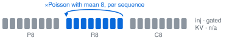

<!-- Generated by scripts/build.py from the YAML files. Do not edit by hand. -->

# Parcae: Parcae: Scaling Laws For Stable Looped Language Models

English · [简体中文](../zh/2604.12946.md) · [Back to the list](../../README.md)

arXiv 2604.12946 · 2026-04-14 · University of California, San Diego, Together AI

> Constrain the loop's injection to a stable negative-diagonal form, sample depth per sequence, and fit training and test-time scaling laws for looping at fixed parameter count.

**Category**: Scaling and budget · **Status**: draft (numbers not yet re-checked) · **Impact**: cites 89 · stars 194 · HF upvotes 11

[paper](https://arxiv.org/abs/2604.12946) · [code](https://github.com/sandyresearch/parcae) · [project](https://sandyresearch.github.io/parcae/) · [weights](https://huggingface.co/SandyResearch/parcae-140m)

## Problem

Middle-looped models such as Huginn-style RDMs diverge or show loss spikes unless hyperparameters are chosen carefully; the paper traces this to injection parameters whose linearized state matrix reaches a spectral radius of 1 or more, and asks whether a stable looped model scales predictably with loops.

## Method

- Write each loop step as h_{t+1} = Ā h_t + B̄ e + R̄(h_t, e) and parameterize A as a negative diagonal discretized with ZOH, so the spectral radius of Ā stays below 1; the prelude output e is normalized before injection.
- Sample the depth T per sequence from a Poisson distribution with mean μ_rec, backpropagate through the last μ_bwd = ⌈μ_rec/2⌉ steps, and loop the middle third of a nanochat-style Transformer.
- Fit isoFLOP scaling laws over μ_rec and tokens at fixed parameters (140M, 370M) and a saturating exponential law for loss against test-time T, then join them in one unified law.

## Loop layout

| Facet | Value |
|---|---|
| Where the loop sits | middle core (prelude-core-coda) |
| Weight sharing | fully tied |
| Passes in training | sampled |
| Passes at test time | can run more passes than trained |
| Input injection | gated |
| KV cache | n/a |
| Gradient through passes | truncated (last k passes) |
| Origin | trained from scratch |
| FFN | dense FFN |
| Attention in the loop | full attention |
| Passes (R8) | train Poisson with mean 8, per sequence; test 8 |
| Backprop (R8) | last 4 |

Shown for the 1.3B model of the Transformer comparison (Table 18), which has 8 prelude, 8 recurrent and 8 coda blocks against a 24-layer Transformer; the 140M, 370M and 770M models use 2, 4 and 6 blocks per unit, and all loop the middle third. Each step computes h_{t+1} = Ā h_t + B̄ e + R̄(h_t, e) with Ā = exp(ΔA) for a negative diagonal A (ZOH), B̄ = ΔB (Euler) and a normalized prelude output e. The Section 5.1 models are also evaluated at T = 1-16 and the Section 5.3 models up to T = 24.

## Results

**Transformer setup (simplified nanochat), FineWeb-Edu, 2,048 context, parameter- and data-matched pairs trained on 11.2B, 29.6B, 61.6B and 104B tokens at 140M, 370M, 770M and 1.3B; Parcae evaluated at T=8** · validation PPL / Core / Core-Extended · Table 5; Table 21

| Variant | Value |
|---|---|
| 140M Transformer | 21.48 / 13.00 / 8.80 |
| 140M Parcae | 19.06 / 14.04 / 9.67 |
| 370M Transformer | 15.79 / 17.46 / 11.71 |
| 370M Parcae | 14.49 / 20.00 / 12.75 |
| 770M Transformer | 13.08 / 22.42 / 14.20 |
| 770M Parcae | 12.49 / 25.07 / 15.19 |
| 1.3B Transformer | 11.95 / 25.45 / 15.90 |
| 1.3B Parcae | 11.42 / 28.44 / 17.08 |

**RDM setup of Geiping et al. (Huginn data and tokenizer); 100M evaluated at T=16, 350M at T=8** · validation PPL / WikiText PPL / zero-shot average of six tasks · Table 3

| Variant | Value |
|---|---|
| 100M RDM | 14.23 / 63.27 / 45.03 |
| 100M Parcae | 13.59 / 60.33 / 46.83 |
| 350M RDM | 10.76 / 41.31 / 49.45 |
| 350M Parcae | 10.09 / 37.53 / 50.12 |

**Transformer setup at 140M and 370M with parameters and training FLOPs fixed (tokens shrink as μ_rec grows); fixed depth means μ_rec = 1** · optimal μ_rec* / Core at μ_rec* / Core at fixed depth · Table 6; Appendix O

| Variant | Value |
|---|---|
| 140M, 1x10^18 FLOPs | 2 / 7.6 / 7.9 |
| 140M, 2x10^18 FLOPs | 2 / 9.0 / 10.5 |
| 140M, 4x10^18 FLOPs | 4 / 11.2 / 10.7 |
| 140M, 8x10^18 FLOPs | 6 / 10.5 / 11.8 |
| 140M, 16x10^18 FLOPs | 8 / 14.6 / 13.0 |
| 140M, 64x10^18 FLOPs | 10 / 16.2 / 15.0 |
| 370M, 32x10^18 FLOPs | 4 / 15.2 / 16.8 |
| 370M, 64x10^18 FLOPs | 6 / 18.1 / 18.1 |
| 370M, 128x10^18 FLOPs | 6 / 20.1 / 18.1 |

**RDM-setup Parcae models (100M trained with μ_rec 16, 350M with μ_rec 8), depth sampled per micro-batch or per sequence** · validation PPL at test-time T = 1 / 4 / 8 / 16 · Table 8; Table 17

| Variant | Value |
|---|---|
| 100M, per-batch | 300.32 / 36.75 / 16.65 / 13.81 |
| 100M, per-sequence | 70.47 / 17.15 / 14.08 / 13.59 |
| 350M, per-batch | 167.61 / 12.80 / 10.40 / 10.24 |
| 350M, per-sequence | 17.92 / 10.49 / 10.09 / 10.11 |

## Other findings

- Run at up to twice the training mean (μ_rec = 8), the 140M-1.3B models' gains plateau near T = μ_rec; the authors read this as training depth setting the test-time ceiling. (Section 5.3; Figure 7)
- Loss against test-time T follows L(T) = L∞ + Z·exp(−zT); fitted on T ≤ μ_rec and tested on T > μ_rec, this form has the lowest error of the four forms tried (Huber loss 3.18 and 2.29 x10^-7 at 140M and 370M). (Section 5.3; Appendix L; Table 12)
- Sampling the total depth from Λ(μ_rec) and then truncating backprop, instead of sampling only the no-gradient steps as Geiping et al. do, keeps validation loss at T = 4, 16 and 64 closer to full backprop (100M models, 10B tokens, μ_rec = μ_bwd = 8). (Section 4.2; Appendix H; Figure 14)
- With parameters and FLOPs fixed, the optimal μ_rec grows with the budget (2 at 1x10^18 to 10 at 64x10^18 FLOPs for 140M) and follows a power law with exponent about 0.40; the optimal token count follows one with exponent about 0.78. (Section 5.2; Table 6; Figure 5)
- In early RDM runs made before the Appendix H sampling fix (10B tokens, μ_bwd = 4, evaluated at T = μ_rec), μ_rec = 8 gave the lowest validation loss (2.453) among values from 4 to 32; in a second sweep at μ_rec = 20 (8.5B tokens), raising μ_bwd from 4 to 12 lowered it from 2.500 to 2.474. (Appendix I; Table 9; Table 10)
- Across learning rates from 2e-4 to 1e-3, the Pre-Norm RDM converges only at 2e-4 and the residual-norm RDM up to 4e-4, while Parcae converges at all five. (Table 2; Appendix F)

## Comparison

- **Baseline**: Fixed-depth Transformers in a simplified nanochat setup with the same parameter count and training data; Huginn-style RDMs with matched parameters and data are a second baseline.
- **Held fixed**: N (unique parameters), D (training tokens)
- **Differs**: F (training FLOPs), L (executed layers per token)
- **Baseline hyperparameters**: tuned separately
- **Headline claim**: At 1.3B parameters and the same data, Parcae (T=8) scores 28.44 Core and 17.08 Core-Extended against the Transformer's 25.45 and 15.90 (+2.99 and +1.18 points); the 770M Parcae's 25.07 Core is comparable to the 1.3B Transformer with roughly half the parameters. (Abstract; Section 5.1; Table 5)

## Caveats

- Experiments stop at 1.3B parameters, 104B tokens and a 2,048-token context with dense FFNs; the scaling laws are fitted only at 140M and 370M, and the authors say their observations are limited to small architectures (Section 6).
- Parameters and data are matched (Parcae has 0.35-0.83% more parameters, Table 19) but compute is not; at T = 8 the recurrent block runs 8 times per token, and the paper reports neither KV-cache size nor inference cost.
- The Transformer and RDM baselines got their own learning-rate sweeps, and Parcae reused the baselines' best settings without a sweep of its own (Section 5.1; Appendix Q).
- Test-time gains saturate near the training mean μ_rec, and the authors note that a larger μ_rec needs more test-time steps for equivalent quality (Section 5.3; Section 6).

## Reproducibility

| Code | Weights | Configs | Data |
|---|---|---|---|
| available | available | available | available |

## Open weights

- Parcae: [SandyResearch/parcae-140m](https://huggingface.co/SandyResearch/parcae-140m), [SandyResearch/parcae-370m](https://huggingface.co/SandyResearch/parcae-370m), [SandyResearch/parcae-770m](https://huggingface.co/SandyResearch/parcae-770m), [SandyResearch/parcae-1.3b](https://huggingface.co/SandyResearch/parcae-1.3b)

## Related open questions

- [Does running more passes at test time than in training keep improving quality?](questions.md#extra-passes-at-test-time) (partly)
- [With training compute held fixed, do more passes help?](questions.md#more-passes-fixed-compute) (partly)

## Authors

Hayden Prairie, Zachary Novack, Taylor Berg-Kirkpatrick, Daniel Y. Fu
