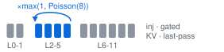

<!-- Generated by scripts/build.py from the YAML files. Do not edit by hand. -->

# Looped CED: Looping Deeper Without Growing the KV Cache: Recurrent Depth for Causal Encoder-Decoders

English · [简体中文](../zh/2611.13378.md) · [Back to the list](../../README.md)

arXiv 2611.13378 · 2026-11-09 · University of California, San Diego, Tsinghua University, Nanjing University

> Loop the CED encoder layers that produce global KV, train with random depth, and keep only the last round's KV.

**Category**: Architecture: where to loop, what to share · **Status**: draft (numbers not yet re-checked) · **Metrics**: cites 0

[paper](https://arxiv.org/abs/2611.13378)

## Problem

When every round caches its own KV, a looped model's KV cache grows with the number of rounds, which cancels the memory advantage of KV-sparse layouts such as the causal encoder-decoder.

## Method

- Loop layers L2-5 of the encoder, which contain its only global KV source, for 8 rounds with Parcae's gated input injection.
- Sample the number of rounds per sequence from max(1, Poisson(8)) and backpropagate through the last 4, so the core settles into a fixed point.
- At inference, past tokens keep only their last-round KV, so the resident KV equals the unlooped CED's.

## Loop layout

| Facet | Value |
|---|---|
| Where the loop sits | KV-producing half (CED encoder / YOCO self-decoder) |
| Weight sharing | fully tied |
| Passes in training | sampled |
| Passes at test time | can run more passes than trained |
| Input injection | gated |
| KV cache | last-pass KV only |
| Gradient through passes | truncated (last k passes) |
| Origin | trained from scratch |
| FFN | dense FFN |
| Attention in the loop | hybrid (full + window / linear) |
| Passes (L2-5) | train max(1, Poisson(8)); test 8 |
| Backprop (L2-5) | last 4 |

12-layer causal encoder-decoder (CED) in the DeepSeek-V4.1-Flash layout: every layer has SWA-128; L2 is the encoder's only global KV source and L6 projects the global KV shared by the decoder. The loop repeats L2-5.

## Results

**150M non-embedding params, 6.0B tokens, FineWeb-Edu, 2048 context, T=8 at evaluation** · validation BPB (lower is better) · Table 1

| Variant | Value |
|---|---|
| Dense, no loop | 0.8747 |
| Dense, loop L2-5 | 0.8461 |
| CED, no loop | 0.8716 |
| CED, encoder loop L2-5 | 0.8468 |
| CED, decoder loop L7-10 | 0.8648 |
| CED, encoder loop, fixed rounds | 0.8487 |
| YOCO-U style, loop L2-5 | 0.8506 |

**150M, 29.6B tokens** · validation BPB / DCLM CORE accuracy · Table 2

| Variant | Value |
|---|---|
| CED, no loop | 0.8401 / 19.09 |
| CED, encoder loop | 0.8124 / 21.63 |
| CED, decoder loop | 0.8295 / 21.56 |

**150M, 6.0B tokens, exact fp32 token-by-token decoding at T=8** · BPB with last-round KV minus BPB with per-round KV · Table 3

| Variant | Value |
|---|---|
| Encoder loop, stochastic depth | -0.0002 |
| Encoder loop, fixed depth | +0.0317 |

**DeepSeek-V4.1-Flash (552B) looped for 8 rounds on 4x GB200, serving only (no loop training)** · KV per token and 128K-token requests that fit · Abstract; Table 4

| Variant | Value |
|---|---|
| Per-layer and per-round KV | cannot fit one 128K request |
| Looped CED (last-round KV) | 36.8x less KV per token, fits 38 requests |

## Other findings

- Running 12 or 16 rounds instead of the trained mean of 8 lowers BPB by at most 0.0004 and never raises it. (Appendix F; Table 9)
- After 5x longer training (29.6B tokens) the decoder loop still captures only 38% of the encoder loop's improvement. (Table 2)

## Comparison

- **Baseline**: Unlooped CED with the same 12-layer layout; dense, decoder-loop and YOCO-U-style variants are also compared.
- **Held fixed**: N (unique parameters), D (training tokens), KV (KV cache per token)
- **Differs**: F (training FLOPs), L (executed layers per token)
- **Baseline hyperparameters**: shared with the looped model
- **Headline claim**: At 150M, the encoder loop lowers BPB from 0.8716 to 0.8468 while keeping the unlooped CED's 8 KB of global KV per token; the paper reports recovering 86-93% of a looped Transformer's gain with 1/6 of its global KV. (Abstract; Table 1)

## Caveats

- Training experiments use 12-layer dense-FFN models up to 340M non-embedding parameters at 2K context; the 552B DeepSeek-V4.1-Flash runs measure serving cost only, with no loop training.
- Parameters, tokens and KV are held fixed but compute is not; a looped model runs 40 layer passes per decoded token instead of 12.
- All runs share one hyperparameter set (Table 8); the baselines were not tuned separately.
- The encoder loop puts every round on the prefill path; in the 552B serving test, prefill cost per prompt token at T=8 is 5.12x the unlooped CED (Table 13).

## Reproducibility

| Code | Weights | Configs | Data |
|---|---|---|---|
| none | none | partial | available |

## Related open questions

- [Does running more passes at test time than in training keep improving quality?](questions.md#extra-passes-at-test-time) (partly)
- [Where in the stack should the loop sit?](questions.md#loop-placement) (supports)
- [Can later passes reuse one KV cache instead of keeping KV for every pass?](questions.md#shared-kv-across-passes) (partly)

## Authors

Jiaqi Leng, Minshen Zhang, Zhaofeng Sun, Yu-Yang Qian, Peng Zhao, Hao Zhang
