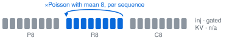

<!-- Generated by scripts/build.py from the YAML files. Do not edit by hand. -->

# Parcae: Parcae: Scaling Laws For Stable Looped Language Models

[English](../en/2604.12946.md) · 简体中文 · [返回列表](../../README.zh-CN.md)

arXiv 2604.12946 · 2026-04-14 · University of California, San Diego, Together AI

> 把循环的注入约束成稳定的负对角形式，按序列采样遍数训练，并在固定参数量下拟合循环的训练和推理 scaling law。

**类别**：Scaling 与预算 · **状态**：草稿（数字未复核） · **影响力**：引用 89 · star 194 · HF 点赞 11

[论文](https://arxiv.org/abs/2604.12946) · [代码](https://github.com/sandyresearch/parcae) · [项目页](https://sandyresearch.github.io/parcae/) · [权重](https://huggingface.co/SandyResearch/parcae-140m)

## 问题

Huginn 式 RDM 等中段循环模型若超参没选好就会发散或出现 loss spike；论文把原因归到注入参数线性化后的状态矩阵谱半径达到或超过 1，并研究稳定后的循环模型能否随循环遍数可预测地 scale。

## 做法

- 把每一步循环写成 h_{t+1} = Ā h_t + B̄ e + R̄(h_t, e)，A 参数化为负对角矩阵并用 ZOH 离散化，使 Ā 的谱半径始终小于 1；prelude 输出 e 注入前先归一化。
- 每条序列的遍数 T 从均值为 μ_rec 的 Poisson 分布采样，只反传最后 μ_bwd = ⌈μ_rec/2⌉ 步；循环 nanochat 式 Transformer 中间三分之一的层。
- 在固定参数（140M、370M）下拟合 μ_rec 与 token 数的 isoFLOP scaling law，再拟合 loss 随推理遍数 T 变化的饱和指数律，最后合成一个统一的 scaling law。

## 循环结构

| 维度 | 取值 |
|---|---|
| 循环位置 | 中段循环（prelude-core-coda） |
| 权重共享 | 完全共享 |
| 训练遍数 | 随机采样 |
| 测试遍数 | 可多于训练遍数 |
| 输入注入 | 门控 |
| KV 缓存 | 不适用 |
| 跨遍梯度 | 截断（只反传最后 k 遍） |
| 来源 | 从头训 |
| FFN | dense FFN |
| 循环体注意力 | 全注意力 |
| 遍数 (R8) | 训练 Poisson with mean 8, per sequence; 测试 8 |
| 反传 (R8) | last 4 |

图示为 Transformer 对比中的 1.3B 模型（Table 18）：prelude、循环块、coda 各 8 层，对照是 24 层 Transformer；140M、370M、770M 每段分别为 2、4、6 层，循环的都是中间三分之一。每一步计算 h_{t+1} = Ā h_t + B̄ e + R̄(h_t, e)，其中 Ā = exp(ΔA)，A 为负对角矩阵（ZOH 离散化），B̄ = ΔB（Euler），e 是归一化后的 prelude 输出。Section 5.1 的模型还在 T = 1-16 上评测，Section 5.3 的模型评测到 T = 24。

## 结果

**Transformer setup (simplified nanochat), FineWeb-Edu, 2,048 context, parameter- and data-matched pairs trained on 11.2B, 29.6B, 61.6B and 104B tokens at 140M, 370M, 770M and 1.3B; Parcae evaluated at T=8** · validation PPL / Core / Core-Extended · Table 5; Table 21

| 对象 | 取值 |
|---|---|
| 140M Transformer | 21.48 / 13.00 / 8.80 |
| 140M Parcae | 19.06 / 14.04 / 9.67 |
| 370M Transformer | 15.79 / 17.46 / 11.71 |
| 370M Parcae | 14.49 / 20.00 / 12.75 |
| 770M Transformer | 13.08 / 22.42 / 14.20 |
| 770M Parcae | 12.49 / 25.07 / 15.19 |
| 1.3B Transformer | 11.95 / 25.45 / 15.90 |
| 1.3B Parcae | 11.42 / 28.44 / 17.08 |

**RDM setup of Geiping et al. (Huginn data and tokenizer); 100M evaluated at T=16, 350M at T=8** · validation PPL / WikiText PPL / zero-shot average of six tasks · Table 3

| 对象 | 取值 |
|---|---|
| 100M RDM | 14.23 / 63.27 / 45.03 |
| 100M Parcae | 13.59 / 60.33 / 46.83 |
| 350M RDM | 10.76 / 41.31 / 49.45 |
| 350M Parcae | 10.09 / 37.53 / 50.12 |

**Transformer setup at 140M and 370M with parameters and training FLOPs fixed (tokens shrink as μ_rec grows); fixed depth means μ_rec = 1** · optimal μ_rec* / Core at μ_rec* / Core at fixed depth · Table 6; Appendix O

| 对象 | 取值 |
|---|---|
| 140M, 1x10^18 FLOPs | 2 / 7.6 / 7.9 |
| 140M, 2x10^18 FLOPs | 2 / 9.0 / 10.5 |
| 140M, 4x10^18 FLOPs | 4 / 11.2 / 10.7 |
| 140M, 8x10^18 FLOPs | 6 / 10.5 / 11.8 |
| 140M, 16x10^18 FLOPs | 8 / 14.6 / 13.0 |
| 140M, 64x10^18 FLOPs | 10 / 16.2 / 15.0 |
| 370M, 32x10^18 FLOPs | 4 / 15.2 / 16.8 |
| 370M, 64x10^18 FLOPs | 6 / 18.1 / 18.1 |
| 370M, 128x10^18 FLOPs | 6 / 20.1 / 18.1 |

**RDM-setup Parcae models (100M trained with μ_rec 16, 350M with μ_rec 8), depth sampled per micro-batch or per sequence** · validation PPL at test-time T = 1 / 4 / 8 / 16 · Table 8; Table 17

| 对象 | 取值 |
|---|---|
| 100M, per-batch | 300.32 / 36.75 / 16.65 / 13.81 |
| 100M, per-sequence | 70.47 / 17.15 / 14.08 / 13.59 |
| 350M, per-batch | 167.61 / 12.80 / 10.40 / 10.24 |
| 350M, per-sequence | 17.92 / 10.49 / 10.09 / 10.11 |

## 其他发现

- 140M–1.3B 模型推理时跑到训练均值 μ_rec = 8 的两倍，收益在 T = μ_rec 附近就饱和；作者认为训练深度决定了推理时 scaling 的上限。 (Section 5.3; Figure 7)
- loss 随推理遍数 T 的变化符合 L(T) = L∞ + Z·exp(−zT)；用 T ≤ μ_rec 拟合、在 T > μ_rec 上检验时，它在四种候选形式中误差最低（140M 和 370M 的 Huber loss 为 3.18 和 2.29 x10^-7）。 (Section 5.3; Appendix L; Table 12)
- 先从 Λ(μ_rec) 采样总遍数再截断反传，而不是像 Geiping et al. 那样只采样不带梯度的步数，能让 T = 4、16、64 时的验证 loss 更接近全程反传（100M 模型，10B token，μ_rec = μ_bwd = 8）。 (Section 4.2; Appendix H; Figure 14)
- 固定参数和 FLOPs 时，最优 μ_rec 随预算增大（140M 从 1x10^18 FLOPs 时的 2 增到 64x10^18 时的 10），服从指数约 0.40 的幂律；最优 token 数服从指数约 0.78 的幂律。 (Section 5.2; Table 6; Figure 5)
- 在 Appendix H 采样修正之前的早期 RDM 实验里（10B token，μ_bwd = 4，按 T = μ_rec 评测），μ_rec 取 4 到 32 时 μ_rec = 8 的验证 loss 最低（2.453）；另一组 μ_rec = 20 的实验（8.5B token）中，把 μ_bwd 从 4 提到 12，loss 从 2.500 降到 2.474。 (Appendix I; Table 9; Table 10)
- 学习率从 2e-4 到 1e-3 的五档中，Pre-Norm RDM 只在 2e-4 收敛，残差归一化 RDM 只到 4e-4，Parcae 五档全部收敛。 (Table 2; Appendix F)

## 对照

- **基线**：简化 nanochat 设置下参数量和训练数据相同的定深 Transformer；另一组对照是参数和数据都对齐的 Huginn 式 RDM。
- **对齐项**：N (唯一参数), D (训练 token)
- **不同项**：F (训练 FLOPs), L (每 token 执行层数)
- **基线超参**：单独调过
- **主要结论**：1.3B 参数、相同数据下，Parcae（T=8）的 Core / Core-Extended 为 28.44 / 17.08，Transformer 为 25.45 / 15.90（高 2.99 和 1.18 分）；770M 的 Parcae Core 为 25.07，用约一半参数与 1.3B Transformer 相当。 (Abstract; Section 5.1; Table 5)

## 保留意见

- 实验最大到 1.3B 参数、104B token、2,048 上下文，FFN 为 dense；scaling law 只在 140M 和 370M 上拟合，作者也说结论仅限于小模型（Section 6）。
- 对齐了参数（Parcae 多 0.35-0.83%，Table 19）和数据，没对齐算力：T = 8 时循环块每个 token 跑 8 遍；论文没有报告 KV 大小或推理成本。
- Transformer 和 RDM 基线各自扫过学习率，Parcae 直接沿用基线的最优设置，没有单独扫（Section 5.1；Appendix Q）。
- 推理收益在训练均值 μ_rec 附近饱和；作者指出 μ_rec 越大，达到同等质量需要的推理步数越多（Section 5.3；Section 6）。

## 复现

| 代码 | 权重 | 配置 | 数据 |
|---|---|---|---|
| 有 | 有 | 有 | 有 |

## 开源权重

- Parcae: [SandyResearch/parcae-140m](https://huggingface.co/SandyResearch/parcae-140m), [SandyResearch/parcae-370m](https://huggingface.co/SandyResearch/parcae-370m), [SandyResearch/parcae-770m](https://huggingface.co/SandyResearch/parcae-770m), [SandyResearch/parcae-1.3b](https://huggingface.co/SandyResearch/parcae-1.3b)

## 相关开放问题

- [推理时跑得比训练时更多遍，质量还会继续提升吗？](questions.md#extra-passes-at-test-time) (部分支持)
- [训练算力固定时，遍数越多越好吗？](questions.md#more-passes-fixed-compute) (部分支持)

## 作者

Hayden Prairie, Zachary Novack, Taylor Berg-Kirkpatrick, Daniel Y. Fu
