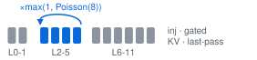

<!-- Generated by scripts/build.py from the YAML files. Do not edit by hand. -->

# Looped CED: Looping Deeper Without Growing the KV Cache: Recurrent Depth for Causal Encoder-Decoders

[English](../en/2611.13378.md) · 简体中文 · [返回列表](../../README.zh-CN.md)

arXiv 2611.13378 · 2026-11-09 · University of California, San Diego, Tsinghua University, Nanjing University

> 循环产出全局 KV 的 CED encoder 层，随机遍数训练，推理只存最后一遍的 KV。

**类别**：结构：放哪循环、共享什么 · **状态**：草稿（数字未复核） · **影响力**：引用 0

[论文](https://arxiv.org/abs/2611.13378)

## 问题

如果每一遍都存自己的 KV，循环模型的 KV 会随遍数增长，抵消掉 CED 这类稀疏 KV 布局的显存优势。

## 做法

- 循环 encoder 的 L2-5（含 encoder 唯一的全局 KV 源），跑 8 遍，用 Parcae 的门控输入注入。
- 每条序列的遍数从 max(1, Poisson(8)) 采样，只反传最后 4 遍，让循环块收敛到不动点。
- 推理时历史 token 只保留最后一遍的 KV，常驻 KV 和不循环的 CED 一样。

## 循环结构

| 维度 | 取值 |
|---|---|
| 循环位置 | 产出共享 KV 的前半段（CED encoder / YOCO self-decoder） |
| 权重共享 | 完全共享 |
| 训练遍数 | 随机采样 |
| 测试遍数 | 可多于训练遍数 |
| 输入注入 | 门控 |
| KV 缓存 | 只存末遍 KV |
| 跨遍梯度 | 截断（只反传最后 k 遍） |
| 来源 | 从头训 |
| FFN | dense FFN |
| 循环体注意力 | 混合（全注意力 + 滑窗或线性） |
| 遍数 (L2-5) | 训练 max(1, Poisson(8)); 测试 8 |
| 反传 (L2-5) | last 4 |

12 层因果编码器-解码器（CED），沿用 DeepSeek-V4.1-Flash 的布局：每层都有 128 窗口 SWA；L2 是 encoder 唯一的全局 KV 源，L6 投影出 decoder 共用的全局 KV。循环 L2-5。

## 结果

**150M non-embedding params, 6.0B tokens, FineWeb-Edu, 2048 context, T=8 at evaluation** · validation BPB (lower is better) · Table 1

| 对象 | 取值 |
|---|---|
| Dense, no loop | 0.8747 |
| Dense, loop L2-5 | 0.8461 |
| CED, no loop | 0.8716 |
| CED, encoder loop L2-5 | 0.8468 |
| CED, decoder loop L7-10 | 0.8648 |
| CED, encoder loop, fixed rounds | 0.8487 |
| YOCO-U style, loop L2-5 | 0.8506 |

**150M, 29.6B tokens** · validation BPB / DCLM CORE accuracy · Table 2

| 对象 | 取值 |
|---|---|
| CED, no loop | 0.8401 / 19.09 |
| CED, encoder loop | 0.8124 / 21.63 |
| CED, decoder loop | 0.8295 / 21.56 |

**150M, 6.0B tokens, exact fp32 token-by-token decoding at T=8** · BPB with last-round KV minus BPB with per-round KV · Table 3

| 对象 | 取值 |
|---|---|
| Encoder loop, stochastic depth | -0.0002 |
| Encoder loop, fixed depth | +0.0317 |

**DeepSeek-V4.1-Flash (552B) looped for 8 rounds on 4x GB200, serving only (no loop training)** · KV per token and 128K-token requests that fit · Abstract; Table 4

| 对象 | 取值 |
|---|---|
| Per-layer and per-round KV | cannot fit one 128K request |
| Looped CED (last-round KV) | 36.8x less KV per token, fits 38 requests |

## 其他发现

- 推理时跑 12 或 16 遍（训练均值是 8 遍），BPB 最多降 0.0004，从不变差。 (Appendix F; Table 9)
- 训练加长到 5 倍（29.6B token）后，decoder 循环的收益仍只有 encoder 循环的 38%。 (Table 2)

## 对照

- **基线**：同样 12 层布局、不循环的 CED；另有 dense、decoder 循环和 YOCO-U 式对照。
- **对齐项**：N (唯一参数), D (训练 token), KV (每 token KV)
- **不同项**：F (训练 FLOPs), L (每 token 执行层数)
- **基线超参**：和循环模型共用
- **主要结论**：150M 规模下，encoder 循环把 BPB 从 0.8716 降到 0.8468，每 token 全局 KV 仍是不循环 CED 的 8 KB；论文称用 1/6 的全局 KV 拿回了循环 Transformer 86-93% 的收益。 (Abstract; Table 1)

## 保留意见

- 训练实验是 12 层 dense FFN 模型，最大 340M 非 embedding 参数，2K 上下文；552B 的 DeepSeek-V4.1-Flash 只测服务成本，没训练过循环。
- 对齐了参数、token 和 KV，没对齐算力：循环模型每解码一个 token 执行 40 层，不循环是 12 层。
- 所有实验共用一套超参（Table 8），基线没有单独调。
- encoder 循环让每一遍都进入 prefill；552B 服务测试里，T=8 时每个 prompt token 的 prefill 成本是不循环 CED 的 5.12 倍（Table 13）。

## 复现

| 代码 | 权重 | 配置 | 数据 |
|---|---|---|---|
| 无 | 无 | 部分 | 有 |

## 相关开放问题

- [推理时跑得比训练时更多遍，质量还会继续提升吗？](questions.md#extra-passes-at-test-time) (部分支持)
- [循环应该放在网络的哪一段？](questions.md#loop-placement) (支持)
- [后续各遍能否共用一份 KV，而不是每遍各存一份？](questions.md#shared-kv-across-passes) (部分支持)

## 作者

Jiaqi Leng, Minshen Zhang, Zhaofeng Sun, Yu-Yang Qian, Peng Zhao, Hao Zhang
